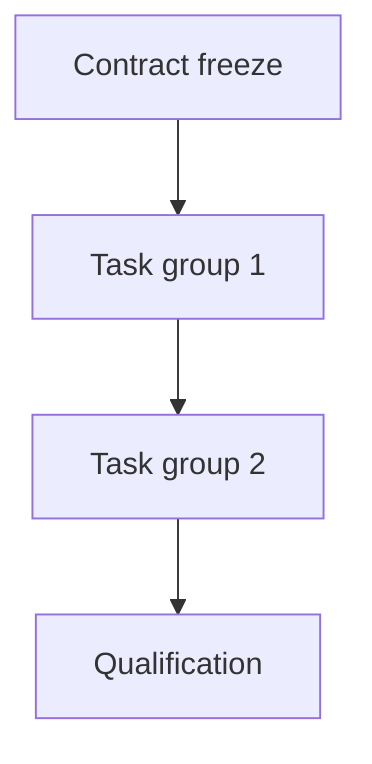

# Implementation Plan: [Feature]

**Feature ID:** NNN  
**Status:** DRAFT - implementation not authorized  
**Spec revision:** [revision]  
**Owners:** [owners]

## 1. Delivery strategy
## 2. Dependency DAG

## 3. Phases
| Phase | Outcome | Dependencies | Owner | Exit gate |
|---|---|---|---|---|
## 4. File ownership and allowed scope
| Path | Change | Authority | Owner | Phase |
|---|---|---|---|---|
## 5. Persistence, migration, rollout and rollback
## 6. Operational risks and observability
## 7. Exact validation commands
| Gate | Command | Expected result | Evidence |
|---|---|---|---|
## 8. Stop/rollback criteria
## 9. Implementation handoff
[Spec hash, owner approval, clean worktree, first task.]
