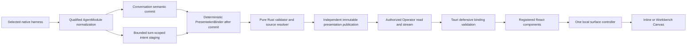

# Native-agent presentation pipeline LLD

**Status:** TARGET design for Feature 016 revision 0.4, IN_REVIEW. A-84 user-delegated direction authorizes implementation of the complete current proposal through scoped tasks while preserving package lifecycle, cross-owner review and qualification gates. B-40 remains the accepted transient SAFE_CALCULATOR and PREVIEW_ONLY executable Artifact boundary. Saved View numeric snapshots and Ask-a-follow-up composer drafts are separate host-owned operations; components never persist or submit state. A-85 still gates provider-visible presentation proposal ingress.

Authority: [Feature 016](../specs/016-rich-presentation-intelligent-ui/README.md) owns presentation semantics and package acceptance; [Architecture](../ARCHITECTURE.md), [Rich Response](RICH-RESPONSE.md), [Presentation Runtime](PRESENTATION-RUNTIME.md), [Host Guidance](HOST-GUIDANCE.md), and [Intelligent UI](INTELLIGENT-UI-AND-IMAGE-CONTENT.md) provide global boundaries. Machine authorities remain [presentation intent](schemas/presentation-intent.schema.json), [rich presentation](schemas/rich-presentation.schema.json), [Operator stream](schemas/operator-stream.schema.json) and the owning OpenAPI/event registries. This supplemental design deliberately supplies no competing sample JSON schema.

## 1. Scope and choices

The user request is to use useful declarative UI ideas inside the existing Rust daemon/Tauri/React product: selected native agent may propose intent/data only through a qualified route; registered host components render it; deterministic calculations react immediately; expansion into the existing contextual Canvas preserves state; separate explicit owner actions may retain data locally, save a reusable view, or send a reviewed modification through ordinary Conversation. Canvas means an expanded surface inside the existing Workbench, not a second workspace, cloud application, permanent specialist tab or new artifact execution engine.

The proposed approach extends the existing compiler and registered renderer. Keeping static Markdown only remains the compatibility baseline but misses local exploration. Importing a generic generative frontend stack would introduce a second state/protocol authority and does not satisfy native harness ownership. No Next.js, PostgreSQL, BYOK model router, hidden second LLM pass, autonomous frontend agent, or replacement native reasoning loop is adopted. More component families, formatting/locales and numerical kernels are individually reviewed extensions; their appearance in a competitor catalog does not admit them.

## 2. Inspected source boundary

At active source checkpoint `6adadab539a62ca1c8b70621c7f88e1785cfe8c2`, ACP `acp_client.rs` negotiates initialize, creates sessions with `mcpServers: []`, sends text prompts and consumes correlated updates. The relevant ACP/presentation source paths were unchanged from the prior source check; the intervening commits were documentation-only. `adapter.rs::parse_acp_session_update` retains message text, tool title/status and plan count; it does not preserve arbitrary structured UI payloads. `tool_call` is an observation, not a generic instruction to execute a host operation. Unknown requests fail closed. Registry discovery proves neither live provider support nor authorization. OpenCode's first adapter is HTTP, not ACP; ACP support must not be inferred for that route.

`domain-presentation` provides Rust CODE validation for renderer-v1 and user-directed renderer-v2 METRIC, CHART and SAFE_CALCULATOR under the shared 512 KiB cap; its calculator path checks initial AST output against an exact semantic numeric cell. Rust, TypeScript, the shared corpus and the desktop renderer now agree on source-bound METRIC/CHART, including required closed unit/scale/time-interval/aggregation context grounded in the exact semantic answer. Desktop CODE/UI renders validated METRIC, CHART and SAFE_CALCULATOR blocks when supplied a valid document. SAFE_CALCULATOR uses bounded labelled fields, inert formula text, local deterministic recomputation/reset and persistent semantic fallback. Read routes are SERVED; T08 adds a CODE-level, post-settlement publisher for exact TABLE/TEXT_SLICE only. Provider structured-intent ingress, proposal tool, Canvas state controller and persistent surface-state route are not established. Stream draft reduction exists without a producer or display consumer. These observations do not establish INTEGRATED or QUALIFIED evidence.

ACP v1 defines `mcpServers` on session setup, so a client can offer an agent a tool server; ACP itself does not define a rich-answer or component-tree content type. Its content types cover text/Markdown, images, audio and resources; `tool_call` / `tool_call_update` describe agent-owned tool activity, including display content such as diffs or terminal references. ACP v1 also defines `session/request_permission` for operation choices and `elicitation/create` for structured user input (form mode for non-secret fields; URL mode for sensitive or external flows). Those request/response contracts support permission and user-input UX, but do not describe LiteCowork components or authorize LiteCowork-mediated operations. ACP v2 is currently documented as a draft; its expanded foreground `requires_action` lifecycle and more detailed elicitation/cancellation rules must not be silently mixed into the v1 adapter. See the official [ACP v1 content](https://agentclientprotocol.com/protocol/v1/content), [tool call/permission](https://agentclientprotocol.com/protocol/v1/tool-calls), and [elicitation](https://agentclientprotocol.com/protocol/v1/elicitation) contracts, plus the [ACP v2 draft overview](https://agentclientprotocol.com/protocol/v2/overview) and [draft elicitation contract](https://agentclientprotocol.com/protocol/v2/elicitation). The current LiteCowork client deliberately passes an empty MCP list and is not yet connected to the Conversation supervisor. The protocol capability is therefore an integration point to qualify, not working output or continuation support. An ACP-capable provider does not prove that a separate OpenCode HTTP route supports the same requests.

## 3. Interoperability and ingress selection

ACP connects a client to a native agent; it does not define LiteCowork's component catalog, calculation semantics, presentation document, or persistence. Each AgentModule publishes a fresh, non-secret descriptor and conformance evidence for an exact provider/version/auth route. Choose the strongest actually qualified ingress, never manufacture support from a registry listing:

| Path | Prerequisite | Normalization and fallback |
|---|---|---|
| Native structured output | Documented provider output mechanism plus fixture/live evidence that exact data and correlation survive the adapter | Normalize bounded data/intent into the canonical PresentationIntent contract. Structured output is still untrusted and never accepted as a finished host document. |
| Client-supplied MCP proposal tool | The exact native provider accepts the offered MCP server on the negotiated ACP version; LiteCowork proves server lifetime, cross-session isolation, turn correlation, permission visibility, startup/teardown and cancellation; the owner approves the bridge design | Offer only the existing target operation `litecowork.presentation.propose`; it stages one bounded, zero-authority intent and returns a typed acknowledgement. It cannot publish, save, run code, call a host action or bypass Tool/Effect policy. Current empty ACP server list is not this integration. |
| A2UI adapter | Exact agent/provider output carries a pinned A2UI version and passes its protocol fixtures; Feature 016 owners approve a bounded subset mapping | Treat A2UI as an optional ingress format only. Validate and map supported passive components/data into the existing canonical intent/document path; do not ship a competing renderer/catalog/state owner. A2UI function calls become untrusted proposals and cannot dispatch host operations. ACP does not natively define A2UI payloads. |
| Bounded text | No qualified structured path | Preserve complete semantic output; deterministic Markdown/table binding. Any future explicitly delimited intent envelope needs its own promoted grammar, byte bound and fixtures. Do not scrape arbitrary code fences or guess a tool call from prose. |

**How an ACP-connected agent could propose this kind of answer:** the agent would return the normal semantic answer and, only when the selected provider/version is qualified, call a host-offered `litecowork.presentation.propose` MCP tool with a bounded `PresentationIntent` plus source references. The normalizer binds the proposal to the current host-known Workspace, AgentSession, Conversation turn, retry and Runtime incarnation; Rust validates it against the canonical schema and committed message/resource data; the existing binder publishes a RichPresentation; registered React components render it. The model never supplies React/HTML/JavaScript or a host operation. If the exact provider cannot call that scoped tool, LiteCowork falls back to semantic text and deterministic host rendering. This proposal tool is TARGET only; current ACP launch sends `mcpServers: []`.

The MCP bridge is an optional first-party adapter, not a package manager or native config writer. No edits to AGENTS.md, harness configuration, global MCP registrations or provider credentials. A short-lived scope must bind Workspace, Runtime incarnation, internal AgentSession, turn, retry ordinal, catalog/schema versions and allowed proposal budget without exposing a reusable bearer credential to the model or unrelated sessions. Revoke at settlement/cancel/retry/disconnect/session replacement; stale or wrong-scope proposals are refused. No arbitrary command, URL, port or server supplied by the model is launched.

**A2UI research decision (rechecked 2026-11-13):** the official public index and Google's launch post mark protocol v1.0 current/stable. The current A2UI SDK and client-setup tables list React support for v1.0 and mark React stable, while the official renderer status matrix and older README/roadmap still say v0.9.1 is current/production and v1.0 support is planned/candidate. The npm package page could not be fetched on 2026-11-13 (HTTP 403); its last retrieved v0.9-era description is historical, not fresh package evidence. Treat protocol stability separately from exact renderer release/conformance. A2UI remains an optional wire-format adapter candidate, not LiteCowork's runtime or state authority. Its actions/functions must be reduced to the Feature 016 allowlist; no function call dispatches a Core operation. Before adoption, pin the exact published artifact/source tag, versioned imports and conformance fixtures, and audit the complete message/data/function surface against the selected catalog. See [Google's A2UI 1.0 announcement](https://developers.googleblog.com/a2ui-10-build-delightful-fast-reliable-agentic-experiences/), [A2UI public index](https://github.com/a2ui-project/a2ui/blob/main/docs/public/index.md), [SDK table](https://a2ui.org/concepts/sdks/), [client setup guide](https://github.com/a2ui-project/a2ui/blob/main/docs/public/guides/client-setup.md), [renderer status matrix](https://a2ui.org/renderers/), [published React package](https://www.npmjs.com/package/@a2ui/react) and [A2UI Releases](https://github.com/a2ui-project/a2ui/releases). Neither a stable protocol nor a tested renderer supplies ACP transport or LiteCowork authorization.

**Provider-specific scope warning:** OpenCode's current official ACP documentation says client-supplied MCP servers are added to the session's working-directory configuration for the lifetime of the `opencode acp` process, and other sessions in that directory can use them; a same-named supplied server replaces the configured one. It also documents an `ai.opencode/sessionID` metadata value on tool calls, while warning that it is opaque correlation data and not authentication. A shared server is therefore not a per-session private capability. Do not offer the proposal tool on a shared process/directory unless the exact provider version proves call-to-session correlation and the broker independently binds the provider process plus current session, turn, retry and incarnation to a zero-authority proposal scope. Test concurrent sessions, load/resume/fork, cancellation, missing/unknown metadata, same-name replacement and process restart. Never accept a model-supplied session id as authority. If those checks fail, that provider uses bounded semantic text only. The OpenCode 2.0.32 HTTP Conversation branch is not the ACP launch route and receives no inferred support.

The normalized proposal accepts the canonical intent schema; scope is host-derived. The model-visible tool input mapping is unresolved under A-85 and must be settled before the MCP tool is offered. Return a bounded acknowledgement with accepted/rejected status, local correlation and typed reason; acceptance means staged as a suggestion, never published, executed, persisted surface data, or verified. Initial target budget is 64 KiB for at most one proposal per response, consistent with the existing response policy; host-assigned sequence permits idempotent transport replay only. T20 must measure these proposed bounds. Duplicate sequence with identical digest is idempotent; changed digest conflicts. Acknowledgement timeout can replay the same candidate identity only while its turn scope lives. Rejections do not retry native reasoning automatically. Proposal staging is ephemeral and creates no CapabilityInvocation, Effect, Artifact, grant or DomainEvent.

**A-85 contract gap:** the existing canonical `presentation-intent.schema.json` requires `submitted_at_sequence`, but no implementation or contract says who supplies it. The design also says sequence is host-assigned. Before offering an MCP tool, T20 must define the model-visible tool input separately from the host-normalized intent, identify the trusted transport observation used for sequence and replay identity, and promote the mapping in the existing canonical schema/owner contract. The model must not choose Workspace, RuntimeIncarnation, AgentSession, Conversation, turn, retry, authorization or credentials. Until this is resolved, the tool stays unavailable; do not claim the full canonical intent schema is directly model-callable or invent a second feature-local tool schema.

## 4. HLD and commit sequence

1. Capture presentation preference and optional guidance digest using existing turn admission. Guidance has zero authority and native harness retains authentication, model choice, tools and reasoning.
2. Normalize provider observations against session, turn, retry and incarnation fences before staging intent. Never forward private thoughts, native handles or raw protocol records into public presentation provenance.
3. Commit the full semantic message first. Failed/cancelled turns have no successful final enhancement; discard old candidates. Missing intent does not block commit.
4. Outside that transaction, binder obtains exact committed `{content, resource_refs}` and semantic text projection; authenticates owner/ACTIVE Workspace before resolving references; derives typed blocks and host provenance. No network/model call occurs in binding.
5. Existing intent has no calculator element. T02/T20 must promote a bounded calculation-intent variant with typed numeric input bindings, AST and semantic formula/fallback references before an agent-proposed calculation is representable. `CHART_FROM_RESULT` requires a real authorized invocation/result binding; never fabricate one for a Markdown table. Plain semantic-table chart derivation is host deterministic policy.
6. Validate closed objects, finite values, budgets, registered versions, semantic/source digests and arithmetic. Canonicalize RFC 8785 bytes and hash; prepare blob; publish one record per message in its own transaction with event and idempotency. The trusted publisher allocates identities. Message uniqueness is retained; a renderer upgrade cannot silently publish another record for that message.
7. Stream a committed reference, fetch and revalidate in desktop. Unknown version, missing blob, disabled view or renderer fault displays complete semantic text. Optional rich drafts follow the existing canonical stream union and fences; no alternate event vocabulary.

## 5. Registered rendering and deterministic reactive data

A build-owned registry maps admitted kind + renderer version to host component, prop validator, reducer, fallback and accessibility policy. The model cannot name module paths, install packages, provide callbacks, override toolbar commands, upload markup or inject CSS/SVG. Current baseline is TEXT_SLICE/LAYOUT/CARD/CALLOUT/TABLE; B-40 target adds CHART/SAFE_CALCULATOR through renderer contract v2. Other families remain unsupported until owner/schema/validator/renderer parity and acceptance evidence exist.

Local state contains only declared primitive input values. Derived outputs are recomputed from validated document plus current inputs; they are not writable state. Bindings are typed field/source references, not arbitrary JSON pointers into host records or JS expressions. A future multi-output dependency graph must validate references, acyclicity, node/depth/cost budgets and evaluate in stable topological order; B-40's single expression stays an AST. Never implement a universal operation-name dispatcher.

Metric bindings derive the measure label from exact source headers/rows and declare unit, scale, time interval and aggregation in the closed context object. The exact committed semantic summary must ground those declarations and source labels. The renderer displays the bound raw number without calculating, converting or rescaling it; this integrity check does not prove that a provider-authored summary is true. T20/T24 own derived metric behavior such as latest, sum or percentage change, and its source bindings, ordering, missing-period, mixed-scale and invalid-denominator fixtures. In the supplied example, six monthly revenue values sum to INR 12.08 lakh, June is INR 3.15 lakh, and January-to-June change is 162.5%; June is not the six-month total.

The accepted arithmetic kernel is only B-40's bounded AST (8 inputs, 64 nodes, depth 12). New SIP/future-value formulas, exponentiation, INR formatting and locale options are new reviewed kernel/catalog work. A SIP kernel must define annual/monthly rate conversion, compounding, beginning/end contribution timing, duration domain, zero-rate limit, overflow/stability, precision and rounding. Tests must distinguish due/ordinary annuity and zero-rate behavior; an arbitrary `sipFutureValue` string is rejected today. Formatting cannot change numeric semantics or imply financial verification.

Concrete numerical review fixtures (for a future admitted kernel, not available operations): contribution 100, 12 periods and zero rate yields 1,200 for either contribution timing; contribution 100, two periods and periodic rate 0.01 yields 201 for end-of-period contributions and 203.01 for beginning-of-period contributions before display rounding. A nominal annual 0.12 divided by twelve is periodic 0.01; an effective annual 0.12 converted with `(1.12)^(1/12)-1` is a different contract and must not be silently substituted. Test explicit rejection of negative duration, fractional period count where integer periods are required, rate at/below the admitted lower domain, huge duration/overflow, undeclared variable, NaN/Infinity, repeated evaluation drift, and values around the zero-rate branch. Numeric tolerance and rounding mode are review decisions, not inferred from formatting. No new exponent node or financial kernel is admitted by writing these fixtures.

Metric fixtures must assert the six exact monthly source values sum to 12.08 lakh, the latest chronologically bound June entry is 3.15 lakh, and `(June / January - 1) * 100` is 162.5 percent. Reorder input rows: chronological latest remains June when dates are declared; no ordering metadata means no latest inference. Missing January or zero January refuses the percentage-change metric; a mixture of rupees and lakh requires explicit validated conversion or refuses aggregation. A title containing total cannot change a latest binding.

## 6. Inline and expanded Canvas

One controller owns state keyed by Workspace + conversation/message + presentation ID + document digest + renderer version. The inline view and expanded Workbench subscribe to that controller; expansion is host navigation and does not create another reducer, regenerate UI, dispatch agent work or execute an Artifact. Transfer focus to Canvas heading, expose Collapse/Read original/Reset, and restore focus to the originating Expand button. If simultaneous views exist, they share one revision and event source. Sorting, filters and disclosure are local view state; admission of those controls still requires a registered component. Layout/focus/scroll do not enter the durable event journal.

Under accepted B-40, the component inputs remain view-local; the component cannot persist or submit them, and unmount/restart discards them unless a separate host-owned persistence path is used. Under A-84, a separate explicit Saved View save may retain validated numeric inputs in immutable ArtifactVersion content. A host-owned Ask-a-follow-up action may copy user-selected values into a visible ordinary composer draft only after explicit selection and review; the existing Send control alone submits the normal user message. This does not add hidden metadata, automatic synchronization or an agent memory feature. Device-local Remember/Forget still requires its own consent, storage, quota, receipt, deletion, backup and recovery contract. Expand/collapse may preserve a live controller without broadening retention. Workspace switch or authorization loss clears protected live state. Reset restores original values and cancels local drafts. Rich rendering disabled means semantic content remains available and protected live state is cleared.

## 7. Proposed opt-in persistence and conversation modification

This section is a revision 0.4 TARGET proposal, not a reinterpretation of B-40 or an implemented route. A host-owned **Remember on this device** control is off by default and exists only if B-46/T01 accept it. It stores allowlisted primitive inputs after explicit consent; it neither stores derived results as truth nor grants the model read/write access. No browser localStorage, hidden autosave, PostgreSQL or remote sync. Feature 016 owns presentation semantics; Storage owns durable operations; Workspace/Conversation retention and deletion remain canonical. This optional state is separate from a Saved View, which preserves the immutable presentation's declared defaults only.

A proposed record `PresentationInteractionState` is partitioned by owner/device, Workspace, Conversation, message, presentation ID, document digest, renderer/state schema version; carries input map, monotonic revision, consent timestamp and update time. Initial proposed ceiling: 32 KiB per record and 5 MiB per Workspace, with visible quota refusal and no automatic eviction of remembered data. T22 must settle quotas, migration allocation, backup inclusion/exclusion, encryption policy and deletion before routes or writes exist. Never retain credentials, arbitrary paths, raw native output, resource bytes or transcript text. Changed document/version gets a fresh namespace; migration requires explicit preview and approval.

Proposed authenticated host routes are read/update/delete state beneath an exact rich presentation, with typed Tauri get/update/forget commands. They are TARGET names to be promoted in owning OpenAPI, schemas, events, IPC and UI ledgers together; they are not currently served. Updates require principal/Workspace/message authorization, ACTIVE write scope, expected state revision, client RequestId and exact body digest. Transaction compares revision, writes inputs and receipt, then appends a content-free state-change event. Duplicate same request/body returns its receipt; changed body conflicts. Timeout reconciles that same receipt before retry; no new RequestId. Forget deletes input content and leaves only permitted minimal replay/deletion fences. Revoked/deleted scope cannot be restored through backup or late acknowledgements.

**Ask a follow-up** is a separate host control directed by A-84. It opens the existing Conversation composer with an editable draft and omits calculator values by default. If the user opts to include selected values, the exact labels and values appear as ordinary readable message text in the preview, and the user must press the normal Send control. No separate API or hidden provider field is introduced. Conversation identity, permission/continuation, idempotency and recovery remain Feature 001-owned. A follow-up creates a new message and answer; it never mutates the original semantic answer, RichPresentation or Saved View. Any local input changes made while the agent responds remain in the view and are not silently carried into another send.

## 8. Authority and provenance

Model-authored UI cannot approve, grant, mark verified, run a Task, call a connector, write a file or settle an Effect. Host-owned chrome may dispatch the separately authorized state-only commands above. Any future consequential action requires an exact typed owner operation, current authorization, explicit confirmation where policy requires, expected version/fence, idempotency and recovery; a component action name is never sufficient. Generic actions/citations remain empty in V1 profile.

Host provenance records public AgentSession identity, source turn/message/digest, normalized ingress category, schema/catalog/binder version, guidance digest, source revision bindings and optional modification parent. Persistence provenance identifies owner consent and state revision; it does not fabricate Effect receipts. The owner selected Saved Views for V1; the drafted Feature 007 contract assigns ArtifactVersion and Library receipts to Feature 007, pending cross-owner review. Feature 016 supplies exact source identity but never writes Artifact storage itself. Native tool status is REPORTED unless actually mediated and observed/committed/verified under the relevant owner. Telemetry contains reason codes/counts/duration and IDs/digests only, no prompt, values, credentials, handles or raw provider bodies.

## 9. Failure, recovery and rollout gates

| Failure window | Required result |
|---|---|
| Unsupported provider ingress/injection | Text and deterministic enhancement; no provider replacement or config rewrite |
| Invalid/stale/foreign proposal or unknown executable operation | Drop/refuse proposal; no host dispatch; semantic turn unaffected |
| Lost draft/queue overflow/stream gap | Drop draft, fence sequence, hydrate committed projection; never block native output |
| Crash after semantic commit before publish | Text remains; deterministic bounded repair may retry with persisted host publish identity/receipt, no new native turn |
| Crash after blob before row | Existing orphan-blob sweep; no document exposed |
| Publish replay/content collision | Same receipt/digest succeeds; mismatch conflicts; retain one per-message record |
| Expand/collapse or renderer exception | Same controller/revision or safe semantic fallback; no regenerated state |
| State update timeout after commit | Show saving/unknown; reconcile same RequestId; no duplicate or false saved indicator |
| Stale state revision/two windows | Preserve local draft, fetch current revision, review conflict |
| Forget races save/late acknowledgement | Deletion fence wins; acknowledgement cannot restore forgotten values |
| Restart | Hydrate authorized committed text/presentation; remembered data only after explicit consent and exact namespace; no agent/app execution |
| Revocation/Workspace switch/delete | Fence in-flight reads/writes and clear protected live/remembered input state; Saved View Artifact retention and source-link masking follow Features 007/014 |
| Saved View save/update timeout or version conflict | Reconcile the same Feature 007 receipt; preserve the draft; open the exact requested version and never follow a moving head |

Sequence: T25 records the already selected Saved View product direction and completes Feature 007/cross-owner contract review; T01 then accepts/revises the complete V1 scope including B-46's separate host-action boundary. T02 promotes global owner prose and canonical machine contracts. T20 proves exact provider ingress or deliberately keeps the route semantic-only; it resolves A-85 before exposing any proposal tool. T21 delivers the single inline/Canvas controller. T22 separately reviews/implements remembered inputs only if accepted. T23 uses Feature 007's exact capability/receipt/version route for Saved Views and Feature 001 for reviewed ordinary-turn modification. T24 supplies denial/concurrency/crash/reconnect/accessibility and packaged provider evidence. Each remains unavailable until dependencies and exact task authority are recorded. Current platform/deferred rows remain in force.

## 11. Saved View boundary (TARGET; product direction decided, cross-owner review pending)

A Saved View is selected for V1 as a non-executable Library Artifact derived from one immutable RichPresentation. The draft contract carries exact source Conversation/message/presentation IDs and digests plus the exact semantic fallback. It preserves the immutable presentation's declared defaults; it contains no session-modified input snapshot, honoring accepted B-40. It does not become the semantic answer, provider transcript, executable app, or a competing schema. Saving is a host operation after user review. Reopening reauthorizes and loads the exact immutable ArtifactVersion. Updating appends a new immutable version under Feature 007's expected-version/idempotency rules and returns the Feature 007 durable receipt. Archive-only removal, source Conversation deletion, backup inclusion, retention, conflict and recovery follow the drafted Artifact owner contract.

Feature 007 revision 1.1 is IN_REVIEW and its first Artifact create path is not currently served. The draft route/media/schema names remain TARGET until T01/T02 promotion; no source route, event producer, storage type or UI control is implemented. Cross-owner review must confirm that Artifact invariants remain intact. If a material conflict appears, resolve it through the owners and product decision before implementation rather than silently bypassing the selected V1 direction. Remembered answer inputs and Interactive Artifact Runtime app data remain separate records and owners.

## 10. Acceptance fixtures and evidence

Revision 0.4 proposed AC-001..AC-041 cover the accepted B-40 foundation plus the pending whole-scope review: semantic fallback and validated ingress; no execution of observed native tool calls; answer commit before publication; truthful source-bound metrics; rejected unknown operations; one controller across inline/Canvas expansion; explicit, consented remembered inputs; durable-state replay/conflict/forget races; reviewed ordinary Conversation send and new-message lineage; Saved View Artifact lifecycle; keyboard/focus/screen-reader/high-zoom behavior; quota and changed-version namespace. Fixtures run against the Rust authority and TypeScript mirror where applicable. Real-provider evidence records build/SHA, OS/WebView, provider/version/model/auth route, ingress/pin, owner reviewer and denial/recovery captures. These acceptance IDs remain TARGET until T25 cross-owner review, T01 and T02 close; tests and schemas alone remain CODE/TARGET. No QUALIFIED claim is allowed until packaged desktop SYSTEM and owner USER evidence exists.
