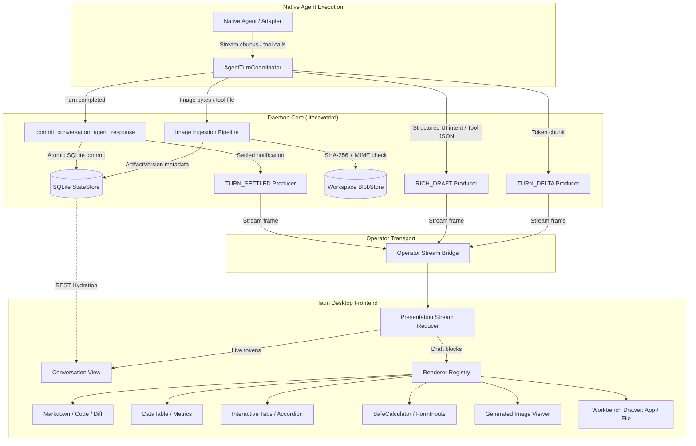

# Intelligent UI, Declarative Presentation, and Image Content Architecture

**Owning Stories:** E08-S08 (Semantic-first RichPresentation and Host Guidance), E08-S04, E08-S06  
**Status:** NORMATIVE V1 PRODUCT ARCHITECTURE  
**Authority:** Subordinate to [ARCHITECTURE.md](../ARCHITECTURE.md), [DATA-MODEL.md](DATA-MODEL.md), [STATE-MACHINES.md](STATE-MACHINES.md), [PRESENTATION-RUNTIME.md](PRESENTATION-RUNTIME.md), and [RICH-RESPONSE.md](RICH-RESPONSE.md).

---

## 1. Product Meaning and Distinction

Intelligent UI transforms conversational outputs from passive text into interactive, visual decision interfaces directly inside the Conversation pane, without requiring an external browser or heavyweight VM. It is an agent-agnostic rendering layer that bridges the gap between static text and standalone applications.

Outputs in LiteCowork maintain five distinct boundaries:

| Output Class | User Experience | State & Interaction | Security Boundary & Authority |
|---|---|---|---|
| **Semantic Response** | Complete, readable answer in conversational transcript | None (static text/Markdown) | Authoritative `ConversationMessage` committed in SQLite |
| **RichPresentation v1** | Polished layout: cards, callouts, tables, formatted text slices | Read-only presentation; no inputs | Validated immutable RFC 8785 JSON; display-only |
| **Generated Image** | Inline high-resolution visual with zoom, lightbox, and export | Image inspection, pan/zoom, download | Pinned `ArtifactVersion` or `Resource` in Workspace BlobStore |
| **Intelligent UI (v1)** | Interactive inline cards, tabbed views, data explorers, forms, calculators | Client-side transient state & bounded local calculations | Versioned Declarative Schema; strictly sandboxed pure reducer |
| **Interactive Artifact** | Full web application running in dedicated right Workbench panel | Full app state, file imports, storage proposals | Isolated Artifact Runtime (sandboxed OS WebView process) |

---

## 2. End-to-End Pipeline Architecture



---

## 3. Declarative Intelligent UI Schema (v1)

### 3.1 Design Principles
1. **Declarative Data Only**: The schema is strictly typed JSON. It contains no executable JavaScript, no `eval()`, no HTML `<script>` tags, no CSS `@import`, and no network URLs.
2. **Deterministic Sandboxed Execution**: Calculations use a bounded, arithmetic-only Abstract Syntax Tree (AST) evaluated by a deterministic pure reducer.
3. **Local State Isolation**: Form controls and interactive widgets update view-local React state only. They cannot mutate Workspace state, issue commands, or spawn Tasks without explicit, host-mediated user confirmation.
4. **Universal Accessibility**: Every interactive node must declare an `id`, an accessible `label`, and a deterministic `fallback_text` representation.

### 3.2 Schema Definition

```typescript
export type IntelligentUiDocument = {
  schema_version: "1.0.0";
  document_id: string;
  conversation_id: string;
  turn_id: string;
  root_node: IntelligentUiNode;
  fallback_markdown: string;
};

export type IntelligentUiNode =
  | LayoutNode
  | TabsNode
  | AccordionNode
  | DataTableNode
  | MetricCardNode
  | ChartNode
  | FormInputNode
  | SafeCalculatorNode
  | CalloutNode
  | ImageNode;

// --- Layout & Containers ---
export type LayoutNode = {
  kind: "LAYOUT";
  layout: "STACK" | "ROW" | "GRID";
  columns?: number; // 1 to 12 for GRID
  gap?: "NONE" | "SM" | "MD" | "LG";
  children: IntelligentUiNode[];
};

export type TabsNode = {
  kind: "TABS";
  id: string;
  default_tab_id?: string;
  tabs: Array<{
    id: string;
    label: string;
    icon?: string;
    badge?: string;
    content: IntelligentUiNode;
  }>;
};

export type AccordionNode = {
  kind: "ACCORDION";
  id: string;
  allow_multiple?: boolean;
  sections: Array<{
    id: string;
    title: string;
    summary?: string;
    default_expanded?: boolean;
    content: IntelligentUiNode;
  }>;
};

// --- Data Visualization ---
export type DataTableNode = {
  kind: "DATA_TABLE";
  id: string;
  caption?: string;
  columns: Array<{
    field: string;
    header: string;
    type: "STRING" | "NUMBER" | "DATE" | "BADGE";
    sortable?: boolean;
    align?: "LEFT" | "CENTER" | "RIGHT";
    badge_variant_map?: Record<string, "DEFAULT" | "SUCCESS" | "WARNING" | "DANGER">;
  }>;
  rows: Array<Record<string, string | number | boolean | null>>;
  pagination?: {
    page_size: number; // Max 50
    allow_page_size_change?: boolean;
  };
  export_csv?: boolean;
};

export type MetricCardNode = {
  kind: "METRIC_CARD";
  id: string;
  label: string;
  value: string | number;
  unit?: string;
  delta?: {
    value: string | number;
    trend: "UP" | "DOWN" | "NEUTRAL";
    is_positive: boolean;
  };
  sparkline?: number[];
  annotation?: string;
};

export type ChartNode = {
  kind: "CHART";
  id: string;
  chart_type: "BAR" | "LINE" | "AREA" | "PIE" | "SCATTER";
  title?: string;
  accessible_summary: string;
  x_axis: { label: string; field: string; type: "CATEGORY" | "TIME" | "NUMERIC" };
  y_axis: { label: string; field: string; unit?: string };
  series: Array<{
    name: string;
    field: string;
    color_token?: string;
  }>;
  data: Array<Record<string, string | number>>;
  height_px?: number; // Bounded 160px - 480px
};

// --- Interactive Inputs & Sandboxed Calculations ---
export type FormInputNode = {
  kind: "FORM_INPUT";
  id: string;
  input_type: "TEXT" | "NUMBER" | "SELECT" | "SLIDER" | "TOGGLE";
  label: string;
  description?: string;
  default_value: string | number | boolean;
  options?: Array<{ label: string; value: string | number }>; // For SELECT
  numeric_bounds?: { min: number; max: number; step?: number }; // For NUMBER / SLIDER
  required?: boolean;
};

export type SafeCalculatorNode = {
  kind: "SAFE_CALCULATOR";
  id: string;
  title?: string;
  input_refs: string[]; // Binds to FormInputNode ids
  formula_ast: CalcAstNode;
  output_format: "CURRENCY_USD" | "PERCENTAGE" | "NUMBER" | "INTEGER";
  explanation?: string;
};

export type CalcAstNode =
  | { type: "LITERAL"; value: number }
  | { type: "VARIABLE"; field_id: string }
  | { type: "BINARY_OP"; op: "+" | "-" | "*" | "/" | "%"; left: CalcAstNode; right: CalcAstNode }
  | { type: "UNARY_OP"; op: "-"; operand: CalcAstNode }
  | { type: "FUNCTION"; func: "MIN" | "MAX" | "ROUND" | "ABS" | "CLAMP"; args: CalcAstNode[] };

// --- Callout & Media ---
export type CalloutNode = {
  kind: "CALLOUT";
  variant: "INFO" | "SUCCESS" | "WARNING" | "DANGER";
  title?: string;
  body_markdown: string;
};

export type ImageNode = {
  kind: "IMAGE";
  id: string;
  resource_ref: string; // Content-addressed URI: litecowork-resource://<workspace_id>/<sha256>
  alt_text: string;
  caption?: string;
  aspect_ratio?: number;
  width_px?: number;
  allow_lightbox?: boolean;
};
```

---

## 4. Generated Image Pipeline

### 4.1 Ingestion & Verification
When a native agent produces an image (via model tool calls, MCP image generator, Grok Imagine, or direct base64 image block):
1. **MIME & Integrity Validation**:
   - Supported MIME types: `image/png`, `image/jpeg`, `image/webp`, `image/gif`.
   - SVG is accepted only if run through the strict daemon XML/SVG sanitizer (stripping `<script>`, `onload`, `href="javascript:"`, and foreign namespaces).
   - Maximum file size: 20 MiB per image.
2. **Content-Addressed Storage**:
   - The daemon computes the raw SHA-256 digest of the image bytes.
   - Bytes are written to the Workspace BlobStore at `blobs/<sha256>`.
   - An immutable `ArtifactVersion` or Workspace `Resource` row is committed in SQLite, linking the image to the originating `conversation_id`, `turn_id`, and `agent_session_id`.
3. **URL Resolution**:
   - The desktop client resolves the image using custom protocol: `litecowork-resource://<workspace_id>/<sha256_digest>`.
   - The Tauri protocol handler checks Workspace access before streaming the bytes, preventing cross-workspace leakage.

### 4.2 Image Input Pipeline
When the user attaches an image in the Conversation Composer:
1. File is selected via native OS file dialog.
2. Tauri checks file bounds (max 20 MiB) and valid image header magic bytes.
3. Daemon writes image to Workspace storage and generates a `ResourceRef`.
4. If the active `AgentBinding` reports `input.images = SUPPORTED`, the adapter projects the image to the native agent using its documented CLI/API flag (e.g., base64 in JSON payload or `--image <path>`).
5. If the agent does not support image input, the composer shows an explicit warning: `"Selected agent does not support image input. Image will be attached as a workspace reference only."`

---

## 5. Operator Stream Producers

In `apps/litecoworkd`, streaming is driven by three dedicated stream producers in the `AgentTurnCoordinator`:

```rust
pub enum OperatorStreamFrame {
    StreamReady {
        stream_id: String,
        workspace_id: String,
        conversation_id: String,
        turn_id: String,
    },
    TurnDelta {
        turn_id: String,
        sequence: u64,
        delta: String,
        observed_at: String,
    },
    RichDraft {
        turn_id: String,
        sequence: u64,
        document_draft: IntelligentUiDocument,
    },
    TurnSettled {
        turn_id: String,
        outcome: TurnOutcome,
        committed_message_id: String,
        settled_at: String,
    },
    ResyncRequired {
        conversation_id: String,
        reason: String,
    },
}
```

### Producer Execution Rules:
1. **`TurnDelta`**: Dispatched synchronously as token chunks arrive from the native harness adapter stdout/SSE parser. Throttled to maximum 60 fps (16 ms batching) to prevent UI thread saturation.
2. **`RichDraft`**: Emitted when the adapter streams structured JSON presentation hints. Parsed against the Declarative Schema. If validation passes, client renders progressive skeleton/layout; if validation fails, the frame is silently dropped and semantic streaming continues.
3. **`TurnSettled`**: Emitted ONLY AFTER `commit_conversation_agent_response` completes successfully in SQLite. Signals the desktop UI to replace transient stream buffers with the authoritative committed `ConversationMessage`.
4. **`ResyncRequired`**: Emitted if IPC reconnection occurs mid-turn or if a frame sequence gap is detected. Directs the client to fetch `GET /v1/conversations/{id}/messages`.

---

## 6. Renderer Registry & Fallback Contract

The desktop frontend implements a unified `RendererRegistry`:

| Node / Block Kind | Target Desktop Component | Graceful Fallback (if unsupported or parsing fails) |
|---|---|---|
| `TEXT_SLICE` | `MarkdownRenderer` | Plain text rendering |
| `LAYOUT` | `FlexContainer` / `GridLayout` | Vertical stack |
| `TABS` | `InteractiveTabs` | Sequential labeled sections |
| `ACCORDION` | `DisclosureAccordion` | Flat vertical sections with headings |
| `DATA_TABLE` | `VirtualDataTable` (sort/filter/paginate) | Accessible Markdown table with horizontal scroll |
| `METRIC_CARD` | `StatCard` | Text summary: `"[Label]: [Value] ([Delta])"` |
| `CHART` | `SandboxedSvgChart` | Raw data table + accessible summary paragraph |
| `FORM_INPUT` | `ClientInputWidget` | Disabled text box showing default value |
| `SAFE_CALCULATOR` | `PureAstReducer` | Static formula explanation and fallback result |
| `IMAGE` | `SafeImageViewer` with lightbox | Alt text + clickable local file download link |
| `MCP_APP` | `SandboxedIframeView` | Informative card with tool name, status, and params |
| `CALLOUT` | `CalloutBox` (styled border + icon) | Markdown blockquote (`> [!NOTE]`) |

---

## 7. Acceptance & Verification Gates

1. **Safety**: Zero raw HTML injection; zero `dangerouslySetInnerHTML` on unvalidated agent output; zero `eval()`.
2. **Determinism**: Identical `IntelligentUiDocument` input produces identical UI state across macOS, Linux, and Windows.
3. **Resilience**: If any rich component throws an unhandled React error, an `ErrorBoundary` catches the failure, isolates the block, and displays the underlying semantic text answer with a `"Display error: showing text view"` notification.
4. **Accessibility**: All interactive controls are navigable via keyboard (`Tab`, `Space`, `Enter`, Arrow keys) and declare ARIA attributes matching their state (`aria-expanded`, `aria-selected`, `aria-controls`).
