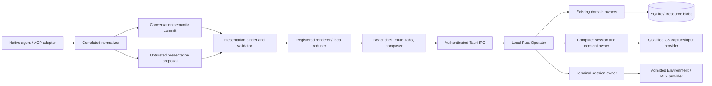

# Workspace experience revision - 2026-11-12

Status: user-requested proposals IN_REVIEW under [A-64](CONTRADICTION-AND-ALIGNMENT-REGISTER.md). Compact navigation and native Computer observation/input are separate decisions. Evidence: TARGET, except the explicitly recorded source observations. This integration map does not create a new API, event, schema or state-machine authority.

## 1. Intent and decisions

The owner explicitly requests a compact interface, a live selected computer screen/window in the right panel with manual takeover, real terminal behavior, and declarative interactive answers that can expand into Canvas. This corrects the previous interpretation that a managed-browser viewport alone fulfilled the computer requirement. Browser and Computer remain independent surfaces and qualification axes.

Retain local-first Tauri/React, Rust daemon, SQLite and the native-agent architecture. Use the useful presentation patterns from the supplied proposal; do not replace the application with Next.js/PostgreSQL, introduce hosted accounts, add a global BYOK model router, or insert a hidden presentation LLM. Those are separate product and architecture decisions. Agents continue to own reasoning; Core owns authorization, durable records and deterministic validation.

These user requests authorize design work, not a silent rewrite of accepted scope. B-32's first-milestone computer-use deferral remains the accepted baseline until the owner separately accepts a Computer scope change. If approved, the exact provider/OS admission contract must also be accepted and qualified before capture or input is enabled. Compact navigation can be reviewed independently and does not authorize Computer capture. B-40's accepted view-local calculator remains the baseline until its separately described persistent-view revision is promoted.

## 2. Information architecture and screen relationships

**IN_REVIEW proposal:** make New Chat or the last eligible Conversation the default main surface. Keep Workspace selection, New Chat, recent chats and search above four persistent destinations: Work, Coworkers, Library, Automations. Make Needs You a compact attention inbox and Settings a footer entry. Reach Discover, explicit New Task, Dashboard, Goals, Notifications and Ideas through collapsed More, contextual links or command palette. Keep Routines inside Automations. Search without a served search operation is not rendered as an active search control. The currently accepted navigation baseline stays in force until owner review of More reachability, keyboard/focus behavior, and the exact persistent destinations.

The conversation experience has three presentation states over the same history: ordinary prose; an inline registered interactive answer; and its expanded Workbench Canvas view. Expansion keeps the same presentation identity and local reducer state. Diagnostics and raw agent activity are disclosed on demand. These are navigation and rendering modes, not separate chats or runtimes.

The route catalog is not the sidebar. Every mounted route needs a reachable entrypoint, but reachability does not require permanent visibility. A More disclosure has a native accessible summary, expands with keyboard, retains focus on close, and reveals the active secondary destination. On narrow windows it uses the existing focus-managed navigation drawer. Dirty Library navigation continues through its existing save/discard guard.

Work contains Task detail and Mission Control projections. Library contains Resources, saved Artifacts and saved views when their owning publication path exists. Coworker detail contains its chats, context, memory and assignments. Automations contains schedules, occurrence history and Routines. Goals and Ideas remain proposals under their owners; relocating a link never grants execution authority. Notifications and actionable Needs You requests remain distinct.

## 3. Right panel, Canvas and defaults

One contextual right panel hosts object tabs and a + menu: Computer, Browser, Terminal, Files, Changes and Canvas. Only open objects occupy tabs. Inspector and Activity are disclosures of their object or Work detail, not a second competing side panel. The panel can expand, resize, collapse and reopen without changing process ownership.

Conceptual target layout (not the current UI):

```text
┌─────────────────────────────────────────────────────────────────────────────────────────────┐
│ Workspace: …          Conversation: …                    agent-control strip when applicable│
│                                                          [Take over] [Stop run]              │
├─────────────────────┬───────────────────────────────────────┬───────────────────────────────┤
│ LITE COWORK         │ CONVERSATION                          │ WORKBENCH                     │
│                     │                                       │ [Computer] [Files] [+] [Expand]│
│ + New Chat          │ User and agent messages               │                               │
│ Recent chats        │                                       │ selected display/window       │
│ Needs You           │ semantic answer, citations,            │ live local preview            │
│                     │ registered inline answer or Canvas    │ source and frame freshness    │
│ Work                │                                       │ local preview: on             │
│ Coworkers           │                                       │ shared with agent: off        │
│ Library             │                                       │ input: unavailable/owned by…  │
│ Automations         │                                       │                               │
│ More                │ [composer and attachment controls]     │                               │
│                     │                                       │                               │
│ Settings            │                                       │                               │
└─────────────────────┴───────────────────────────────────────┴───────────────────────────────┘
```

When agent input is active, the strip is app chrome and remains visible while the user is in LiteCowork; it is never drawn into the captured screen. Since a foreground target app covers LiteCowork, manual takeover also needs the separately qualified out-of-app shortcut or tray path below. The displayed frame rate/quality is real measured provider output, not the 8 fps prototype ceiling from the Computer LLD.

Desktop launch shows a compact entry surface without starting a provider. Restore the last explicit per-Workspace layout after authorization. An agent work event may suggest/open the relevant authorized object only when the user has not deliberately closed the panel; avoid repeated reopening and focus theft. Narrow screens use a focus-managed drawer; expanded Canvas retains a route back to chat.

An inline answer and expanded Canvas share one authorized document identity and current local state owner. Expanding is a layout transition, not a new generated application. Closing an unsaved Canvas uses Artifact draft guards. Saving or exporting is an explicit owning operation with revision, receipt and provenance. A /canvas shortcut and + > Canvas address the same command; a native agent slash command must not be intercepted or silently reinterpreted as a host command.

### Take over, Stop, and sending a message

When a provider has an active mediated computer-input lease, a persistent, non-modal **Agent is controlling your computer · Take over · Stop run** strip appears in app chrome, outside captured pixels and independent of the selected tab. It stays visible while LiteCowork is foreground and does not obscure the screen being observed. Because the target app normally covers LiteCowork during computer use, the strip alone is not an emergency path. The target design therefore requires a qualified OS-level global Take over shortcut or native tray action that reaches the same broker fence without first focusing LiteCowork. Prefer a global shortcut for speed and a tray item as a discoverable fallback; exact per-OS mechanisms and shortcut-conflict behavior remain owner decisions. Do not admit agent input until at least one out-of-app path is registered and working. If no such path qualifies, Computer remains observation-only on that OS/provider. A transient popup or notification does not meet this requirement.

Take over immediately closes the host's input-admission fence and discards unsent queued input; it does not wait for capture, rendering, or model generation. If an action already crossed the OS boundary, show it as pending/unknown until the owning provider reconciles it. Manual ownership is reported only after the transfer fence is acknowledged. If the provider cannot guarantee that every computer input goes through this broker, controlled Computer use is unavailable for that provider. Provider control-channel loss, shell crash and Runtime-incarnation change must fail closed before another input; bounded provider-specific liveness evidence remains an implementation gate.

**Take over** stops further agent-controlled mouse/keyboard actions through LiteCowork and lets the user interact locally as soon as the broker fence closes. It does not stop the agent's reasoning or unrelated authorized tools, cancel a Conversation, or cancel a Task. The user can still see the computer locally if that separate observation permit remains active. **Stop run** is separate: close the Computer input fence, then request Feature 001 Conversation cancellation or the owning Task cancellation fan-out; each service fences and reconciles its own mediated operations. The UI must show `Stopping` or `Outcome unknown` while that work is unresolved. A computer-using agent remains running after Take over but cannot dispatch another mediated computer action.

Sending a message is not a control-transfer gesture. Only a provider-qualified typed continuation or answer to the exact active UserRequest/permission prompt can continue an existing turn; an ordinary message must not be silently treated as steering. If the provider cannot accept a concurrent continuation, the user stops the run, waits for settlement, then sends a new turn. Taking over never sends a message or automatically returns computer control to the agent.

### Terminal defaults and ownership

Opening Terminal shows an idle shell launcher; application start and opening the + menu never spawn a process. **New terminal** is the explicit process-start action. Every terminal, including a user-manual terminal, requires an explicit execution context that satisfies the accepted Feature 008/B-23 Environment gate. The authenticated local Runtime and a selected Workspace root identify the context; they do not themselves prove isolation or authorize an uncontained host shell. If no qualified Environment/profile is available, show the exact unavailable reason and do not spawn. Within a qualified admitted context, prefer Windows PowerShell 7 when that exact executable is discovered and qualified; otherwise let the user choose a supported qualified profile. Linux/macOS use the configured account shell only when that profile is supported inside the admitted context; otherwise ask the user to choose. Never install or substitute a shell silently. Git Bash, WSL, containers and custom shells require explicit selection and show their actual Runtime/Environment. A separate unisolated owner-only host terminal would need an explicit owner decision and new security/API/UI contract; this proposal does not authorize it. Task/Attempt terminals use the separately admitted Environment's qualified profile, never the manual terminal's profile. See [`V1-INTEGRATED-TERMINAL-LLD.md`](V1-INTEGRATED-TERMINAL-LLD.md) for ownerKind and recovery details; this terminal design is TARGET and Feature 008 revision 1.1 remains IN_REVIEW.

The initial terminal tab is **You** with one owner input writer. An agent terminal is a separate session under an admitted Environment and task authority; it never reuses the user's shell, credentials, startup files or cwd. While an agent owns terminal input, the user gets a persistent **Take over terminal** control. It fences new agent stdin, but does not interrupt an already-running command; **Interrupt process**, **Stop process**, **Stop task**, and Conversation **Take control** remain separate operations. Old PTY bytes and shell lines are never replayed after restart. A terminal process is not created until the user or an explicitly admitted Task starts it.

### Patterns verified in product documentation

Checked 2026-11-12: the [ChatGPT desktop navigation update](https://help.openai.com/en/articles/20001276-moving-to-the-new-chatgpt-desktop-app) groups Chat and Work within one ChatGPT surface and brings their chats together in Recents; [Claude Artifacts](https://support.claude.com/en/articles/17153992-what-are-artifacts-and-how-do-i-use-them) opens substantial output beside conversation and supports editing, iteration, versioning and a saved artifact space. LiteCowork adopts the compact intent-based navigation and contextual Canvas pattern. [MCP Apps](https://apps.extensions.modelcontextprotocol.io/api/documents/Overview.html) provides an optional host-rendered interactive tool surface with sandboxed iframe communication and graceful plain-result fallback; that remains separate from the default registered native presentation renderer. [Anthropic's computer-use privacy description](https://privacy.claude.com/en/articles/10030352-what-personal-data-will-be-processed-by-computer-use) confirms screenshots are a computer-use data flow; it does not establish low-overhead live video or a takeover guarantee. See Feature 016 RESEARCH for protocol comparisons and version/pin limits.

The current Claude help page also lists Docs, Slides, Design and Data templates, Sheets and Whiteboards in beta, and Artifacts that can use connected apps after showing the requested tools and getting approval. Those show that saved interactive outputs can become a broader product surface. LiteCowork should assess each extension under its own local Workspace, connector authorization, provenance and retention contracts; matching a rival's feature list does not justify copying its cloud storage or app permissions.

## 4. System boundaries and topology



React owns local layout, focus and ephemeral reducer state. The daemon owns session lifecycles, authorization, source revalidation and durable changes. OS brokers hold native capture/PTY handles locally. SQLite transactions never contain OS waits or provider calls. Frame and terminal-output channels are authenticated, bounded and incarnation-scoped; they cannot grant authority or settle a Task. Presentation failures never prevent semantic Conversation commit.

## 5. Owning contracts and module consequences

| Module | Required UI/interconnection | HLD/LLD and contract consequence |
|---|---|---|
| 001 Conversation | Composer, inline semantic answer, Stop, retry, expand answer | Correlate structured proposals to current turn/attempt; semantic commit precedes publication; unsupported rich output keeps prose. |
| 002 Agents | Agent-first picker and honest presentation capability | Capability-specific provider evidence; supported guidance delivery/output forms; MCP injection is not assumed from ACP support. |
| 003 Context | Attachments and inspectable sources in chat/Canvas | Bind exact authorized Resource revisions and digests; retrieved data is not an instruction or presentation authority. |
| 004 Relay | Producer-labelled responses and portable handoff | Saved view/document references transfer only as authorized portable pins; no native handles or implicit state merging. |
| 005 Task | Work plan, active computer/terminal attachment and results | Separate Task control from input transfer; no desktop control as a substitute for Task Environment containment. |
| 006 Connections | Review external actions from forms or MCP Apps | Rendered controls call typed owner actions; scope/grant/Effect checks apply at dispatch; visual confirmation is not approval. |
| 007 Artifacts | Canvas save/export and Library reopen | Initial publication, immutable versions, provenance, explicit export receipt and conflict handling remain prerequisites. |
| 008 Workbench | Computer, Browser, Terminal, Files, Changes tabs | Owns computer observation/input leases and terminal sessions; see its revised package and Computer LLD. |
| 009 Coworkers | Scoped chats/context/memory and optional defaults | A Coworker cannot silently acquire capture/input authority or share a saved view across scopes. |
| 010 Automations | Routines inside Automations; local-host status | Background schedule cannot silently consent to screen capture or user-desktop input. |
| 011 Shell | Four main destinations, Needs You, collapsed secondary links | Local layout/focus/dirty guards only; no new backend route needed for navigation. |
| 012 Take control | Conversation ownership and owner continuation | Conversation cancel/quiescence differs from browser/computer input takeover; no auto-send on takeover. |
| 013 LiteSPM | Discover in secondary navigation | Package lifecycle still owner-deferred; a local bundled presentation endpoint is not a duplicate package manager. |
| 014 History | Search, reopen, rename/archive and exact-view references | Archive/delete impact and retention govern linked views; history replays committed data, not transient frames. |
| 015 Delegation | Work workers, child state and cancellation | Takeover pauses dependent input work; child/parent cancellation fan-out and unrelated work remain separately owned. |
| 016 Presentation | Inline native controls and expanded Canvas | One internal protocol; immutable presentation plus separately governed optional saved view state; semantic and accessibility fallback. |
| 017 Portability | Backup/restore saved content and supported view state | Never export capture frames, native handles, leases or credentials; restored views reauthorize sources and cannot restore control. |
| 018 Diagnostics | Inspect provenance, dropped frames and source confidence | No screenshot, terminal secret content or model payload in ordinary logs/support bundles; metrics are bounded counts. |
| 019 Release | Exact OS/provider/build matrix | Capture-only, input, takeover, PTY and rendering qualify independently; unavailable rows stay unavailable. |
| 020 Learning | Inspect proposed learning with scope/source | No learning from screenshots, terminal output or interactive values by default; explicit permitted sources only. |

Detailed contracts stay in their owners: [Computer observation/control](COMPUTER-OBSERVATION-AND-CONTROL-LLD.md), [Terminal](V1-INTEGRATED-TERMINAL-LLD.md), [ACP presentation pipeline](ACP-PRESENTATION-PIPELINE-LLD.md), [Presentation](INTELLIGENT-UI-AND-IMAGE-CONTENT.md), [Trust](TRUST.md), [Artifact runtime](INTERACTIVE-ARTIFACT-RUNTIME.md). The last remains separately qualified; an iframe alone is not sufficient isolation evidence.

## 6. LLD: shell commands, data and state

Existing internal Page identifiers remain stable. A navigation visibility classification is local UI metadata: PRIMARY, ATTENTION, SECONDARY, FOOTER or IN_PAGE. It is not a domain enum, permission or new public API. New Chat clears the selected Conversation through the existing guarded route path. More changes visibility only. Each destination still resolves through requestPageNavigation so Library save/discard, focus restoration and Workspace fences are retained.

Tab identity is the existing owning object identity plus view kind and optional immutable revision. Persist local layout and selected tab references only; on reopen authorize the object and replace missing/revoked objects with a repair state. Do not persist provider handles or control ownership in localStorage. Active computer/terminal status comes from owner projections, never from which tab is selected.

Computer preview ownership, agent-disclosure consent and input authority are separate. A user may watch while holding manual input. Take over blocks new agent dispatch immediately at the host, requests provider input fencing, reconciles any dispatched action, then reports manual control only after acknowledgement. The current physical desktop input path must be fully mediated for this guarantee; direct native provider input remains outside LiteCowork's Effect boundary and makes takeover unavailable. Timeout is transfer pending/unknown, not success. Return requires explicit confirmation and fresh observation. Message send is neither emergency stop nor implicit return-to-agent.

## 7. Contract promotion and failures

Navigation changes require no new OpenAPI, event or MCP operation. Computer/view persistence proposals require their owning feature to promote exact request/response/error/schema/event definitions before route implementation. Do not invent route names in the UI or add unused machine contracts just to make an inventory look complete. Canonical schemas in docs/schemas are authoritative; illustrative vendor JSON is not another accepted schema.

For every new operation trace exact control -> typed command -> authenticated transport -> Workspace/principal authorization -> owning service -> version/epoch/idempotency fence -> transaction/receipt -> projection -> recovery. A visual component can propose a host action but never approve it, choose a raw URL, supply a credential, or claim an Effect succeeded.

Failure table: revoked source -> clear protected content and request repair; stale view revision -> conflict and preserve local draft; malformed/oversized proposal -> semantic fallback; stream gap -> rehydrate committed snapshot; interrupted layout restore -> safe default; lost computer provider -> no input and explicit stale preview; lost terminal -> LOST without command replay. The detailed owner recovery machines remain canonical.

## 8. Acceptance criteria

- UX-01: WHEN the app opens, THE SYSTEM SHALL show at most four persistent workspace destinations plus New Chat, recent chats, Needs You and footer Settings; every other mounted route SHALL remain keyboard-reachable through a disclosure or contextual path.
- UX-02: WHEN More opens or closes, THE SYSTEM SHALL preserve visible focus and announce its expanded state; the active secondary page SHALL be discoverable without making every secondary route permanently visible.
- UX-03: WHEN a dirty Library/Canvas navigation is requested, THE SYSTEM SHALL preserve its existing save/discard/conflict guard; expanding a view SHALL retain input values and document identity.
- UX-04: WHILE the user has deliberately closed the right panel, THE SYSTEM SHALL not repeatedly reopen it on streamed activity or take composer focus.
- UX-05: WHEN computer control is requested, THE SYSTEM SHALL distinguish local observation, agent disclosure and input permits and display exact capture scope; selecting a tab SHALL not grant any permit.
- UX-06: WHEN takeover is requested, THE SYSTEM SHALL block new agent input before waiting for provider acknowledgement and SHALL not claim manual ownership while transfer is unknown.
- UX-07: WHEN an interactive answer is unavailable or rejected, THE SYSTEM SHALL preserve the complete semantic answer and show a concise fallback; derived metrics SHALL use declared units, time periods and aggregation definitions.
- UX-08: WHEN settings, layout or data are restored, THE SYSTEM SHALL not restore capture consent, input leases, native handles, live process claims or execution authority from UI preferences.

Acceptance for each module additionally includes denial, foreign Workspace/principal, duplicate replay, stale epoch/revision, timeout after dispatch, revocation, crash, restart, reconnect, keyboard/screen-reader behavior and exact provider qualification where applicable.

## 9. Implementation sequence and gates

1. Record requirement changes and resolve authority conflicts; read source and full affected packages. Keep review coverage honest.
2. Implement compact navigation within 011-T19, retaining all routes and dirty/focus guards. Verify reachability and accessible disclosure. No backend migration.
3. Qualify existing Conversation lifecycle and preserve provider structured data through a bounded adapter. Do not make rendering a prerequisite for Send.
4. Complete shared presentation validation/binding and one static chart/restricted calculator. Prove invalid/malicious output falls back. Existing schemas and B-40 baseline first.
5. Qualify computer capture-only on one exact OS/provider, then separately input consent and acknowledged takeover. A proposed provider list is not release approval.
6. Qualify real daemon PTY and independent terminal input ownership; preserve Windows agent-execution containment gate.
7. Promote optional persistent interactive-view revisions, migration, backup/retention and conversational update conflicts before implementing them. Preserve inline/Canvas state continuity within a session meanwhile.
8. Complete explicit Artifact save/export and source provenance, then end-to-end desktop journeys and owner acceptance. Do not enable arbitrary custom-app execution as a shortcut around missing components.

## 10. Review boundary

This document records concrete decisions and owner dependencies for the requested revision. It does not certify every repository line correct, all modules fully designed, every proposal accepted, or any provider qualified. Per-file coverage and unresolved findings belong in the audit report; structural script ingestion and line counts are not semantic review. The supplied AI answer is research input, not repository instructions or normative contracts.
