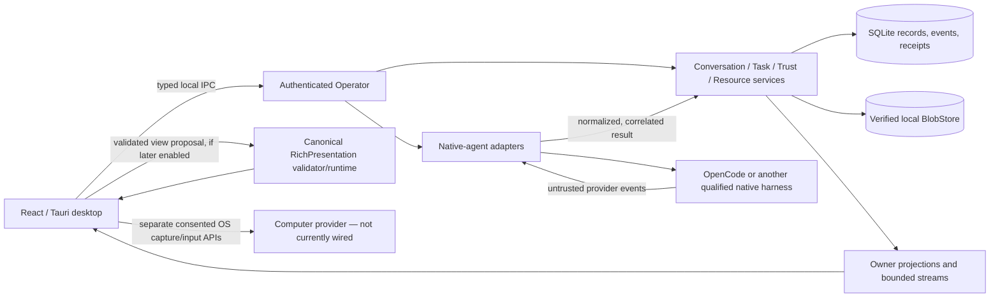

# Full repository re-audit — 2026-11-14

## Purpose and evidence boundary

This report records a fresh line-by-line reread and a cross-layer review of the active LiteCowork checkout. It is a dated audit, not a new normative authority. The root `ARCHITECTURE.md`, Product/V1 release contracts, domain owners, canonical schemas, active feature TASKS and exact qualification evidence remain authoritative in their established order.

The checkout at the start of the audit was clean on `main`, HEAD `28e67b5b743b7aa6582727fbeed2cf9636a49520`, 18 commits ahead of `origin/main`. This audit itself did not change product code and did not run tests or validators. Prior test results remain dated evidence; in particular, the recorded full UI run is **626 passed, 5 failed, 5 skipped** and is not a pass. A source or test file being present does not create new CODE/SERVED/INTEGRATED/QUALIFIED evidence.

### Read coverage

| Area | Tracked coverage | Read coverage |
|---|---:|---:|
| `docs/`, including `docs/archive/` | 347 files | 347 files, all lines |
| `specs/` | 221 files | 221 files, 26,781 lines |
| `apps/litecowork-ui/` | 332 paths | 328 text files, 65,433 LF lines |
| `apps/litecoworkd/` | 106 text files | 96,706 LF lines |
| `crates/storage-sqlite/` | 90 files | 121,824 LF lines |
| Other tracked `crates/` | 115 paths | 59,045 LF lines |

Temporary external ledgers preserve per-file ranges for the line-by-line passes. Historical documents were read to understand chronology but were not treated as current implementation status and are not rewritten by this report.

## What LiteCowork is building

LiteCowork is a **local-first, chat-first, BYOA-first desktop workspace**. The Rust local Runtime and domain/storage crates own Workspace-scoped conversations, explicit Tasks, Trust, mediated Effects, Artifacts, evidence and recovery. Native agent harnesses keep ownership of their reasoning, authentication, model catalogs, private transcripts and native tools. Ordinary Conversation does not require creating a Task. A READY Task is a stored request, not a running worker.

The user experience is one workspace with progressively opened surfaces:

- **Work** is the default work area: ordinary conversations and explicitly created Tasks share a home while retaining separate lifecycles.
- **Coworkers** are configured native-agent/work profiles and their conversations/context; a profile record is not proof that a process is running.
- **Library** contains Workspace Resources and, as creation/publishing is implemented, managed Artifacts and saved views.
- **Automations** contains schedules, Routines and occurrence history; a schedule may admit a READY Task but does not execute its body.
- **Needs You** is a compact, actionable attention entry for persisted requests/approvals and real blockers. It is distinct from notification delivery history.
- **More** holds secondary destinations such as Discover, explicit New Task and other owner-governed surfaces. Settings stays in the footer.

The central Conversation surface can show semantic prose and registered, validated rich answers. A contextual right Workbench hosts only opened objects—Computer, Browser, Terminal, Files, Changes and Canvas—rather than permanent application-wide tabs for every tool. Inspector/activity details are disclosed within the relevant surface. Native developer traces are on demand.

This is not a hosted account/model router or a headless UI SDK in V1. The supplied ChatGPT-like rendering proposal contributes the useful idea of converting agent output into a consistent native interactive presentation. Its suggested Next.js/PostgreSQL/assistant-ui/Vercel AI stack, universal BYOK router, extra hidden model pass and arbitrary generated frontend code do not fit the accepted local-first Rust/Tauri architecture and are not adopted.

## Product and competitor cross-check

First-party product documentation shows two useful UX patterns: OpenAI's desktop app brings Chat and Work threads together in Recents and keeps Projects discoverable; Claude Artifacts open substantial standalone content beside chat and support direct edits and version navigation. LiteCowork can use unified recent-work discovery and an expandable answer/canvas with retained identity, without copying either product's cloud behavior or internal implementation. Sources: [OpenAI desktop app](https://help.openai.com/en/articles/20001276-moving-to-the-new-chatgpt-desktop-app) and [Claude Artifacts](https://support.anthropic.com/en/articles/9487310-what-are-artifacts-and-how-do-i-use-them).

## HLD: system boundaries and data flow

- **Rust local Runtime/Operator** authenticates local IPC, validates bounded commands, invokes owning services and returns owner-backed projections. A mounted route does not prove provider integration.
- **Conversation supervisor** owns durable turn admission, dispatch intent, native session lifecycle, normalization, receipt settlement, cancellation and recovery. The current OpenCode execution route is HTTP; ACP plumbing exists but is not wired into the live supervisor route.
- **Domain/storage services** own state machines, Workspace boundaries, CAS/version fences, idempotency and durable event/receipt behavior. Never create duplicate schemas/state machines in UI or adapters.
- **Tauri/React** renders typed projections and submits typed commands; optimistic UI is not a receipt. A transport timeout can mean the operation is still running, so UI and retry flows preserve UNKNOWN until the same request is reconciled.
- **Native providers** are untrusted, separately versioned systems. Discovery, installation, authentication, assignment, grant, activation, invocation and verification remain distinct facts.
- **Trust boundary:** LiteCowork Trust applies to calls actually mediated by LiteCowork. It cannot claim to intercept a provider's direct native shell, filesystem, network, hidden subagent or other tool unless a qualified hook/OS boundary mediates it.
- **Credentials/private handles:** remain in the OS SecretStore or private Runtime incarnation state; they do not enter public projections, replicated events or ordinary logs.

## UX decisions and detailed behavior

### Left navigation and Workbench

The proposal has four persistent workspace destinations—Work, Coworkers, Library and Automations—with a compact Needs You entry and footer Settings. Conversation search/history belongs with Work. Discover, explicit New Task and other secondary modules stay under a collapsed More or contextual entry. This reduces permanent navigation rows without deleting owner routes.

The Workbench is the **contextual right object panel**. Only opened objects appear as tabs; a `+` menu opens another object. It can resize/collapse, with layout preference separate from permissions and provider handles. The desktop starts with a compact entry surface and no provider process. When an already-authorized Computer session is LIVE and local preview is permitted, select the Computer object so the user can see the selected display/window; that view change must not start capture, grant agent access, steal focus or lose the unsent draft. Respect a deliberate close for that session while keeping a control strip and Show computer entry available. This target is in Feature 008 revision 1.1 IN_REVIEW; the current Computer provider is unavailable.

### Computer live view, consent and takeover

The view is technically feasible with native OS capture APIs, subject to exact platform/provider qualification. The existing Computer LLD proposes a bounded same-device preview: initially at most 8 frames/s locally at a 1280px longest edge, one pending encoded frame/subscriber, 1 MiB compressed cap and 1920×1080 decode cap; agent disclosure is on demand at no more than 1 frame/s with its own byte/token budget. Adaptive quality uses latest-frame-wins backpressure, reports real freshness/quality, and stops capture when no permitted subscriber remains. These are **benchmark targets, not measured performance claims**. No recording is kept by default; audio and clipboard capture are out of scope. Local preview, agent disclosure and input authority require separate consent and revocation.

While a provider has a live mediated Computer input lease, show a persistent non-modal app-chrome strip: **Agent is controlling your computer · Take over · Stop run**. A timed popup alone is not an emergency control because the target app covers LiteCowork. Before admitting agent input, the provider must qualify an out-of-app global shortcut or tray control that reaches the same input broker.

- **Take over** immediately fences new LiteCowork-mediated Computer input and cancels unsent queued input. It does not cancel model reasoning, a Conversation, or a Task. Actions already across the OS boundary remain pending/unknown until reconciled; never claim they were undone.
- **Stop run** first fences Computer input, then requests cancellation through the owning Conversation or Task service and waits for their own reconciliation/quiescence.
- **Send a message** is neither takeover nor stop. If the provider supports a correlated UserRequest/permission answer or typed continuation, use that exact owner path. Otherwise Stop, wait for settlement, then send a new ordinary turn.
- **Conversation Take control** (Feature 012) is separate from Computer input takeover: stop the active turn and wait for native quiescence before recording owner continuation. Task pause/cancel is also a separate lifecycle action.

### Terminal default

Terminal is idle until the user explicitly chooses **New terminal**. App launch, opening Workbench or opening `+` never spawns a shell. Both manual and Task terminals require a qualified admitted Environment; a Workspace root alone is not isolation and there is no host-shell fallback. Resolve profile in this order: explicit New Terminal profile, validated Workspace+Runtime override, validated Runtime preference, then a qualified OS recommendation. No eligible shell means Choose shell/unavailable. Windows recommends PowerShell 7 only if that exact executable is qualified; Linux/macOS use a discovered configured login shell only inside the admitted Environment. Manual and Task terminals never share process, credentials or ownership. Feature 008 revision 1.1 remains IN_REVIEW and no PTY/ConPTY provider is served.

### Agent-generated interactive answers / ACP

ACP does not define a universal UI component tree; its content and tool-call events carry text/media/resources and permission/input requests. LiteCowork's ACP client currently sends `mcpServers: []`, and live OpenCode dispatch is a separate HTTP route. Thus no current ACP agent can publish a LiteCowork rich view through a production path.

The safe integration path, if Feature 016 accepts it, is:

1. Preserve the agent's semantic text/answer as the canonical Conversation result.
2. Optionally let a qualified adapter invoke a narrowly scoped host proposal tool bound to Workspace, Conversation, turn, provider session and request ID.
3. Validate one canonical, versioned RichPresentation schema against an allowlisted component registry and complexity/data limits. Keep the model unable to supply arbitrary React, HTML, JavaScript, native handles, secrets or unbounded actions.
4. Commit/publish only after the semantic result is reconciled; expose provenance and deterministic formulas/data where relevant.
5. Render inline and allow expansion into Canvas while retaining the same presentation identity/state. If the proposal is missing, unsupported or invalid, show the complete semantic text and a recoverable explanation.

ACP/MCP Apps/A2UI can be evaluated as transport or ingress ideas, but must not introduce a second source-of-truth schema. Current RichPresentation supports five kinds in validator/read code, has no production publisher, and rich-draft stream state has no UI consumer. CHART and SAFE_CALCULATOR are not enabled. Any deterministic calculations require an approved allowlisted operation, not `eval`; saved interactive state/conversational revisions remain separately gated. Feature 016 baseline acceptance is pending T01 and its rev 0.2 extension is separately gated at T25; B-40 “accepted as proposed” is not whole-feature acceptance.

## Source-backed gaps and owner gates

Severity here is audit triage, not a repository-defined classification. Findings below do not authorize code work; resolve their owner contract and task allowlist first.

| Priority | Finding and evidence | Owner / next gate |
|---|---|---|
| P1 | New-chat Send creates a Conversation, carries the draft and returns without admitting the first turn. Existing-chat submission appends a synthetic user row; failure restores the draft but leaves that row visible. A retry gets a fresh RequestId, and UI cannot distinguish definite refusal from ambiguous post-dispatch transport failure. | Feature 001: add reviewed user journey and exact ambiguous retry/reconciliation task; preserve the same RequestId for an uncertain request and reconcile its durable receipt before a new attempt. |
| P1 | Explicit historical Resource revision may pass dispatch materialization when the Resource has no current head: the adapter rejects mismatch only when `current_revision_id` is Some. | Feature 001 T14 + Resource owner: require an existing current head and exact pin policy; add stale/deleted/no-head recovery cases. |
| P1 | Agent credential submission remains fail-closed. Descriptor-scoped route is served but uses `NoAgentDescriptorSource`; it returns unavailable before calling the SecretStore writer. No real sign-in/bind/send path is qualified. | Feature 002 T07/T08/T19 and provider owner evidence; do not add credential UI or claim authentication before durable secret write/replay/recovery is accepted. |
| P1 | Linux provider probe treats cgroup-v2 and the system systemd manager as enough, while actual user-scope launch tests require a user manager and delegated controllers. The live integration tests are ignored pending a real host. | Feature 005/Linux provider: probe exact prerequisites or return UNKNOWN/unavailable; qualify native Linux before Environment readiness. |
| P1 | MCP App CSP validation uses a broad URI check and accepts wildcard-like sources despite an exact-origin contract; the resulting value is inserted into CSP. | Skill/MCP App owner: validate exact scheme/host/port/origin grammar; test wildcard, userinfo, path, malformed port and Unicode cases before trusting the frame route. |
| P1/P2 | Coworker learning secret redaction matches in lowercased text then applies transformed byte offsets to original UTF-8 text; Unicode case expansion can leave secret fragments or cause invalid-boundary slicing. | Feature 020/storage-core owner: match on original byte-safe ranges or normalize with a reversible mapping; add Unicode regression tests before any live producer. |
| P2 | Weekly recurrence BYDAY enumeration uses Sunday-first numeric set order before Monday-based date offsets; `SU,MO` can enumerate Sunday before Monday and skip a slot. Current tests only exercise MO/WE. | Feature 010/recurrence owner: sort candidate dates chronologically and cover cross-week ordering and COUNT before RRULE enablement. |
| P2 | Occurrence `CLAIMED` transition returns `claim_expires_at = now`, which is immediately expired if persisted as the lease deadline. | Feature 010/storage owner: verify caller semantics, then return a bounded future deadline or revise the contract; test the persisted lease. |
| P2 | Lead-failover commits POLICY_FAILOVER before building/validating the response packet; a later storage/budget error may return failure after the Task changed, and retry can fail stale before receipt replay. No production caller exists. | Feature 015: prevalidate/replay exact packet or persist it atomically; package remains IN_REVIEW/T01 blocked. |
| P2 | Discover compatibility derivation and UI decoder can surface `AVAILABLE` while compatibility is UNKNOWN. | Discover/LiteSPM owner: make canonical derivation reject unknown compatibility; align UI decoder and truth-state contract. Feature 013 lifecycle remains owner-deferred. |
| P2 | Automation occurrence history UI requests only the first page and discards `next_cursor`; failure can render alongside the “no occurrences” empty state. | Feature 010 T11: paginate, preserve retry cursor and make error/empty states mutually truthful. |
| P2 | Worker Profile load failure clears the list, while the mounted Settings page shows “No worker profiles have been created.” | Settings/Delegation owner: keep error/loading/empty distinct; add exact UI contract and task ownership. |
| P2 | Conversation dispatch with no host can discard an error from settling the turn FAILED; startup recovery may later reconcile it, but the current caller lacks a surfaced diagnostic. | Feature 001 supervisor/storage: define observable in-session settlement failure and exact receipt/recovery behavior. |
| P2 | Conversation and Automation settlement perform BlobStore operations while holding SQLite IMMEDIATE transactions; Automation settlement scans all eligible STARTED rows without a batch bound. | Storage/owning domain review: decide prewrite/reservation and bounded-batch patterns without weakening atomic receipts/events. |
| P2 | Offline backup restore joins manifest paths beneath staging without an evident containment/path grammar check; a single-Workspace export also contains rows from other Workspaces. | Feature 017 T01 is blocked: accept exact archive path grammar and complete Workspace table map; preserve offline-only boundary until both are fixed. |
| P2 | Served ContextDocument purge does not enforce documented target/reference/serialized-manifest caps before tombstoning. | Resource/Storage owner: add fail-closed manifest admission limits in an authorized task; do not rely on page-size caps. |
| P2 | Windows IPC response timeout is shorter than the Unix route budget, so a committed operation may return UNKNOWN to the caller. | IPC owner: define operation-specific reconciliation and align timeout envelopes; preserve UNKNOWN after dispatch. |
| P3 | `domain-responsibility/README.md` describes persistence/routes/UI that the crate `lib.rs` explicitly says it does not own. | Correct README scope; distinguish crate logic from wider repository adapters. |
| P3 | Quiet-hours timezone shape accepts nonempty strings; a timezone parse error is converted to “outside quiet hours,” potentially allowing delivery. | Notifications/Storage owner: validate an IANA zone when persisted and propagate malformed-state errors according to the owner contract. |
| P3 | Workspace replication-policy mutation uses unchecked version increment while neighboring operations use checked arithmetic. | Workspace owner: use checked increment and a typed exhaustion error if the existing contract requires bounded versions. |
| P3 | Routine/Coworker/settings forms expose some policy values whose consumer is absent; pending notification rows have no delivery sender. | Owners: hide/mark unsupported controls or wire the real owner service; never imply notification delivery from saved preferences. |
| P3 | Theme preference is persisted/applied, but Settings and Workbench styles retain hard-coded light surfaces. | Feature 011/008 UI owner: complete token-based dark styling and rendered contrast checks; current theme is partial visually. |
| P3 | `rich_draft` reducer stores bounded replacement data but has no producer-to-UI consumer; no production `publish_rich_presentation` caller exists. | Feature 016: define one typed producer and mounted consumer, update schema/UI/events together after T01/A-85 approval. |

### Additional dormant or unintegrated source observations

- `environment_computer_use.rs` stores a Workspace in consent but its pure authorization helper does not compare the action Workspace. No Computer provider/route is wired, so this is a latent trust boundary, not a live bypass; bind Workspace before integration.
- Browser consent/control and Runtime isolation helpers have code/tests but no production provider wiring. Browser takeover helpers are not a served BrowserSession service.
- Power assertion release can lose its child handle after a failed kill and later report RELEASED without proving exit; the module is not wired into Runtime.
- `lead_failover_choice_request` and several Environment mutators exist in SQLite without a production service route. Treat them as code foundations only.
- Some async daemon handlers perform synchronous SQLite reads on Tokio workers. This is a responsiveness/performance hypothesis until measured under storage contention, not a proven user-visible failure.
- History, Artifact, Task and Automation read/write routes are not interchangeable with complete product journeys; each still needs the exact UI path, failure/recovery behavior, and relevant packaged/provider evidence.

## Contract and plan corrections required before implementation

1. Reconcile accepted ACs and source: A-79 waiting-state Conversation Stop differs from current RUNNING/OPEN route/UI behavior; A-81 Artifact export has conflicting receipt-vs-picker ordering; A-82 GitHub OAuth recipe conflicts with current provider constraints; A-83 exact terminal command receipts cannot be authenticated from PTY/OSC output alone. Leave each with its owner until resolved.
2. Correct stale future migration path lists that name existing v29 as new. Use only the exact allocated migration (`v39` for the deferred Feature 013 proposal; `v43` for Feature 020 where already allocated), and remove Feature 001's duplicate “new v29” instructions. Keep `SCHEMA_VERSION` 32 until an accepted, implemented migration changes it.
3. Repair Feature 008 verification dependency/acceptance so revision 1.1 Computer criteria are not accidentally treated as VERIFIED by revision 1.0 T21.
4. Reconcile Feature 002 T07 OpenCode login wording with the locked no-auth-descriptor/unsupported-opener route; remove stale provisional v33/v34 allowed paths unless the owner allocates them.
5. Reconcile Feature 006 `WIRING.yaml` so invocation atomicity includes the actual Trust, ApprovalUse, lease and last-hop fence gates specified in its owner contract. Preserve A-82 and A-80 gates.
6. Repair Feature 014 WIRING YAML indentation, stale “completed by T13/T16” trace labels, title-null semantics and any conflict between accepted B-38 and package acceptance. Keep B-38's already-recorded owner acceptance current.
7. Align Feature 016's canonical rich-presentation profile/version boundary, `rich_draft` type, renderer location and blocked host proposal tool A-85. Do not create a second UI schema.
8. Update active owner/status docs together: A-100 status, current HEAD/ahead count/push result, 20-package validator scope, latest UI run, Settings theme/shortcut/enrollment facts, Automation pagination and empty/error behavior, Workbench source evidence, and active UI action traces.
9. Keep all new tasks `PROPOSED`/`NOT STARTED` or `BLOCKED` until owner review and exact allowed paths are recorded. No code change is authorized by this audit report.

## Implementation sequence and release gates

1. **Owner review and contract reconciliation:** resolve the explicitly open A-register items; update one canonical owner per state/API/event/schema. No conflicting cross-owner transaction should be implemented by guessing.
2. **Conversation and agent foundations:** finish first-send plus ambiguous receipt behavior; pin live OpenCode event/permission evidence; complete safe durable authentication and exact provider bind/send; then qualify the packaged chat send/stop/retry/restart/recovery journey on the exact Windows/OpenCode tuple.
3. **Workspace context and relay:** accept provenance/resource version semantics; complete bounded retrieval and a receipt tied to the admitted send; then qualify A→B→A only after a second provider route exists.
4. **Task execution:** admit one bounded Attempt, attest one isolated Environment, enforce Trust at the mediated write boundary, reconcile an exact receipt, independently verify and recover cancellation/timeout/restart. Linux is the first execution qualification lane; Windows remains unavailable until B-35/provider qualification.
5. **Workbench providers:** qualify Browser, PTY/ConPTY, Computer capture and input independently. Computer local preview, agent disclosure and input each need distinct consent/evidence; Task execution readiness is not provider readiness.
6. **Artifacts and rich answers:** first create/provenance, Markdown author/publish and durable export receipt; then produce and render the canonical registered rich schema with semantic fallback. Only afterward consider restricted charts/calculations, saved state or custom sandboxed apps under separate acceptance.
7. **Release/E2E:** run packaged desktop UI through daemon, IPC, storage, actual native session and recovery on the exact OS/build/provider/auth tuple. Include denial, duplicate replay, timeout-after-dispatch, cancellation races, crash, restart and reconnect. WSL2/container evidence does not qualify native Windows/Linux.

## Documentation verification after edits

After the status/design reconciliation, the active corpus inventory regenerated at 372 files / 77,250 lines; the Markdown audit passed at 369 files / 77,276 lines with zero broken links; the 20-package structural validator passed; design-owner consistency passed at 373 documents / 77,666 lines / 36 assertions / zero issues; strict API audit passed with zero errors (231 OpenAPI operations: 178 mounted, 4 served outside OpenAPI, 53 target-only); and architecture validation passed with one warning because optional `openapi-spec-validator` is not installed. `git -c core.whitespace=cr-at-eol diff --check` passed. These checks validate documentation structure and consistency only; no product tests were run as part of this re-audit, and none of these results qualifies a provider or release.

\n