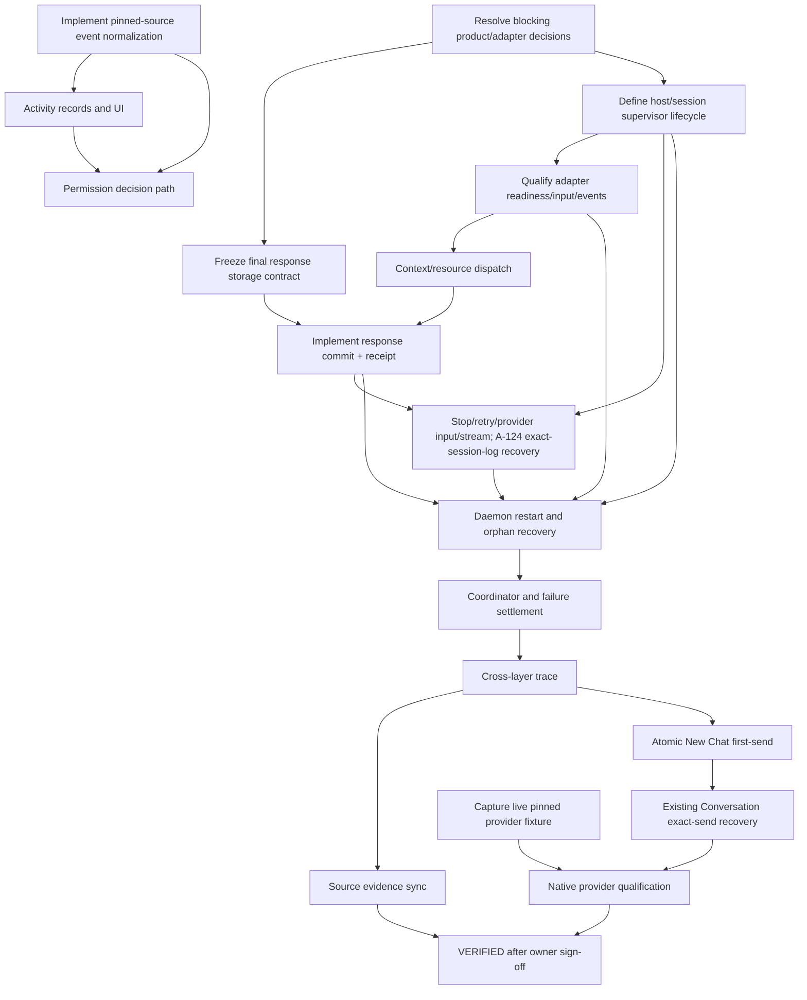

# Implementation Plan - Conversation Session Supervisor and Native Turn Execution

**Feature:** 001 | **Spec:** revision 1.1 ACCEPTED/LOCKED; revision 1.2 IN_REVIEW (T30 user-delegated direction)
**Status:** ACCEPTED/LOCKED - owner-accepted 2026-11-09; authorizes implementation; not a claim of implementation or qualification.
**Updated:** 2026-11-24 (A-124 same-incarnation StopUnconfirmed recovery sequence added to T03/T04; implementation evidence is recorded in CURRENT-RUN)
**Rule:** Implementation evidence is recorded separately from qualification. The authoritative work list is [TASKS.md](TASKS.md) (T01 to T32; T29-T32 include user-delegated implementation directions, not external owner ratification); A-124 is a T03/T04 implementation slice, not a new task or public contract. The phase table below is the summary view.

## 1. Delivery strategy

Deliver one qualified native chat vertical slice for one pinned OS/build, one selected harness/version, one adapter version and one auth route. Do not enable general multi-agent support or all platforms by inference. The active main branch contains source. Before implementation, inspect the current working tree and ignored worktrees, preserve user changes, and select the intended clean task worktree. Do not reset or mutate unrelated branches.

The durable transaction path is built before UI enablement. Adapter launch is outside SQLite. Readiness activation and final response settlement are separate atomic storage operations. Native events are normalized and never become canonical Conversation state directly.

## 2. Dependency graph

## 3. Phases and exit gates

| Phase | Tasks | Outcome | Exit gate |
|---|---|---|---|
| A - contract lock and promotion | T01 | B-01 to B-10 owner-accepted 2026-11-09 (done); accepted interfaces promoted into owner docs and docs/schemas | Promotion reviewed; validator/link/schema pass |
| B - durable completion boundary | T02, T06 design | Typed result commit, message+turn transaction and event/receipt semantics frozen | Storage review; transaction/rollback/idempotency tests specified |
| C - lifecycle supervisor | T03 | Bounded supervisor/host/session lifecycle, STARTING -> activation -> quiescence/close/recovery | State transition and crash-window matrix passes |
| D - one adapter | T04 | Version-pinned adapter handshake, exact prompt receipt identity, bounded event stream and same-incarnation durable-log recovery after StopUnconfirmed | Provider conformance fixtures, exact readiness proof, reducer/fake-transport regressions; live qualification remains T09/T23 |
| E - context dispatch | T05 | Same-Workspace bounded transcript, supported resource preparation and explicit oversize behavior | Context/resource boundary and prompt delivery tests |
| F - durable result | T06 | Atomic AGENT message + terminal turn + event/snapshot/receipt | Failure injection at every transaction boundary passes |
| G - user lifecycle and recovery | T07, T08, T10-T18, T20, T29-T30 | Stop/Retry, durable dispatch intent, single-flight, UserRequest, stream/reconnect, attachments, usage, composer, atomic first New Chat send, existing-Conversation exact-send recovery and admitted-failure settlement | UI/daemon/DB integration, race and restart tests |
| H - event evidence and presentation | T23-T27 | Source-contract normalizer, live provider fixture, REPORTED activity, scroll behavior and native permission display/reply when supported | Exact event contract; T23 real provider capture; denial and recovery evidence. Source-derived synthetic fixtures can test CODE but cannot close T23 or qualification. |
| I - cross-layer evidence and qualification | T21, T22, T09, T28 | Complete operation traces, source status sync, then Windows x64 + OpenCode v2.0.32 first and a separate native Linux row; T09 consumes T29's atomic New Chat admission and T30's exact existing-Conversation recovery; VERIFIED only after owner sign-off | Full CODE/SYSTEM/USER/recovery report; qualification is per exact tuple |

## 4. Scope and file ownership (candidate paths, re-inspect before implementation)

| Area | Candidate paths | Owner | Guardrail |
|---|---|---|---|
| Operator/request admission | `apps/litecoworkd/src/conversation_operator.rs` and focused tests | Operator/Conversation | Auth, receipt, If-Match and fail-closed behavior |
| Session/host lifecycle | focused `apps/litecoworkd/src/agents/` modules | Agent Runtime | No direct turn aggregate writes from Supervisor |
| Storage API | `crates/storage-core/src/conversation.rs`, `crates/storage-core/src/lib.rs` | Storage | Exact request/result contract; handle redaction |
| SQLite operations | `crates/storage-sqlite/src/conversations.rs`, `crates/storage-sqlite/src/lib.rs` | Storage | Immediate transaction; immutable event prefix; atomic event/snapshot/receipt |
| Native adapter | one selected `apps/litecoworkd/src/agents/<adapter>.rs`; T27 also uses `apps/litecoworkd/src/agents/adapter.rs` for bounded in-turn permission-command servicing | Agent Runtime | Transport only; version pin; bounded untrusted frames; active adapter retains exclusive ownership of its provider server |
| Desktop UI | `apps/litecowork-ui/src/conversations/` | UI | Keep disabled until end-to-end qualification |
| Tauri bridge | `apps/litecowork-ui/src-tauri/src/conversation_stream_bridge.rs` | Desktop bridge | Existing projection cursor/backpressure |
| Contracts/docs | API, EVENTS, STORAGE, SERVICES, STATE-MACHINES, SCHEMAS, AGENT-CONTROL, NATIVE-COMPOSER | Domain owners | Promote global contracts atomically |
| Tests | adjacent unit/integration/contract plus one feature e2e target | Each owner | Fail closed, crash/race/replay coverage |

Do not edit a candidate path just because it is listed. Only files needed for the accepted task are in scope. No unrelated formatting sweep.

## 5. Persistence, migration, rollout

- Current storage is sqlite-v1 through sqlite-v32. Reinspect the active chain, migration checksums and validators before any new migration.
- Reuse existing Conversation and AgentSession identities, event streams, snapshots and idempotency patterns.
- The activation transaction, v29 dispatch intent/single-flight/response identity/usage records, and v30 activity records are present in source. Verify their owner contracts and current integration before changing or extending them.
- The final result commit may require new local schema fields/indexes or no migration if existing tables can satisfy the semantics. Decide only after exact storage model review.
- Any migration is forward-only, numbered, immutable after release, checksummed and covered by upgrade/rollback-to-old-binary compatibility tests.
- Do not enable UI Send until operator, supervisor, adapter, final result writer, stream/reload and failure recovery all qualify. A feature flag must not bypass missing server-side capability.
- Rollout starts with one explicitly pinned target environment; no broad capability claim until each OS/harness/auth tuple is qualified.

## 6. Operational risks

| Risk | Mitigation / gate |
|---|---|
| Host READY confused with session readiness | Exact adapter SESSION_READY handshake; activation transaction rechecks all pins |
| Turn pinned selector drift | Immutable turn-created event is sole authority |
| Duplicate prompt on timeout | Distinguish pre-dispatch from timeout-after-dispatch; reconcile by stable native request/session identity |
| Duplicate final message | Idempotent atomic result transaction keyed to turn/session/retry/response identity |
| Stale or hostile provider frames | Bound, normalize, correlate, order, redact and treat as untrusted |
| Daemon crash between reservation and activation | STARTING recovery sweep and LOST settlement; no turn falsely RUNNING |
| Daemon crash after activation | Settle the prior-incarnation turn FAILED and AgentSession LOST with `RUNTIME_RESTARTED`; never restore its handle or replay the prompt. Reconcile owned host processes by verified process identity/provider observation before replacement work; PID-only references are insufficient (A-104) |
| Stop/final race | Observe adapter quiescence; persist whichever terminal observation wins |
| StopUnconfirmed after volatile-feed loss | Reconcile only through the same owned pinned OpenCode process and exact session/message IDs; validate durable log lineage and sync watermark under bounded time/bytes/count; otherwise retain CANCEL_REQUESTED and handle, never resend |
| Resource oversize or unsupported attachment | Explicit typed rejection; no silent omission |
| UI transient gap | Drop transient content and resync durable projection |
| Native direct Effect misrepresented | Clearly label assurance boundary; don't claim Core mediation |

## 7. Validation command matrix

| Gate | Exact command/target | Expected result |
|---|---|---|
| Storage readiness foundation | `cargo test -p storage-sqlite --locked conversation_activation_commits_session_turn_and_local_host_binding_atomically -- --nocapture` | Focused CODE evidence only; check exact current results in `CURRENT-RUN.md`, not historical results |
| Storage package regression | `cargo test -p storage-sqlite --locked` | Entire suite passes after final changes, with documented platform-only ignored tests |
| Daemon supervisor unit/contract | `cargo test -p litecoworkd --locked conversation_session_supervisor` | Bounded lifecycle/error/race tests pass |
| Feature end-to-end (PROPOSED target) | `cargo test -p litecoworkd --test conversation_session_supervisor --locked -- --nocapture` | Actual daemon+SQLite+adapter fake/fixture e2e passes; test target must be created |
| Documentation contracts | `python3 .specify/scripts/validate_feature_package.py` | Package structure, links, traceability and wiring pass |
| Docs/schema validation | owning repository validator commands from `docs/TESTING.md` | OpenAPI/event/SQL/schema and coverage consistent |
| Target OS qualification | pinned GUI/daemon/native agent test harness | Send, stop, retry, reconnect and recovery pass with owner USER evidence |

## 8. Stop and rollback criteria

Stop immediately on unresolved binding, missing handshake proof, unexpected provider fallback, secret/handle leakage, ambiguous dispatch, unbounded buffer, missing result receipt, or failure to reconcile stop/restart. Keep Send fail-closed. Do not restore a prior session handle to a new Runtime incarnation. For schema work, use forward repair/reconciliation; never delete the user's committed USER message to hide a failed agent attempt.

## 9. Handoff

SPEC status is ACCEPTED/LOCKED (2026-11-09): B-01 to B-10 are accepted, the first tuple is fixed as Windows x64 + OpenCode v2.0.32, and the B-04, B-07 and B-09 caveats are binding conditions on T02/T06, T05 and T03. The implementation task must name the accepted spec revision and SHA, exact clean worktree, first task ID and exact acceptance command. No commit/push is included in this plan.

