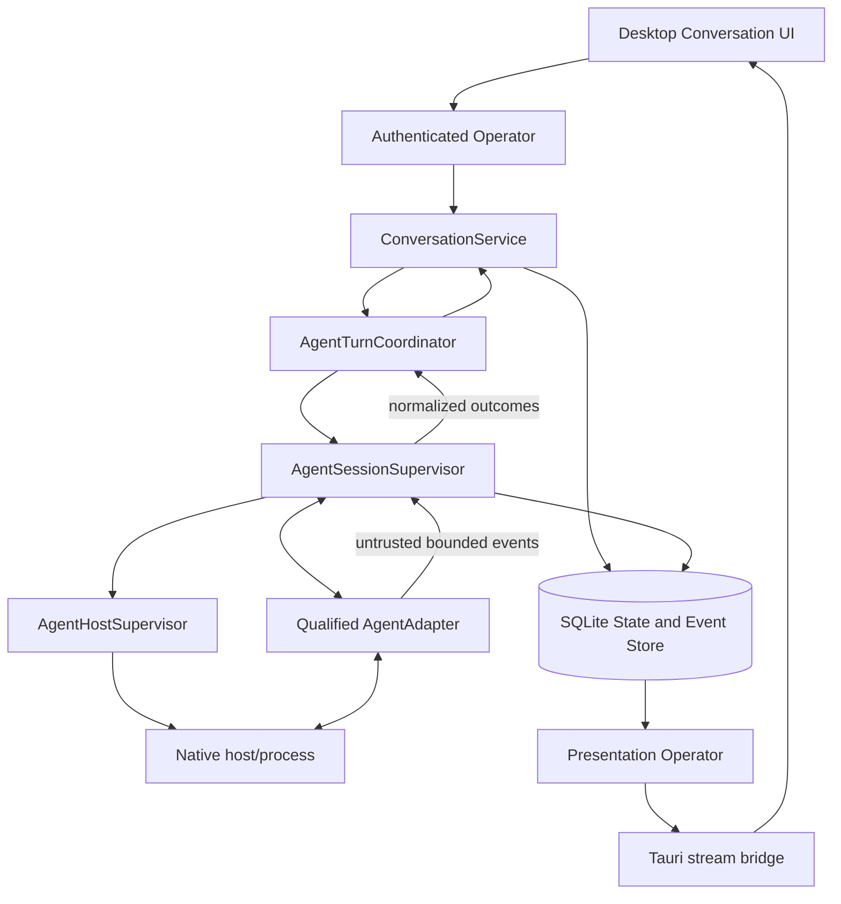

# Feature Specification - Conversation Session Supervisor and Native Turn Execution

- **Feature ID:** 001 | **Status:** ACCEPTED/LOCKED | **Revision:** 1.1
- **Owner acceptance:** accepted 2026-11-09 by the repository owner (sarv-projects) via [docs/OWNER-ACCEPTANCE-REVIEW-PACKET.md](../../docs/OWNER-ACCEPTANCE-REVIEW-PACKET.md) (PR #1), including every "ACCEPT (scoped)" caveat as a binding condition. Acceptance approves the design and authorizes implementation; it is not evidence that anything is implemented, SERVED, INTEGRATED or QUALIFIED.
- **Revision note:** revision 1.1 adds V1 gap coverage per owner acceptance 2026-11-09 (AC-020 to AC-026: composer attachments, usage records, durable dispatch outbox, storage single-flight, composer fencing and Stop/Retry UI, final-response identity).
- **Change control:** this is a locked contract. Any change to it from now on requires a new revision and renewed owner approval (SPECIFICATION-STANDARD section 7).
- **Target:** LiteCowork V1 native Conversation
- **Owners:** Conversation, Agent Runtime, Storage, Operator/API, Desktop UI, Security/Trust, Product
- **Dependencies:** Conversation/turn contract; AgentSession reservation and activation; AgentHostSupervisor; qualified native adapter; durable result settlement.

## 1. Problem and user outcome

LiteCowork is local-first, chat-first and BYOA. A normal Conversation must invoke the user's chosen native harness without creating a Task, Attempt or Coworker. LiteCowork owns canonical message/turn state, admission, correlation, display, cancellation, final persistence and recovery; the harness continues to own its reasoning, authentication, private transcript and native tools.

The active daemon contains an OpenCode-only Conversation dispatch path. `submit_conversation_turn` atomically commits the USER message, OPEN turn, events, receipt, and v29 dispatch intent, applies same-Conversation single-flight admission, then hands the admitted turn to `AgentTurnCoordinator`, which starts the supervisor asynchronously. The supervisor claims the intent, reserves STARTING, persists a per-session AgentHostInstance as STARTING, starts OpenCode Server v2.0.32 outside SQLite, records READY only after native startup/health, creates a native session, atomically activates the session and turn, loads bounded context, sends it, consumes normalized observations, and commits the final response. For COMPLETED/CANCELLED/FAILED outcomes, the Conversation/AgentSession settlement occurs before per-turn process shutdown; the storage transaction returns a closed session's host row to READY, after which observed process exit moves it to STOPPED and unconfirmed exit to DEGRADED. Early-error drop attempts DEGRADED. If READY persistence reports failure, the helper re-reads the durable host row. For a durably READY row, including a lost-ack commit, it attempts READY→STOPPING before process cleanup. A committed STOPPING row advances to STOPPED only after an observed exit. If the first STOPPING write fails, confirmed exit triggers a bounded re-read/retry through legal states instead of a stale STARTING→FAILED compare-and-set; an observed retry after an earlier unconfirmed stop can reconcile DEGRADED→STOPPING→STOPPED. Ambiguous acknowledgements are accepted only after re-reading a terminal row. A still-STARTING row follows failed-start handling. If storage cannot confirm lifecycle transitions within the bounded reconciliation, the outcome remains unconfirmed and restart reconciliation is not established. Nine recording-store tests cover this code path; they are not SQLite fault-injection evidence. StopUnconfirmed remains a separate gap: the adapter shuts down/drops its process owner even though the turn remains CANCEL_REQUESTED, so host/session reference retention and later reconciliation are not implemented. A daemon-start recovery sweep settles prior-incarnation unsettled intents as FAILED and releases orphan STARTING sessions without replaying an uncertain prompt. Retry reopens FAILED to OPEN with a new ordinal and intent. Stop requests interrupt and wait for quiescence before cancellation settlement, but live OpenCode completion-versus-interrupt behavior remains unqualified. T20 classifies post-admission failures, attempts exact-attempt settlement, retries transient storage failures, and leaves failed settlements to startup reconciliation. The no-eligible-host branch also retries transient local settlement failures up to three times with 100 ms backoff before retaining the unclaimed durable intent for restart recovery. CODE tests include a profile-catalog read failure after successful host/binding resolution; it settles the admitted turn FAILED and intent SETTLED before any session reservation. A captured-writer test proves closed-class structured diagnostic bytes omit provider/secret text, while process panic-hook and external log collector behavior remain unverified. The former absent-host fabricated-READY insertion is removed; focused tests verify helper state mappings and fail-closed behavior with a non-Send-capable Codex fixture. This is CODE only, not a successful OpenCode first-send. The target reusable AgentHostSupervisor is not yet wired: the adapter still owns/stops the server per turn, process reuse and idle TTL are absent, and StopUnconfirmed does not retain the process/session reference through reconciliation. T20 now has binding-lookup and post-admission endpoint-unavailability recovery coverage; the latter verifies AGENT_UNAVAILABLE settlement with preserved USER input and no session or fabricated answer. Its no-eligible-host settlement path retries transient storage failures before returning the closed SETTLEMENT class for persistent failure. Exhaustive per-stage fault and recovery coverage remains open. The current send/stop/retry/restart route remains unqualified; keep release claims gated on the remaining lifecycle work and exact Windows/provider/UI qualification.

**Outcome:** the user selects a supported native agent, sends a message, sees truthful progress, receives a durable answer, can stop/retry safely, and can reload/reconnect after daemon failure. A turn never silently changes its pinned agent.

## 2. Goals

- G-01 Plain Conversation works without Task/Attempt/Coworker.
- G-02 Immutable turn-created authority pins the selected AgentBinding; no fallback to changed selector/default.
- G-03 Turn becomes RUNNING only after an exact native session readiness handshake and atomic activation.
- G-04 Dispatch uses bounded, same-Workspace committed context; ResourceRefs are reauthorized.
- G-05 Final AGENT response and terminal turn outcome are durable exactly once with session/binding provenance.
- G-06 Transient output is bounded and never confused with a saved answer.
- G-07 Stop, retry, provider input, host degradation, crash, timeout and restart have deterministic recovery.
- G-08 Native handles/secrets/private provider state never enter public projections, replicated events or ordinary logs.
- G-09 Send remains unavailable until one exact OS/build/harness/version/auth route passes CODE, SYSTEM and owner USER gates.

## 3. Non-goals

No Task/Attempt/Plan/Coworker; no universal model router; no automatic provider fallback; no transfer of provider-private transcript/session between harnesses; no general native command execution from Composer; no direct provider stream to WebView; no new Trust/Effect authority from provider output; no generated apps/rich media; no LiteSPM, connector, OAuth, Environment or sandbox redesign; no cloud Runtime, remote continuation or mobile; no arbitrary native module management.

## 4. Current implementation/evidence boundary (checked 2026-11-12)

| Capability | Current evidence | Limitation |
|---|---|---|
| Admission and dispatch intent | CODE/SERVED: USER+OPEN, events, receipt and v29 dispatch intent commit atomically; storage enforces single-flight; the supervisor claims the intent before STARTING | A 202 means durable admission, not provider acceptance or completion; replay does not authorize a second prompt |
| Send eligibility | PARTIAL dispatch-only UI gate: `isSendEligible` checks draft, Workspace, Operator readiness, composer occupancy and a binding choice; `buildConversationAgentChoices` filters to same-Workspace, enabled, lead-eligible bindings whose profile provider key is OPENCODE | It does not check a fresh descriptor/Runtime offer, authentication, session readiness, profile safety eligibility or route qualification. Send can enable for an unqualified tuple; this is an active release blocker, and no end-to-end route is QUALIFIED |
| Conversation projections and history | CODE/SERVED with desktop calls and bounded reconnect stream | Packaged desktop restart/reconnect journey remains unqualified |
| Stop and Retry | CODE/SERVED foundations: Stop targets projected turn/version; retry is versioned and idempotent and reopens FAILED to OPEN with a new ordinal/intent; native interrupt fixtures and quiescence path exist | No live provider race evidence. OpenCode cannot currently distinguish all completion-versus-interrupt outcomes; ambiguous completion must not be asserted CANCELLED/Stopped under AC-010 |
| Composer and attachments | CODE: all-turn occupancy fences; text ResourceRef picker/materialization and visible refusal; unsupported controls are disabled or removed | Binary files and WorkspaceRoot attachments are unavailable; new-Conversation attachment and Context Used receipt remain open |
| Turn context | CODE: bounded committed-prefix loading and deterministic windowing/omission notice | Exact OpenCode acceptance budget and persisted/displayed reduction receipt are unqualified |
| OpenCode dispatch | CODE path through AgentSessionSupervisor and OpenCode v2.0.32 Server; other provider profiles are not Conversation-send capable | Host process ownership remains per-turn; exact Windows packaging/auth/USER qualification is not established |
| Readiness and recovery | CODE: STARTING reservation, activation, v29 intent claim and daemon-start recovery; prior-incarnation unsettled work is failed with RUNTIME_RESTARTED, never silently resent. T03 persists each local OpenCode host as STARTING before spawn and READY only after observed native health. COMPLETED/CANCELLED/FAILED settlement precedes per-turn process shutdown; observed exit then records STOPPED, otherwise DEGRADED. T20 adds typed settlement of early setup/provider failures with bounded retry, profile-lookup fault coverage and startup recovery fallback; the captured structured-diagnostic writer is tested for detail redaction. | No shared AgentHostSupervisor or host reuse, StopUnconfirmed process/session retention, idle TTL, process panic-hook/external collector validation, binding-lookup and exhaustive per-stage settlement fault coverage, or real process-kill recovery exercise; packaged journey and first-send remain unqualified |
| Final AGENT settlement | CODE in supervisor and SQLite: atomic message/turn/session/events/snapshots/receipt, retry ordinal and provider response identity | Public API receipt/schema promotion and complete negative/fault-injection proof remain open; native identifiers must not enter public projections |
| Usage and activity | CODE: per-attempt usage rows, bounded turn.delta, REPORTED activity rows/frames and Activity UI. T13 is PARTIAL because `turn.delta` omits the AgentSession identity required by its task/API contract (A-94). | A live OpenCode run and packaged/rendered journey are not qualified; whether reported 0/0 token counts mean unknown needs confirmation |
| UserRequest continuation | NOT IMPLEMENTED; T12 BLOCKED | Pinned OpenCode Form APIs exist in source, but no live event capture or approved mapping to B-06 exists |
| Native permission | PARTIAL display only; T27 | Pinned OpenCode permission list/get/reply APIs exist, but no aligned live event payload, UI/bridge answer path, denial, service-close or restart/recovery proof. The provider has no elapsed-time timeout/default; see T27 and RESEARCH §8.1. |
| End-to-end native Send | CODE/SERVED path only; no QUALIFIED row | Exact OS/provider/version/auth/UI journey and denial/replay/timeout/cancel/restart/reconnect evidence remain release gates |

Do not duplicate test totals in this feature package. Exact commands/results belong in [docs/IMPLEMENTATION-STATUS.md](../../docs/IMPLEMENTATION-STATUS.md) and [CURRENT-RUN.md](../../CURRENT-RUN.md). The v29 storage tests now cover single-flight admission and the current retry transition; these code-level tests do not qualify the packaged native-provider lifecycle.

## 5. Decision register

### Inherited LOCKED invariants (canonical owners; not feature approval)

| ID | Invariant | Authority |
|---|---|---|
| L-01 | Plain Conversation is not a Task and creates no Task/Attempt/Coworker. | PRODUCT, DATA-MODEL |
| L-02 | Turn-created event pins AgentBinding; later selection/default changes affect future turns only. | STATE-MACHINES, AGENT-CONTROL |
| L-03 | One Conversation AgentSession is scoped to exactly one turn. Retry/continuation uses a fresh session. | STATE-MACHINES |
| L-04 | STARTING is reservation only. Adapter/process/network calls never occur inside SQLite. | STATE-MACHINES, STORAGE |
| L-05 | Session ACTIVE, turn RUNNING, snapshots/events and Runtime-local host binding commit atomically after readiness. | STORAGE, EVENTS |
| L-06 | Native session handle exists only in exact Runtime/RuntimeIncarnation host binding and is excluded from Serde, Debug (except presence boolean), events, snapshots, API responses and logs. | AGENT-CONTROL, STORAGE |
| L-07 | AgentSessionSupervisor owns session/adapter lifecycle; AgentHostSupervisor owns host/process lifecycle; AgentTurnCoordinator owns turn orchestration; ConversationService owns Conversation/message/turn mutations. | SERVICES |
| L-08 | Native events are untrusted observations, not authorization, verified Effects or durable completion. | ARCHITECTURE, TRUST, AGENT-FABRIC |
| L-09 | ResourceRefs do not grant access; authorize exact same-Workspace revision at dispatch. | STORAGE, TRUST |
| L-10 | Persisted semantic messages and terminal outcomes are authoritative; deltas/rich drafts are transient. | API, EVENTS, PRESENTATION-RUNTIME |
| L-11 | Cancellation settles only after stop/quiescence is observed; completion/failure that wins the race remains authoritative. | STATE-MACHINES |
| L-12 | Retry is explicit, version/idempotency protected, increments retry_ordinal, uses a fresh session and retains prior provenance. | STATE-MACHINES |
| L-13 | No automatic fallback. Unsupported or expired target fails visibly and preserves user content. | PRODUCT, AGENT-CONTROL |
| L-14 | Final AGENT message and terminal turn state must commit atomically with events/snapshots/receipt. | STATE-MACHINES, STORAGE; SQLite implementation exists, qualification and contract completeness remain open |

### FLEXIBLE

| ID | Choice | Allowed options | Constraint |
|---|---|---|---|
| F-01 | Coordinator internal shape | Keyed actor or bounded per-Conversation serial lane | One active dispatch per chosen policy; finite queue |
| F-02 | Host reuse | Per-session host or eligible shared host | Host ownership/concurrency and exact local binding rules |
| F-03 | Event transport | Bounded SSE, App Server events or polling | Correlation, ordering, bounds and backpressure |
| F-04 | First UI progress | Durable projections only, then bounded transient frames | Saved transcript remains source of truth |
| F-05 | Internal module names | Existing crate boundaries or focused module | No duplicated provider framework |

### ACCEPTED DECISIONS AND ARCHITECTURAL CONTRACTS (owner-accepted 2026-11-09)

| ID | Topic | Resolution & Architectural Contract | Canonical Authority & Consequence |
|---|---|---|---|
| B-01 | Concurrent send policy per Conversation | **ACCEPTED (2026-11-09).** **Strict Serialized Turn Lane.** A Conversation enforces a single-flight active turn (`OPEN` -> `RUNNING` -> `SETTLED`). Concurrent submit requests are rejected with `CONVERSATION_TURN_IN_PROGRESS` (HTTP 409 Conflict). The client UI disables the composer Send button and shows an in-flight status indicator while a turn is active. Local typing buffer is preserved in desktop UI state. | [STATE-MACHINES.md](../../docs/STATE-MACHINES.md), [API.md](../../docs/API.md). Eliminates race conditions in HLC ordering, message correlation, and context packaging. |
| B-02 | First GA OS/build, harness, adapter version and auth mode | **ACCEPTED (2026-11-09) with owner rider:** the first GA OS is Windows 11/10 `x86_64-pc-windows-msvc` and the FIRST route to qualify is **OpenCode v2.0.32**, the only harness `AgentSessionSupervisor` dispatches today. Claude Code CLI is the second module (B-11/B-16, Feature 004); Codex is a later module. The generic Adapter 1.0 framed transport below is the target contract the OpenCode adapter must be wrapped behind; the OpenCode server/session path qualifies first. Linux x86_64 desktop (0600/0700 socket) is the second release-matrix row (B-28). Original declared text: **Windows 11 / Windows 10 (`x86_64-pc-windows-msvc`) + Claude Code CLI & OpenCode / Codex CLI.** Adapter Version: `1.0.0` subprocess framed transport. Auth Mode: **Harness-Managed Native Pass-Through**. The CLI harness authenticates directly with the model provider via its native credentials (e.g. `claude login` or provider API keys in user environment/keyring). LiteCowork passes no raw bearer keys and stores no user provider credentials, preserving BYOA zero-knowledge security. | [AGENT-CONTROL.md](../../docs/AGENT-CONTROL.md), [LOCAL-OPERATOR-IPC.md](../../docs/LOCAL-OPERATOR-IPC.md). Windows MSVC toolchain is fully native with VS 2022 Build Tools. |
| B-03 | Exact readiness handshake that proves session identity | **ACCEPTED (2026-11-09).** **Three-Phase Session Handshake Protocol**: 1. `AdapterVersionProbe`: Host probes adapter executable via `--version`/ping, receiving `AdapterVersionInfo { adapter_version: "1.0.0", harness_version, capabilities: [STREAMING, INTERRUPT] }`. 2. `CreateSessionRequest`: Supervisor sends `{ workspace_id, conversation_id, turn_id, options }` and adapter establishes native session, returning `SessionReadyResponse { native_session_id, protocol_version }`. 3. `Atomic Activation`: Supervisor executes SQLite CAS `activate_conversation_agent_session` binding the native handle to local SQLite only and advancing turn `OPEN` -> `RUNNING`. Prompt dispatch occurs only after activation commits. | [AGENT-CONTROL.md](../../docs/AGENT-CONTROL.md), [STORAGE.md](../../docs/STORAGE.md). Distinguishes host process presence from active turn readiness. |
| B-04 | Exact atomic storage operation for final response commit | **ACCEPTED (2026-11-09) with binding caveat:** an explicit retry ordinal and a stable provider-response identity must be added to the commit request, receipt and replay check before final-commit is complete (TASKS T02/T06, AC-026). **`commit_conversation_agent_response`** SQLite Immediate Transaction. Atomically executes: 1. Verifies `expected_turn_version` and `expected_session_version`. 2. Inserts final `conversation_messages` row (`message_kind = 'AGENT'`, content, tokens, source refs). 3. Updates `conversation_turns` to `SETTLED` (`outcome = COMPLETED | FAILED | CANCELLED`, `settled_at = datetime('now')`). 4. Updates `agent_sessions` to `CLOSED`. 5. Appends `conversation.message.added.v1` and `conversation.turn.settled.v1` to `event_journal`. 6. Commits idempotency receipt to `request_dedup`. Failure leaves state unchanged with zero partial writes. | [STORAGE.md](../../docs/STORAGE.md), [EVENTS.md](../../docs/EVENTS.md), [STATE-MACHINES.md](../../docs/STATE-MACHINES.md). Prevents partial final-response commits and phantom messages; it does not replace durable dispatch admission or daemon-restart recovery. |
| B-05 | Resumable streaming sequence vs stream gaps | **ACCEPTED (2026-11-09).** **Best-Effort Transient Streaming with Authoritative REST Resync.** `TURN_DELTA` frames are transient, sequence-tagged, and emitted over the Operator stream bridge. If a stream disconnection or sequence gap occurs, the UI discards transient token buffers and issues an authenticated REST query `GET /v1/conversations/{id}/messages` to restore the committed semantic transcript. Transient frames are never replayed from historical storage. | [PRESENTATION-RUNTIME.md](../../docs/PRESENTATION-RUNTIME.md), [API.md](../../docs/API.md), Architecture Invariant 17. |
| B-06 | Conversation-scoped UserRequest continuation | **ACCEPTED (2026-11-09).** **State-Machine Driven Continuation.** Commits immutable `UserRequestResponse` and transitions exact `WAITING_USER` turn to `WAITING_DEPENDENCY`. Reconciles provider input acceptance against the Runtime-local input key; only then allocates a fresh `AgentSession` reserved `STARTING` and returns to `RUNNING` on readiness. Rejection or ambiguous acceptance follows canonical state machines. Never creates Task or Attempt authority. | [STATE-MACHINES.md](../../docs/STATE-MACHINES.md), [API.md](../../docs/API.md), [STORAGE.md](../../docs/STORAGE.md), [TRUST.md](../../docs/TRUST.md). |
| B-07 | Context package reduction for tight harness budgets | **ACCEPTED (2026-11-09) with binding caveat:** confirm the first adapter's real context budget (OpenCode v2.0.32; the adapter currently caps one request at `MAX_REQUEST_BYTES` = 512 KiB in `apps/litecoworkd/src/agents/opencode_server.rs`) during the context-dispatch task (TASKS T05) before the 80% window is treated as qualified. **Bounded Deterministic Sliding Window with Pinned Preamble**: 1. Pinned Workspace instructions / system prompt (always retained). 2. Selected `ResourceRefs` / `ContextAttachments` with cryptographic digests. 3. Most recent contiguous messages backwards from latest user turn until 80% of provider context budget is reached. 4. Explicit truncation receipt header appended to prompt: `[Notice: Messages 1..N omitted due to model context window budget]`. Never silently drops content without audit provenance. | [CONTEXT.md](../../docs/CONTEXT.md), [SCHEMAS.md](../../docs/SCHEMAS.md). Transparent and reviewable context limits. |
| B-08 | Attachment/resource materialization | **ACCEPTED (2026-11-09).** Implemented jointly with Feature 003 (ResourceRef authority, Context Used) per TASKS T14. **Dual-Mode Materialization**: 1. Text / Markdown / Code: materialized inline into the prompt envelope with delimited `ResourceRef` headers and checksums. 2. Binary / Workspace local files: materialized as verified, read-only canonical paths within the admitted WorkspaceRoot and passed via native adapter `--file <path>` CLI arguments. Arbitrary external paths are rejected. | [STORAGE.md](../../docs/STORAGE.md), [TRUST.md](../../docs/TRUST.md). Prevents path traversal and enforces Workspace boundaries. |
| B-09 | Process ownership, lifecycle and idle shutdown | **ACCEPTED (2026-11-09) with binding caveat:** the Job Object (Windows) or cgroup (Linux) is process-lifetime control only and is never an isolation or sandbox claim (isolation belongs to B-17/B-35 Environment providers). **Supervised Subprocess with Job Object / Cgroup and 10-Minute Idle TTL.** `AgentHostSupervisor` launches adapter under an OS Job Object (Windows) or cgroup (Linux). Sessions register live use references. When all active turns finish and reference count reaches 0, an idle timer starts. After 10 minutes of inactivity, supervisor sends graceful termination signal, waits 5 seconds for clean exit, and forcibly kills lingering processes. Shared external processes are never killed. | [RUNTIME-LIFECYCLE.md](../../docs/RUNTIME-LIFECYCLE.md), [LOCAL-OPERATOR-IPC.md](../../docs/LOCAL-OPERATOR-IPC.md). Clean process isolation and zero zombie processes. |
| B-10 | Usage and cost attribution | **ACCEPTED (2026-11-09).** This package owns the usage record write path (TASKS T15, AC-021); Feature 018 owns the UsageSummary/QuotaSnapshot dashboard. **Tiered Telemetry Attribution**: 1. If provider/harness reports token counts in final response, record in `usage_records` with `attribution_source = PROVIDER_REPORTED`. 2. If provider omits token usage, calculate byte-based heuristic (`tokens = max(1, utf8_byte_count / 4)`) and record with `attribution_source = ESTIMATED_LOCAL`. Turn settlement and response display are never blocked on missing provider billing telemetry. | [OBSERVABILITY.md](../../docs/OBSERVABILITY.md), [SCHEMAS.md](../../docs/SCHEMAS.md). Truthful, non-fabricated usage accounting. |

B-01 through B-10 are owner-accepted (2026-11-09) and this package is ACCEPTED/LOCKED, with the B-02 rider and the B-04, B-07 and B-09 caveats above as binding conditions. Acceptance does not change any current-state fact: implementation, source conformance and qualification status are unchanged and are tracked in section 4, in [TASKS.md](TASKS.md) and in [docs/IMPLEMENTATION-STATUS.md](../../docs/IMPLEMENTATION-STATUS.md).

## 6. High-level design



### Target request sequence (not the current source wiring)

1. UI creates a stable send idempotency key and sends authenticated Workspace/Conversation request.
2. Operator authenticates, applies expected version/idempotency and owner scope. ConversationService commits USER message + OPEN turn + receipt atomically.
3. Turn target comes from unique immutable turn-created event, not the latest selector or Workspace default.
4. AgentTurnCoordinator obtains the bounded ConversationContextPackage and exact pinned host resolution.
5. AgentSessionSupervisor persists STARTING; AgentHostSupervisor ensures/retains exact eligible host. Native process/adapter startup happens outside SQLite.
6. Supervisor validates the exact adapter SESSION_READY handshake and rechecks host/endpoint/Runtime incarnation/Workspace enrollment/session+turn versions.
7. Storage atomically activates AgentSession, changes turn OPEN->RUNNING, writes snapshots/events and stores opaque handle only in Runtime-local host binding.
8. Only after activation does adapter receive the bounded context and current USER message. Every ResourceRef is reauthorized/materialized.
9. Provider output is treated as untrusted; bounded normalized observations correlate to Workspace/Conversation/turn/retry/session and sequence.
10. The OpenCode supervisor calls the implemented SQLite final-response transaction to commit the AGENT message and terminal turn/session outcome atomically; its current contract and failure/replay coverage remain incomplete and unqualified.
11. Supervisor waits for quiescence, closes session and releases host reference. Durable projection supports reload/reconnect.

**Current source divergence:** the Operator commits USER+OPEN+intent directly through SQLite, then calls the thin `AgentTurnCoordinator` entry, which starts `AgentSessionSupervisor` asynchronously. The coordinator does not yet own context acquisition, ordered outcomes, retry/continuation, or ConversationService settlement; the Operator still constructs storage commands directly and the supervisor calls SQLite for final settlement. Production OpenCode dispatch now calls `agents/host_supervisor.rs::start_host_process`: it persists a unique per-session AgentHostInstance as STARTING, starts the server outside SQLite, and commits READY only after the pinned startup and health checks succeed. If READY persistence reports failure, the helper re-reads durable state. A READY row, including a lost-ack commit, attempts READY→STOPPING before cleanup; observed exit reaches STOPPED only through the accepted lifecycle edges. If the first STOPPING write fails, confirmed exit triggers bounded re-read/CAS reconciliation rather than a stale STARTING→FAILED write. An observed retry after earlier unconfirmed cleanup also reconciles DEGRADED→STOPPING→STOPPED. Ambiguous acknowledgements count only after a re-read proves terminal state. A still-STARTING row follows failed-start handling. Nine recording-store tests cover this mapping, not real SQLite commit ambiguity. This is CODE only and does not run an OpenCode send. A-101 records one further source divergence: the accepted AgentHostInstance machine requires STOPPING before STOPPED/FAILED, while the current guard stops first and persists STOPPED/DEGRADED afterward; the storage transition validator accepts extra direct-to-STOPPED edges. This is not a reason to edit the accepted state machine; the storage source is outside T03 allowed paths and needs an explicitly authorized paired task. The target shared AgentHostSupervisor remains unwired: the per-turn adapter still owns and stops `OpenCodeServer`, with no reusable host, retained host-use lease, idle TTL or process-restart reconciliation. These are architectural integration gaps, not merely naming differences.

### Ownership

| Owner | Responsibility | Excluded responsibility |
|---|---|---|
| UI | Draft, local selection, accessibility, transient display | Provider process, secrets or durable authority |
| Operator | Auth, Workspace scoping, API validation and projection access | Native process lifecycle |
| ConversationService | Conversation/message/turn writes and receipts | Parsing raw provider events |
| AgentTurnCoordinator | Turn orchestration, ordered outcomes, retry/continuation | Direct aggregate writes |
| AgentSessionSupervisor | Session lifecycle, adapter invocation, readiness, normalization, quiescence | Host process ownership or turn aggregate writes |
| AgentHostSupervisor | Host instance, process, health, references, stop | Turn or Conversation outcome |
| AgentAdapter | Protocol-specific startup/input/events/interrupt | Core authorization or durable state |
| Storage | Transactions, invariants, receipts, snapshots/events, local binding | External process/network calls |
| Presentation Operator | Authorized snapshots/upserts and bounded frames | Converting provider text directly to durable state |

## 7. Low-level design and interfaces

### 7.1 Existing storage signatures

Observed in the active main-worktree source; the OpenCode supervisor invokes the activation path. Existence and invocation are CODE evidence, not SYSTEM/USER qualification.

```rust
pub trait AgentSessionStore: Send + Sync {
    fn start_conversation_agent_session(
        &self, start: ConversationAgentSessionStart,
    ) -> Result<CommittedAgentSession, StoreError>;

    fn mark_starting_conversation_agent_session_lost(
        &self, transition: MarkStartingConversationAgentSessionLost,
    ) -> Result<CommittedAgentSession, StoreError>;

    fn list_starting_conversation_agent_sessions(
        &self, workspace_id: &str, after_agent_session_id: Option<&str>,
        limit: usize,
    ) -> Result<Vec<AgentSessionRecord>, StoreError>;

    fn activate_conversation_agent_session(
        &self, activation: ActivateConversationAgentSession,
    ) -> Result<CommittedConversationActivation, StoreError>;
}
```

Activation request fields: principal_id, workspace_id, agent_session_id, expected_session_version, expected_turn_version, occurred_at, host_instance_id, native_session_ref, session_event and turn_event. The handle is skipped by Serde and Debug prints only a boolean presence marker. The committed result contains session, session event, turn and turn event only.

Existing `ConversationTurnStore` operations:
- `replay_conversation_turn(principal_id, request_id, request_payload)`
- `create_conversation_turn(commit)`
- `load_conversation_context_for_turn(principal_id, workspace_id, conversation_id, turn_id)`
- `resolve_conversation_session_host_for_turn(principal_id, workspace_id, conversation_id, turn_id)`
- `transition_conversation_turn(principal_id, workspace_id, conversation_id, turn_id, expected_version, command, event)`

Generic OPEN->RUNNING through `transition_conversation_turn` remains forbidden; only readiness activation may do it.

### 7.2 Service contracts

**ConversationService** owns Conversation/message/turn aggregates. Target operations include:
- `submit_turn(principal, workspace, conversation, expected_version, idempotency_key, request) -> ConversationTurnReceipt`
- `cancel_turn(turn_id, expected_version, request_id) -> CancelReceipt`
- `retry_turn(turn_id, expected_version, request_id) -> ConversationTurnReceipt`
- `commit_conversation_agent_response(commit) -> CommittedConversationAgentResponse` - implemented in `ConversationTurnStore` and called by the OpenCode supervisor; the Operator does not yet expose a separate ConversationService/AgentTurnCoordinator owner boundary.

**AgentTurnCoordinator** consumes committed dispatch, resolves exact turn binding/context, requests supervisor startup/dispatch, consumes normalized results, asks ConversationService for durable settlement and continues a WAITING_DEPENDENCY turn only after provider acceptance. It never writes Conversation/Turn directly.

**AgentSessionSupervisor** validates scope and exact host, reserves STARTING, calls host/adapter outside SQLite, verifies readiness, activates atomically, normalizes events, requests stop, awaits quiescence, closes session and releases local host binding.

**AgentHostSupervisor** ensures/attaches only the exact endpoint and Runtime incarnation, supervises process/health/concurrency and stops only LiteCowork-owned processes with no live references.

For the T03/T04 implementation boundary, AgentHostSupervisor owns the reusable native
process and its private stop handle. It commits an AgentHostInstance as STARTING before
native startup, performs startup and readiness checks outside SQLite, and may publish
READY only after the pinned adapter's native readiness handshake is observed. It issues
a private host-use lease to AgentSessionSupervisor; that lease spans the native session
and its durable close/lost settlement. Per-turn adapters borrow the host transport and
own only turn-scoped correlation, cancellation and observers. The internal adapter's
per-turn `shutdown` releases turn-scoped resources only; it must not stop the shared host.
AgentHostSupervisor alone performs process shutdown. On StopUnconfirmed, the
AgentSessionHostBinding remains a live reference and prevents idle cleanup until
reconciliation proves CLOSED or LOST. AgentHostSupervisor alone applies the 10-minute
idle TTL and the 5-second graceful-stop window followed by termination of the exact
LiteCowork-owned process scope; if quiescence cannot be observed, it retains the private
cleanup handle and reports no STOPPED success. Host lookup and reuse are always scoped to
the exact Runtime incarnation. This internal split does not grant authorization, change
provider ownership or alter public ACP/OpenCode wire protocols.

For OpenCode v2.0.32, host process working directory and native session location are separate inputs. The adapter must pass the revalidated Workspace working directory as the `location.directory` in each `POST /api/session` body; it must not infer a later session's location from the shared process cwd. The shared server must use a Runtime-owned neutral startup directory, never a Workspace root. This preserves the Runtime/endpoint host identity while pinning each provider session to the Workspace selected for its admitted turn. If the pinned route fails to honor the body location, the adapter must fail closed and the host cannot be reused across Workspace roots. This is a provider-specific contract verified at the pinned source level only; same-host, different-root runtime behavior remains an acceptance test and qualification gate.

### 7.3 Implemented final-result transaction and remaining proof

The active source defines `CommitConversationAgentResponse` and `CommittedConversationAgentResponse` in `crates/storage-core/src/conversation.rs`. `ConversationTurnStore::commit_conversation_agent_response` is implemented in `crates/storage-sqlite/src/conversations.rs` and is called by the OpenCode branch in `apps/litecoworkd/src/agents/supervisor.rs`.

The SQLite IMMEDIATE transaction currently:
- checks the owner/workspace boundary and active Workspace state;
- verifies the Conversation exists and compares the current turn version/status/session ID;
- verifies the AgentSession version, ACTIVE state and exact Conversation/turn scope;
- inserts the AGENT message, settles the turn, closes the session, returns the host instance to READY and deletes the ephemeral host binding;
- writes aggregate snapshots, domain events and an idempotency receipt before commit; and
- resolves an exact request replay through the stored receipt/digest.

The SQLite request now includes `retry_ordinal` and `provider_response_id`; the transaction checks the ordinal and response identity with a content digest, and compares the caller's AGENT author JSON to the exact turn-pinned binding before writing. It derives message role and binding/session/turn pointers from the validated session. The public receipt/schema promotion and complete qualification matrix remain open. Existing adjacent tests cover key stale/version/scope/replay cases, but the current test inventory must still be checked for complete wrong-Workspace/session, crash/rollback and concurrent final-response coverage before claiming the full target.

Keep this as CODE, not QUALIFIED. Retain the owner requirement: one atomic transaction must protect message + terminal turn + session close + events + snapshots + receipt. If commit outcome is uncertain, query the stable storage receipt/authoritative state before retrying the local commit. Never resend the provider prompt to repair a DB write.

### 7.4 Native adapter boundary

A qualified host/adapter pair needs a negotiated/versioned contract for process start, exact host-readiness handshake, native session creation, prompt/context input, bounded event observation, interrupt and observed session/host quiescence. The per-turn AgentAdapter's internal `shutdown` releases turn-scoped state; AgentHostSupervisor owns native process shutdown and process-tree quiescence. No first harness contract is locked until B-02/B-03.

The active supervisor calls the OpenCode Server helper: it creates a session, activates the durable AgentSession/ConversationTurn, loads the bounded Conversation context, sends that context, consumes SSE observations and commits a final response. Only the `opencode` provider key has a dispatch branch, pinned to OpenCode Server protocol v2.0.32. Codex transport helpers exist but are not called by this supervisor; Claude Code, Codex, Gemini CLI and Cline are not Send-capable through this path. The current implementation directly starts/stops an OpenCode server inside the per-turn blocking dispatch flow; it does not yet demonstrate the separately owned AgentHostSupervisor/AgentTurnCoordinator topology in the target diagram. Provider events remain untrusted observations, not authorization or Effect proof. Exact Windows packaging, credentials, stop/quiescence and end-to-end USER behavior are unqualified.

### 7.5 Context projection

Use the existing ConversationContextPackage builder:
- binding resolved from the unique immutable turn-created event;
- same-owner/same-Workspace committed USER, CHANNEL and prior AGENT messages through the submitted USER message;
- Conversation event revision orders the prefix, not timestamps or opaque IDs;
- earlier AGENT messages retain original binding provenance;
- excludes product notices, drafts, native handles, credentials/cookies and private harness history;
- max 1,024 messages / 4 MiB before materialization;
- ResourceRefs only; every reference reauthorized at dispatch.

SCHEMAS.md caps ConversationContextPackage at 1,024 messages and 4 MiB. API.md caps a UserRequest detail prompt at 256 KiB. That 256 KiB figure is not the adapter request budget. CONVERSATION_CONTEXT_LIMIT_EXCEEDED is named in SCHEMAS.md and is absent from the 131-code error registry, so it is not a promotable error until the schema and SCHEMAS.md change together. Silent truncation is forbidden. Any smaller harness budget is a pinned provider observation, not this package inventing 256 KiB as the product limit.

### 7.6 Presentation

Use the existing durable Conversation presentation snapshot/upsert cursor, Tauri bridge, bounded backpressure and resumable UI reducer. The current daemon code emits bounded `turn.delta` and `turn.settled` transient frames on the single-Conversation stream; these are CODE evidence, not packaged, live-provider or USER qualification. `rich.draft` remains a target frame and has no current producer. Any provider deltas are transient frames correlated to Workspace/Conversation/turn/retry and monotonic sequence, bounded/coalesced/redacted, never DomainEvents/messages/replicated content. A sequence gap requires replay or discard/resync. A committed AGENT message supersedes deltas.

## 8. Security, trust and privacy

- Authenticate every write and scope it to the owner and Workspace.
- Never reroute an admitted turn using selector/default reads.
- Installation, Runtime health or AgentHost READY is not adapter session readiness.
- Never call external process/network/provider inside a SQLite transaction.
- Provider output/events/tool names/arguments are untrusted; they cannot grant authority, approve requests, create Effects or prove completion.
- Native handle stays only in the exact Runtime-local AgentSessionHostBinding; never serialised, logged, emitted, snapshotted or displayed.
- Provider credentials/cookies remain with the native harness or authorized secret provider.
- Conversation text is untrusted input, not system/developer policy.
- ResourceRefs are not permissions: recheck Workspace, owner, exact revision, root/location, media and adapter support.
- Native direct action and Core-mediated Effect are different assurance classes.
- Diagnostics contain correlation and safe classifications only, never prompt text, hidden reasoning, secret or handle values.

## 9. Errors, edge cases and recovery

See [errors-recovery.md](contracts/errors-recovery.md). Global rules: external uncertainty is reconciled before retry; no ambiguous prompt is blindly replayed; no response becomes visible as completed before commit.

## 10. Configuration and compatibility

- No hidden global router or silent fallback.
- Qualification is pinned to OS/build/harness/version/adapter/auth mode and exact capability descriptor.
- Readiness, process shutdown, event frame, buffer, queue, concurrency and retry deadlines must be finite; exact initial values are blocking.
- Product context limit is 1,024 messages / 4 MiB. The 256 KiB figure is the UserRequest detail prompt cap in API.md, not the adapter budget. Change limits only through owner contracts and tests.
- Model, reasoning effort and native command catalog remain harness-owned; Core keeps only approved non-secret selections/digests.
- UI/API eligibility stays false until complete route qualification.
- Existing activation feature does not automatically require a schema migration; final-result persistence may. Add a forward-only migration only when approved.

## 11. Observability

Record safe correlation IDs for request, Workspace, Conversation, turn, retry, session and host; stage duration; readiness result; normalized terminal classification; queue pressure; event gaps; resync; restart recovery. Exclude provider text, handles, auth and secret bytes. Usage distinguishes measured, native-reported, estimate and UNKNOWN; do not infer billing.

## 12. EARS acceptance criteria

- AC-001 WHEN a valid owner submits a turn, THE SYSTEM SHALL atomically commit one USER message, OPEN turn and idempotency receipt before native startup. Verify: Operator/SQLite integration.
- AC-002 WHEN a plain Conversation turn is admitted, THE SYSTEM SHALL NOT create Task, Attempt, PlanRevision or Coworker. Verify: storage assertions.
- AC-003 WHEN selector/default changes after turn commit, THE SYSTEM SHALL retain the immutable turn-pinned AgentBinding. Verify: race test.
- AC-004 WHEN exact native readiness succeeds and all fences pass, THE SYSTEM SHALL atomically commit ACTIVE session, RUNNING turn, snapshots/events and local handle binding. Verify: storage atomicity test.
- AC-005 IF only Runtime/AgentHost READY is known but no exact session handshake exists, THEN THE SYSTEM SHALL NOT activate or report RUNNING. Verify: negative test.
- AC-006 WHEN dispatch begins, THE SYSTEM SHALL send only the bounded committed prefix through the submitted USER message and reauthorize ResourceRefs. Verify: context/adapter test.
- AC-007 IF context exceeds the selected adapter bound, THEN THE SYSTEM SHALL refuse or require approved reduction without silently truncating. Verify: boundary test.
- AC-008 WHEN a provider event is received, THE SYSTEM SHALL enforce size, session/turn/retry correlation and sequence before projection and SHALL NOT treat it as authority. Verify: malformed/replay tests.
- AC-009 WHEN one final response is accepted, THE SYSTEM SHALL atomically commit one provenance-linked AGENT message and terminal turn receipt. Verify: result write crash/replay test.
- AC-010 WHEN stop is requested, THE SYSTEM SHALL settle CANCELLED only after observed stop/quiescence; a winning completion/failure remains authoritative. Verify: race test.
- AC-011 WHEN a FAILED turn is explicitly retried with expected version/idempotency, THE SYSTEM SHALL use a fresh session, increment retry ordinal and preserve earlier provenance. Verify: retry replay.
- AC-012 WHEN daemon restarts with prior-incarnation STARTING session, THE SYSTEM SHALL reconcile it LOST unless same live incarnation and adapter prove safe resume. Verify: restart test.
- AC-013 WHEN request/event/snapshot/Debug/API/log values are serialized, THE SYSTEM SHALL exclude the native handle. Verify: redaction tests.
- AC-014 WHEN a stream reconnects, THE SYSTEM SHALL reconcile an authorized durable snapshot/cursor without duplicating messages; a transient gap requires replay or discard/resync. Verify: projection stream tests.
- AC-015 IF pinned adapter is missing, expired, unauthenticated or fails startup, THEN THE SYSTEM SHALL preserve the USER message, report typed failure and SHALL NOT fall back. Verify: failure matrix.
- AC-016 WHILE supervisor/result writer/route qualification is incomplete, THE SYSTEM SHALL keep Send fail-closed and SHALL NOT claim end-to-end support. Verify: route/UI negative.
- AC-017 WHEN an authenticated owner answers a valid Conversation-scoped UserRequest for the exact turn in WAITING_USER, THE SYSTEM SHALL atomically persist the immutable UserRequestResponse and move that turn to WAITING_DEPENDENCY before enqueueing continuation, without creating Task, Attempt, PlanRevision or Coworker authority. Verify: response transaction and stale/replay tests.
- AC-018 WHEN a Conversation-scoped UserRequest represents provider INPUT_REQUIRED, THE SYSTEM SHALL correlate the response to the exact Runtime-local provider input key; an update acknowledgement alone SHALL NOT count as acceptance, and for MCP the Runtime SHALL poll the same provider task until that exact key resolves or the provider reaches a terminal state. Acceptance of that response SHALL allow a new Conversation-scoped AgentSession reserved STARTING. THE SYSTEM SHALL commit RUNNING only after readiness, in the same agent.session.started.v1 transition that moves the turn from OPEN to RUNNING. THE SYSTEM SHALL NOT treat readiness as a precondition for creating the STARTING reservation that the handshake proves. Verify: exact-key provider fixture, replay and timeout integration tests.
- AC-019 IF the provider rejects the input but remains INPUT_REQUIRED, THE SYSTEM SHALL close the old UserRequest, create a new request for the current provider key and return the exact turn to WAITING_USER; IF acceptance is ambiguous, THE SYSTEM SHALL keep the turn WAITING_DEPENDENCY and prohibit a new AgentSession until reconciliation. Verify: reject, ambiguity and recovery tests.

V1 gap coverage added in revision 1.1 (owner acceptance 2026-11-09):

- AC-020 WHEN the owner attaches a supported same-Workspace resource from the composer, THE SYSTEM SHALL submit it as a ResourceRef, reauthorize the exact revision at dispatch and materialize it per B-08 (text inline with a delimited, checksummed ResourceRef header; binary as a verified read-only path inside the admitted WorkspaceRoot), and IF the reference resolves outside an admitted WorkspaceRoot, is revoked or is unsupported, THEN THE SYSTEM SHALL reject it before native dispatch with a typed error and preserve the draft. Verify: materializer unit tests, path-traversal negative tests and composer attachment UI test.
- AC-021 WHEN a turn settles, THE SYSTEM SHALL record usage for that turn with attribution PROVIDER_REPORTED when the harness reports tokens, ESTIMATED_LOCAL (`max(1, utf8_bytes / 4)`) when it does not, and SHALL NOT block settlement on missing telemetry or fabricate cost. Verify: usage write-path tests for reported, estimated and failed turns.
- AC-022 IF the daemon stops after a turn admission commit and before native dispatch is claimed, THEN on restart THE SYSTEM SHALL find the durable dispatch intent and either claim and dispatch it exactly once or settle the turn FAILED with a typed reason; it SHALL NOT leave the turn OPEN indefinitely or dispatch it twice. Verify: crash-window injection and restart tests.
- AC-023 IF a submit arrives while another turn in the same Conversation is OPEN, RUNNING, WAITING_USER, WAITING_DEPENDENCY or CANCEL_REQUESTED, THEN THE SYSTEM SHALL reject it in the storage transaction with CONVERSATION_TURN_IN_PROGRESS (HTTP 409) and write nothing, including when two submits race from the same stale snapshot. Verify: storage concurrency test and Operator 409 test.
- AC-024 WHILE the projected active turn is OPEN, RUNNING, WAITING_USER, WAITING_DEPENDENCY or CANCEL_REQUESTED, THE SYSTEM SHALL keep composer Send fenced, and WHEN the owner presses Stop, THE SYSTEM SHALL target the projected active turn id with its current aggregate version in If-Match and show "Stopping" until the durable terminal outcome is projected. Verify: UI reducer/component tests and keyboard/screen-reader label checks.
- AC-025 WHEN the latest turn is FAILED and retryable, THE SYSTEM SHALL offer an accessible Retry control that sends the current turn version and a fresh idempotency key, and WHILE a composer affordance (attachment, voice, more options, mode, @-mention, / command) has no owner route, THE SYSTEM SHALL hide it or render it disabled with an "unavailable" accessible name instead of an inert control or placeholder claim. Verify: UI tests and accessibility audit.
- AC-026 WHEN a final response commit is replayed with the same turn, retry ordinal and provider-response identity, THE SYSTEM SHALL return the stored receipt and message; IF the replay carries a different retry ordinal, provider-response identity or content digest under the same identity, THEN THE SYSTEM SHALL reject it with no partial write. Verify: storage replay/conflict tests.
- AC-027 WHEN the OpenCode v2.0.32 turn fixture (folded by owner approval 2026-11-09 as task P-00) is replayed, THE SYSTEM SHALL reproduce the captured event envelope deterministically with handles, tokens and prompt text redacted, and RESEARCH.md SHALL record whether finding R-01 holds on the real envelope. Verify: fixture replay test.
- AC-028 WHEN provider events are normalized by the OpenCodeEventNormalizer (task P-01), THE SYSTEM SHALL correlate each event on the envelope session id, keep reasoning separate so it never enters the committed AGENT message, and count and drop unknown or uncorrelated events rather than projecting them. Verify: normalizer fixture tests.
- AC-029 WHEN tool, file, permission or todo events arrive during a turn (task P-02), THE SYSTEM SHALL emit transient turn.activity frames and persist REPORTED activity observation records linked to the turn, never LiteCowork Effects, and the UI SHALL show activity cards, a plan checklist and an inline FAILED card labelled "reported by the agent" that reconstruct after restart. Verify: activity record and UI tests.
- AC-030 WHILE the user is reading history, THE SYSTEM SHALL keep the message list scroll position stable and show a new-messages indicator (task P-04), and WHILE the view is at the bottom THE SYSTEM SHALL follow new frames. Verify: UI autoscroll tests.
- AC-031 WHEN the harness emits a native permission prompt (task P-09, jointly with Feature 002), THE SYSTEM SHALL surface it inline and in Needs You, answer it back through the harness permission API and SHALL NOT create a LiteCowork grant or Effect. Verify: permission-prompt integration and UI tests.

## 13. Executable acceptance command

**Canonical feature acceptance command (accepted target; the test target does not exist yet and is created by TASKS T09):**

```bash
cargo test -p litecoworkd --test conversation_session_supervisor --locked -- --nocapture
```

**Narrow foundation evidence only:** the focused storage activation test passed in an earlier run; the current Windows full-workspace serial run is separately recorded in `CURRENT-RUN.md` and `docs/IMPLEMENTATION-STATUS.md`. Storage activation/result tests do not by themselves prove packaged desktop, provider auth, cancellation/quiescence, crash recovery or the end-to-end USER journey.

Do not mark the feature VERIFIED until the canonical target exists, covers AC-001 through AC-031 and passes on each claimed OS/provider route (Windows x64 + OpenCode v2.0.32 first; Linux x64 second), including provider input and permission cases supported by that route.

## 14. Out-of-bounds paths and side effects

This package is ACCEPTED/LOCKED (owner-accepted 2026-11-09). Acceptance authorizes implementation only through the scoped tasks in [TASKS.md](TASKS.md): each task names its exact allowed paths, and any path outside them is out of bounds for that task. Before each change, review the worktree, preserve unrelated user work and record the exact command and result. Candidate paths are the focused daemon Conversation/agent supervisor modules, AgentSession/Conversation storage ports and SQLite transaction code, the Conversation UI and Tauri bridges, adjacent tests and the canonical owner docs/schemas promoted by T01.

Out of scope: Task planning/Attempt execution; Coworker/delegation; generic routing; LiteSPM; connectors/OAuth/SecretStore redesign; Environment/sandbox; browser/computer/terminal; arbitrary native module system; automated memory; interactive artifact runtime; rich media; cloud Runtime; mobile; replication; unrelated schema migrations.

Do not execute native prompts, install/update/remove software, access/change user-native profiles or secrets, cause network/filesystem effects or stop an externally owned process during design validation.

## 15. Assumptions and open questions

| ID | Question | Evidence/limitation | Owner | Gate |
|---|---|---|---|---|
| O-01 | First harness and exact route match. | Resolved in design by the accepted B-02 rider (2026-11-09): OpenCode v2.0.32 on Windows x64 is the first route, which matches the only dispatch branch in source. Wrapping that adapter behind the Adapter 1.0 contract and qualifying it is still open work. | Product/Agent Runtime | B-02 / T04 / T09 |
| O-02 | Handshake conformance and host/session identity. | OpenCode path performs session creation and readiness activation, but conformance to the declared generic Adapter 1.0 handshake and independently owned host lifecycle is not proven. | Agent Runtime | B-03 / T03-T04 |
| O-03 | Enforce the declared strict single-flight policy. | Resolved in CODE by the v29 transaction guard/triggers; exact packaged route qualification remains in T09. | Conversation/Storage | B-01 / T11 / T09 |
| O-04 | Complete and qualify final-result transaction contract. | Retry ordinal, stable response identity, turn-pinned AGENT author validation and atomic writer exist in source; public receipt/schema promotion and remaining rollback/recovery/qualification evidence remain open. | Storage/Conversation | B-04 / T01 / T02 / T06 / T09 |
| O-05 | A pinned harness may accept less than the 4 MiB / 1,024-message package. | 256 KiB in API.md is the UserRequest detail prompt cap, not the adapter budget. | Product/Agent Runtime | B-07 |
| O-06 | First adapter can report ordered bounded output/final/stop events. | Need pinned provider fixture. | Agent Runtime | B-05 |
| O-07 | Attachment/resource transfer is provider-specific. | Package exposes ResourceRefs only. | Resource/Agent Runtime | B-08 |
| O-08 | Native usage may be opaque/unknown. | No fabricated cost. | Usage | B-10 |

## 16. Requirement traceability

| Requirement | Canonical owner | Task | Acceptance |
|---|---|---|---|
| Accepted contract promotion | API, EVENTS, SCHEMAS, STORAGE, ERROR registry | 001-T01 | AC-016 / AC-023 |
| Turn admission and idempotency | API, STORAGE, EVENTS | 001-T09 | AC-001 |
| Plain chat, no Task | PRODUCT, DATA-MODEL | 001-T09 | AC-002 |
| Pin selected binding | STATE-MACHINES, AGENT-CONTROL | 001-T03 | AC-003 |
| Atomic readiness activation | STORAGE, EVENTS | 001-T03 | AC-004 / AC-005 |
| Supervisor + host lifecycle | SERVICES, STATE-MACHINES | 001-T03 / 001-T08 | AC-012 |
| Context/resources | STORAGE, SCHEMAS, TRUST | 001-T05 | AC-006 / AC-007 |
| Durable final message/turn commit | STORAGE, EVENTS | 001-T02 / 001-T06 | AC-009 / AC-026 |
| Provider event normalization | API, EVENTS, AGENT-CONTROL | 001-T04 / 001-T13 | AC-008 |
| Projection/stream/reconnect | API, PRESENTATION-RUNTIME | 001-T13 | AC-014 |
| Effective Stop and Retry lifecycle (daemon) | STATE-MACHINES, API | 001-T07 | AC-010 / AC-011 |
| Native handle privacy | STORAGE, AGENT-CONTROL | 001-T03 / 001-T09 | AC-013 |
| Conversation-scoped UserRequest continuation | API, STATE-MACHINES, STORAGE, TRUST | 001-T12 | AC-017 / AC-018 / AC-019 |
| Fail closed/route qualification | TESTING, ACCEPTANCE-AND-E2E-PLAN | 001-T09 / 001-T19 | AC-015 / AC-016 |
| Durable dispatch outbox and startup sweep | STORAGE, FAILURE-RECOVERY | 001-T10 / 001-T08 | AC-022 |
| Storage single-flight admission | STATE-MACHINES, STORAGE, API | 001-T11 | AC-023 |
| Composer attachments and B-08 materialization | STORAGE, TRUST, CONTEXT (with Feature 003) | 001-T14 | AC-020 |
| Usage record write path (B-10) | OBSERVABILITY, SCHEMAS (dashboard in Feature 018) | 001-T15 | AC-021 |
| Stop UI, composer fencing and real cancel version | NATIVE-COMPOSER-LLD, V1-UI-SCREEN-CONTRACT | 001-T16 / 001-T18 | AC-024 |
| Retry UI and truthful composer affordances | NATIVE-COMPOSER-LLD, V1-UI-SCREEN-CONTRACT | 001-T17 / 001-T18 | AC-025 |
| Owner boundary and stale header comment | SERVICES | 001-T20 | AC-001 / AC-022 |
| OpenCode v2.0.32 turn fixture (P-00, owner approval 2026-11-09) | AGENT-FABRIC, RESEARCH | 001-T23 | AC-027 |
| Provider event normalizer (P-01, owner approval 2026-11-09) | AGENT-CONTROL, AGENT-FABRIC | 001-T24 | AC-028 |
| Transient activity frames and REPORTED records (P-02, owner approval 2026-11-09) | PRESENTATION-RUNTIME, STATE-MACHINES | 001-T25 | AC-029 |
| Stick-to-bottom autoscroll (P-04, owner approval 2026-11-09) | NATIVE-COMPOSER-LLD, V1-UI-SCREEN-CONTRACT | 001-T26 | AC-030 |
| Native permission prompts inline and in Needs You (P-09, owner approval 2026-11-09, with Feature 002) | TRUST, AGENT-CONTROL | 001-T27 | AC-031 |
| Cross-layer trace, docs sync and VERIFIED transition | AGENTS.md section 4, IMPLEMENTATION-STATUS | 001-T21 / 001-T22 / 001-T28 | AC-001 to AC-031 |
