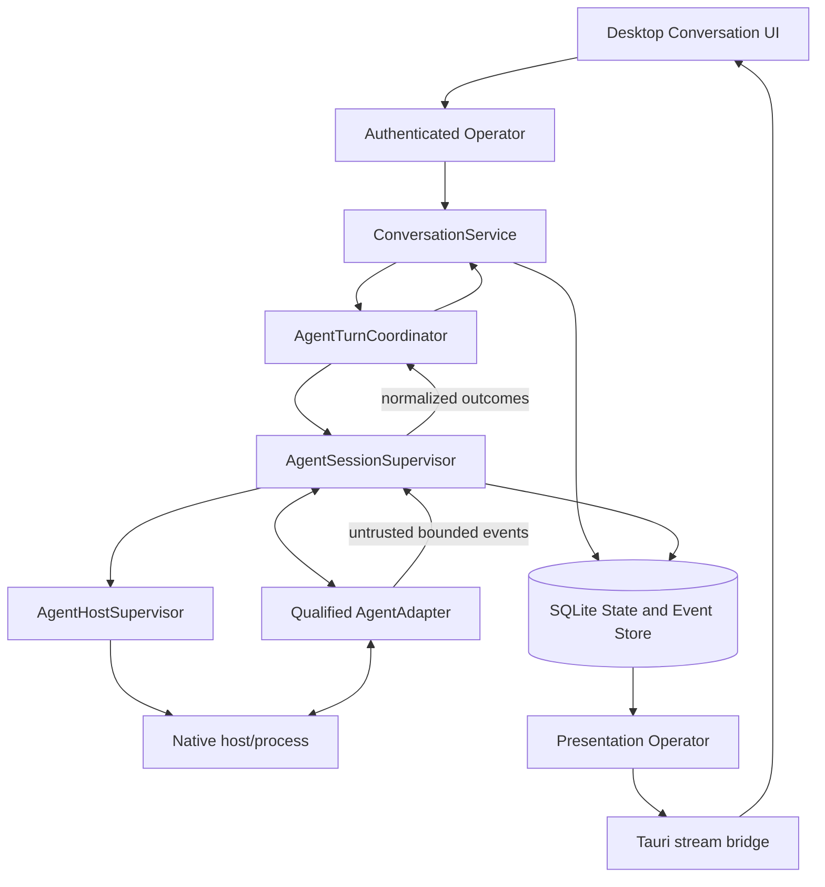

# Feature Specification - Conversation Session Supervisor and Native Turn Execution

**Feature ID:** 001 | **Status:** ACCEPTED/LOCKED | **Revision:** 1.0  
**Created/updated:** 2026-11-01 | **Target:** LiteCowork V1 native Conversation  
**Owners:** Conversation, Agent Runtime, Storage, Operator/API, Desktop UI, Security/Trust, Product  
**Dependencies:** Conversation/turn contract; AgentSession reservation and activation; AgentHostSupervisor; qualified native adapter; durable result settlement.

## 1. Problem and user outcome

LiteCowork is local-first, chat-first and BYOA. A normal Conversation must invoke the user's chosen native harness without creating a Task, Attempt or Coworker. LiteCowork owns canonical message/turn state, admission, correlation, display, cancellation, final persistence and recovery; the harness continues to own its reasoning, authentication, private transcript and native tools.

Today the daemon can commit a USER message and OPEN turn, but with no qualified session supervisor it settles the turn as FAILED using `CONVERSATION_SESSION_ADMISSION_UNAVAILABLE` and responds dependency-unavailable. The preserved dirty feature worktree adds a storage-only Conversation readiness activation operation. No supervisor invokes it; no native prompt is dispatched through it; no final AGENT response writer or end-to-end Send path is integrated. This spec defines the missing journey without claiming it exists.

**Outcome:** the user selects a supported native agent, sends a message, sees truthful progress, receives a durable answer, can stop/retry safely, and can reload/reconnect after daemon failure. A turn never silently changes its pinned agent.

## 2. Goals

- G-01 Plain Conversation works without Task/Attempt/Coworker.
- G-02 Immutable turn-created authority pins the selected AgentBinding; no fallback to changed selector/default.
- G-03 Turn becomes RUNNING only after an exact native session readiness handshake and atomic activation.
- G-04 Dispatch uses bounded, same-Workspace committed context; ResourceRefs are reauthorized.
- G-05 Final AGENT response and terminal turn outcome are durable exactly once with session/binding provenance.
- G-06 Transient output is bounded and never confused with a saved answer.
- G-07 Stop, retry, provider input, host degradation, crash, timeout and restart have deterministic recovery.
- G-08 Native handles/secrets/private provider state never enter public projections, replicated events or ordinary logs.
- G-09 Send remains unavailable until one exact OS/build/harness/version/auth route passes CODE, SYSTEM and owner USER gates.

## 3. Non-goals

No Task/Attempt/Plan/Coworker; no universal model router; no automatic provider fallback; no transfer of provider-private transcript/session between harnesses; no general native command execution from Composer; no direct provider stream to WebView; no new Trust/Effect authority from provider output; no generated apps/rich media; no LiteSPM, connector, OAuth, Environment or sandbox redesign; no cloud Runtime, remote continuation or mobile; no arbitrary native module management.

## 4. Current implementation/evidence boundary

| Capability | State and evidence | Limitation |
|---|---|---|
| USER message + OPEN turn | CODE/SERVED in preserved source snapshot | Not native admission |
| Turn-pinned binding + host resolver | CODE in preserved source snapshot | Resolver is observational, not readiness |
| STARTING reservation + LOST recovery | CODE in preserved source snapshot | No supervisor orchestration |
| Bounded context package load | CODE in preserved source snapshot | Not dispatched by supervisor |
| Atomic Conversation activation | CODE in dirty feature worktree at 3052341; focused storage test passed 2026-10-31 | No supervisor caller; broader package suite predates final handle-redaction changes |
| OpenCode/Codex transport helpers | CODE as transport-only helpers | Not a supervisor, authorization layer or durable output path |
| Supervisor, dispatch, final response writer | TARGET | Not integrated/served |
| Durable Conversation projection | CODE/SERVED | Native transient deltas not produced by local Operator |
| End-to-end native Send | NOT QUALIFIED | Remains fail-closed |

The preserved storage-sqlite package suite previously passed 593 unit tests plus 2 AgentRegistryCache integration tests; it was not rerun after final handle-redaction assertions. The focused activation test was rerun and passed after those changes. Linux Secret Service integration was deliberately ignored due active-user side effects; Windows Credential Manager had no tests on Linux. These are not end-to-end evidence.

## 5. Decision register

### Inherited LOCKED invariants (canonical owners; not feature approval)

| ID | Invariant | Authority |
|---|---|---|
| L-01 | Plain Conversation is not a Task and creates no Task/Attempt/Coworker. | PRODUCT, DATA-MODEL |
| L-02 | Turn-created event pins AgentBinding; later selection/default changes affect future turns only. | STATE-MACHINES, AGENT-CONTROL |
| L-03 | One Conversation AgentSession is scoped to exactly one turn. Retry/continuation uses a fresh session. | STATE-MACHINES |
| L-04 | STARTING is reservation only. Adapter/process/network calls never occur inside SQLite. | STATE-MACHINES, STORAGE |
| L-05 | Session ACTIVE, turn RUNNING, snapshots/events and Runtime-local host binding commit atomically after readiness. | STORAGE, EVENTS |
| L-06 | Native session handle exists only in exact Runtime/RuntimeIncarnation host binding and is excluded from Serde, Debug (except presence boolean), events, snapshots, API responses and logs. | AGENT-CONTROL, STORAGE |
| L-07 | AgentSessionSupervisor owns session/adapter lifecycle; AgentHostSupervisor owns host/process lifecycle; AgentTurnCoordinator owns turn orchestration; ConversationService owns Conversation/message/turn mutations. | SERVICES |
| L-08 | Native events are untrusted observations, not authorization, verified Effects or durable completion. | ARCHITECTURE, TRUST, AGENT-FABRIC |
| L-09 | ResourceRefs do not grant access; authorize exact same-Workspace revision at dispatch. | STORAGE, TRUST |
| L-10 | Persisted semantic messages and terminal outcomes are authoritative; deltas/rich drafts are transient. | API, EVENTS, PRESENTATION-RUNTIME |
| L-11 | Cancellation settles only after stop/quiescence is observed; completion/failure that wins the race remains authoritative. | STATE-MACHINES |
| L-12 | Retry is explicit, version/idempotency protected, increments retry_ordinal, uses a fresh session and retains prior provenance. | STATE-MACHINES |
| L-13 | No automatic fallback. Unsupported or expired target fails visibly and preserves user content. | PRODUCT, AGENT-CONTROL |
| L-14 | Final AGENT message and terminal turn state must commit atomically with events/snapshots/receipt. | STATE-MACHINES; write boundary still to be promoted |

### FLEXIBLE

| ID | Choice | Allowed options | Constraint |
|---|---|---|---|
| F-01 | Coordinator internal shape | Keyed actor or bounded per-Conversation serial lane | One active dispatch per chosen policy; finite queue |
| F-02 | Host reuse | Per-session host or eligible shared host | Host ownership/concurrency and exact local binding rules |
| F-03 | Event transport | Bounded SSE, App Server events or polling | Correlation, ordering, bounds and backpressure |
| F-04 | First UI progress | Durable projections only, then bounded transient frames | Saved transcript remains source of truth |
| F-05 | Internal module names | Existing crate boundaries or focused module | No duplicated provider framework |

### RESOLVED OWNER DECISIONS AND ARCHITECTURAL CONTRACTS

| ID | Topic | Resolution & Architectural Contract | Canonical Authority & Consequence |
|---|---|---|---|
| B-01 | Concurrent send policy per Conversation | **Strict Serialized Turn Lane.** A Conversation enforces a single-flight active turn (`OPEN` -> `RUNNING` -> `SETTLED`). Concurrent submit requests are rejected with `CONVERSATION_TURN_IN_PROGRESS` (HTTP 409 Conflict). The client UI disables the composer Send button and shows an in-flight status indicator while a turn is active. Local typing buffer is preserved in desktop UI state. | [STATE-MACHINES.md](../../docs/STATE-MACHINES.md), [API.md](../../docs/API.md). Eliminates race conditions in HLC ordering, message correlation, and context packaging. |
| B-02 | First GA OS/build, harness, adapter version and auth mode | **Windows 11 / Windows 10 (`x86_64-pc-windows-msvc`) + Claude Code CLI & OpenCode / Codex CLI.** Adapter Version: `1.0.0` subprocess framed transport. Auth Mode: **Harness-Managed Native Pass-Through**. The CLI harness authenticates directly with the model provider via its native credentials (e.g. `claude login` or provider API keys in user environment/keyring). LiteCowork passes no raw bearer keys and stores no user provider credentials, preserving BYOA zero-knowledge security. | [AGENT-CONTROL.md](../../docs/AGENT-CONTROL.md), [LOCAL-OPERATOR-IPC.md](../../docs/LOCAL-OPERATOR-IPC.md). Windows MSVC toolchain is fully native with VS 2022 Build Tools. |
| B-03 | Exact readiness handshake that proves session identity | **Three-Phase Session Handshake Protocol**: 1. `AdapterVersionProbe`: Host probes adapter executable via `--version`/ping, receiving `AdapterVersionInfo { adapter_version: "1.0.0", harness_version, capabilities: [STREAMING, INTERRUPT] }`. 2. `CreateSessionRequest`: Supervisor sends `{ workspace_id, conversation_id, turn_id, options }` and adapter establishes native session, returning `SessionReadyResponse { native_session_id, protocol_version }`. 3. `Atomic Activation`: Supervisor executes SQLite CAS `activate_conversation_agent_session` binding the native handle to local SQLite only and advancing turn `OPEN` -> `RUNNING`. Prompt dispatch occurs only after activation commits. | [AGENT-CONTROL.md](../../docs/AGENT-CONTROL.md), [STORAGE.md](../../docs/STORAGE.md). Distinguishes host process presence from active turn readiness. |
| B-04 | Exact atomic storage operation for final response commit | **`commit_conversation_agent_response`** SQLite Immediate Transaction. Atomically executes: 1. Verifies `expected_turn_version` and `expected_session_version`. 2. Inserts final `conversation_messages` row (`message_kind = 'AGENT'`, content, tokens, source refs). 3. Updates `conversation_turns` to `SETTLED` (`outcome = COMPLETED | FAILED | CANCELLED`, `settled_at = datetime('now')`). 4. Updates `agent_sessions` to `CLOSED`. 5. Appends `conversation.message.added.v1` and `conversation.turn.settled.v1` to `event_journal`. 6. Commits idempotency receipt to `request_dedup`. Failure leaves state unchanged with zero partial writes. | [STORAGE.md](../../docs/STORAGE.md), [EVENTS.md](../../docs/EVENTS.md), [STATE-MACHINES.md](../../docs/STATE-MACHINES.md). Eliminates orphaned turns and phantom messages. |
| B-05 | Resumable streaming sequence vs stream gaps | **Best-Effort Transient Streaming with Authoritative REST Resync.** `TURN_DELTA` frames are transient, sequence-tagged, and emitted over the Operator stream bridge. If a stream disconnection or sequence gap occurs, the UI discards transient token buffers and issues an authenticated REST query `GET /v1/conversations/{id}/messages` to restore the committed semantic transcript. Transient frames are never replayed from historical storage. | [PRESENTATION-RUNTIME.md](../../docs/PRESENTATION-RUNTIME.md), [API.md](../../docs/API.md), Architecture Invariant 17. |
| B-06 | Conversation-scoped UserRequest continuation | **State-Machine Driven Continuation.** Commits immutable `UserRequestResponse` and transitions exact `WAITING_USER` turn to `WAITING_DEPENDENCY`. Reconciles provider input acceptance against the Runtime-local input key; only then allocates a fresh `AgentSession` reserved `STARTING` and returns to `RUNNING` on readiness. Rejection or ambiguous acceptance follows canonical state machines. Never creates Task or Attempt authority. | [STATE-MACHINES.md](../../docs/STATE-MACHINES.md), [API.md](../../docs/API.md), [STORAGE.md](../../docs/STORAGE.md), [TRUST.md](../../docs/TRUST.md). |
| B-07 | Context package reduction for tight harness budgets | **Bounded Deterministic Sliding Window with Pinned Preamble**: 1. Pinned Workspace instructions / system prompt (always retained). 2. Selected `ResourceRefs` / `ContextAttachments` with cryptographic digests. 3. Most recent contiguous messages backwards from latest user turn until 80% of provider context budget is reached. 4. Explicit truncation receipt header appended to prompt: `[Notice: Messages 1..N omitted due to model context window budget]`. Never silently drops content without audit provenance. | [CONTEXT.md](../../docs/CONTEXT.md), [SCHEMAS.md](../../docs/SCHEMAS.md). Transparent and reviewable context limits. |
| B-08 | Attachment/resource materialization | **Dual-Mode Materialization**: 1. Text / Markdown / Code: materialized inline into the prompt envelope with delimited `ResourceRef` headers and checksums. 2. Binary / Workspace local files: materialized as verified, read-only canonical paths within the admitted WorkspaceRoot and passed via native adapter `--file <path>` CLI arguments. Arbitrary external paths are rejected. | [STORAGE.md](../../docs/STORAGE.md), [TRUST.md](../../docs/TRUST.md). Prevents path traversal and enforces Workspace boundaries. |
| B-09 | Process ownership, lifecycle and idle shutdown | **Supervised Subprocess with Job Object / Cgroup and 10-Minute Idle TTL.** `AgentHostSupervisor` launches adapter under an OS Job Object (Windows) or cgroup (Linux). Sessions register live use references. When all active turns finish and reference count reaches 0, an idle timer starts. After 10 minutes of inactivity, supervisor sends graceful termination signal, waits 5 seconds for clean exit, and forcibly kills lingering processes. Shared external processes are never killed. | [RUNTIME-LIFECYCLE.md](../../docs/RUNTIME-LIFECYCLE.md), [LOCAL-OPERATOR-IPC.md](../../docs/LOCAL-OPERATOR-IPC.md). Clean process isolation and zero zombie processes. |
| B-10 | Usage and cost attribution | **Tiered Telemetry Attribution**: 1. If provider/harness reports token counts in final response, record in `usage_records` with `attribution_source = PROVIDER_REPORTED`. 2. If provider omits token usage, calculate byte-based heuristic (`tokens = max(1, utf8_byte_count / 4)`) and record with `attribution_source = ESTIMATED_LOCAL`. Turn settlement and response display are never blocked on missing provider billing telemetry. | [OBSERVABILITY.md](../../docs/OBSERVABILITY.md), [SCHEMAS.md](../../docs/SCHEMAS.md). Truthful, non-fabricated usage accounting. |

All blocking decisions B-01 through B-10 are fully resolved and locked.

## 6. High-level design



### Request sequence

1. UI creates a stable send idempotency key and sends authenticated Workspace/Conversation request.
2. Operator authenticates, applies expected version/idempotency and owner scope. ConversationService commits USER message + OPEN turn + receipt atomically.
3. Turn target comes from unique immutable turn-created event, not the latest selector or Workspace default.
4. AgentTurnCoordinator obtains the bounded ConversationContextPackage and exact pinned host resolution.
5. AgentSessionSupervisor persists STARTING; AgentHostSupervisor ensures/retains exact eligible host. Native process/adapter startup happens outside SQLite.
6. Supervisor validates the exact adapter SESSION_READY handshake and rechecks host/endpoint/Runtime incarnation/Workspace enrollment/session+turn versions.
7. Storage atomically activates AgentSession, changes turn OPEN->RUNNING, writes snapshots/events and stores opaque handle only in Runtime-local host binding.
8. Only after activation does adapter receive the bounded context and current USER message. Every ResourceRef is reauthorized/materialized.
9. Provider output is treated as untrusted; bounded normalized observations correlate to Workspace/Conversation/turn/retry/session and sequence.
10. ConversationService commits final AGENT message and terminal turn outcome atomically through a storage operation that still needs design/promotion.
11. Supervisor waits for quiescence, closes session and releases host reference. Durable projection supports reload/reconnect.

### Ownership

| Owner | Responsibility | Excluded responsibility |
|---|---|---|
| UI | Draft, local selection, accessibility, transient display | Provider process, secrets or durable authority |
| Operator | Auth, Workspace scoping, API validation and projection access | Native process lifecycle |
| ConversationService | Conversation/message/turn writes and receipts | Parsing raw provider events |
| AgentTurnCoordinator | Turn orchestration, ordered outcomes, retry/continuation | Direct aggregate writes |
| AgentSessionSupervisor | Session lifecycle, adapter invocation, readiness, normalization, quiescence | Host process ownership or turn aggregate writes |
| AgentHostSupervisor | Host instance, process, health, references, stop | Turn or Conversation outcome |
| AgentAdapter | Protocol-specific startup/input/events/interrupt | Core authorization or durable state |
| Storage | Transactions, invariants, receipts, snapshots/events, local binding | External process/network calls |
| Presentation Operator | Authorized snapshots/upserts and bounded frames | Converting provider text directly to durable state |

## 7. Low-level design and interfaces

### 7.1 Existing storage signatures

Observed in the preserved feature worktree at `3052341473e964bececf7f34c9d45923848e5218`; existence does not prove invocation by a supervisor.

```rust
pub trait AgentSessionStore: Send + Sync {
    fn start_conversation_agent_session(
        &self, start: ConversationAgentSessionStart,
    ) -> Result<CommittedAgentSession, StoreError>;

    fn mark_starting_conversation_agent_session_lost(
        &self, transition: MarkStartingConversationAgentSessionLost,
    ) -> Result<CommittedAgentSession, StoreError>;

    fn list_starting_conversation_agent_sessions(
        &self, workspace_id: &str, after_agent_session_id: Option<&str>,
        limit: usize,
    ) -> Result<Vec<AgentSessionRecord>, StoreError>;

    fn activate_conversation_agent_session(
        &self, activation: ActivateConversationAgentSession,
    ) -> Result<CommittedConversationActivation, StoreError>;
}
```

Activation request fields: principal_id, workspace_id, agent_session_id, expected_session_version, expected_turn_version, occurred_at, host_instance_id, native_session_ref, session_event and turn_event. The handle is skipped by Serde and Debug prints only a boolean presence marker. The committed result contains session, session event, turn and turn event only.

Existing `ConversationTurnStore` operations:
- `replay_conversation_turn(principal_id, request_id, request_payload)`
- `create_conversation_turn(commit)`
- `load_conversation_context_for_turn(principal_id, workspace_id, conversation_id, turn_id)`
- `resolve_conversation_session_host_for_turn(principal_id, workspace_id, conversation_id, turn_id)`
- `transition_conversation_turn(principal_id, workspace_id, conversation_id, turn_id, expected_version, command, event)`

Generic OPEN->RUNNING through `transition_conversation_turn` remains forbidden; only readiness activation may do it.

### 7.2 Service contracts

**ConversationService** owns Conversation/message/turn aggregates. Target operations include:
- `submit_turn(principal, workspace, conversation, expected_version, idempotency_key, request) -> ConversationTurnReceipt`
- `cancel_turn(turn_id, expected_version, request_id) -> CancelReceipt`
- `retry_turn(turn_id, expected_version, request_id) -> ConversationTurnReceipt`
- `append_agent_response_and_settle(request) -> CommittedConversationAgentResponse` - PROPOSED; backing storage port missing.

**AgentTurnCoordinator** consumes committed dispatch, resolves exact turn binding/context, requests supervisor startup/dispatch, consumes normalized results, asks ConversationService for durable settlement and continues a WAITING_DEPENDENCY turn only after provider acceptance. It never writes Conversation/Turn directly.

**AgentSessionSupervisor** validates scope and exact host, reserves STARTING, calls host/adapter outside SQLite, verifies readiness, activates atomically, normalizes events, requests stop, awaits quiescence, closes session and releases local host binding.

**AgentHostSupervisor** ensures/attaches only the exact endpoint and Runtime incarnation, supervises process/health/concurrency and stops only LiteCowork-owned processes with no live references.

### 7.3 Required proposed final-result transaction

No final AGENT-message-plus-terminal-turn atomic write was found in the inspected ConversationTurnStore port. This is B-04 and blocks truthful durable completion.

**PROPOSED signature, not a current API:**

```rust
fn commit_conversation_agent_response(
    &self,
    commit: CommitConversationAgentResponse,
) -> Result<CommittedConversationAgentResponse, StoreError>;
```

Request binds principal, Workspace, Conversation, turn, AgentSession, retry ordinal, expected turn/session versions, stable response identity, immutable AGENT message/provenance and event drafts. Result returns only committed message, turn and events (never handle).

One SQLite immediate transaction must recheck owner/scope, turn RUNNING, exact ACTIVE session, versions, retry ordinal and pinned binding; validate message author and provenance; dedupe response identity; commit AGENT message + message event + message snapshot; commit terminal turn + settled event + turn snapshot + receipt. Stale/foreign/malformed/duplicate IDs abort without partial writes.

Reuse the event names/versions already owned by EVENTS.md (including `conversation.message.added.v1` and `conversation.turn.settled.v1` where applicable). Do not invent a new global event/schema without changing owner docs, JSON schemas, migration and tests together. Exact event draft and storage request is open for B-04.

If DB commit is uncertain after provider final output, query stable response identity and authoritative state before retrying the local commit. Never resend the provider prompt to repair a DB write.

### 7.4 Native adapter boundary

A qualified adapter needs a negotiated/versioned contract for process/session start, exact readiness handshake, prompt/context input, bounded event observation, interrupt and shutdown/quiescence. No first harness contract is locked until B-02/B-03.

OpenCode Server and Codex App Server helpers exist in the preserved source. OpenCode includes bounded SSE and context-aware sends; Codex includes thread/turn start, interrupt and events/poll. They are transport-only: events are untrusted observations, not authorization/effect proof, and no supervisor currently calls Conversation activation.

### 7.5 Context projection

Use the existing ConversationContextPackage builder:
- binding resolved from the unique immutable turn-created event;
- same-owner/same-Workspace committed USER, CHANNEL and prior AGENT messages through the submitted USER message;
- Conversation event revision orders the prefix, not timestamps or opaque IDs;
- earlier AGENT messages retain original binding provenance;
- excludes product notices, drafts, native handles, credentials/cookies and private harness history;
- max 1,024 messages / 4 MiB before materialization;
- ResourceRefs only; every reference reauthorized at dispatch.

SCHEMAS.md caps ConversationContextPackage at 1,024 messages and 4 MiB. API.md caps a UserRequest detail prompt at 256 KiB. That 256 KiB figure is not the adapter request budget. CONVERSATION_CONTEXT_LIMIT_EXCEEDED is named in SCHEMAS.md and is absent from the 131-code error registry, so it is not a promotable error until the schema and SCHEMAS.md change together. Silent truncation is forbidden. Any smaller harness budget is a pinned provider observation, not this package inventing 256 KiB as the product limit.

### 7.6 Presentation

Use the existing durable Conversation presentation snapshot/upsert cursor, Tauri bridge, bounded backpressure and resumable UI reducer. If provider deltas are added, they are transient frames correlated to Workspace/Conversation/turn/retry/session and monotonic sequence, bounded/coalesced/redacted, never DomainEvents/messages/replicated content. A sequence gap requires replay or discard/resync. A committed AGENT message supersedes deltas. Local Operator does not currently emit `turn.delta`, `turn.settled` or `rich.draft`.

## 8. Security, trust and privacy

- Authenticate every write and scope it to the owner and Workspace.
- Never reroute an admitted turn using selector/default reads.
- Installation, Runtime health or AgentHost READY is not adapter session readiness.
- Never call external process/network/provider inside a SQLite transaction.
- Provider output/events/tool names/arguments are untrusted; they cannot grant authority, approve requests, create Effects or prove completion.
- Native handle stays only in the exact Runtime-local AgentSessionHostBinding; never serialised, logged, emitted, snapshotted or displayed.
- Provider credentials/cookies remain with the native harness or authorized secret provider.
- Conversation text is untrusted input, not system/developer policy.
- ResourceRefs are not permissions: recheck Workspace, owner, exact revision, root/location, media and adapter support.
- Native direct action and Core-mediated Effect are different assurance classes.
- Diagnostics contain correlation and safe classifications only, never prompt text, hidden reasoning, secret or handle values.

## 9. Errors, edge cases and recovery

See [errors-recovery.md](contracts/errors-recovery.md). Global rules: external uncertainty is reconciled before retry; no ambiguous prompt is blindly replayed; no response becomes visible as completed before commit.

## 10. Configuration and compatibility

- No hidden global router or silent fallback.
- Qualification is pinned to OS/build/harness/version/adapter/auth mode and exact capability descriptor.
- Readiness, process shutdown, event frame, buffer, queue, concurrency and retry deadlines must be finite; exact initial values are blocking.
- Product context limit is 1,024 messages / 4 MiB. The 256 KiB figure is the UserRequest detail prompt cap in API.md, not the adapter budget. Change limits only through owner contracts and tests.
- Model, reasoning effort and native command catalog remain harness-owned; Core keeps only approved non-secret selections/digests.
- UI/API eligibility stays false until complete route qualification.
- Existing activation feature does not automatically require a schema migration; final-result persistence may. Add a forward-only migration only when approved.

## 11. Observability

Record safe correlation IDs for request, Workspace, Conversation, turn, retry, session and host; stage duration; readiness result; normalized terminal classification; queue pressure; event gaps; resync; restart recovery. Exclude provider text, handles, auth and secret bytes. Usage distinguishes measured, native-reported, estimate and UNKNOWN; do not infer billing.

## 12. EARS acceptance criteria

- AC-001 WHEN a valid owner submits a turn, THE SYSTEM SHALL atomically commit one USER message, OPEN turn and idempotency receipt before native startup. Verify: Operator/SQLite integration.
- AC-002 WHEN a plain Conversation turn is admitted, THE SYSTEM SHALL NOT create Task, Attempt, PlanRevision or Coworker. Verify: storage assertions.
- AC-003 WHEN selector/default changes after turn commit, THE SYSTEM SHALL retain the immutable turn-pinned AgentBinding. Verify: race test.
- AC-004 WHEN exact native readiness succeeds and all fences pass, THE SYSTEM SHALL atomically commit ACTIVE session, RUNNING turn, snapshots/events and local handle binding. Verify: storage atomicity test.
- AC-005 IF only Runtime/AgentHost READY is known but no exact session handshake exists, THEN THE SYSTEM SHALL NOT activate or report RUNNING. Verify: negative test.
- AC-006 WHEN dispatch begins, THE SYSTEM SHALL send only the bounded committed prefix through the submitted USER message and reauthorize ResourceRefs. Verify: context/adapter test.
- AC-007 IF context exceeds the selected adapter bound, THEN THE SYSTEM SHALL refuse or require approved reduction without silently truncating. Verify: boundary test.
- AC-008 WHEN a provider event is received, THE SYSTEM SHALL enforce size, session/turn/retry correlation and sequence before projection and SHALL NOT treat it as authority. Verify: malformed/replay tests.
- AC-009 WHEN one final response is accepted, THE SYSTEM SHALL atomically commit one provenance-linked AGENT message and terminal turn receipt. Verify: result write crash/replay test.
- AC-010 WHEN stop is requested, THE SYSTEM SHALL settle CANCELLED only after observed stop/quiescence; a winning completion/failure remains authoritative. Verify: race test.
- AC-011 WHEN a FAILED turn is explicitly retried with expected version/idempotency, THE SYSTEM SHALL use a fresh session, increment retry ordinal and preserve earlier provenance. Verify: retry replay.
- AC-012 WHEN daemon restarts with prior-incarnation STARTING session, THE SYSTEM SHALL reconcile it LOST unless same live incarnation and adapter prove safe resume. Verify: restart test.
- AC-013 WHEN request/event/snapshot/Debug/API/log values are serialized, THE SYSTEM SHALL exclude the native handle. Verify: redaction tests.
- AC-014 WHEN a stream reconnects, THE SYSTEM SHALL reconcile an authorized durable snapshot/cursor without duplicating messages; a transient gap requires replay or discard/resync. Verify: projection stream tests.
- AC-015 IF pinned adapter is missing, expired, unauthenticated or fails startup, THEN THE SYSTEM SHALL preserve the USER message, report typed failure and SHALL NOT fall back. Verify: failure matrix.
- AC-016 WHILE supervisor/result writer/route qualification is incomplete, THE SYSTEM SHALL keep Send fail-closed and SHALL NOT claim end-to-end support. Verify: route/UI negative.
- AC-017 WHEN an authenticated owner answers a valid Conversation-scoped UserRequest for the exact turn in WAITING_USER, THE SYSTEM SHALL atomically persist the immutable UserRequestResponse and move that turn to WAITING_DEPENDENCY before enqueueing continuation, without creating Task, Attempt, PlanRevision or Coworker authority. Verify: response transaction and stale/replay tests.
- AC-018 WHEN a Conversation-scoped UserRequest represents provider INPUT_REQUIRED, THE SYSTEM SHALL correlate the response to the exact Runtime-local provider input key; an update acknowledgement alone SHALL NOT count as acceptance, and for MCP the Runtime SHALL poll the same provider task until that exact key resolves or the provider reaches a terminal state. Acceptance of that response SHALL allow a new Conversation-scoped AgentSession reserved STARTING. THE SYSTEM SHALL commit RUNNING only after readiness, in the same agent.session.started.v1 transition that moves the turn from OPEN to RUNNING. THE SYSTEM SHALL NOT treat readiness as a precondition for creating the STARTING reservation that the handshake proves. Verify: exact-key provider fixture, replay and timeout integration tests.
- AC-019 IF the provider rejects the input but remains INPUT_REQUIRED, THE SYSTEM SHALL close the old UserRequest, create a new request for the current provider key and return the exact turn to WAITING_USER; IF acceptance is ambiguous, THE SYSTEM SHALL keep the turn WAITING_DEPENDENCY and prohibit a new AgentSession until reconciliation. Verify: reject, ambiguity and recovery tests.

## 13. Executable acceptance command

**Canonical feature acceptance command (PROPOSED; target test does not exist yet):**

```bash
cargo test -p litecoworkd --test conversation_session_supervisor --locked -- --nocapture
```

**Narrow foundation evidence only:** the focused storage activation test passed in the preserved feature worktree on 2026-10-31: `cargo test -p storage-sqlite --locked conversation_activation_commits_session_turn_and_local_host_binding_atomically -- --nocapture`. It does not exercise the supervisor, prompt dispatch, final response writer, Send route or end-to-end UI journey.

Do not mark the feature VERIFIED until the canonical target exists, covers AC-001 through AC-019 and passes on the pinned OS/provider.

## 14. Out-of-bounds paths and side effects

No implementation changes are authorized while this package is DRAFT. After lock, candidate paths (subject to fresh worktree review) are focused daemon Conversation/agent supervisor modules, AgentSession/Conversation storage ports and SQLite transaction code, Conversation UI/Tauri bridge, tests and canonical owner docs/schemas.

Out of scope: Task planning/Attempt execution; Coworker/delegation; generic routing; LiteSPM; connectors/OAuth/SecretStore redesign; Environment/sandbox; browser/computer/terminal; arbitrary native module system; automated memory; interactive artifact runtime; rich media; cloud Runtime; mobile; replication; unrelated schema migrations.

Do not execute native prompts, install/update/remove software, access/change user-native profiles or secrets, cause network/filesystem effects or stop an externally owned process during design validation.

## 15. Assumptions and open questions

| ID | Question | Evidence/limitation | Owner | Gate |
|---|---|---|---|---|
| O-01 | First harness is Codex App Server or OpenCode Server. | Both transports exist; neither supervisor-qualified. | Product/Agent Runtime | B-02 |
| O-02 | Handshake can correlate stable session ID, host and incarnation. | Not specified in current adapter API. | Agent Runtime | B-03 |
| O-03 | A single-flight policy exists per Conversation. | Confirm reject versus bounded queue. | Conversation/Product | B-01 |
| O-04 | Final message and terminal turn can share one transaction. | Current write port missing. | Storage | B-04 |
| O-05 | A pinned harness may accept less than the 4 MiB / 1,024-message package. | 256 KiB in API.md is the UserRequest detail prompt cap, not the adapter budget. | Product/Agent Runtime | B-07 |
| O-06 | First adapter can report ordered bounded output/final/stop events. | Need pinned provider fixture. | Agent Runtime | B-05 |
| O-07 | Attachment/resource transfer is provider-specific. | Package exposes ResourceRefs only. | Resource/Agent Runtime | B-08 |
| O-08 | Native usage may be opaque/unknown. | No fabricated cost. | Usage | B-10 |

## 16. Requirement traceability

| Requirement | Canonical owner | Task | Acceptance |
|---|---|---|---|
| Turn admission and idempotency | API, STORAGE, EVENTS | 001-T09 | AC-001 |
| Plain chat, no Task | PRODUCT, DATA-MODEL | 001-T09 | AC-002 |
| Pin selected binding | STATE-MACHINES, AGENT-CONTROL | 001-T03 | AC-003 |
| Atomic readiness activation | STORAGE, EVENTS | 001-T03 | AC-004 / AC-005 |
| Supervisor + host lifecycle | SERVICES, STATE-MACHINES | 001-T03 / 001-T08 | AC-012 |
| Context/resources | STORAGE, SCHEMAS, TRUST | 001-T05 | AC-006 / AC-007 |
| Durable final message/turn commit | STORAGE, EVENTS | 001-T02 / 001-T06 | AC-009 |
| Provider event normalization | API, EVENTS, AGENT-CONTROL | 001-T04 / 001-T07 | AC-008 |
| Projection/stream/reconnect | API, PRESENTATION-RUNTIME | 001-T07 | AC-014 |
| Stop/retry | STATE-MACHINES, API | 001-T07 | AC-010 / AC-011 |
| Native handle privacy | STORAGE, AGENT-CONTROL | 001-T03 / 001-T09 | AC-013 |
| Conversation-scoped UserRequest continuation | API, STATE-MACHINES, STORAGE, TRUST | 001-T07 | AC-017 / AC-018 / AC-019 |
| Fail closed/route qualification | TESTING, ACCEPTANCE-AND-E2E-PLAN | 001-T09 | AC-015 / AC-016 |

