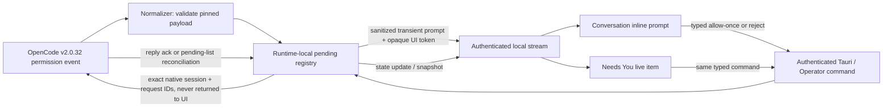

# Native Conversation Permission Flow - T27 Design

**Status:** TARGET design for the already owner-authorized 001-T27 capability. The proposed HTTP operations, request/response schemas, and transient `turn.permission` frame are now promoted in the canonical OpenAPI and stream schemas and generated UI API types. The authenticated snapshot GET is SERVED partial with route-level CODE evidence; the reply POST and UI answer journey remain target-only and no provider path is qualified.

**Owners:** Agent Runtime, Conversation, Operator/API, Desktop UI, Security.

**Authority:** Feature 001 AC-031 and 001-T27 remain the owning capability contract. Global API, event, schema, Trust and presentation owners remain authoritative for their respective contracts. This proposal adds no Conversation event, LiteCowork grant, Effect, persistent permission record, or second permission state machine.

## 1. Product behavior

When a live native OpenCode turn asks for a permission, LiteCowork shows an inline prompt in that Conversation and a matching actionable item in Needs You. The UI says **the agent is asking**; it does not describe the prompt as a LiteCowork permission or grant. The owner may allow this request once, or reject the request with explicit disclosure that OpenCode v2.0.32 rejects every permission currently pending in that same native session. Do not offer `always` in this flow: the pinned provider may save a persistent rule and resolve other requests.

The prompt is actionable for as long as the exact native session remains live and the request remains pending. LiteCowork does not add a timer or guess a harness default. Stopping or closing the native session is a separate action. Sending an ordinary Conversation message is not a permission answer or continuation.

The existing persisted `PERMISSION/ASKED` activity remains a historical report. It does not create or represent a live prompt, and it must not be upgraded optimistically after a click. No native request/session identifier, raw provider metadata, resource path, or permission decision is written to the activity store, domain event log, or durable Conversation projection.

## 2. HLD and trust boundaries

- OpenCode owns its permission request and its decision semantics. LiteCowork owns the UI projection, local correlation, and ensuring that only an authenticated owner action can cause a reply.
- The native request ID and native session ID are private Runtime-local reply keys. The UI receives a random opaque prompt token scoped to one Runtime incarnation, Workspace, Conversation, turn and request. The token is not an authorization grant and cannot be reused across Workspaces or turns.
- The pending registry is in memory only. Its key includes Workspace, Conversation, turn, retry ordinal, Runtime incarnation, native session and native request. Duplicate event delivery for the same native key is idempotent only when action, explanation and private resource list match; a conflicting duplicate is rejected. The public snapshot filters by owner scope and exposes only the opaque token and sanitized projection. This reflects that the native session and its pending requests are not resumable product state. On Runtime restart the old registry is discarded, the prior turn follows Feature 001 startup recovery, and no user decision is replayed.
- The UI never sends arbitrary provider URLs, paths, session IDs, request IDs, or OpenCode methods. Only the allowlisted decision enum is accepted.
- This path answers a native harness permission. It does not create a LiteCowork Trust grant, authorize a mediated Effect, or claim visibility into direct native tools outside this adapter.

## 3. Proposed user journey and API operations

The GET snapshot route is SERVED partial. The POST reply route remains TARGET; the UI/Tauri actions are not implemented.

| Hop | Proposed behavior |
|---|---|
| User outcome | Review what the agent is asking to do and make a clear one-request/session-pending decision. |
| UI control | Inline prompt offers **Allow once** and **Reject this and all other pending requests in this session**. The Needs You row opens/focuses the same prompt. Both surfaces show `Waiting`, `Sending decision`, `Answered`, `Outcome unknown`, or `Session ended` from the owner projection. |
| Typed UI command | `get_conversation_permissions(conversation_id, turn_id)` rehydrates live prompts; `reply_conversation_permission(conversation_id, turn_id, prompt_token, decision, idempotency_key)` submits `ALLOW_ONCE` or `REJECT_SESSION_PENDING`. |
| Authenticated IPC / Operator | `GET /v1/conversations/{id}/turns/{turn_id}/permissions` is SERVED and resolves the principal and Workspace from authenticated local transport; `POST /v1/conversations/{id}/turns/{turn_id}/permissions/{prompt_token}/reply` remains TARGET. Never trust body-supplied ownership. |
| Authorization | Require same Workspace, Conversation, active turn, active native session, Runtime incarnation, prompt token and pending state. Reject stale, cross-scope, duplicate-conflicting, or already-ended commands without calling OpenCode. |
| Service owner | Conversation Operator delegates reads to the Runtime-local prompt registry. For the future reply path, it must submit a bounded, attempt-scoped command through a Runtime-owned mailbox; the active turn worker remains the sole owner of `OpenCodeServer` and performs the provider call while servicing its bounded event loop. Do not share the process handle, provider password or a second uncontrolled server client with Operator handlers. The permission reply does not mutate SQLite Conversation state. |
| Provider operation | Registry resolves its private native IDs and invokes only the pinned OpenCode v2.0.32 session-scoped permission reply endpoint. No generic URL or method is accepted. |
| Persistence / receipt | Do not persist the live permission or native reply receipt. Exact idempotency is Runtime-local: repeated identical key/decision returns the known attempt state; conflicting decision for that key conflicts. Persistent `PERMISSION/ASKED` activity remains REPORTED and unchanged. |
| Projection / stream | Publish bounded ephemeral `turn.permission` frames containing only the opaque prompt token, safe display fields, exact Conversation/turn/retry correlation, sequence and state. On reconnect, reload a bounded live prompt snapshot; do not rebuild live permission state from historical activity. |
| Recovery | A Runtime restart invalidates prompt tokens and never replays a decision. Session close removes actionable prompts and reports `SESSION_ENDED`; startup recovery independently settles the turn under Feature 001. |

The operation names, status codes, idempotency mapping, and frame fields are promoted in `docs/API.md`, `docs/schemas/operator-api.openapi.yaml`, `docs/schemas/operator-stream.schema.json`, generated UI types, and this feature's API/event and UI behavior contracts. The GET snapshot is SERVED partial (179 served OpenAPI operations, 54 target-only); the POST remains TARGET until its mailbox-backed handler is integrated. Neither route establishes a UI or live-provider journey.

## 4. LLD: prompt and decision state

The pinned OpenCode v2.0.32 transport contract is exact and session-scoped: `GET /api/session/{sessionID}/permission` lists that session's pending requests; `GET /api/session/{sessionID}/permission/{requestID}` reads one; `POST /api/session/{sessionID}/permission/{requestID}/reply` submits `{ "decision": "once" | "reject" }` and returns no content. LiteCowork validates both opaque path IDs against a conservative ASCII allowlist before constructing a path. `always` is unrepresentable in the V1 transport type. The list/get response is bounded and must stay Runtime-local until normalized. These methods have CODE tests against a fake loopback server for exact route, body and 204 acknowledgment, plus ID and decision validation. They do not establish caller authorization, Runtime command ownership, real provider behavior, or a live provider journey.

```mermaid
stateDiagram-v2
  [*] --> PENDING: validated permission.asked for active session
  PENDING --> REPLYING: owner command admitted
  REPLYING --> ANSWERED: provider reply returns 2xx
  REPLYING --> PENDING: reconcile proves exact request is still pending
  REPLYING --> OUTCOME_UNKNOWN: reply result ambiguous and request is absent/unreadable
  PENDING --> SESSION_ENDED: provider session closes
  REPLYING --> SESSION_ENDED: session closes during reply; no automatic retry
  ANSWERED --> [*]
  SESSION_ENDED --> [*]
  OUTCOME_UNKNOWN --> [*]
```

- `PENDING` is admitted only after schema validation of the pinned event, exact active session correlation, bounded field validation and insertion into the Runtime-local registry. Duplicate provider notifications for the same native request are idempotent; conflicting immutable fields fail closed and are not shown as a second prompt.
- `REPLYING` atomically fences a second decision for that prompt before any provider call. A local mutex/transaction must not be held across network I/O.
- A received 2xx reply acknowledgment settles the exact prompt as `ANSWERED` with the selected decision. The API response is no-content, so successful HTTP status is the provider acknowledgment.
- If reply transport times out or disconnects, query the pinned same-session permission list/get API. If the exact request remains pending, return it to actionable `PENDING`; if absent, return `OUTCOME_UNKNOWN` and remove the action. Never retry an uncertain decision automatically or label absence as approval/rejection.
- `REJECT_SESSION_PENDING` has the provider's documented side effect: the selected request and all requests pending in the same session are rejected. The UI label and accessible description must state this before dispatch. Requests added after the provider applies that reply are unaffected.
- Provider service close can reject pending requests internally. Remove their actionability and show `SESSION_ENDED` (not `REJECTED_BY_USER`) unless LiteCowork received an acknowledged owner rejection.
- No elapsed-time default is added. A long-lived request remains visible/actionable while its owning session is live. The user can separately stop the Conversation; stop follows the canonical quiescence and cancellation path.

## 5. Safe display projection

The normalizer validates `id`, `sessionID`, `action`, bounded `resources`, and optional supported fields from the pinned v2.0.32 permission schema. Unknown fields are discarded. The provider message/action is untrusted text: render as text only, strip control characters, enforce a byte/line cap, and never interpret markup. Do not persist it.

The UI needs enough context to decide without exposing native paths to stream consumers or logs. The Runtime should provide a bounded local projection: normalized action; optional bounded provider explanation; resource count; and display names relative to the authorized Workspace root where safely contained. For resources outside that root, show a generic external-resource label and count rather than an absolute path. If path normalization/revalidation is uncertain, omit the path and show a safe warning. Keep metadata and full provider payload Runtime-local and never include them in diagnostics.

## 6. Failure, race, and recovery requirements

- Malformed, oversized, wrong-session, wrong-turn, wrong-incarnation and duplicate-conflicting events are discarded or correlated to an explicit safe failure; they never create actionability.
- Two UI surfaces racing on one prompt can cause at most one decision call. Identical idempotent replay returns the current prompt state; a conflicting decision returns conflict and does not contact the provider.
- If a prompt is answered or the session ends while a reply is in flight, the registry reconciles against the provider and does not overwrite a newer terminal state.
- Provider rejection, unauthorized reply, timeout, connection loss, malformed response and pending-list failure map to closed UI states. Raw response bodies, paths, credentials and native identifiers never reach the UI or logs.
- Reconnect fetches current active prompts; sequence gaps trigger a fresh bounded snapshot. Historical `PERMISSION/ASKED` activity never recreates action buttons.
- Crash/restart ends the Runtime-owned server/session and discards the ephemeral registry. No permission reply is replayed. The old Conversation turn is recovered through the existing `RUNTIME_RESTARTED` behavior.

## 7. Contracts and implementation sequence

T27 implementation must update, in one reviewed change, the exact pinned event fixture and normalizer, OpenCode session permission list/get/reply transport, Runtime-local registry and state transitions, authenticated Operator/Tauri commands, bounded transient frame schema and producer, typed generated UI clients, inline prompt and Needs You projection, denial/privacy/race/reconnect tests, and T27/T22 evidence. Candidate source paths therefore include `normalizer.rs`, `opencode_server.rs`, `supervisor.rs`, `conversation_operator.rs` and its tests, `transient_frames.rs`, `conversation_stream_bridge.rs`, the Conversation React page, turn activity/Needs You components and tests, plus promoted API/stream schemas and generated types. Reconfirm every path against the active TASKS scope before editing.

Required verification proceeds in this order:

1. Validate the pinned v2.0.32 event and reply/list/get contracts against pinned source and correct the fixture; do not call it a live capture.
2. Add normalizer and state-machine tests for malformed, duplicate, out-of-order, wrong-session and bounded-resource cases.
3. Add provider transport tests for exact route/body, allow-once, session-wide rejection, HTTP errors, timeout-after-dispatch without automatic replay, and response redaction. The timeout regression now proves only that the bounded transport reports `Timeout` after one POST and does not retry; Runtime reconciliation through the pending-list API remains unimplemented.
4. Add authenticated route and registry tests for Workspace/turn/session fences, idempotent replay, conflicting decisions, close races and restart invalidation.
5. Add UI and Needs You tests for both surfaces, disabled/stale/loading/error states, exact rejection disclosure, keyboard/screen-reader behavior, and non-reconstruction from REPORTED history.
6. Run packaged desktop/provider E2E only when a valid native account route is available. The current 401/UNAUTHENTICATED and insufficient-balance observations do not support that qualification.

**Current status:** T27 remains PARTIAL. Contract and schema promotion is TARGET; normalization, bounded transport and the first Runtime projection slice provide narrow CODE evidence. The Runtime-local registry now keys by Workspace, Conversation, turn, retry ordinal, Runtime incarnation, native session and native request; it generates a random 256-bit opaque token, caps entries, returns exact-scope snapshots, treats identical duplicate notifications idempotently and rejects conflicting duplicates. The `NativePermissionObserver` consumes normalized permission events and publishes a bounded `turn.permission` frame while keeping both native IDs and raw resource paths out of the projection; resources currently use generic labels (`Resource 1`, etc.), so safe Workspace-relative display names remain to be implemented. The focused native-Windows registry/observer tests passed 3/3, including scope rejection, exact duplicate handling, opaque token generation and frame privacy. The authenticated snapshot GET now exposes the bounded live registry through the Operator; the reply route remains unimplemented. The event normalizer validates and bounds the pinned request fields and drops malformed/foreign/over-limit observations (CODE fixture tests; not a live capture). The OpenCode permission transport has bounded list/get/reply operations and fake-loopback CODE coverage for paths, body, 204 acknowledgment, IDs, decisions and a timed-out reply after dispatch. The timeout test confirms one reply POST and no automatic transport retry; it does not reconcile the pending request or establish the eventual provider decision. A fake-server test also confirms 401/403 map to a closed `Unauthorized` error and 500 maps to `HttpStatus(500)` without exposing the response body. The reply handler, answer UI, reply dispatch, Runtime reconciliation, restart invalidation and provider qualification remain absent; the authenticated GET is a read-only snapshot and does not create durable permission state. No persistent permission record is created.

## 8. Pinned provider sources

See [Feature 001 RESEARCH §8.1](../RESEARCH.md#81-finding-for-001-t12-and-t27-rechecked-2026-11-11-pinned-opencode-v2032-contracts) for the exact pinned v2.0.32 source links and verified permission semantics. ACP `request_permission` is a separate provider path and is not implied by this OpenCode HTTP design.
