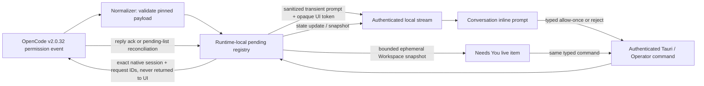

# Native Conversation Permission Flow - T27 Design

**Status:** TARGET behavior for the already owner-authorized 001-T27 capability, with partial daemon implementation. The exact-turn snapshot GET and reply POST are SERVED partial: the reply route is wired to a bounded Runtime-local mailbox, the active OpenCode turn owner applies the native call and reconciles an ambiguous result through the exact session's pending list, and the daemon fails closed on stale scope. CODE covers registry/idempotency/reconciliation, negative route cases, synthetic authenticated allow and reject POST-to-worker receipt/replay paths, and a synthetic mailbox-close-after-dispatch race with a fake provider. The rejection route test confirms one fake native `reject` call after idempotent replay and no new LiteCowork capability grant. No real OpenCode permission decision has been captured. Typed Tauri commands, strict projections, the inline Conversation card and Needs You Workspace snapshot have CODE coverage; the real-provider decision and packaged desktop journey remain incomplete.

**Owners:** Agent Runtime, Conversation, Operator/API, Desktop UI, Security.

**Authority:** Feature 001 AC-031 and 001-T27 remain the owning capability contract. Global API, event, schema, Trust and presentation owners remain authoritative for their respective contracts. This proposal adds no Conversation event, LiteCowork grant, Effect, persistent permission record, or second permission state machine.

## 1. Product behavior

When a live native OpenCode turn asks for a permission, LiteCowork shows an inline prompt in that Conversation and a matching actionable item in Needs You. The UI says **the agent is asking**; it does not describe the prompt as a LiteCowork permission or grant. The owner may allow this request once, or reject the request with explicit disclosure that OpenCode v2.0.32 rejects every permission currently pending in that same native session. Do not offer `always` in this flow: the pinned provider may save a persistent rule and resolve other requests.

The prompt is actionable for as long as the exact native session remains live and the request remains pending. LiteCowork does not add a timer or guess a harness default. Stopping or closing the native session is a separate action. Sending an ordinary Conversation message is not a permission answer or continuation.

The existing persisted `PERMISSION/ASKED` activity remains a historical report. It does not create or represent a live prompt, and it must not be upgraded optimistically after a click. No native request/session identifier, raw provider metadata, resource path, or permission decision is written to the activity store, domain event log, or durable Conversation projection.

## 2. HLD and trust boundaries

- OpenCode owns its permission request and its decision semantics. LiteCowork owns the UI projection, local correlation, and ensuring that only an authenticated owner action can cause a reply.
- The native request ID and native session ID are private Runtime-local reply keys. The UI receives a random opaque prompt token scoped to one Runtime incarnation, Workspace, Conversation, turn and request. The token is not an authorization grant and cannot be reused across Workspaces or turns.
- The pending registry is in memory only. Its key includes Workspace, Conversation, turn, retry ordinal, Runtime incarnation, native session and native request. Duplicate event delivery for the same native key is idempotent only when action, explanation and private resource list match; a conflicting duplicate is rejected. The public snapshot filters by owner scope and exposes only the opaque token and sanitized projection. This reflects that the native session and its pending requests are not resumable product state. On Runtime restart the old registry is discarded, the prior turn follows Feature 001 startup recovery, and no user decision is replayed.
- The UI never sends arbitrary provider URLs, paths, session IDs, request IDs, or OpenCode methods. Only the allowlisted decision enum is accepted.
- This path answers a native harness permission. It does not create a LiteCowork Trust grant, authorize a mediated Effect, or claim visibility into direct native tools outside this adapter.

## 3. Proposed user journey and API operations

The exact-turn and Workspace GET snapshots plus POST reply route are SERVED partial. Typed Tauri commands, strict response validation, the inline RUNNING-attempt card, Needs You snapshot cards and sequenced frame reducers have CODE coverage. Needs You refreshes on entry/focus/visibility and explicit refresh; it is not a push subscription or durable inbox row.

| Hop | Proposed behavior |
|---|---|
| User outcome | Review what the agent is asking to do and make a clear one-request/session-pending decision. |
| UI control | Inline prompt offers **Allow once** and **Reject this and all other pending requests in this session**. Needs You contains a compact live native-request section with the same prompt and direct decision controls. A stale item is harmless because the reply operation revalidates the exact live scope. Both surfaces show `Waiting`, `Sending decision`, `Answered`, `Outcome unknown`, or `Session ended` from the owner projection. |
| Typed UI command | `list_conversation_turn_permissions(conversation_id, turn_id)` rehydrates one exact live attempt; `list_workspace_live_conversation_permissions()` refreshes the bounded ephemeral Needs You section; `reply_conversation_permission(conversation_id, turn_id, prompt_token, decision, idempotency_key)` submits `ALLOW_ONCE` or `REJECT_SESSION_PENDING`. |
| Authenticated IPC / Operator | The exact-turn `GET /v1/conversations/{id}/turns/{turn_id}/permissions`, Workspace `GET /v1/conversation-permissions`, and `POST /v1/conversations/{id}/turns/{turn_id}/permissions/{prompt_token}/reply` are authenticated local operations. Both reads are no-store and Runtime-local; the Workspace snapshot is capped at 256 prompts, projects only live unresolved states, and revalidates each exact RUNNING turn and ACTIVE AgentSession before returning it. The POST rechecks the persisted RUNNING turn and ACTIVE AgentSession, scopes to the selected Workspace and current Runtime, and accepts no client-supplied provider identity. It returns 410 for an ended/stale prompt, 409 for a conflicting decision, and 503 when the Runtime cannot accept the command. |
| Authorization | Require same Workspace, Conversation, active turn, active native session, Runtime incarnation, prompt token and pending state. Reject stale, cross-scope, duplicate-conflicting, or already-ended commands without calling OpenCode. |
| Service owner | Conversation Operator delegates reads to the Runtime-local prompt registry. For replies it submits a bounded, attempt-scoped command through a Runtime-owned mailbox; the active turn worker remains the sole owner of `OpenCodeServer` and performs the provider call before its next bounded event poll. Do not share the process handle, provider password or a second uncontrolled server client with Operator handlers. The permission reply does not mutate SQLite Conversation state. |
| Provider operation | The active worker resolves its private native IDs and calls only the pinned OpenCode v2.0.32 session-scoped permission reply endpoint. On any provider error it reads the exact session's pending list; it never retries an uncertain reply. This path is CODE/SERVED partial, not proof of a live OpenCode response. |
| Persistence / receipt | Do not persist the live permission or native reply receipt. Exact idempotency is Runtime-local: repeated identical key/decision returns the known attempt state; conflicting decision for that key conflicts. Persistent `PERMISSION/ASKED` activity remains REPORTED and unchanged. |
| Projection / stream | Publish bounded ephemeral `turn.permission` frames containing only the opaque prompt token, safe display fields, exact Conversation/turn/retry correlation, a monotonically increasing per-attempt sequence and state. Every visible registry transition, including provider acknowledgment, reconciliation and session close, receives a new sequence. On reconnect, replace local state only from a bounded exact-attempt snapshot; detect sequence gaps and refresh. Do not rebuild live permission state from historical activity. |
| Recovery | A Runtime restart invalidates prompt tokens and never replays a decision. Session close publishes `SESSION_ENDED` for each actionable prompt before discarding the exact mailbox scope. After reconnect, a terminal turn also ends locally cached pending prompts. The Workspace Needs You snapshot is reloaded when opened, when the window regains focus, and by explicit refresh. Startup recovery independently settles the turn under Feature 001. |

The operation names, status codes, idempotency mapping, and frame fields are promoted in `docs/API.md`, `docs/schemas/operator-api.openapi.yaml`, `docs/schemas/operator-stream.schema.json`, generated UI types, and this feature's API/event and UI behavior contracts. Both routes are SERVED partial and are included in the current composed-router audit. The reply route has synthetic authenticated allow and reject tests through the active worker; the reject test verifies no LiteCowork grant is created. These fake-provider tests establish only CODE behavior at the route/worker boundary. They do not establish a real provider decision, a complete rendered Tauri/UI journey, or live-provider qualification.

## 4. LLD: prompt and decision state

The pinned OpenCode v2.0.32 transport contract is exact and session-scoped: `GET /api/session/{sessionID}/permission` lists that session's pending requests; `GET /api/session/{sessionID}/permission/{requestID}` reads one; `POST /api/session/{sessionID}/permission/{requestID}/reply` submits `{ "decision": "once" | "reject" }` and returns no content. LiteCowork validates both opaque path IDs against a conservative ASCII allowlist before constructing a path. `always` is unrepresentable in the V1 transport type. The list/get response is bounded and must stay Runtime-local until normalized. These methods have CODE tests against a fake loopback server for exact route, body and 204 acknowledgment, plus ID and decision validation. They do not establish caller authorization, Runtime command ownership, real provider behavior, or a live provider journey.

```mermaid
stateDiagram-v2
  [*] --> PENDING: validated permission.asked for active session
  PENDING --> REPLYING: owner command admitted
  REPLYING --> ANSWERED: provider reply returns 2xx
  REPLYING --> PENDING: reconcile proves exact request is still pending
  REPLYING --> OUTCOME_UNKNOWN: reply result ambiguous and request is absent/unreadable
  PENDING --> SESSION_ENDED: provider session closes
  REPLYING --> SESSION_ENDED: session closes during reply; no automatic retry
  ANSWERED --> [*]
  SESSION_ENDED --> [*]
  OUTCOME_UNKNOWN --> [*]
```

- `PENDING` is admitted only after schema validation of the pinned event, exact active session correlation, bounded field validation and insertion into the Runtime-local registry. Duplicate provider notifications for the same native request are idempotent; conflicting immutable fields fail closed and are not shown as a second prompt.
- `REPLYING` atomically fences a second decision for that prompt before any provider call. A local mutex/transaction must not be held across network I/O.
- A received 2xx reply acknowledgment settles the exact prompt as `ANSWERED` with the selected decision. The API response is no-content, so successful HTTP status is the provider acknowledgment.
- If reply transport times out or disconnects, query the pinned same-session permission list/get API. If the exact request remains pending, return it to actionable `PENDING`; if absent, return `OUTCOME_UNKNOWN` and remove the action. Never retry an uncertain decision automatically or label absence as approval/rejection.
- `REJECT_SESSION_PENDING` has the provider's documented side effect: the selected request and all requests pending in the same session are rejected. The UI label and accessible description must state this before dispatch. Requests added after the provider applies that reply are unaffected.
- Provider service close can reject pending requests internally. Remove their actionability and show `SESSION_ENDED` (not `REJECTED_BY_USER`) unless LiteCowork received an acknowledged owner rejection.
- No elapsed-time default is added. A long-lived request remains visible/actionable while its owning session is live. The user can separately stop the Conversation; stop follows the canonical quiescence and cancellation path.

### Bounded registry lifetime

The Runtime registry holds at most 32 prompt records for one exact turn attempt and at most 256 records across the Runtime. The Runtime-wide cap applies to currently retained attempt scopes, not the Runtime's lifetime history. Each attempt has one monotonically increasing sequence shared by prompt registration and visible state transitions; snapshots return the attempt sequence even when their prompt list is empty. A Workspace snapshot contains at most 256 unresolved live prompts and is not persisted. When the exact attempt's mailbox registration ends, pending/replying records first transition to `SESSION_ENDED` and publish one sequenced terminal frame per changed prompt; then all records and native correlation for that exact scope are discarded and its opaque tokens become stale. This bounds memory and permits later attempts to register prompts. Active scopes are never evicted to make room; if all 256 retained prompts belong to active attempts, a new prompt fails closed at capacity.

The authenticated exact-turn routes require the persisted turn/session to remain active. A terminal frame is best-effort transient delivery; if it is missed, the persisted terminal turn plus an empty active snapshot safely ends cached pending prompts without inferring a provider decision. When reconciliation proves that a request is still pending, its state returns to `PENDING` and the attempted decision is cleared. `OUTCOME_UNKNOWN` retains the attempted decision only as context, with no action enabled.

## 5. Safe display projection

The normalizer validates `id`, `sessionID`, `action`, bounded `resources`, and optional supported fields from the pinned v2.0.32 permission schema. Unknown fields are discarded. The provider message/action is untrusted text: render as text only, strip control characters, enforce a byte/line cap, and never interpret markup. Do not persist it.

The UI needs enough context to decide without exposing native paths to stream consumers or logs. The Runtime should provide a bounded local projection: normalized action; optional bounded provider explanation; resource count; and display names relative to the authorized Workspace root where safely contained. For resources outside that root, show a generic external-resource label and count rather than an absolute path. If path normalization/revalidation is uncertain, omit the path and show a safe warning. Keep metadata and full provider payload Runtime-local and never include them in diagnostics.

## 6. Failure, race, and recovery requirements

- Malformed, oversized, wrong-session, wrong-turn, wrong-incarnation and duplicate-conflicting events are discarded or correlated to an explicit safe failure; they never create actionability.
- Two UI surfaces racing on one prompt can cause at most one decision call. Identical idempotent replay returns the current prompt state; a conflicting decision returns conflict and does not contact the provider.
- If a prompt is answered or the session ends while a reply is in flight, the registry reconciles against the provider and does not overwrite a newer terminal state.
- Provider rejection, unauthorized reply, timeout, connection loss, malformed response and pending-list failure map to closed UI states. Raw response bodies, paths, credentials and native identifiers never reach the UI or logs.
- Reconnect fetches current active prompts; sequence gaps trigger a fresh bounded snapshot. The Conversation stream controller now marks its inline permission cache stale after a resumed `stream.ready`, so decisions stay disabled while the exact-attempt snapshot is fetched. Controller/reducer CODE tests cover the callback and stale-state transition; the mounted React reconnect journey is not separately tested. If the inline snapshot refresh fails, the card stays disabled and exposes Check live status; Needs You exposes Refresh live requests. Historical `PERMISSION/ASKED` activity never recreates action buttons.
- Crash/restart ends the Runtime-owned server/session and discards the ephemeral registry. No permission reply is replayed. The old Conversation turn is recovered through the existing `RUNTIME_RESTARTED` behavior.

## 7. Contracts and implementation sequence

T27 implementation must update, in one reviewed change, the exact pinned event fixture and normalizer, OpenCode session permission list/get/reply transport, Runtime-local registry and state transitions, authenticated Operator/Tauri commands, bounded transient frame schema and producer, typed generated UI clients, inline prompt and Needs You projection, denial/privacy/race/reconnect tests, and T27/T22 evidence. Candidate source paths therefore include `normalizer.rs`, `opencode_server.rs`, `supervisor.rs`, `conversation_operator.rs` and its tests, `transient_frames.rs`, `conversation_stream_bridge.rs`, the Conversation React page, turn activity/Needs You components and tests, plus promoted API/stream schemas and generated types. Reconfirm every path against the active TASKS scope before editing.

Required verification proceeds in this order:

**Implementation checkpoint (2026-11-16):** pinned source validation and bounded normalization, fake transport and ambiguous-ack no-replay coverage, Runtime registry/reconciliation and authenticated snapshot/reply routes, sequenced decision/session-end frames, strict Tauri validation, and the inline/Needs You source paths are now implemented with focused CODE/SERVED evidence. The 24 daemon permission-filter tests, 2 Tauri projection tests and 14 UI reducer/stream tests pass; the UI production build passed at the preceding same-worktree checkpoint. Three synthetic worker tests exercise successful allow-once, session-wide rejection and exact-session timeout reconciliation through the active worker method with a fake provider boundary. Three synthetic route tests exercise authenticated Operator POST-to-worker behavior: allow-once receipt replay dispatches once; rejection receipt replay dispatches one fake native `reject` without changing the Conversation's LiteCowork capability-grant count; and mailbox closure after provider dispatch returns GONE rather than an ANSWERED receipt while recording exactly one provider call. These use seeded state and a fake provider; none invokes a real OpenCode process or captured provider event/decision. The focused checks also do not cover rendered accessibility/interaction behavior, the full service-close/reconnect/restart race matrix, or packaged qualification. Continue the numbered verification below against those remaining gates; do not mark the provider journey complete from these focused checks.

1. Validate the pinned v2.0.32 event and reply/list/get contracts against pinned source and correct the fixture; do not call it a live capture.
2. Add normalizer and state-machine tests for malformed, duplicate, out-of-order, wrong-session and bounded-resource cases.
3. The fake-loopback transport tests cover the pinned list/get/reply route and body, allow-once and rejection mapping, HTTP errors, timeout-after-dispatch without automatic replay, and response redaction. The worker tests exercise the real registry/mailbox service with a fake provider boundary: exact allow-once, session-wide rejection, and one exact-session pending-list reconciliation after an ambiguous timeout. These are synthetic CODE checks, not a live OpenCode process or captured provider event.
4. Registry tests cover Workspace/turn/session fences, idempotent replay, conflicting decisions, capacity and pending-state reconciliation. Snapshot route tests cover owner scoping. Reply-route coverage includes settled-turn and missing-prompt denials, a synthetic authenticated POST-to-worker receipt/replay success path, and a mailbox-close-after-dispatch race. The first uses seeded Runtime-local state and a test-only provider to verify that same-key replay does not invoke it twice. The race test closes the mailbox after fake-provider dispatch and verifies GONE instead of an ANSWERED receipt, with one provider call. Neither proves a real OpenCode reply. Other service-close races and restart invalidation presentation remain to be tested.
5. Tauri bridge, UI reducer and stream tests cover strict shapes, sequence handling, inline and Needs You source paths, non-reconstruction from REPORTED history, and invalidating cached inline permission state when a resumed stream reports `stream.ready`. The exact-attempt snapshot then replaces the cache; decisions remain disabled while the state is marked `needsRefresh` and after a failed refresh. This is controller/reducer CODE evidence, not a mounted React reconnect test. Rendered interaction, loading/error states, keyboard and screen-reader behavior, and a full denial/recovery journey remain to be qualified.
6. Run packaged desktop/provider E2E only when a valid native account route is available. The current 401/UNAUTHENTICATED and insufficient-balance observations do not support that qualification.

**Current status:** T27 remains PARTIAL. The contract and schema define the target; normalization, bounded transport, Runtime projection, both authenticated routes, the active-worker mailbox and exact-session pending-list reconciliation now have narrow CODE/SERVED evidence. The Runtime-local registry keys by Workspace, Conversation, turn, retry ordinal, Runtime incarnation, AgentSession, native session and native request; it generates a random 256-bit opaque token, caps each attempt at 32 prompts and the Runtime at 256 retained prompts, returns exact-scope snapshots, treats identical duplicate notifications idempotently and rejects conflicting duplicates. When the exact mailbox ends, pending/replying prompts publish sequenced SESSION_ENDED frames before the attempt prompts and tokens are discarded; active attempt scopes are never evicted. The `NativePermissionObserver` publishes bounded `turn.permission` frames with generic resource labels and no native IDs or raw paths. A duplicate provider event republishes the registry current state; reply-command state changes and mailbox teardown publish sequenced frames consumed by the inline Conversation surface. The native-Windows `permission_` focused daemon run passed 24/24, including capacity reclamation after ending one of eight full attempt scopes, confirmed-pending decision clearing, registry privacy/scope/idempotency/rejection reconciliation, duplicate-state framing, two negative route cases, three synthetic active-worker tests and three synthetic authenticated POST-to-worker route tests. The worker tests exercise exact allow-once dispatch, same-session rejection and one exact-session pending-list read after an ambiguous timeout; they assert that the uncertain reply is not replayed and confirmed-pending state clears the attempted decision. The route tests cover allow-once receipt replay with exactly one fake-provider call, rejection receipt replay with one fake native `reject` and no increase in the Conversation's LiteCowork capability grants, and mailbox closure after fake-provider dispatch returning GONE rather than ANSWERED while recording one provider call. These tests use seeded state and a fake provider; none proves a real OpenCode decision. Event normalizer fixtures and the fake provider boundary are synthetic, not live captures/processes. Fake-loopback transport coverage exercises pinned list/get/reply routes, closed decisions, 204 acknowledgment, timeout-after-dispatch without replay, 401/403 and 500 mapping. Ambiguous reply errors perform one exact-session pending-list read: exact known pending requests remain PENDING with the attempted decision cleared; absent or unreadable state is OUTCOME_UNKNOWN. Attempt end clears the attempt registry and drops the mailbox; process restart discards the registry and never replays a decision. No durable permission record is created. The daemon publishes sequenced reply and SESSION_ENDED frames; typed Tauri commands feed an inline RUNNING-attempt card and a Needs You Workspace snapshot. Needs You refreshes on entry/focus/visibility and explicit refresh, without a Workspace-wide push subscription. The live snapshot is not a durable inbox row. Focused daemon/UI tests cover synthetic state, the synthetic route path, route denials, reducer ordering and bridge shape; no real provider event/reply, packaged journey, full denial/race/recovery matrix or qualification exists.

## 8. Pinned provider sources

See [Feature 001 RESEARCH §8.1](../RESEARCH.md#81-finding-for-001-t12-and-t27-rechecked-2026-11-11-pinned-opencode-v2032-contracts) for the exact pinned v2.0.32 source links and verified permission semantics. ACP `request_permission` is a separate provider path and is not implied by this OpenCode HTTP design.
