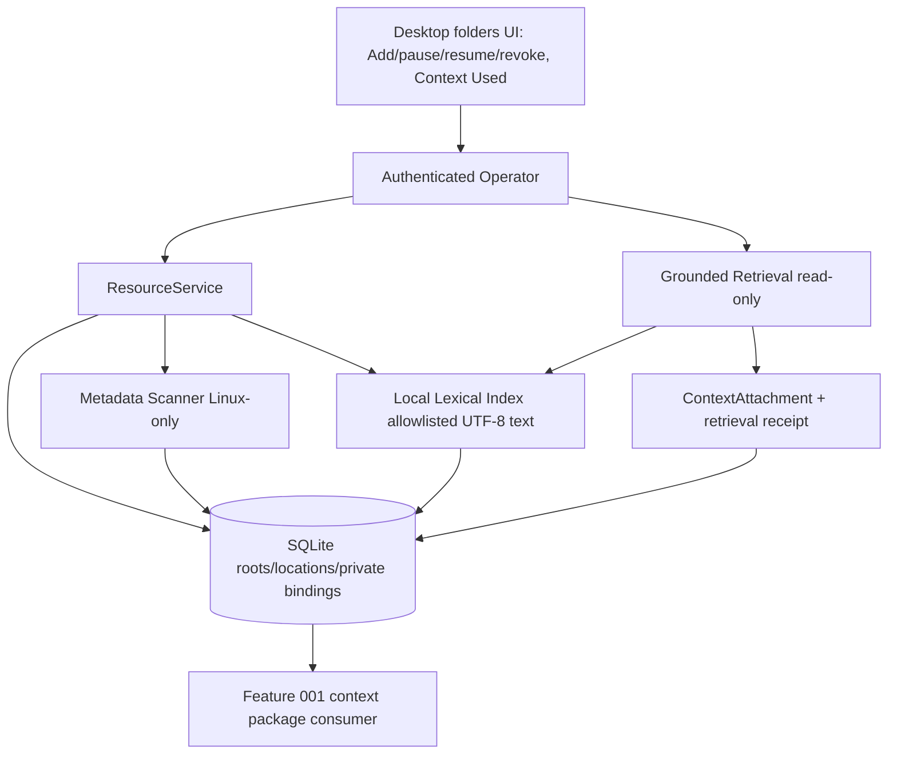

# 003 - Workspace Roots and Context Ingestion

**ID:** 003
**Status:** ACCEPTED/LOCKED
**Owners:** Resource, Conversation, Storage, Security/Trust, Desktop UI
**Updated:** 2026-11-13 (current-evidence crosswalk only; target revision remains 1.0)
**Revision:** 1.0 (revision 1.0 adds V1 gap coverage per owner acceptance 2026-11-09: Windows WorkspaceRoot add and scan, Windows path-identity tests, persisted ContextAttachment, retrieval receipt called from Send, @-reference ResourceRef picker; AC-013 to AC-019)
**Owner acceptance:** accepted 2026-11-09 by the repository owner (sarv-projects) via [docs/OWNER-ACCEPTANCE-REVIEW-PACKET.md](../../docs/OWNER-ACCEPTANCE-REVIEW-PACKET.md) (PR #1), including each scoped caveat as a binding condition. Acceptance authorizes implementation; it is not a claim of implementation, SERVED, INTEGRATED or QUALIFIED status.
**Change control:** a change to a locked contract in this package from now on requires a new revision and renewed owner approval (SPECIFICATION-STANDARD §7).
**Target release:** V1 local desktop
**Dependencies:** root ARCHITECTURE.md, docs/V1-PRODUCT-RELEASE-CONTRACT.md, docs/IMPLEMENTATION-MASTER-PLAN.md, and the owner documents named in RESEARCH.md. Feature 001 remains the Conversation send authority.

## 1. Problem

Chat without grounded files cannot cite local work. A one-time attachment is not a WorkspaceRoot. Search snippets must not become silent context. The machine must not be scanned wholesale.

Observable outcome: The owner attaches a folder as a persistent WorkspaceRoot, asks a grounded question with citations from exact revisions, and revokes the root so later retrieval is fenced.

## 2. Goals

- Create, pause, resume and revoke WorkspaceRoots with overlap rejection and private locators.
- Ingest bounded Resources with revision and digest identity.
- Expose Context Used only from actual ContextAttachments and retrieval receipts.
- Qualify WorkspaceRoot add and manual metadata rescan on the first GA row (Windows 11/10 `x86_64-pc-windows-msvc`) and on the Linux x86_64 second row, with symlink, reparse-point and path-identity denial tests (V1 gap coverage, revision 1.0).
- Persist ContextAttachments and a durable retrieval receipt from the Feature 001 Send path, and let the owner pick explicit ResourceRefs with an @-reference picker in the Feature 001 composer (V1 gap coverage, revision 1.0).
- After revoke, exclude that root from future retrieval while retaining historical provenance that does not re-expose bytes.

## 3. Non-goals

- Cloud replication of roots in V1 beyond the existing policy intersection.
- Treat pause as unavailable, or unavailable as revoked.
- Grant write, network or secret rights because a root exists.

## 4. Current evidence

The active checkout has partial WorkspaceRoot, Resource upload/index and local grounded-retrieval surfaces. This source/route/UI crosswalk was rechecked on 2026-11-13 at source checkpoint `6adadab539a62ca1c8b70621c7f88e1785cfe8c2`; it is not owner acceptance or release qualification. The complete Windows folder-ingestion and Context Used journey is not implemented. A-65 blocks the proposed separate receipt transaction, and A-69 records conflicting required/optional provenance fields; T01, T09 and T10 must not promote schema or transaction behavior until those owner decisions are resolved.

| Capability | Current source evidence | Limitation / release meaning |
|---|---|---|
| WorkspaceRoot list/status | CODE/SERVED: GET list, pause, resume and revoke routes; versioned/idempotent mutations | These routes do not imply a working root-creation path on every OS. |
| WorkspaceRoot creation | Desktop Tauri `add_workspace_root` opens the native folder picker and calls authenticated local-only `POST /__litecowork_local/workspace-root-selection`; the daemon handler commits Resource, root, location and private binding transactionally on Linux/macOS | Windows has a compiled fallback that returns `503 UNAVAILABLE` (“Persistent folder access is not qualified on this platform”). Public OpenAPI `POST /workspace-roots` remains target-only. The Add button is not proactively disabled on Windows and fails after selection. The current UI also commits immediately after the native picker selection, with no separate post-picker preview/confirm; watch policy `METADATA` and replication policy `NONE` are hardcoded. |
| WorkspaceRoot update | OpenAPI `PATCH /workspace-roots/{rootId}` is target-only | No served update handler. |
| WorkspaceRoot scan/observations | Scan and paginated observation routes are mounted; Linux scanner uses bounded metadata traversal and records file membership/observations | Scan is compiled only for Linux. Every non-Linux target (including Windows/macOS) returns `501 SCAN_UNSUPPORTED_PLATFORM`. Scan does not read file contents, create content revisions or index them. |
| Root scanning bounds | Source enforces 1,000 entries, depth 32, 1 MiB relative-locator budget, bounded deadline and two concurrent scans | A partial metadata census is not content ingestion and does not tombstone unseen files. |
| Resource upload/import | CODE/SERVED: quick import, chunked upload, revision upload/commit, list/detail/content, search and location/dependency reads | Resource storage is real; it is separate from automatic folder-root ingestion. The Library accepts ZIP/PDF/Office/image files as opaque stored originals; ZIP contents are not unpacked, indexed or attached to an agent. |
| ZIP archive preview | Source route `/v1/resources/{resource_id}/archive/preview` and isolated worker code exist; `ZipIntakeNotice` is mounted in Library and readiness reports `UNAVAILABLE` / `OPAQUE_RESOURCE_ONLY` | The worker bridge requires the non-default Linux `source-zip-worker` development feature; release sidecars build without it. The current UI does not call the preview route. No ZIP extraction, child-Resource creation, indexing or Task/Conversation attachment is available. |
| Local text index | CODE/SERVED: rebuild and index-state routes; allowlisted UTF-8 text formats include TXT/Markdown/CSV/JSON/JSONL/NDJSON/Rust/Python/TOML/YAML/JavaScript/TypeScript/CSS; max 1 MiB plus control-character and term-count bounds | PDF, Office, archive, image, audio and video are not indexable by this provider. This is a local lexical index, not embeddings/vector retrieval. |
| Grounded retrieval | CODE/SERVED: POST `/resources/retrieval` returns exact revision/digest-bound citations or explicit insufficient evidence from the local lexical provider | Read-only operation: no ContextAttachment, event, durable retrieval receipt, Effect or Artifact is committed. It is not wired into Conversation send. |
| Context Used | No persisted ContextAttachment domain record/table/event or production UI call site was found; `CONTEXT_ATTACHMENT` appears only as an AgentControl capability enum | AC-006 is not implemented. The UI helper `resources/retrieval-grounding.ts` has no production call site; there is no Context Used surface. |
| Desktop UI | `LibraryPage.tsx` owns the Persistent folders list, Add, pause/resume/revoke, manual scan and `WorkspaceRootObservations`; Resource/Library/Workbench views show Resource projections and read-only revision preview. The existing-Conversation **Add context or file** button loads one Resource page, filters attachable text and sends exact revision-pinned `resourceRefs`. | Root observation UI explicitly says metadata only and no content read/watch/index. On Windows, Add remains clickable but fails with 503; Scan is attempted once, then `SCAN_UNSUPPORTED_PLATFORM` feedback disables further scans. The composer does not open on `@`, cannot attach to a first message, and does not yet meet AC-017's labelled listbox/search/arrow-key/result-count contract. No Context Used UI exists. |

Code or a route alone does not qualify the feature. The design decisions are owner-accepted and the package is ACCEPTED/LOCKED (2026-11-09). Implementation and qualification status are unchanged by acceptance and are tracked in this section and in [docs/IMPLEMENTATION-STATUS.md](../../docs/IMPLEMENTATION-STATUS.md).

**Cross-owner implementation blocker (A-65/A-69; no target decision is changed here):** The diagram and §7.2 signatures remain accepted target material, not executable sequencing. Do not commit the retrieval receipt/ContextAttachment using the standalone `tx-attach` before Feature 001 creates its turn and dispatch intent. The required `retrieval_receipt_id` and `root_id` fields in §7.2 also conflict with DATA-MODEL's nullable fields for explicit references and uploaded Resources. T01/T09/T10 remain blocked until owner-reviewed provenance and atomic-admission contracts replace these conflicting shapes.

## 5. LOCKED and FLEXIBLE decisions

### LOCKED

- Root identity revalidation uses no-follow directory handles and exact OS identity (WORLD-RESOURCES).
- Canonical paths stay Runtime-local and never enter events or public errors.
- Overlapping non-revoked roots are rejected.
- Revoked roots cannot be reactivated.
- Root observation is not a capability grant.
- Context instructions cannot grant capabilities (CONTEXT.md).

### FLEXIBLE

- Module file layout and private helper names, provided the transactions and secret boundaries stay intact.
- Presentation copy, provided state distinctions remain visible.

### ACCEPTED DECISIONS AND ARCHITECTURAL CONTRACTS

These resolutions were accepted as written by the repository owner on 2026-11-09 via [docs/OWNER-ACCEPTANCE-REVIEW-PACKET.md](../../docs/OWNER-ACCEPTANCE-REVIEW-PACKET.md). The register rows in [docs/CONTRADICTION-AND-ALIGNMENT-REGISTER.md](../../docs/CONTRADICTION-AND-ALIGNMENT-REGISTER.md) are closed by the orchestrator, not by this package.

| ID | Topic | Accepted resolution and architectural contract | Canonical authority and consequence |
|---|---|---|---|
| B-13 | First supported Workspace ingestion formats | **ACCEPTED (2026-11-09): Qualify exactly the already-allowlisted UTF-8 lexical text set first.** The first GA ingestion formats are the formats the local text index already bounds: TXT, Markdown, CSV, JSON, JSONL, NDJSON, Rust, Python, TOML, YAML, JavaScript, TypeScript and CSS, each capped at 1 MiB with the existing control-character and term-count bounds. PDF, Office, archive, image, audio and video stay opaque stored originals (no extraction/index) in this slice. ZIP contents remain unexpanded. Every ingested revision carries a content digest; a format outside the set is stored opaque and fails retrieval indexing, not the whole root. | [WORLD-RESOURCES.md](../../docs/WORLD-RESOURCES.md), [CONTEXT.md](../../docs/CONTEXT.md). Keeps ingestion bounded and qualifiable per format; this is a local lexical index, not embeddings/vector retrieval, until an owner promotes a second provider. |
| B-14 | Watcher versus explicit rescan behavior | **ACCEPTED (2026-11-09): Explicit manual rescan is the GA default; no filesystem watcher ships in V1.** A rescan is an owner-initiated bounded metadata census (1,000 entries, depth 32, 1 MiB relative-locator budget, 8s deadline stopping traversal at 7s, two concurrent jobs); it commits FILE membership only and never silently tombstones unseen Resources. A watcher is target-only and deferred until OS notification semantics and invalidation are owned in WORLD-RESOURCES. Current source: scan is Linux-only and non-Linux returns `SCAN_UNSUPPORTED_PLATFORM`. **Rider (B-02/B-28):** the first GA row is Windows 11/10 `x86_64-pc-windows-msvc`, so V1 requires a Windows manual-rescan scanner with the same bounds (TASKS); macOS keeps returning `SCAN_UNSUPPORTED_PLATFORM` until separately qualified. | [WORLD-RESOURCES.md](../../docs/WORLD-RESOURCES.md), [STATE-MACHINES.md](../../docs/STATE-MACHINES.md). Avoids an unowned notification/invalidation contract; manual rescan is deterministic and already bounded in source. |

Both decisions are owner-accepted and the package is ACCEPTED/LOCKED. The GA OS is fixed by the B-02/B-28 rider: Windows 11/10 `x86_64-pc-windows-msvc` with OpenCode v2.0.32 first, Linux x86_64 desktop second. Acceptance does not change the current-state evidence in §4; Windows add (503) and scan (501) remain unimplemented until their tasks land.

## 6. High-level design

UI picker returns a candidate path to the Operator. ResourceService commits root status, location availability and private bindings in one SQLite transaction. Context assembly reads only ACTIVE roots and pinned revisions. Conversation send remains feature 001 and only consumes an already built package.

### Feature-specific component diagram



The metadata scanner, local lexical index and the ContextAttachment/retrieval-receipt path are the feature-specific components; root identity and locator custody remain WORLD-RESOURCES-owned and are not redefined here.

### Trust boundaries

The desktop UI is untrusted; the authenticated Operator is the only command path. Canonical paths and OS directory handles stay Runtime-local and never enter events or public error bodies. Context instructions and folder contents are untrusted input, not capability grants. A root being ACTIVE is not an implicit attachment. SQLite transactions perform no filesystem traversal, network or process calls; the scanner and index workers run outside the admission transaction.

### Actor sequence (target)

1. Owner picks a folder; Tauri calls the authenticated local-only selection route; the daemon commits Resource + root + location + private binding in one transaction (Linux/macOS; Windows fails closed with 503).
2. Owner runs a bounded metadata rescan (Linux); the scanner commits FILE membership only.
3. Owner uploads or the index ingests an allowlisted text revision with a content digest.
4. Owner asks a grounded question; retrieval returns exact revision/digest citations or explicit insufficient evidence.
5. A grounded answer lists Context Used only from committed ContextAttachments and retrieval receipts.
6. Owner revokes the root; the transaction fences future retrieval and keeps provenance without re-exposing bytes.

### Ownership

| Owner | Responsibility | Excluded responsibility |
|---|---|---|
| Desktop UI | Folder lifecycle controls, Context Used surface, distinct status labels | Reading contents, following symlinks |
| Operator | Auth, Workspace version checks, selection route | Locator bytes in error bodies |
| ResourceService | Root/location/binding transactions, revocation fencing | Content traversal inside SQLite |
| Metadata Scanner | Bounded census, FILE membership | Content reads, revision creation |
| Local Lexical Index | Allowlisted UTF-8 text index, rebuild | PDF/Office/binary indexing |
| Grounded Retrieval | Revision/digest citations, insufficient-evidence signal | Committing attachments on its own |
| Storage | Atomic commits, private-binding deletion on revoke | External process/network calls |

Trust boundary: the desktop UI is untrusted; the authenticated Operator is the only command path; native credentials and OS handles stay outside public events; SQLite transactions do not perform network or process calls.

## 7. Low-level design and interfaces

Follow WORLD-RESOURCES root creation, pause, resume and revoke transactions. ContextAttachments are explicit. Retrieval receipts record resource revision ids. Accepted-target indexing workers stay outside the admission transaction.

### 7.1 Existing signatures (CODE)

- Served root routes: `GET` list, pause, resume, revoke, scan, observations (scan Linux-only).
- Desktop selection: authenticated local-only `POST /__litecowork_local/workspace-root-selection`; the daemon commits Resource/root/location/private binding transactionally on Linux/macOS, Windows returns `503 UNAVAILABLE`.
- Scanner bounds in source: 1,000 entries, depth 32, 1 MiB relative-locator budget, 8s deadline (traversal stops at 7s), two concurrent jobs.
- Local text index: rebuild and index-state routes over the allowlisted UTF-8 formats at max 1 MiB with control-character and term-count bounds.
- Grounded retrieval: `POST /v1/resources/retrieval` returns revision/digest-bound citations or explicit insufficient evidence; read-only, commits no attachment.
- Events: `workspace.root.created.v1`, `workspace.root.status.changed.v1`.

### 7.2 Accepted target signatures (not yet in source)

Every signature below is an accepted target interface (not yet in source). It is promoted into its canonical owner document and the OpenAPI/schema in the same change that implements it.

```rust
// Accepted target interface (not yet in source): commit an explicit ContextAttachment with a retrieval receipt.
pub struct CommitContextAttachment {
    pub principal_id: String,
    pub workspace_id: String,
    pub conversation_id: String,
    pub resource_refs: Vec<PinnedResourceRef>,   // exact revision + content_digest
    pub retrieval_receipt_id: String,
    pub expected_conversation_version: u64,
}

pub trait ContextAttachmentStore: Send + Sync {
    fn commit_context_attachment(
        &self, commit: CommitContextAttachment,
    ) -> Result<CommittedContextAttachment, StoreError>;
}

// Accepted target interface (not yet in source): Context Used projection for a grounded answer.
pub struct ContextUsedEntry {
    pub resource_ref: PinnedResourceRef,
    pub root_id: String,
    pub citation_span: Option<CitationSpan>,
}

// Accepted target interface (not yet in source): durable retrieval receipt written when Send
// performs grounded retrieval (Feature 001 turn admission calls this owner port).
pub struct CommitRetrievalReceipt {
    pub principal_id: String,
    pub workspace_id: String,
    pub conversation_id: String,
    pub turn_id: String,
    pub query_digest: ContentDigest,           // digest of the query text, not the text
    pub provider_id: String,                   // current: local lexical parser id
    pub citations: Vec<PinnedResourceRef>,     // exact revision + content_digest
    pub outcome: RetrievalOutcome,             // GROUNDED | INSUFFICIENT_EVIDENCE | PROVIDER_UNAVAILABLE
    pub idempotency_key: String,
}

// Accepted target interface (not yet in source): Windows root selection on the GA row.
// Built on windows_local_security::open_directory_path_without_reparse,
// VerifiedDirectory::identity (volume serial + 128-bit file id) and
// windows_absolute_paths_overlap; replaces the cfg(not(linux|macos)) 503 fallback of
// create_workspace_root_from_native_selection in apps/litecoworkd/src/operator.rs.
#[cfg(windows)]
async fn create_workspace_root_from_native_selection(
    State(state): State<ApiState>, headers: HeaderMap, body: Bytes,
) -> Result<Json<WorkspaceRootCreatedResponse>, Response>;
```

Typed errors (accepted target interface, not yet in source): `ContextAttachmentError::{RootNotActive, RevisionConflicted, IntegrityFailure, OverBound}` reusing the existing `RESOURCE_CONFLICT`/`INTEGRITY_FAILURE` codes; `CONTEXT_ATTACHMENT`-specific codes are accepted targets and are not usable until promoted into SCHEMAS.md and the error registry together.

Ordering: authorize, compare expected version, commit the durable receipt, then perform any external call, then reconcile. Accepted target payload fields are not served until the canonical owner document and machine schema change together.

## 8. Data

See [DATA-MODEL.md](DATA-MODEL.md). This feature does not create a second source of truth beside the domain owner.

## 9. Wiring

See [WIRING.yaml](WIRING.yaml). Requests enter through the Operator. External calls sit outside transactions.

## 10. Security

Owner authorization and Workspace version are checked on every mutation. Symlinks are not followed. Overlap uses component comparison, not string prefix. Private locators are absent from Operator error bodies. Revocation deletes private bindings.

## 11. Errors and recovery

UNAVAILABLE, PAUSED and REVOKED are distinct. Stale Workspace version conflicts without partial writes. Identity mismatch on resume leaves the root PAUSED. Lost keyring identity is a startup blocker and must not be reported as a successful scan.

Races use compare-and-swap or a single-writer occurrence identity. Timeout after an external effect reconciles. Duplicate retries return the original receipt when the idempotency key matches and fail when the payload conflicts.

## 12. Crash and restart

Reload the last committed owner records. Do not infer success from an intent. Reconcile in-flight external work before a new side effect. Cancellation fences late results.

## 13. Configuration and compatibility

Linux and Windows locator encodings differ and both fail closed on malformed input. Windows UNC, drive-relative, device (`\\.\`), alternate-data-stream and noncanonical component paths fail closed. macOS qualification is separate. B-14 is accepted: no filesystem watcher ships in V1; rescan is manual.

OS qualification is per native desktop. WSL2 does not qualify Windows or Linux GUI behavior.

## 14. Observability

Log ids, versions, statuses and denial reasons. Do not log secret bytes, native handles, private locators or raw credentials. Audit commits include actor, workspace and receipt id.

## 15. EARS acceptance

Positive:
- **AC-001:** WHEN the owner adds a folder root, THE SYSTEM SHALL commit root, location and private binding in one transaction or leave no partial current-incarnation binding. Verify: SQLite atomicity test.
- **AC-006:** WHEN a grounded answer is shown, THE SYSTEM SHALL list Context Used only from committed attachments and retrieval receipts, not from bare search snippets. Verify: Context Used projection test.

Negative:
- **AC-002:** IF the proposed root overlaps an existing non-revoked root, THEN THE SYSTEM SHALL reject it without revealing the other root's private path. Verify: overlap rejection test asserting no locator in the error body.
- **AC-005:** WHEN the owner revokes a root, THE SYSTEM SHALL fence future retrieval and SHALL NOT reactivate that root id. Verify: revoke fencing + reactivation-refusal test.

Boundary:
- **AC-004:** WHILE a root is PAUSED or UNAVAILABLE, THE SYSTEM SHALL exclude it from search and context assembly. Verify: status-gating assembly test.
- **AC-007:** IF ingestion exceeds the configured byte or file bound, THEN THE SYSTEM SHALL fail that resource and continue unrelated roots. Verify: per-resource bound test.

Recovery:
- **AC-003:** WHEN startup reopens a saved root, THE SYSTEM SHALL bind it only on exact OS identity match. IF that check fails for an ACTIVE root, THEN THE SYSTEM SHALL mark the root UNAVAILABLE. IF the root is PAUSED, THEN THE SYSTEM SHALL leave it PAUSED and mark the location UNAVAILABLE. IF the root is REVOKED, THEN THE SYSTEM SHALL NOT reopen it. Verify: startup identity-revalidation matrix.

Security:
- **AC-008:** WHEN any root mutation or scan runs, THE SYSTEM SHALL not follow symlinks and SHALL keep canonical paths out of events and public errors. Verify: symlink and locator-redaction tests.

Concurrency:
- **AC-009:** WHILE two scans are in flight, THE SYSTEM SHALL bound concurrency to two jobs and settle each with compare-and-swap on the Workspace version. Verify: concurrent-scan test.

UI and accessibility:
- **AC-010:** WHEN a root is UNAVAILABLE, PAUSED or REVOKED, THE SYSTEM SHALL present each state distinctly and SHALL NOT present PAUSED as REVOKED or UNAVAILABLE as a successful scan. Verify: desktop status-label render test.

Performance:
- **AC-011:** WHEN a metadata rescan runs, THE SYSTEM SHALL stop traversal at the bounded deadline and commit a partial census without tombstoning unseen Resources. Verify: deadline-bound census test.

Integrity:
- **AC-012:** IF a pinned ResourceRef digest no longer matches the committed content, THEN THE SYSTEM SHALL return `INTEGRITY_FAILURE` and SHALL NOT serve the stale bytes as a citation. Verify: digest-mismatch test.

V1 gap coverage (revision 1.0):
- **AC-013:** WHEN the owner adds a folder root on Windows x64, THE SYSTEM SHALL open the selected directory without following reparse points, bind the root to its exact volume serial number and file id, reject UNC, drive-relative, device and alternate-data-stream paths, and commit Resource, root, location and private binding in one transaction. Verify: Windows root-selection test matrix on the GA row.
- **AC-014:** WHEN the owner runs a manual rescan on Windows x64, THE SYSTEM SHALL apply the same bounds as Linux (1,000 entries, depth 32, 1 MiB relative-locator budget, deadline, two concurrent jobs), SHALL NOT traverse junctions, symbolic links or mount points, and SHALL commit FILE membership only. Verify: Windows bounded-census test.
- **AC-015:** WHILE root add or scan is not qualified on the running platform, THE SYSTEM SHALL disable the control before selection and state why, and SHALL NOT open the folder picker or report a successful scan. Verify: platform-availability render test.
- **AC-016:** WHEN Send performs grounded retrieval for a turn, THE SYSTEM SHALL commit a durable retrieval receipt bound to the turn, its exact cited revisions and the outcome before dispatch, and an identical replay SHALL return the same receipt. Verify: retrieval-receipt send-path test.
- **AC-017:** WHEN the owner types @ in the composer, THE SYSTEM SHALL offer only Resources of the current Workspace that are under an ACTIVE root or otherwise admitted, pin each choice to an exact revision, and expose the picker as a keyboard-operable labelled listbox. Verify: @-reference picker render and keyboard test.
- **AC-018:** WHEN a turn with explicit ResourceRefs is admitted, THE SYSTEM SHALL persist one ContextAttachment per pinned ref with the turn, and after restart Context Used SHALL show the same attachments. Verify: ContextAttachment persistence and restart test.
- **AC-019:** IF a root is paused or revoked after a ResourceRef was selected but before the turn dispatches, THEN THE SYSTEM SHALL refuse the attachment with a typed root-not-active error and SHALL NOT materialize its bytes to the agent. Verify: revoke-during-send race test.
- **AC-020:** WHEN the owner opens the Context Debugger for a committed turn (task P-15, owner approval 2026-11-09), THE SYSTEM SHALL show exactly what entered the model context - attachments, retrieved passages with their source revisions, in-scope skills and the applied limits - read from the durable retrieval receipt and ContextAttachment records, and SHALL NOT reconstruct or fabricate context; a turn with no retrieval SHALL show an explicit no-retrieval state. Verify: Context Debugger render and restart test.

## 16. Executable acceptance command

```bash
python3 .specify/scripts/validate_feature_package.py specs/003-workspace-roots-context-ingestion
```

Implementation gates are the cargo and pnpm commands named in TASKS.md. They are not evidence until run at an identified revision on the declared release-matrix row.

## 17. Out-of-bounds

- Do not perform mediated file writes (feature 005).
- Do not start browser or terminal sessions.
- Do not replicate secret files into events.

## 18. Assumptions and open questions

- The active checkout has a real private local-only root-selection route, but its handler is available only on Linux/macOS; the Windows fallback returns 503. The public OpenAPI `POST /workspace-roots` remains target-only.
- Root scan is explicitly Linux-only; Windows/macOS return 501 `SCAN_UNSUPPORTED_PLATFORM`. Windows lifecycle/status route tests do not qualify add-root or scan.
- Root scanning is metadata-only. It does not ingest file contents or produce content revisions. The separate Resource upload/index and grounded-retrieval surfaces are not wired into Conversation ContextAttachments or a Context Used UI.
- The first GA OS (Windows x64, B-02/B-28 rider) and ingestion formats (B-13) are accepted; the current Windows desktop still cannot complete the root-add/scan journey until the Windows tasks land.
- Open question for implementation: whether Windows 8.3 short names and case variants are normalized before overlap comparison or rejected; `windows_absolute_paths_overlap` currently compares components ordinal case-insensitively and fails closed on noncanonical components.

All section 5 decisions are owner-accepted. Implementation tasks run from 003-T01 through 003-T18 in TASKS.md.

## 7a. Owner facts incorporated 2026-11-01

Read from WORLD-RESOURCES, CONTEXT, and STATE-MACHINES.

- An ACTIVE root is not an implicit attachment. Context assembly admits only explicitly selected pinned ResourceRefs.
- A metadata census commits FILE membership only, reads no content, and creates no ResourceRevision. Bounds: 1,000 directory entries, depth 32, 1 MiB of relative locator bytes, an 8-second deadline that stops traversal at 7 seconds, and two concurrent jobs. A partial scan does not tombstone unseen Resources.
- Resume of PAUSED requires an AVAILABLE location and the current incarnation READY or DEGRADED. An UNAVAILABLE root is restored only by identity revalidation, never by resume.
- Keyring identity loss blocks startup before the root transaction and does not mark roots UNAVAILABLE.
- Revocation commits REVOKED, deletes private bindings, and removes selected-root replication membership in one transaction. Task history and Artifacts remain under their own retention.
- Overlap rejects the same, ancestor, or descendant path of every ACTIVE, PAUSED, or UNAVAILABLE root. Only REVOKED leaves the check. SELECTED_FOLDERS stores root ids. A root policy cannot broaden Workspace replication.
- Workspace instruction revisions are at most 64 KiB UTF-8. A stale write returns STALE_WORKSPACE_VERSION.
- Content reads require ContextDocumentStatus ACTIVE. REVOKED, DELETION_PENDING, and DELETED block new reads. Revocation does not rewrite a transcript that already received the bytes.
- An unpinned ResourceRef in CONFLICTED returns RESOURCE_CONFLICT. A digest mismatch against the pinned content_digest returns INTEGRITY_FAILURE.
- Served public operations include list/pause/resume/revoke/scan/observations for roots and Resource list/search/content/upload/revision/index/retrieval. Desktop root creation is not the public `addWorkspaceRoot` operation: Tauri uses the authenticated local-only `POST /__litecowork_local/workspace-root-selection` handler, which is implemented only on Linux/macOS; Windows returns 503. Public `addWorkspaceRoot` and `updateWorkspaceRoot` remain target-only. Scan is Linux-only; non-Linux returns 501. Events: workspace.root.created.v1, workspace.root.status.changed.v1.


## 19. Requirement traceability

| Requirement | Canonical contract | Task | Acceptance | Verification method |
|---|---|---|---|---|
| Atomic root/location/binding commit | WORLD-RESOURCES, STORAGE | 003-T02 | AC-001 | SQLite atomicity test |
| Overlap rejection, no locator leak | WORLD-RESOURCES, TRUST | 003-T02 | AC-002 | Overlap rejection test |
| Startup identity revalidation | WORLD-RESOURCES, STATE-MACHINES | 003-T04 | AC-003 | Startup matrix test |
| Exclude PAUSED/UNAVAILABLE | CONTEXT, WORLD-RESOURCES | 003-T02 | AC-004 | Status-gating test |
| Revoke fencing, no reactivation | WORLD-RESOURCES | 003-T02 | AC-005 | Revoke fencing test |
| Context Used from receipts only | CONTEXT, STORAGE | 003-T12 | AC-006 | Projection test |
| Per-resource ingestion bound | WORLD-RESOURCES, STORAGE | 003-T07 | AC-007 | Bound test |
| No symlink follow, locator redaction | TRUST, WORLD-RESOURCES | 003-T06 | AC-008 | Symlink + redaction tests |
| Bounded scan concurrency | WORLD-RESOURCES | 003-T05 | AC-009 | Concurrent-scan test |
| Distinct status labels | PRESENTATION-RUNTIME, contracts/ui-behavior.md | 003-T08 | AC-010 | Render test |
| Deadline-bounded census | WORLD-RESOURCES | 003-T05 | AC-011 | Deadline census test |
| Digest-mismatch integrity failure | STORAGE, CONTEXT | 003-T09 | AC-012 | Digest-mismatch test |
| Windows root add with exact identity | WORLD-RESOURCES, SECURITY | 003-T03 | AC-013 | Windows root-selection matrix |
| Windows bounded manual rescan | WORLD-RESOURCES | 003-T05 | AC-014 | Windows bounded-census test |
| Platform-unavailable controls disabled | contracts/ui-behavior.md, V1-UI-ACTION-STATE-LEDGER | 003-T08 | AC-015 | Platform-availability render test |
| Retrieval receipt from Send | CONTEXT, STORAGE, Feature 001 | 003-T10 | AC-016 | Retrieval-receipt send-path test |
| @-reference ResourceRef picker | CONTEXT, NATIVE-COMPOSER-LLD | 003-T11 | AC-017 | Picker render and keyboard test |
| Persisted ContextAttachment | CONTEXT, STORAGE | 003-T09 | AC-018 | Persistence and restart test |
| Revoke-during-send fence | CONTEXT, WORLD-RESOURCES, FAILURE-RECOVERY | 003-T13 | AC-019 | Revoke-during-send race test |
| Context Debugger surface (P-15, owner approval 2026-11-09) | CONTEXT, PRESENTATION-RUNTIME | 003-T17 | AC-020 | Context Debugger render and restart test |
