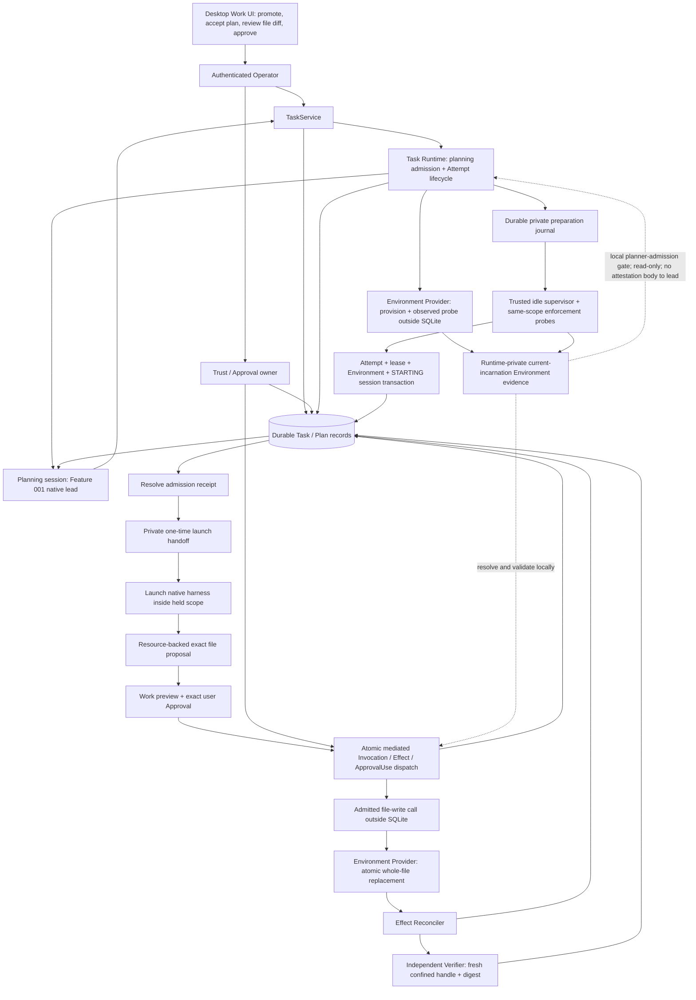

# 005 - Safe Task Path

**ID:** 005
**Status:** IN_REVIEW (revision 1.0 is ACCEPTED/LOCKED; revision 1.1 has owner-directed implementation authorization and awaits cross-owner review)
**Owners:** Task Runtime, Environments, Trust, Storage, Desktop UI
**Updated:** 2026-11-17 (owner-directed revision 1.1 records the Environment lifecycle, durable write proposal, mediated dispatch and grant-request decisions; implementation and qualification remain separate)
**Revision:** 1.1 (proposed; revision 1.0 remains the last accepted revision)
**Owner acceptance:** accepted 2026-11-09 by the repository owner (sarv-projects) via [docs/OWNER-ACCEPTANCE-REVIEW-PACKET.md](../../docs/OWNER-ACCEPTANCE-REVIEW-PACKET.md) (PR #1), including every "ACCEPT (scoped)" caveat and the B-17 rider as binding conditions.
**Revision 1.1 owner direction:** On 2026-11-17 the repository owner directed implementation of the T01 resolutions for A-70/A-87/A-88/A-90. This authorizes work on the proposal while the revised package remains IN_REVIEW pending cross-owner review. It does not claim renewed acceptance, provider integration, or qualification.
**Revision note:** revision 1.0 adds V1 gap coverage per owner acceptance 2026-11-09: the Conversation-to-Task promotion control (AC-013), the Windows-row UNAVAILABLE posture for Task execution (AC-014), the observed-launch Linux attestation rule (AC-015), the atomic-replace crash rule (AC-016) and the PROPOSED Windows Environment provider B-35 (AC-017, pending owner). Revision 1.1 resolves A-70/A-87/A-88/A-90 for implementation: planning uses a Task-scoped read-only Environment; every execution Attempt uses a fresh Attempt-private Environment; exact replacement bytes are pinned through an immutable managed ResourceRevision; Attempt admission and mediated write dispatch are distinct transactions; and FileWriteScopeRequest is untrusted input resolved by Trust.
**Change control:** revision 1.0 is locked; revision 1.1 is an owner-directed proposal authorized for implementation and remains IN_REVIEW until cross-owner review is recorded. Any later change to a locked decision, accepted target interface or AC requires a new revision and renewed owner review (SPECIFICATION-STANDARD §7). No revision status is a claim of SERVED, INTEGRATED or QUALIFIED evidence.
**Target release:** V1 local desktop. Release matrix consequence (B-17 rider): Task execution qualifies first on the Linux x86_64 desktop row; on the Windows 11/10 `x86_64-pc-windows-msvc` row it stays visibly UNAVAILABLE until a Windows Environment provider (B-35) qualifies.
**Dependencies:** root ARCHITECTURE.md, docs/V1-PRODUCT-RELEASE-CONTRACT.md, docs/IMPLEMENTATION-MASTER-PLAN.md, and the owner documents named in RESEARCH.md. Feature 001 remains the Conversation send authority.

## 1. Problem

Ordinary chat must not become a Task by inference. A working directory is not a sandbox. One consequential edit needs plan acceptance, isolation attestation, lease, grant and independent verification.

Observable outcome: The owner promotes one Conversation outcome into a Task, accepts an immutable plan, and one isolated Attempt edits one approved file with a receipt that survives cancel and restart.

## 2. Goals

- Create a Task explicitly from a committed Conversation outcome or a standalone objective.
- Accept one immutable PlanRevision and Steps atomically before any Attempt.
- Run one Environment provider that attests read/write roots, network, process tree and limits.
- Reconcile an ambiguous write before retry and verify the edit independently.

## 3. Non-goals

- Multi-step heterogeneous delegation beyond one edit.
- Coworker-required Tasks.
- Treating git worktree alone as isolation.
- Treating omission of LeadFailoverPolicy as DISABLED when a Coworker revision already supplies ASK or ALLOW_LISTED.

## 4. Current evidence

The active checkout contains a partial Task record/specification/read model, a read-only planning preflight, and compiled domain/storage execution primitives. It does not contain an integrated Task planning → accepted PlanRevision → Attempt → isolated Environment → mediated Effect → independent verification path. The following matrix records the current source/route/UI boundary; it is not owner acceptance or release qualification.

| Capability | Current source/route evidence | Limitation / release meaning |
|---|---|---|
| Explicit Task creation | CODE/SERVED: `POST /v1/tasks` persists a durable Task and initial TaskSpecRevision with idempotency receipt. The Home “New task” composer submits a standalone objective, optional Coworker/default lead, and pinned Resource revision refs. Suggestion acceptance and Routine Manual Run also materialize Task records. | Task creation deliberately does not start planning, an AgentSession, an Attempt or an Environment. No explicit “promote this Conversation outcome” action was found in `ConversationsPage`; current Home creation is a separate Task objective flow. |
| Task/specification read and edit | CODE/SERVED: Task list/get, `POST /v1/tasks/{task_id}/spec-revisions`, plan-revision list, Step list, Conversation Task list, Task artifacts, presentation/progress, capability-invocation and verification-run read views | These are durable records and read projections. Reading existing Steps/Attempt/Evidence is not an Attempt admission path. |
| Task lead selection | CODE/SERVED: Task create resolves explicit preferred binding, then selected Coworker default, then Workspace default; missing lead fails `AGENT_UNAVAILABLE`. Owner Task lead handoff is served via `POST /v1/tasks/{task_id}/lead-agent` and commits a Task lead change. | Changing the lead does not start planning or create an Attempt. There is no substitute-agent execution fallback. |
| Planning readiness | CODE/SERVED: `GET /v1/tasks/{task_id}/planning-readiness` validates Workspace ownership and `If-Match`, prepares a bounded internal planning packet, and returns a read-only projection | Response hardcodes `dispatch_available=false`, `planning_started=false`, `agent_session_started=false`, `plan_created=false`. Current blockers include isolation, unmediated native capabilities, protocol/process qualification, planning context materialization and session settlement. No provider is invoked. |
| Plan acceptance | Only `GET /v1/tasks/{task_id}/plan-revisions` is served; `POST /v1/tasks/{task_id}/plan-revisions` (`submitTaskPlan`) is target-only. CODE: `accept_initial_plan_transaction` checks Workspace ownership, Task/spec versions and state, active planner session/runtime/host binding, request digest/replay; then atomically writes Task aggregate/current-plan pointer, PlanRevision, Steps, their events and a receipt. | No authenticated Operator plan-acceptance handler or usable live planner exists. The planner dispatch gate remains closed, so this storage transaction is not an integrated plan-production path; negative/replay/concurrency/rollback acceptance coverage remains incomplete. |
| Attempt admission and recovery | Attempt/lease admission state types and SQLite storage methods exist in domain/storage crates with unit tests | No Task daemon route or production caller of `admit_step_attempt` was found. Attempt list, Effect list, recovery, pause/resume/cancel/steer and environment control routes are target-only. `attempt_process_scope.rs` explicitly says its containment/journal remains staged and is `allow(dead_code)`. |
| Environment provider | CODE (checked 2026-11-12): `probe_environment_provider` reports platform/provider observations. Windows reports no Task-capable `LocalWorkspace` class or supported lifetime and returns a typed planning blocker. Linux only reports a local workspace class if the canonical trust-checked Bubblewrap probe finds an eligible candidate; that probe does not attest isolation. | Provider probe is not provisioning or Task invocation. Budget enforcement is `Unavailable`; checkpoint/restore and persistent Workspace lifetime are false. No Task API provisions or attaches an Environment. Job Object support in `windows-local-security` is a process-lifetime primitive only, not a Windows Environment provider. |
| Isolation/quiescence evidence | CODE: `IsolationAttestation`, enforcement dimensions and fail-closed admission checks exist in `environment_isolation.rs`; process-scope journal/proof types exist | Search found no production caller wiring those attestations into Task Attempt admission or recovery. A Windows Job Object is process-tree containment evidence; by itself it does not prove filesystem-root confinement, network denial or resource-budget enforcement. |
| Trust and grants | CODE/SERVED: `POST /v1/capability-grants` and revoke route accept bounded, expiring Task-planning `workspace.resource.read` grants scoped to exact Resource refs | These are read grants for planning context, not an execution grant for the proposed file write. The Trust evaluator is not connected to a live Attempt/tool invocation path. |
| Effects and verification | CODE/SERVED read views for Task verification runs, Artifacts, capability invocations and presentation/progress | The SQLite CapabilityDispatchStore has CODE for closed Effect validation and exact Core file-replacement grant-scope revalidation, but no production Task dispatcher/reconciler/verification pipeline is connected to the Attempt path. No file write is issued through an Environment by this feature. |
| Desktop Work UI | `App.tsx` Home composer explicitly saves a Task; Work lists Tasks, opens detail, edits objective revisions, checks planning readiness, displays pinned inputs, read-only Steps, presentation/progress snapshots and committed outputs | No plan acceptance, Attempt start, cancellation, retry/recover, approval, Environment detail or real execution controls. Task presentation reads saved records and does not prove an execution worker is live. |

Feature 005 revision 1.0 is ACCEPTED/LOCKED as of owner acceptance 2026-11-09. Revision 1.1 records the owner-directed decisions for A-70/A-87/A-88/A-90 and remains IN_REVIEW pending cross-owner review. The 2026-11-09 source notes below are historical. Current evidence is split between the 2026-11-19 execution boundary in §7c and the 2026-11-23 Conversation-promotion slice in §7d. A real, independently verified isolated file edit remains unimplemented and unqualified. Additional historical source facts checked 2026-11-09 for Task grounding:

- Historical 2026-11-09 finding: storage refused Conversation-origin Task creation until its source lineage contract was resolved. That refusal was removed by the user-directed 005-T12 CODE/SERVED slice described in §7d; do not use this baseline as current behavior.
- Storage refuses planning-session start: `require_task_planning_isolation_admission()` in `crates/storage-sqlite/src/lib.rs` always returns `TASK_PLANNING_ISOLATION_UNAVAILABLE`, which closes `start_task_planning_session`. `accept_initial_plan` (`PlanAcceptanceCommit` / `PlanAcceptance` in `crates/storage-core/src/lib.rs`) exists with tests but has no Operator caller.
- The source crosswalk written on 2026-11-09 is stale. The current daemon depends on `domain-environment`, `linux-process-scope` and `local-environment-staging`; `environment_isolation.rs` imports the canonical `domain_environment::environment::EnforcementStatus`; and `environment_provider.rs` calls the single `linux_process_scope::probe_local_provider` implementation, whose candidate list is `BUBBLEWRAP_CANDIDATES`. This consolidation is CODE, not Environment provisioning or attestation.
- `crates/linux-process-scope/src/bubblewrap.rs` builds an unshared Bubblewrap launch under a systemd transient scope. The current code passes `--unshare-user --unshare-pid --unshare-net --unshare-ipc --unshare-uts --die-with-parent --cap-drop ALL`, binds staged inputs read-only, and places output/home/`/tmp` on a size-capped sandbox-private `/workspace` tmpfs; unit tests verify the command plan and host staging path is not mounted. The immediate `--attempt-runner`, held `--held-attempt-runner`, and internal output-frame parser/file reader have CODE coverage. The held runner emits an in-scope readiness marker then blocks on an exact one-shot launch signal; the Runtime wrapper requires the held readiness marker, refuses a second or ambiguous signal write, and withholds native stdio until signal success. Before readiness, the packaged inner runner now checks exact tmpfs capacity, writable aliases, root/input read-only behavior and tiny canaries in that scope. A separate disposable small-cap test exercises `ENOSPC`; it is not production readiness or attestation evidence. A direct WSL Bubblewrap test checks that the native harness remains unstarted before that signal. A separate `RuntimeLocalPreparationJournal` provides CODE for write-ahead intent, exact held-scope and receipt phases, bounded no-follow journal reads, canonical Attempt-key checks and cross-process phase serialization; focused native-Windows journal tests pass 6/6. These remain code primitives: there is no same-scope process/network enforcement probe, exact SQLite receipt check, production Task Runtime caller, attestation, Attempt admission or Resource persistence. The existing capture session still starts an already-admitted mapped scope, preserves native stdio, drains the framed candidate stream, and returns bytes only after recursive cgroup quiescence and launcher reap. Its fake-scope retry/exit/cancellation tests and direct WSL runner/scratch tests remain CODE only; direct Bubblewrap tests bypass `ManagedScope` and systemd/cgroup supervision. Native managed-scope, scratch, namespace and systemd/cgroup qualification remain outstanding.
- 2026-11-25 source update: `ManagedScope`/`HeldEnvironmentScope` expose CODE-only process-start and cgroup identity capture/recheck. The observation pins the PID with pidfd and binds boot ID, start time, exact cgroup membership/inode, executable inode, effective UID and observed cgroup limits; it repeats process liveness/start, membership, UID, executable, cgroup inode/population and limit checks after collecting the initial snapshot. A daemon-private adapter persists the captured unit/PID/start/digest into the existing preparation journal and reloads/rechecks it only from the `ScopeHeld` pre-admission phase; three fake-scope tests cover persistence, phase refusal and changed live identity. No Task Runtime caller invokes the adapter before admission, and this code does not observe namespace/network policy or prove real systemd-managed behavior.
- `crates/windows-local-security` provides `spawn_kill_on_drop_job` (Job Object, KILL_ON_JOB_CLOSE) and `replace_file_write_through`; it has no AppContainer, restricted-token or Windows Filtering Platform code.
- `StepAttemptCoordinator::admit` (`crates/domain-task/src/execution.rs`), `SqliteCapabilityDispatchStore::admit_capability_dispatch` and the Effect/Evidence store (`crates/storage-sqlite/src/effect_evidence.rs`) have no daemon caller. The SQLite dispatch store has CODE-only admission coverage: it reloads and validates the Effect and compares the exact Core file-write grant constraints to the closed target before committing durable dispatch records.

## 5. LOCKED and FLEXIBLE decisions

### LOCKED

- Task creation does not imply Step, Attempt, lease or Environment (TASK-RUNTIME).
- No persisted Task DRAFT; unsent composer stays in the Operator.
- Unavailable lead fails with AGENT_UNAVAILABLE and does not substitute another binding.
- Unknown external effect is reconciled before retry (release contract §6).
- Grants are explicit and scoped.

### FLEXIBLE

- Module file layout and private helper names, provided the transactions and secret boundaries stay intact.
- Presentation copy, provided state distinctions remain visible.

### OWNER-ACCEPTED DECISIONS AND ARCHITECTURAL CONTRACTS

B-17 and B-18 were accepted by the repository owner on 2026-11-09 via [docs/OWNER-ACCEPTANCE-REVIEW-PACKET.md](../../docs/OWNER-ACCEPTANCE-REVIEW-PACKET.md); the B-17 rider below is binding. B-35 is a new blocker raised by that rider; it is PROPOSED and still needs an owner decision. The register of record is [docs/CONTRADICTION-AND-ALIGNMENT-REGISTER.md](../../docs/CONTRADICTION-AND-ALIGNMENT-REGISTER.md).

| ID | Topic | Status, resolution and architectural contract | Canonical authority and consequence |
|---|---|---|---|
| B-17 | First Environment provider for safe Task execution | **ACCEPTED (2026-11-09): The first Environment provider is the Linux bubblewrap-backed local provider, qualified for all four isolation dimensions, not the Windows Job Object provider.** Admission accepts only a current-incarnation `IsolationAttestation` whose filesystem roots, process-tree lifetime/quiescence, network policy (default deny) and resource-limit fields are all `ENFORCED`. A Windows Job Object proves process-tree containment only; by itself it is `NOT_ENFORCED` for filesystem-root confinement and network denial and therefore fails admission closed. `probe_environment_provider()` output is discovery evidence, not an attestation. **Owner rider (binding):** Task execution (Area 6) and the daemon-owned terminal (Area 4, B-23 needs an admitted Environment) qualify first on the Linux x86_64 desktop row; on the Windows 11/10 `x86_64-pc-windows-msvc` row they stay visibly UNAVAILABLE until a Windows Environment provider (B-35) qualifies. Per the B-09 caveat a Job Object or cgroup is process lifetime only, never an isolation claim. | [ENVIRONMENTS.md](../../docs/ENVIRONMENTS.md), [TRUST.md](../../docs/TRUST.md). A partial OS capability is never promoted to a full sandbox. The exact bubblewrap version and launch profile are pinned by the contract-promotion task and recorded with the qualification evidence. |
| B-18 | First mediated file-operation class | **ACCEPTED (2026-11-09): The one write primitive is atomic whole-file replacement of exactly one approved file.** Contract: input is a new-content blob bound to the approved plan digest; the base is the pinned prior revision digest; maximum 1 MiB; the path must resolve inside the admitted WorkspaceRoot with no symlink escape; the provider writes to a temporary file, fsyncs, then atomically renames over the target; on an `INTEGRITY_FAILURE` or ambiguous result it rolls back and reconciles before any retry; an independent post-write verifier recomputes the digest against the approved content. Arbitrary shell commands and general workspace writes are not an equivalent first slice. **Revision 1.1 implementation detail:** candidate bytes are an exact managed ResourceRevision; Attempt admission precedes a separate mediated Invocation/Effect dispatch transaction that revalidates the live lease and consumes ApprovalUse atomically. | [TASK-RUNTIME.md](../../docs/TASK-RUNTIME.md), [ENVIRONMENTS.md](../../docs/ENVIRONMENTS.md), [TRUST.md](../../docs/TRUST.md), [STORAGE.md](../../docs/STORAGE.md). The write runs outside SQLite after dispatch admission; the verifier makes success independently provable. |
| B-35 | Windows Environment provider for safe Task execution | **PROPOSED (pending owner): a Windows local Environment provider built from an AppContainer (filesystem and object-namespace confinement to the admitted roots through explicit capability SIDs and ACLs), a restricted token (no privileges, deny-only administrator and user groups), a Job Object (process-tree lifetime, KILL_ON_JOB_CLOSE, active-process, memory and CPU limits) and a Windows Filtering Platform egress policy (default-deny outbound for the AppContainer package SID), with all four isolation dimensions (filesystem, process-tree, network, resource-limit) ENFORCED and attested in a current-incarnation `IsolationAttestation` from an observed launch.** Delivered as a V1 task after the Linux bubblewrap slice qualifies. A Job Object alone is never described or attested as a sandbox; any dimension that is UNKNOWN or NOT_ENFORCED fails admission closed. | [ENVIRONMENTS.md](../../docs/ENVIRONMENTS.md), [TRUST.md](../../docs/TRUST.md), [NETWORK-SECURITY.md](../../docs/NETWORK-SECURITY.md). Until B-35 is owner-accepted and its provider qualifies on the exact Windows build, Task execution and the daemon-owned terminal on the Windows release row remain visibly UNAVAILABLE (AC-014). Owner: Environments with Security; decision needed from the repository owner. |

The B-18 outcome remains one exact, bounded, independently verified file replacement. Revision 1.1 records these owner-directed resolutions:

- **A-70 — Environment identity and lifecycle.** Planning uses a Task-owned `TASK_SHARED` / `TASK_RETAINED` Environment with read-only roots and a current-incarnation attestation bound to the exact TaskSpec revision and Resource set. The planning AgentSession stores its public `environment_id`; Runtime attestation and provider handles remain private. Each execution Attempt, delegated child Attempt, and verifier receives a newly provisioned `ATTEMPT_PRIVATE` Environment. No planning Environment or prior Attempt Environment is reused for execution. Before any provider side effect, Runtime durably writes a private, owner-only Environment-preparation journal entry containing the proposed Environment/Attempt/session identities, current Runtime incarnation, exact normalized policy/input digests and provider-resource reconciliation key. The provider then starts only a trusted, fixed-identity, idle supervisor inside the exact prepared scope. It runs bounded enforcement probes in that live scope and holds the scope without starting a native harness, model session, tool server, user code, or credentials. Runtime derives and stores the current-incarnation attestation only from those observations and rechecks supervisor/process-scope identity immediately before admission. One short SQLite transaction then commits Environment metadata, Attempt, Step binding, lease, `STARTING` AgentSession and receipt. Only after the committed receipt is resolved does Runtime send a one-time private launch handoff that starts the native harness inside the already-attested scope. The private preparation journal is not a domain record, event, API object, backup or source of authority; it exists to recover external preparation across the non-atomic OS/SQLite boundary. Exact-receipt recovery decides whether a journaled scope is bound. An unbound scope is destroyed only after exact provider identity and quiescence are observed; unknown identity or quiescence retains a startup blocker. PID-only or process-name cleanup is forbidden. If a provider cannot hold the same observed scope across admission and native launch, the Task remains unavailable rather than accepting a preflight-only attestation.
- **A-87 — exact replacement content.** Candidate bytes are uploaded through the existing managed Resource lifecycle and pinned by exact `(workspace_id, resource_id, resource_revision_id, content_digest, size_bytes)`. T08 must provide an authenticated, Attempt-scoped, bounded producer-to-Resource handoff that accepts exact bytes and returns the committed ResourceRef/revision/digest/size plus a durable receipt; a host path, a transient scratch file, a textual diff or a provider's “write succeeded” message is not a durable proposal. The handoff creates candidate data only and grants no write authority. Provider-specific ACP/MCP tool transport is usable only after the exact provider/version proves the tool is available, bound to the correct Attempt, and isolated from other sessions; absence of a qualified tool path blocks the proposal rather than falling back to arbitrary direct host writes. The canonical `Effect.target_json` carries a typed file-replacement target containing the WorkspaceRoot ID, root-relative path, base digest, exact ResourceRef, content digest, byte count and accepted plan-action digest. The immutable ResourceRevision is the durable preview and recovery source; no bytes or native locator are copied into an event, Task packet, approval record or ordinary log. Proposal creation and later dispatch have distinct idempotency identities. A missing, revoked, external-only, digest-mismatched or oversized Resource blocks approval and dispatch.
- **A-88 — transaction composition.** Attempt admission is a prior Task Runtime transaction that commits Environment metadata, Attempt, Step binding, ExecutionLease, `STARTING` AgentSession and its receipt after the exact live trusted supervisor has been observed and attested. The native harness starts only after the admission receipt is committed and resolved; an ambiguous storage result is resolved by the original idempotency identity before any launch handoff. If the supervisor dies after commit but before harness readiness, the Attempt remains non-running and is failed/abandoned through recovery; no file call is possible. Admission does not start a filesystem Effect. The user reviews the exact Resource-backed preview and resolves an effect-bound Approval. Before the external write, the existing `CapabilityDispatchStore::admit_capability_dispatch` transaction rechecks the active Attempt/session, current Runtime incarnation, exact live lease/fence, durable grant, activation, Trust decision, Effect action/request digests and exact Approval. It atomically commits Invocation `DISPATCHED`, Effect `STARTED`, `ApprovalUse`, events, snapshots, audit and dispatch receipt. The file call occurs only after that transaction commits and outside SQLite. Attempt admission and dispatch are not one transaction; the live lease is revalidated inside the dispatch transaction. No `invocation_intent` record is introduced.
- **A-90 — request versus authority.** `FileWriteScopeRequest` contains only untrusted selectors and requested scope (`attempt_id`, `step_id`, `workspace_root_id`, normalized root-relative path, base digest, requested byte limit and exact candidate ResourceRef). It cannot contain or assert a Task/plan revision, `CapabilityGrant`, Approval, Trust decision, attestation, provider handle, lease or fence. Trust/Storage derives the Task and current PlanRevision from the already admitted Attempt, verifies that the selected Step is its current Step, and compares the requested root/path/base/byte limit with the accepted Step's closed `workspace.file.replace` requirement; a narrower positive byte limit is permitted, but it cannot exceed the accepted maximum. The exact Step requirement has `semantic_requirement = "workspace.file.replace"`, `operation_ids = ["workspace.file.replace"]`, and a `resource_scope` with empty `resource_refs`, the same operation list, and exactly the constraints `workspace_root_id`, `target_relative_path`, `base_revision_digest`, and `max_bytes`. A separate Trust transaction then verifies the active Attempt/session/current Runtime incarnation/live lease, active WorkspaceRoot, and exact locally managed immutable candidate revision before issuing a short-lived `CORE_BUILTIN` `workspace.file.replace` grant whose expiry does not outlive that lease. It does not consume `ApprovalUse`; the user Approval separately binds the exact Effect target/content digest and is consumed only by mediated dispatch. Request fields alone never authorize a write.

These choices preserve B-17/B-18 and the existing Storage/Trust atomicity. Cross-owner review remains required before revision 1.1 is labeled ACCEPTED/LOCKED. The user has authorized implementation to proceed while that review is outstanding.

Revision 1.0 preserves the owner-accepted B-17/B-18 decisions and remains the last ACCEPTED/LOCKED revision. Revision 1.1 is IN_REVIEW with owner-directed implementation authorization; cross-owner review is pending. B-35 is PROPOSED only; its tasks stay BLOCKED until the owner accepts it. Implementation and qualification status are tracked in §4 and [docs/IMPLEMENTATION-STATUS.md](../../docs/IMPLEMENTATION-STATUS.md).

## 6. High-level design

UI promotes work with an explicit command. TaskService commits Task and TaskSpecRevision. Planning uses a native lead session inside a Task-scoped, read-only, Runtime-attested Environment. Acceptance commits PlanRevision. Task Runtime durably journals a fresh Environment preparation, starts an idle trusted supervisor, and observes enforcement in the same held scope before the Attempt admission transaction. That transaction reserves the Attempt, lease, Environment identity and `STARTING` session; only the committed receipt permits the native harness launch handoff into that scope. If preparation or attestation fails, no Attempt exists; if the transaction result is ambiguous, the original idempotency receipt is reconciled before any harness launch or cleanup. The worker's exact file proposal is an immutable ResourceRevision referenced by the Effect target. Work renders that Resource as a bounded inert diff. User approval is exact-content-bound. Mediated dispatch commits Invocation, Effect STARTED, ApprovalUse and current-lease revalidation atomically; only then does the provider replace the file outside SQLite. Reconciliation and independent verification settle the result.

### Feature-specific component diagram



Planning and execution use distinct Environment identities. Planning binds an exact TaskSpec revision to a read-only Task-scoped Environment. Each Attempt gets a fresh ATTEMPT_PRIVATE Environment. Attestation and provider observations stay in Runtime-private incarnation-scoped state; the UI, public request and planning lead never receive their body or a provider handle. The user reviews the exact bounded Resource-backed diff before approval binds the WorkspaceRoot, relative path, base/content/plan digests. Attempt admission and write dispatch are separate transactions; the dispatch transaction revalidates the current lease/fence while atomically committing Invocation, Effect STARTED, Trust decision, ApprovalUse, events, snapshots, audit and receipt. The file mutation is a later provider call outside SQLite.

### Trust boundaries

The desktop UI is untrusted; the authenticated Operator is the only command path. The Environment cannot widen roots; network defaults to deny unless the plan's grant allows it; secret material never enters the TaskPacket. Admission accepts only a Runtime-held attestation whose four dimensions are `ENFORCED`; a caller-supplied or `UNKNOWN` attestation fails closed. The filesystem write runs outside SQLite; the transaction performs no process or network call.

### Actor sequence (target)

1. Owner explicitly promotes a Conversation outcome or submits a standalone objective; TaskService commits Task + TaskSpecRevision (no Attempt).
2. Before planner admission, the Runtime writes a private preparation intent, prepares the Task-owned, read-only `TASK_SHARED` / `TASK_RETAINED` Environment, starts a trusted idle supervisor and attests the exact live scope for the TaskSpec revision and pinned Resource set. It commits the public Environment identity with the `STARTING` planning AgentSession; private attestation, supervisor handle and process identity remain Runtime-local. Only after the reservation receipt commits does the Runtime hand off the native planning launch. Without a current-incarnation attestation, planning returns `DEPENDENCY_UNAVAILABLE`. This Environment is never reused for execution.
3. Owner accepts an immutable PlanRevision and Steps atomically (If-Match on TaskSpec head).
4. Before each execution, delegated-child or verifier Attempt, the Runtime durably journals and prepares a fresh `ATTEMPT_PRIVATE` Environment in a trusted idle supervisor, then observes all four enforcement dimensions in that same held scope. One short admission transaction commits Environment metadata, Attempt, Step binding, lease, `STARTING` AgentSession and admission receipt. The native harness starts only after the receipt is resolved and a private one-time launch handoff is accepted. If preparation fails, no Attempt is admitted; if storage outcome is ambiguous, Runtime checks the same idempotency receipt before launch or cleanup. A rejected/failed admission aborts the scope and observes quiescence before deleting its journal entry; unknown cleanup retains a startup blocker.
5. The user reviews the exact Resource-backed candidate and resolves an Effect-bound Approval. Before the file call, a separate atomic mediated-dispatch transaction rechecks the current Attempt/session and live lease fence, durable grant, activation, Trust decision, Effect/action digests and exact Approval; it commits Invocation `DISPATCHED`, Effect `STARTED`, ApprovalUse, events, snapshots, audit and dispatch receipt. The provider write runs after commit and outside SQLite. No separately committed lease authorizes a later write, and no `invocation_intent` record is introduced.
6. The provider performs the atomic whole-file replace outside SQLite.
7. The reconciler settles the Effect and the independent verifier recomputes the digest; cancel/restart fence the lease and never report success without verification.

### Ownership

| Owner | Responsibility | Excluded responsibility |
|---|---|---|
| Desktop UI | Promote command, plan acceptance, exact file-diff review, approval, durable receipt display | Starting execution on its own |
| Operator | Auth, Workspace scope, plan-acceptance and attempt validation | Running the filesystem write |
| TaskService | Task/spec/plan commits, lead resolution | Isolation enforcement |
| Environment Provider | Attestation, confined roots, process-tree/network/limits | Task outcome authority |
| Attempt Admission | Atomic Attempt/lease admission and current-incarnation binding | External call inside the transaction |
| Trust / Effect admission | Exact-action approval, grant use and dispatch admission under canonical owner transactions | Accepting model/provider assertions as approval |
| Effect Reconciler + Verifier | Reconcile ambiguous writes, independent digest verify | Inferring success from intent |
| Storage | Atomic commits, fences, receipts | External process/network calls |

Trust boundary: the desktop UI is untrusted; the authenticated Operator is the only command path; native credentials and OS handles stay outside public events; SQLite transactions do not perform network or process calls.

## 7. Low-level design and interfaces

CreateTaskRequest fields follow TASK-RUNTIME. Plan acceptance atomically commits Task state, PlanRevision, Steps and their events. Planning and execution AgentSessions bind to their exact Environment identity. Attempt/lease admission follows TASK-RUNTIME; Effect proposal/transition, Evidence append and VerificationRun creation follow STORAGE. B-18 writes use the existing mediated capability-dispatch transaction, which rechecks the current lease and atomically commits Trust, Effect STARTED, ApprovalUse, Invocation status, events and receipt. Attempt admission and dispatch are separate transactions. Every external provider or filesystem call stays outside SQLite; reconciliation never treats intent as success.

### 7.1 Existing signatures (CODE)

- Served: `POST /v1/tasks` (Task + TaskSpecRevision + receipt), `POST /v1/tasks/{task_id}/spec-revisions`, Task/plan/Step/artifact read routes, `GET /v1/tasks/{task_id}/planning-readiness` (hardcodes dispatch/planning/session/plan booleans false), `POST /v1/tasks/{task_id}/lead-agent`, `POST /v1/capability-grants` (bounded `workspace.resource.read`).
- Domain/storage primitives with unit tests: `admit_step_attempt`, Attempt/lease admission types, `IsolationAttestation` and enforcement dimensions in `environment_isolation.rs`, process-scope journal types (compiled `allow(dead_code)`), `probe_environment_provider`.

### 7.2 Revision 1.1 target signatures (not yet in source)

These signatures record the owner-directed revision 1.1 contract and remain IN_REVIEW with the package. The repository owner authorized implementation; cross-owner review is pending. Canonical owner documents, OpenAPI/JSON Schema and migration are promoted together by 005-T01. The B-35 Windows provider shape in §7.3 is PROPOSED, not accepted.

```rust
// Canonical wire path; validated as slash-separated, root-relative components before use.
pub struct WorkspaceRelativePath(String);

// Untrusted request from an admitted Task session; it carries no authority.
pub struct FileWriteScopeRequest {
    pub attempt_id: AttemptId,              // untrusted selector; verify against the admitted session
    pub step_id: StepId,                    // untrusted selector; verify as the current accepted Step
    pub workspace_root_id: String,
    pub target_relative_path: WorkspaceRelativePath,
    pub base_revision_digest: ContentDigest,
    pub requested_max_bytes: u64,          // 1..=1 MiB
    pub candidate_resource: PinnedResourceRef, // exact managed immutable ResourceRevision
}

// Public body contains only requested action fields. Principal/Workspace/Task/version/
// idempotency identity come from authenticated Operator context, route and headers.
pub struct AdmitTaskAttemptRequest {
    pub plan_revision: u64,
    pub step_id: String,
}

// Internal command after authentication; the Task Runtime resolves the current binding,
// Runtime and lease and prepares/attests the Environment outside SQLite.
pub struct AdmitTaskAttemptCommand {
    pub principal: AuthenticatedPrincipal,
    pub workspace_id: WorkspaceId,
    pub task_id: TaskId,
    pub expected_task_version: u64,
    pub plan_revision: u64,
    pub step_id: StepId,
    pub idempotency_key: IdempotencyKey,
}

#[serde(rename_all = "SCREAMING_SNAKE_CASE")]
pub enum FileReplacementKind {
    FileReplacement,
}

// Exact reviewed target for B-18; stored in Effect.target_json as one closed schema.
pub struct FileReplacementTarget {
    pub kind: FileReplacementKind,           // FILE_REPLACEMENT
    pub workspace_root_id: WorkspaceRootId,
    pub target_relative_path: WorkspaceRelativePath,
    pub base_revision_digest: ContentDigest,
    pub content: PinnedResourceRef,
    pub content_digest: ContentDigest,
    pub content_bytes: u32,                  // <= 1 MiB
    pub plan_action_digest: ActionDigest,
}

// Opaque in-memory byte buffer, limited to 1 MiB and not serializable.
pub struct BoundedBlob(Vec<u8>);

// Transient provider input, rehydrated from the exact managed revision after dispatch.
// The bytes are never copied into Effect.target_json, an event, or an ordinary log.
pub struct ApprovedFileReplacement {
    pub effect_id: EffectId,
    pub target: FileReplacementTarget,
    pub content: BoundedBlob,
}

// Accepted target (not yet in source): independent post-write verification.
pub trait FileWriteVerifier: Send + Sync {
    fn verify(
        &self, target: &FileReplacementTarget,
    ) -> Result<VerificationEvidence, VerifyError>;
}

pub enum VerifyError {
    PathEscape,
    InputUnavailable,
    TimedOut,
}
```

`WorkspaceRelativePath` is a wire string using `/` separators, with no leading/trailing
slash, empty, `.` or `..` component, backslash, drive/UNC/device prefix, NUL, or control
character. It preserves the exact component text and is not Unicode-normalized. The provider
must still resolve it beneath an opened WorkspaceRoot handle and reject symlink/reparse
escapes; the lexical type is not confinement. `BoundedBlob` has no serialization and is
limited to 0..=1 MiB.

`WorkspaceConfinedPath` is an opaque Runtime-local handle plus validated root-relative path;
it has no serialization, `Debug` representation or public host-path representation. The
Runtime resolves the owner-approved `WorkspaceRootId`, opens its private local binding
without following links, compares the opened identity with the saved binding, and only then
constructs this capability. It also carries the durable Effect ID used for the private
same-directory temporary name; that name is a deterministic hash of the Effect ID and does
not expose it. No provider or agent may construct this value from an arbitrary path.

The B-18 primitive has focused CODE coverage but is not called by Task dispatch and does
not create authority, an Effect receipt or a LiteCowork event. It checks `BoundedBlob`
size before filesystem writes, resolves each target component relative to the retained
root handle, rejects symlink/reparse components, non-regular targets and hard-linked
targets, and verifies the current bytes against the pinned base digest before creating a
temporary file. The temp is created exclusively in the target's parent directory and
flushed before atomic same-volume replacement. Linux uses handle-relative `openat2`
resolution with `BENEATH | NO_SYMLINKS | NO_MAGICLINKS | NO_XDEV`, then `renameat` and
file plus parent `fsync`. It copies UID/GID, mode, `system.posix_acl_access` and `user.*`
xattrs; unknown/security xattr namespaces and metadata-copy errors fail closed. Mode,
UID/GID and user-xattr preservation are tested. The ACL-copy branch is implemented but
remains unverified: the available WSL ext4 `/tmp`, tmpfs, and a disposable ext4 loop mount
all returned `ENOTSUP` when the test tried to set a POSIX ACL xattr.

Windows uses `VerifiedDirectory` and a separate optional narrowly scoped replacement
handle for handle-relative no-reparse operations. Replacement is enabled only when the
handle identifies NTFS; the temp is opened with `FILE_WRITE_THROUGH`, its bytes are
flushed, and `NtSetInformationFile(FileRenameInformationEx)` replaces the relative leaf
from a verified parent handle. It copies owner/group/DACL and the DACL protection state,
plus supported NORMAL, ARCHIVE, HIDDEN, SYSTEM and NOT_CONTENT_INDEXED attributes. Other
security metadata or attributes fail closed; replacement timestamps describe the new
file. Native Windows tests verify owner/group/DACL and HIDDEN/ARCHIVE preservation. The
old target handles are closed after the final digest check because Windows rejects the
replacement while those handles remain open.

Both platforms perform a final base-digest recheck while staging. This is not a filesystem
compare-and-swap: an external editor or native tool can write between that check and the
rename because it does not participate in LiteCowork's lease fence. A mismatch or rename/
durability uncertainty is ambiguous and must be reconciled before retry; do not claim
that an external writer race is prevented. A process crash before rename leaves the
original target at its base digest and an Effect-keyed temp for the separate T09
reconciler. These implementation details do not qualify a Windows Task Environment;
B-35 still controls that row. The primitive provides CODE evidence only until a served
Task path calls it after the atomic Trust/Effect/ApprovalUse dispatch transaction.

`VerificationEvidence` carries only the observed content digest and observation time, not
file bytes or a locator.
`VerifyError` is internal: `PathEscape` yields a FAILED VerificationRun with
`INTEGRITY_FAILURE`; `InputUnavailable` yields INCONCLUSIVE with `INPUT_UNAVAILABLE`;
`TimedOut` yields INCONCLUSIVE with `TIMEOUT`. The verifier resolves the target from the
owner-approved root and opens it through a fresh confined handle independent of the writer's
handle and process. A digest match produces an `OBSERVED` Effect followed by a
separate VerificationRun; only a passing independent result may move the Effect to
`VERIFIED`. A base-digest match is a `NOT_APPLIED` reconciliation outcome, not a new Effect
state; it remains `RECONCILING` until explicit retry authorization or a terminal failure.
Other or unavailable observations remain `AMBIGUOUS`. The verifier never trusts provider
exit status as proof.

No public request accepts an `IsolationAttestation`, Environment handle, provider
observation, `CapabilityGrant`, Approval, Trust decision or lease. Task Runtime resolves
the Environment and current-incarnation attestation from Runtime-owned state. The Runtime's
`FileWriteScopeRequest` carries only Attempt/Step selectors, root/path/base/size and
an exact pinned candidate ResourceRef. Trust/Storage derives the Task and current plan from
the admitted Attempt, resolves the accepted Step requirement and exact WorkspaceRoot, and
issues a durable Attempt-bound Core grant in a separate transaction after validating the
live lease and managed ResourceRevision. Exact bytes are reloaded from that pinned revision
and verified before preview and dispatch.

The proposal handoff is Runtime-owned and protocol-neutral. After the worker's process
tree is observed QUIESCENT, the Runtime asks the exact admitted Environment for the one
candidate named by the accepted Step. The provider returns bounded bytes through a private
Attempt/Environment/incarnation-bound channel; callers cannot choose a host path or return
a ResourceRef as proof. The Runtime derives the target path, base digest and byte ceiling
from the accepted plan, recomputes the digest, and creates the immutable managed Resource
through the existing Resource lifecycle. Its provenance sets `created_by_attempt` to the
exact Attempt; Trust additionally verifies that marker against the live Attempt before
issuing a grant. One proposal identity is scoped to Attempt + Step: exact byte replay
returns the original Resource receipt, while changed bytes conflict and require a new
Attempt. This capture stores data only; it grants no write authority and creates no Effect.
If process quiescence, provider identity, byte bounds or the private output channel cannot
be proven, proposal capture fails closed.

#### Linux candidate export inside the Environment (revision 1.1 implementation proposal)

The daemon cannot read `/workspace/outputs/proposal` after the Bubblewrap mount namespace
has exited: its bounded tmpfs no longer exists, and keeping a host staging directory
mounted into the worker would break the Environment boundary. T04 therefore starts a
Runtime-owned `litecowork-scope-gate --attempt-runner` mode as Bubblewrap's command and the
native harness as its child. The runner marks itself as a child subreaper before starting the harness, makes
its own process descriptors non-dumpable before the untrusted child starts, and waits for
the harness plus every reparented descendant to exit. The kernel cgroup observation in
`ManagedScope` remains the final quiescence proof; subreaper completion alone is not treated
as process-tree quiescence.

The harness writes the proposed content to the fixed sandbox path
`/workspace/outputs/proposal` on the same size-capped private `/workspace` tmpfs as other
scratch files. After the descendants exit, the trusted runner opens that exact leaf with
no-follow semantics, requires a regular file, enforces the accepted Step's positive byte
limit (never above the V1 1 MiB cap), and sends only a versioned length-framed byte payload
over the runner's dedicated inherited stderr pipe. The harness retains the original
stdin/stdout for its native protocol; its stderr is separately drained and encoded as log
frames, so worker text cannot be parsed as candidate data. The runner's process descriptor
is non-dumpable before the harness starts, preventing a same-UID child from opening the
runner's stderr descriptor through `/proc` to forge a frame. Failure to set this property
fails the launch closed.

The daemon parses the frame under the Step byte cap and may hold at most one candidate in
bounded ephemeral memory. It does not expose the bytes to `TaskFileProposalService` or
persist them until the exact Attempt `ManagedScope` reports recursive cgroup-v2
`populated 0` and the direct launcher is reaped. Only then does the provider return the
bytes with Runtime-held Environment, Attempt, incarnation and Step identity. The accepted
target path is held by Runtime and is not sent in the frame. Missing/duplicate/malformed/
truncated/oversized frames, identity mismatch, timeout, cancellation, crash or unknown
quiescence return no candidate, create no Resource/grant/Effect, and preserve the Attempt
fence for recovery. This internal channel adds no public route, event, persistent table,
agent-provided digest, or write authority.

The source-owned frame format is a 10-byte header (`LCOW`, version byte, kind byte,
big-endian u32 payload length) followed by payload. Current kinds are bounded log,
candidate, no-candidate and rejected. Candidate payloads are capped at 1 MiB; each log
frame is capped at 4 KiB and total log payload at 64 KiB. A valid channel contains one
terminal frame and then EOF. The canonical implementation and typed rejection codes are
in `crates/linux-process-scope/src/output_channel.rs`; these are private process-pipe
bytes, not an Operator API or domain event schema. The parser's CODE tests do not prove
that the daemon drains it or withholds bytes until cgroup quiescence.

The capture channel does not bind the host output directory, an output socket or a worker-
writable host path. The candidate remains on the capped private tmpfs until the trusted
runner reads it, preserving the existing aggregate scratch quota. Bubblewrap's pinned
`--ro-bind` command is sufficient to expose only read-only runtime files; the candidate
transport itself is the existing scope stderr pipe. Exact Bubblewrap build/version and
the packaged runner identity remain required qualification metadata under B-17.

ACP's standard `fs/write_text_file` callback is not this handoff. LiteCowork's current ACP
handler executes a Client-side Workspace write; reusing it for Task output would change
protocol meaning and could mutate a user file before approval. ACP text updates and native
tool reports are not candidate bytes. A future Task adapter may use a separately reviewed
client capability, but it must preserve ACP ownership and may only produce the same
untrusted, Resource-backed proposal described above.

The closed `FileReplacementTarget` is stored in `Effect.target_json`, reusing the existing
Effect lifecycle rather than creating a parallel proposal aggregate or event. Its exact
ResourceRef, content digest, byte count, WorkspaceRoot, relative path, base digest and
plan-action digest are included in the request/action digests and approval preview. The
ResourceRevision and Effect proposal have independent durable receipts. Resource deletion
or managed-blob collection must be refused while an unresolved Effect or verification
references its exact revision.

Typed errors: `AttemptAdmissionError::{AttestationNotEnforced, StalePlanVersion, StaleFence, LeaseConflict}`; `FileWriteError::{IntegrityFailure, PathEscape, OverBound, AmbiguousResult, UnsupportedMetadata, IoUnavailable}`. `UnsupportedMetadata` and pre-mutation `IoUnavailable` map to canonical `DEPENDENCY_UNAVAILABLE`; `PathEscape` maps to the canonical integrity/security refusal owned by the caller. Once the atomic replace may have happened, return `AmbiguousResult` and require reconciliation before any retry.

Revision 1.1 sequence: write a private Runtime preparation intent before provider creation; provision a Task-planning or fresh Attempt-private Environment outside SQLite using a trusted idle supervisor; probe and hold the exact live scope without running an agent; atomically persist its public identity with the appropriate AgentSession reservation and (for execution) Attempt/lease; resolve the exact admission receipt; only then send the one-time private launch handoff for the native provider. After the worker process tree is quiescent, use the Runtime-private provider channel to capture the accepted Step's single bounded candidate and persist it through the existing Resource lifecycle with `created_by_attempt`; pass the untrusted FileWriteScopeRequest through Trust, which separately issues the exact short-lived grant after storage rechecks the accepted Step, live Attempt/session/lease, root and same-Attempt candidate provenance; create an Effect proposal that pins the ResourceRef and action digest; render the exact preview in Work; resolve the user Approval; then atomically revalidate the live lease, grant, activation, Trust decision and Approval while committing Invocation DISPATCHED, Effect STARTED, ApprovalUse and dispatch receipt. The external write follows commit, then reconciliation and independent verification. Replay of each boundary returns its own durable receipt; an uncertain provider result is reconciled before retry.

Conversation-to-Task promotion uses the existing `POST /v1/tasks` (`createTask`) operation and the existing Task/TaskSpec records. Under the user-delegated A-115 direction (2026-11-23; Feature 005 revision 1.1 cross-owner review pending), it references the already committed USER prompt and AGENT reply from one completed turn; it does not append a duplicate ConversationMessage or mutate the turn. The Task-create transaction revalidates both immutable message records, their unique canonical append events, the same Workspace/Conversation/turn and `COMPLETED` settlement, lead eligibility, and exact USER-message Resource pins, then atomically records Task + TaskSpecRevision source refs + `task.created.v1` + idempotency receipt. This path is CODE/SERVED through the existing route and Tauri command; it creates a READY Task only and does not start planning or execution. It is not packaged UI/provider E2E or QUALIFIED evidence.

### 7.3 PROPOSED Windows Environment provider shape (B-35, pending owner)

```rust
// PROPOSED (B-35, not accepted): Windows provider composed from four OS mechanisms.
pub struct WindowsEnvironmentLaunch {
    pub appcontainer_profile: AppContainerProfileName, // per-Environment, derived SID
    pub readable_roots: Vec<ConfinedRoot>,             // ACL grants to the package SID, read-only
    pub writable_root: ConfinedRoot,                   // one output root, write ACL only here
    pub restricted_token: RestrictedTokenPolicy,       // no privileges, deny-only admin/user groups
    pub job_limits: JobObjectLimits,                   // kill-on-close, process count, memory, CPU
    pub egress: WfpEgressPolicy,                       // default-deny outbound for the package SID
}
```

The attestation for this provider is the same `IsolationAttestation` type; each enforcement field is set from an observed post-launch probe (denied write outside the root, denied outbound connect, observed Job accounting), never from configuration intent.

## 8. Data

See [DATA-MODEL.md](DATA-MODEL.md). This feature does not create a second source of truth beside the domain owner.

## 9. Wiring

See [WIRING.yaml](WIRING.yaml). Requests enter through the Operator. External calls sit outside transactions.

## 10. Security

Workspace and owner checks on every command. Environment cannot widen roots. Network default deny unless the plan's grant allows it. Secret material is not placed in the TaskPacket.

## 11. Errors and recovery

Cancel fences the lease. Timeout-after-dispatch reconciles. Restart reloads Task state and does not reissue a write whose receipt is ambiguous. Stale plan version conflicts.

Races use compare-and-swap or a single-writer occurrence identity. Timeout after an external effect reconciles. Duplicate retries return the original receipt when the idempotency key matches and fail when the payload conflicts.

## 12. Crash and restart

Reload the last committed owner records. Do not infer success from an intent. Reconcile in-flight external work before a new side effect. Cancellation fences late results.

## 13. Configuration and compatibility

One Environment provider. One file edit. LeadFailoverPolicy is pinned from an explicit Task request, otherwise the selected Coworker revision, otherwise DISABLED with empty triggers, empty fallbacks, and max_lead_changes 0.

OS qualification is per native desktop. WSL2 does not qualify Windows or Linux GUI behavior.

Release matrix for this package (B-17 rider): the Linux x86_64 desktop row (0600/0700 socket, B-28 second row) is the first row on which Task execution can qualify, with the native lead route that row declares. On the Windows 11/10 `x86_64-pc-windows-msvc` row with OpenCode v2.0.32, Task create, spec edit and read views remain available, while planning dispatch, plan acceptance that leads to execution, Attempt start and the file write render as visibly UNAVAILABLE with the reason "no qualified Windows Environment provider (B-35)". That row's state changes only when B-35 is accepted and its provider qualifies on the exact Windows build.

## 14. Observability

Log ids, versions, statuses and denial reasons. Do not log secret bytes, native handles, private locators or raw credentials. Audit commits include actor, workspace and receipt id.

## 15. EARS acceptance

Positive:
- **AC-002:** WHEN the owner explicitly promotes an outcome, THE SYSTEM SHALL commit Task and TaskSpecRevision without an Attempt. Verify: Task-creation storage test.
- **AC-004:** WHEN the owner accepts a plan, THE SYSTEM SHALL commit an immutable PlanRevision and Steps before any Effect. Verify: plan-acceptance atomicity test.
- **AC-005:** WHEN a Task Attempt is admitted, THE SYSTEM SHALL prepare and attest its fresh ATTEMPT_PRIVATE Environment outside SQLite, then atomically commit Environment metadata, Attempt, Step binding, lease, STARTING AgentSession and admission receipt before launching the provider. WHEN a file write is dispatched, THE SYSTEM SHALL revalidate the active Attempt/session and current lease fence and atomically commit Invocation DISPATCHED, Effect STARTED, Trust decision, ApprovalUse, events and dispatch receipt before the external file call. Verify: two transaction-boundary tests; no provider/file call occurs inside either transaction.

Negative:
- **AC-001:** WHEN the owner sends an ordinary Conversation message, THE SYSTEM SHALL NOT create a Task. Verify: no-Task assertion.
- **AC-003:** IF the preferred lead binding is unavailable, THEN THE SYSTEM SHALL return AGENT_UNAVAILABLE and create no Task. Verify: lead-unavailable negative test.

Security:
- **AC-008:** WHEN an Attempt is admitted, THE SYSTEM SHALL accept only a current-incarnation `IsolationAttestation` derived from enforcement probes in the exact live, held provider scope that will receive the native harness after the admission receipt; filesystem, process-tree, network and resource-limit dimensions must all be `ENFORCED`. A capability probe, detached test scope, caller assertion, or dead/mismatched supervisor SHALL fail closed. Verify: attestation-gate matrix and held-scope identity race test.
- **AC-009:** WHEN the approved write resolves a path, THE SYSTEM SHALL confine it to the admitted WorkspaceRoot with no symlink escape and reject writes over the 1 MiB bound. Verify: path-escape and over-bound tests.

Recovery:
- **AC-006:** IF the external write result is unknown, THEN THE SYSTEM SHALL reconcile before any retry. Verify: ambiguous-result reconciliation test.
- **AC-007:** WHEN the Runtime restarts after cancel or timeout, THE SYSTEM SHALL show a durable receipt and SHALL NOT report success without independent verification. Verify: restart + verifier test.

Concurrency:
- **AC-010:** WHILE an Attempt holds a writer lease, THE SYSTEM SHALL require `QUIESCENT` before releasing the lease or destroying the Environment and SHALL fence a stale fence with `STALE_FENCE`. Verify: lease/quiescence race test.

UI and accessibility:
- **AC-011:** WHEN execution controls are shown, THE SYSTEM SHALL present planning readiness, plan acceptance and approval distinctly and SHALL NOT present a saved record as live execution proof. Verify: Work-surface render test.

Performance:
- **AC-012:** WHEN a bounded plan is accepted, THE SYSTEM SHALL build the planning preflight packet within a finite budget and SHALL NOT scan unbounded Task history. Verify: bounded-preflight test.

V1 gap coverage (revision 1.0):
- **AC-013:** WHEN the owner selects "Create Task from this reply" on a committed AGENT message in a Conversation, THE SYSTEM SHALL create the Task through `createTask` with that `conversation_id` and exact `source_message_refs`, append the origin reference and the Task in one transaction, keep the Conversation usable, and SHALL NOT offer the control on an uncommitted, streaming or failed turn. Verify: storage atomic-origin test plus Conversation-page render and keyboard test.
- **AC-014:** WHILE the running platform has no qualified Environment provider (the Windows row until B-35 qualifies), THE SYSTEM SHALL report planning dispatch and Attempt start as UNAVAILABLE with the provider reason, SHALL keep Task create and read views working, and SHALL NOT render a Job Object observation as an isolation badge. Verify: Windows-row readiness projection test and Work render test.
- **AC-015:** WHEN the Linux bubblewrap provider produces an `IsolationAttestation`, THE SYSTEM SHALL derive each of the four enforcement fields from probes executed inside the exact live Bubblewrap/cgroup scope by a trusted fixed-identity supervisor before native-harness launch, bind them to the current Runtime incarnation and exact policy/input digests, and SHALL refuse capability-probe output or evidence from a different/dead scope. The supervisor SHALL launch no native harness, agent tools, credentials or user code until the Attempt/session admission receipt is committed and resolved. Verify: same-scope live Bubblewrap attestation, probe-only refusal, launch-order and supervisor-death race tests.
- **AC-016:** IF the Runtime crashes between the temporary-file write and the atomic rename of an approved replacement, THEN THE SYSTEM SHALL on restart leave the Effect AMBIGUOUS, reconcile the target digest against the base and approved digests, remove the orphaned temporary file and SHALL NOT reissue the write automatically. Verify: crash-injection recovery test.
- **AC-017:** WHERE B-35 is owner-accepted, WHEN the Windows provider launches an Attempt, THE SYSTEM SHALL admit it only if AppContainer filesystem confinement, restricted-token plus Job Object process-tree control, WFP default-deny egress and Job resource limits are each observed ENFORCED for the current incarnation. Verify: Windows attestation matrix on the exact Windows build.
- **AC-018:** WHEN planning is admitted, THE SYSTEM SHALL bind the planning AgentSession to a Task-scoped read-only Environment attested for the exact TaskSpec revision, pinned Resource set, Workspace and current Runtime incarnation; a planning Environment SHALL never be attached to an execution Attempt. The native planner launches only after the reservation receipt commits. Verify: scope/identity matrix, provider-leak denial and launch-order tests.
- **AC-019:** WHEN an execution, delegated-child or verifier Attempt is admitted, THE SYSTEM SHALL use a freshly provisioned ATTEMPT_PRIVATE Environment. The Runtime SHALL durably journal the pre-admission provider identity before creating external state, and failed or ambiguous preparation SHALL create no admitted Attempt; an unbound scope must be destroyed or quarantined by exact identity before retry. A storage result that may have committed must be reconciled by its idempotency receipt before cleanup or launch. Verify: failure injection before/after provider prepare, after commit-before-handoff, ambiguous receipt, and Runtime restart.
- **AC-020:** WHEN an agent proposes a replacement, THE SYSTEM SHALL pin exact bytes as a managed immutable ResourceRevision and bind its ID, revision, digest, size, root-relative target, base digest and plan-action digest into the Effect target before approval. Missing, external-only, revoked, changed or over-1-MiB content SHALL block approval and dispatch. Verify: exact-revision, deletion/race, digest and size tests.
- **AC-021:** WHEN a user approves a replacement, THE SYSTEM SHALL resolve FileWriteScopeRequest as untrusted input, issue any durable CapabilityGrant only through Trust, and consume the exact ApprovalUse in the atomic mediated-dispatch transaction. A stale lease/fence, grant, activation, Trust decision, action digest or Approval SHALL cause no file mutation. Verify: one negative test per binding and no-write assertions.
- **AC-022:** IF Runtime crashes after a trusted pre-admission supervisor starts but before Attempt admission commits, THEN startup recovery SHALL reconcile the private preparation journal against the exact provider scope identity; it SHALL destroy an unbound scope only after observed quiescence, retain a typed blocker when identity or quiescence is unknown, and SHALL create no Attempt or launch a native harness from the orphaned preparation. IF the admission receipt committed before the crash, recovery SHALL fence the old Runtime incarnation and reconcile that Attempt before any replacement. Verify: crash injection before commit, after commit-before-launch-handoff, journal corruption, identity mismatch, quiescence timeout and exact-receipt replay tests.

## 16. Executable acceptance command

```bash
python3 .specify/scripts/validate_feature_package.py specs/005-safe-task-path
```

Further gates after ACCEPTED/LOCKED are the cargo filters named in TASKS.md. They are not evidence until run on a recovered source tree.

## 17. Out-of-bounds

- Do not run browser automation.
- Do not install connectors.
- Do not enable standing automations.

## 18. Assumptions and open questions

- The first Environment provider is decided (B-17 accepted: Linux bubblewrap). The Windows provider (B-35) is PROPOSED and needs the owner.
- Verification for this slice is an independent digest recompute of the approved file (B-18 accepted).
- Open: which native lead harness and version the Linux row declares for planning. OpenCode v2.0.32 is the only harness the supervisor dispatches today; the Linux row reuses it unless the release matrix names another.
- Open: whether the 006 golden connector write, which is a broker-only STRUCTURED_API Step with no filesystem effect, needs an admitted Environment. If it does, E2E-05 inherits the Windows-row UNAVAILABLE posture. The decision belongs to the Trust and Environments owners and is recorded in 006 SPEC §18.
- Resolved for implementation by owner-directed revision 1.1 (cross-owner review pending): A-70 uses a Task-scoped read-only planner Environment and a distinct fresh ATTEMPT_PRIVATE Environment per Attempt; A-87 pins candidate bytes through the exact managed ResourceRevision referenced from Effect.target_json; A-88 separates Attempt admission from the existing atomic mediated-dispatch transaction, which revalidates the live lease; A-90 treats FileWriteScopeRequest as untrusted and Trust as the only grant issuer.

Revision 1.0 accepted decisions are recorded in §5 and remain the last formally accepted revision. Revision 1.1 owner-directed decisions remain IN_REVIEW pending cross-owner review. Implementation tasks: 005-T01 through 005-T20 in [TASKS.md](TASKS.md); B-35 work is 005-T16, 005-T17 and 005-T18.

## 7a. Historical owner crosswalk checked 2026-11-06

This section records the revision 1.0 crosswalk at that date. Where it conflicts with
revision 1.1, the owner-directed sequence in §5 and the transaction graph in
[WIRING.yaml](WIRING.yaml) supersede it. In particular, the earlier sentence that grouped
the Attempt, lease, grant and receipt into one transaction is historical and is not the
current target.

Read from TASK-RUNTIME, ENVIRONMENTS, DELEGATION, and STATE-MACHINES.

- If the lead binding is unavailable, creation returns AGENT_UNAVAILABLE, creates no Task or turn, does not fall through to a lower-precedence binding, and leaves the unsent composer draft.
- Until a current-incarnation IsolationAttestation is revalidated, planner admission returns DEPENDENCY_UNAVAILABLE and creates no session, PlanRevision, Step, Attempt, or Environment.
- Plan acceptance uses If-Match and the current TaskSpec head. A Task-version mismatch returns 409 STALE_TASK_VERSION. A spec mismatch returns 409 STALE_SPEC_REVISION. A producer who is no longer the active TASK_PLANNING session or leased lead is 403 FORBIDDEN or 409 CONFLICT.
- Revision 1.1 separates these boundaries: provider preparation and attestation happen before the Attempt-admission transaction; that transaction commits Environment metadata, Attempt, Step binding, ExecutionLease, STARTING AgentSession and its receipt. Trust issues a durable file-write grant in a separate transaction after admission. The exact ApprovalUse, Invocation DISPATCHED, Effect STARTED and dispatch receipt commit together in the existing mediated-dispatch transaction, which rechecks the live lease/fence. Only then may the external file replacement run. No grant or ApprovalUse is committed by Attempt admission, and no filesystem call runs inside SQLite.
- Admission accepts only a Runtime-held IsolationAttestation whose filesystem, process-tree, network, and resource-limit fields are ENFORCED. UNKNOWN, NOT_ENFORCED, or a caller-supplied attestation fails closed.
- Releasing a writer lease or destroying the Environment requires QuiescenceObservation QUIESCENT. UNKNOWN, timeout, or restart leaves the Attempt fenced.
- Cancel moves the Task to CANCEL_REQUESTED, reconciles STARTED, ACKNOWLEDGED, and AMBIGUOUS Effects, and commits CANCELLED only after attempts, invocations, verification, and Effects have settled.
- There is no Task retry command. Continuation is recover_step, which creates a new Attempt id. A changed placement plan returns STALE_VERSION.
- A new Runtime incarnation cannot renew the prior lease. Recovery commits that lease EXPIRED or REVOKED and the Attempt ABANDONED. A stale fence returns STALE_FENCE.
- The provider exposes the pinned revision read-only, writes through a revalidated handle and atomic replace, and returns INTEGRITY_FAILURE when the observed digest differs.


## 7b. Current source and UI boundary checked 2026-11-12

- Task create/spec edit and planning-readiness read are served; plan submission, Attempt admission/listing, Effect list/dispatch, recovery, Task pause/resume/cancel/steer and Environment provision/control remain target-only.
- At the 2026-11-12 source checkpoint, the Task composer was a standalone Home “New task” form and Conversation had no promotion control. This is historical implementation evidence superseded by §7d: current Conversation promotion is explicit, limited to a verified completed exchange, uses the existing Task-create route, and does not make ordinary Conversation Send create a Task.
- Task planning readiness only builds an internal bounded preflight packet. It hardcodes dispatch/planning/session/plan booleans false. `LocalPlanningPreflight::require_dispatch()` remains unused and always refuses dispatch. No production `admit_step_attempt` call site exists in the daemon.
- SQLite plan acceptance is CODE only: `accept_initial_plan_transaction` checks owner, version/spec/status and active producer scope, then commits the Task aggregate, PlanRevision, Steps, events and receipt atomically. The target submit route is absent and no live planning session can currently produce a plan; T03 still needs its negative/replay/race/rollback cases.
- `probe_environment_provider()` reports provider observations, not an attached Environment. On Windows it reports no Task-capable `LocalWorkspace` class or supported Task lifetime and returns `WINDOWS_ENVIRONMENT_PROVIDER_UNAVAILABLE`; a Job Object is only a process-lifetime primitive. On Linux, LocalWorkspace discovery requires a root-owned, non-group/world-writable Bubblewrap candidate from `linux-process-scope`; even that trusted candidate does not attest isolation. The probe reports no budget enforcement, checkpoint/restore, or workspace-persistent lifetime.
- IsolationAttestation and quiescence proof types exist with strict comparisons, but they are not connected to production Task admission/recovery. The attempt process-scope journal is compiled as staged/dead code until exact Runtime scope evidence is wired.
- The only currently served capability grant is the bounded Task-planning Resource-read grant. It does not authorize a file write. Trust evaluation and Effect reconciliation are not connected to a live Attempt execution path.
- The desktop Work surface renders persisted Task envelope/spec/plan/Step/Artifact/presentation records and read-only planning readiness. It does not provide plan acceptance, Attempt start, Effect approval, cancel/recover, or Environment control. Task presentation is not a live execution proof.
- The current Windows Job Object process-tree observation is not an attestation of filesystem root enforcement, network deny or every resource limit. Do not show it as a full Environment isolation badge.

## 7c. Current source and evidence boundary checked 2026-11-19

- T08 has CODE for strict closed `FileReplacementTarget` validation in `domain-effects` and SQLite proposal storage. The atomic SQLite dispatch store reloads and validates the Effect, then requires the exact Core file-write grant scope (candidate ResourceRef, root/path/base/candidate digest/size/plan-action/max-byte constraints, empty secret refs and Core Trust issuer) to match before commit. Red-first tests cover malformed-target and wrong-path denial with no durable dispatch writes; the focused dispatch suite passes 14/14. This remains a store-level CODE seam: it creates no candidate Resource or Task proposal and has no production Attempt/dispatch caller, filesystem call, reconciliation or recovery path. T08 remains PARTIAL.
- `prepare_bubblewrap_command` now constructs the root `--size` before its root tmpfs, puts outputs and worker home on one size-capped `/workspace` tmpfs, and creates `/tmp` as an in-sandbox symlink to `/workspace/tmp` so the worker cannot multiply its scratch budget. Bubblewrap `--bind` sources resolve in the host namespace; a production-builder test caught that binding `/workspace/tmp` to `/tmp` failed before worker launch. The builder now explicitly drops all worker capabilities with `--cap-drop ALL`. Exact staged inputs remain read-only. The host output/staging directory is still validated as a private launcher working directory but is no longer bind-mounted into the agent namespace.
- The scratch cap is a required low-level `BubblewrapLaunchSpec.scratch_limit_bytes`, bounded to `1..=512 MiB`. The daemon launch-plan mapper maps the persisted Environment storage limit into this field and maps memory, process count and CPU only when the process-scope API can represent them. It binds the plan to Environment/Task/Attempt/Runtime-incarnation identity and compares the staged Workspace plus exact Resource/revision/content-digest pins. Five mapper tests and three private capture-session tests pass on WSL. The capture tests prove that a nonzero exit remains terminal across retry, while an unknown/quiescence-timeout result remains retryable. CODE includes a launcher/drainer helper, but no production Task Runtime caller starts it and the tests use a fake process scope; they do not demonstrate a real launch or attestation. The low-level argument-plan test verifies ordering, cap, shared `/tmp`, no host output bind and denial of zero/over-bound values.
- `RuntimeLocalPreparationJournal` is a separate Runtime-private CODE primitive. It writes intent before provider creation; bounds journal reads to 16 KiB; opens regular files without following links; validates owner and private mode on Unix, regular-file identity on Windows, and canonical Attempt-key filenames; and fails closed on malformed or corrupt pending entries. One exclusive lock serializes public read and phase-transition operations across processes. A daemon-private held-scope adapter now records and pre-admission-rechecks the exact `HeldProviderScopeIdentity`; its three fake-scope tests are CODE only. Native-Windows `cargo test -p litecoworkd preparation_journal -- --nocapture` passed 6/6, and the WSL filter passed 7/7, including cross-process lock, oversized-record and Unix symlink refusal. No provider-preparation or startup-recovery caller, exact SQLite receipt query, attestation producer or Task admission transaction uses the journal yet.
- WSL Ubuntu 24.04 `cargo check -p linux-process-scope --locked --all-targets` passed; the latest default `cargo test -p linux-process-scope --locked` passed 36 library and 4 runner tests. The three live Bubblewrap library tests, Bubblewrap/systemd integration test, three systemd/cgroup tests and both direct Bubblewrap integration tests are ignored by default. The direct runner test was explicitly run with `CARGO_BUILD_JOBS=1 cargo test -p linux-process-scope --locked --test bubblewrap_scope candidate_runner_as_pid_one_blocks_frame_forgery_and_waits_for_descendants -- --ignored --nocapture`; it passed 1/1, exercising the built runner as PID 1 under direct WSL Bubblewrap, blocking child frame forgery and waiting for a delayed descendant. The separate direct tmpfs test was explicitly run with `CARGO_BUILD_JOBS=1 cargo test -p linux-process-scope --locked --test bubblewrap_scope bubblewrap_command_builder_enforces_workspace_tmpfs_cap_and_observes_enospc -- --ignored --nocapture`; it passed 1/1, running the production `prepare_bubblewrap_command` output directly, reading back its fixed 1 MiB cap, writing under `/workspace/outputs` and the in-sandbox `/tmp` symlink, and observing `ENOSPC` across their shared quota. Both direct tests bypass `ManagedScope` and systemd/cgroup supervision; the tmpfs test does not check mapping from an admitted Environment configuration. `cargo test -p local-environment-staging --locked` passed 38 tests; `CARGO_BUILD_JOBS=1 cargo test -p litecoworkd --locked linux_environment_provider` passed 8/8 (723 filtered out). The fixed candidate reader, frame encoder/parser, `--attempt-runner` source, launch mapper and fake-scope capture state tests have CODE coverage. WSL is not the native Linux release row. Managed configured-limit readback, systemd-managed scope/quiescence, real daemon process/candidate exchange, attestation, Environment admission, Resource persistence and packaged Task journey remain unevidenced. `check_output_quota` remains observational and cannot set resource-limit enforcement to ENFORCED.
- Direct scratch output is transient and is not automatically treated as a committed file proposal. Exact proposed bytes must enter the managed ResourceRevision path and later cross the Trust/Approval/Invocation dispatch boundary. The daemon still has no bounded producer-to-Resource caller, so the private scratch output cannot become a durable Workspace proposal or write.

## 7d. Current Conversation-to-Task promotion boundary checked 2026-11-23

- The Feature 001 message-turn projection task adds nullable `turn_status` to each bounded Conversation presentation item using the message's immutable `turn_id` and a same-Conversation turn join in the same SQLite snapshot transaction. Null/legacy omission remains unknown; the field is a display predicate, never Task/Stop/Retry authority.
- Feature 005-T12 adds a typed `ConversationTaskOrigin`, reuses `POST /v1/tasks` and the existing Tauri `create_task` command, persists source IDs in `TaskSpecRevision.source_message_refs`, and opens a validated created Task in Work. The UI gates promotion to a completed same-turn USER/AGENT pair; only exact pinned source USER ResourceRefs are selectable, and unresolved refs remain visible but excluded.
- The Task-create IMMEDIATE transaction checks exact ordered roles, owner-authored USER prompt, same Workspace/Conversation/turn, `COMPLETED` settlement, agent producer identity, exactly one matching canonical append event per message, lead eligibility, and submitted input refs. A new duplicate-append-event regression caught and fixed the prior count-only ambiguity; exact idempotency replay returns the original committed receipt before mutable source revalidation.
- The UI's request cache retains one exact Task request while the current process remains open after an ambiguous response. It is not a durable restart journal; packaged restart recovery and end-to-end duplicate prevention across app restart remain open. No Conversation message is appended or mutated by promotion; the source pair already exists.
- Source tests cover ordered origin parsing, exact storage acceptance/replay and denial (including a valid exact pinned source Resource, unpinned inputs, reversed pair, incomplete turn and duplicate append events), pure UI eligibility/lead/cache behavior, and the Tauri request-builder boundary. On 2026-11-23 the request-builder regression passed 2/2, daemon request-origin parsing passed 2/2, storage origin acceptance/replay passed 1/1, UI promotion logic passed 5/5, same-snapshot projection passed 1/1, Conversation view tests passed 30/30, TypeScript/API checks and structural package validation passed. Authenticated route-to-storage integration, rendered keyboard/focus journey, package/restart duplicate replay and the full denial/race/recovery acceptance matrix remain required before T12 can be marked complete. No Attempt, plan or provider dispatch is created.
- Evidence ceiling: these changes support CODE and the existing served Task route/command boundary only. T12 remains IN PROGRESS; Feature 005 revision 1.1 remains IN_REVIEW pending cross-owner review; Feature 001 revision 1.2 remains IN_REVIEW; no packaged journey is INTEGRATED or QUALIFIED.

## 19. Requirement traceability

| Requirement | Canonical contract | Task | Acceptance | Verification method |
|---|---|---|---|---|
| Ordinary chat is not a Task | TASK-RUNTIME, PRODUCT | 005-T12 | AC-001 | No-Task assertion |
| Explicit promote without Attempt | TASK-RUNTIME, STORAGE | 005-T12 | AC-002 | Task-creation test |
| Unavailable lead fails, no Task | DELEGATION, AGENT-CONTROL | 005-T12 | AC-003 | Lead-unavailable test |
| Atomic plan acceptance | TASK-RUNTIME, STATE-MACHINES | 005-T03 | AC-004 | Plan atomicity test |
| Separate Environment/Attempt admission and atomic file dispatch before external call | TASK-RUNTIME, STORAGE, TRUST | 005-T08 | AC-005 | Admission + dispatch transaction tests |
| Reconcile unknown write | TRUST, ENVIRONMENTS | 005-T09 | AC-006 | Reconciliation test |
| Restart + independent verify | FAILURE-RECOVERY, TASK-RUNTIME | 005-T11 | AC-007 | Restart + verifier test |
| Enforced attestation gate | ENVIRONMENTS, TRUST | 005-T08 | AC-008 | Attestation matrix |
| Confined path + byte bound | ENVIRONMENTS, STORAGE | 005-T06 | AC-009 | Path-escape + bound tests |
| Lease quiescence + stale fence | ENVIRONMENTS, STATE-MACHINES | 005-T11 | AC-010 | Lease/quiescence race test |
| Distinct execution controls | PRESENTATION-RUNTIME, contracts/ui-behavior.md | 005-T13 | AC-011 | Render test |
| Bounded preflight build | TASK-RUNTIME | 005-T05 | AC-012 | Bounded-preflight test |
| Conversation-to-Task promotion control | TASK-RUNTIME, V1-UI-SCREEN-CONTRACT | 005-T12 | AC-013 | Atomic-origin storage test + render/keyboard test |
| Windows row Task execution UNAVAILABLE until B-35 | V1-PRODUCT-RELEASE-CONTRACT, ENVIRONMENTS | 005-T14 | AC-014 | Readiness projection + Work render test |
| Same-scope pre-admission Linux attestation | ENVIRONMENTS | 005-T04 | AC-015 | Live held-scope attestation + probe-only refusal + launch-order test |
| Atomic-replace crash recovery | FAILURE-RECOVERY, TRUST | 005-T11 | AC-016 | Crash-injection recovery test |
| Windows provider four-dimension attestation (B-35, PROPOSED) | ENVIRONMENTS, NETWORK-SECURITY | 005-T17 | AC-017 | Windows attestation matrix |
| Task-scoped read-only planning Environment | ENVIRONMENTS, TASK-RUNTIME | 005-T01, 005-T04 | AC-018 | Scope/identity and provider-leak tests |
| Fresh Attempt-private Environment and prepare-before-admit recovery | ENVIRONMENTS, TASK-RUNTIME, DELEGATION | 005-T01, 005-T08, [Feature 015 child-admission task](../../specs/015-task-control-delegation/TASKS.md#015-t08---child-attempt-admission-service-with-allowlist-and-b-39-environment-rule) | AC-019 | Exact scope/receipt failure-injection and restart tests |
| Resource-backed exact file proposal and retention | STORAGE, RESOURCE, TRUST | 005-T01, 005-T07, 005-T08 | AC-020 | Exact revision/digest/retention tests |
| Untrusted scope request and atomic ApprovalUse dispatch | TRUST, STORAGE | 005-T01, 005-T07, 005-T08 | AC-021 | Binding-denial/no-mutation tests |
| Pre-admission preparation-journal crash recovery | ENVIRONMENTS, TASK-RUNTIME, STORAGE | 005-T01, 005-T04, 005-T11 | AC-022 | Crash-before/after-commit, exact identity, receipt replay and quiescence tests |

## 7e. Linux tmpfs quota probe safety refinement (2026-11-25)

**USER-DELEGATED DECISION; Feature 005 revision 1.1 remains IN_REVIEW.** The live provider must observe the exact capped writable filesystem in the same held scope that will receive the post-admission native harness, while avoiding a destructive quota test against that production scope.

The `EnvironmentConfig.resource_limits.storage_bytes` value is the maximum requested writable space. Because tmpfs accounts capacity in kernel pages, Bubblewrap receives the requested value rounded down to the host kernel page size; a request smaller than one page fails closed. This keeps the actual quota at or below the configured maximum rather than relying on a mount option that the kernel rounds upward. The effective value is private provider configuration, not a new public field or record.

Before held readiness, the trusted packaged scope-gate runner reads `/workspace` with `fstatfs` and requires TMPFS plus the exact effective capacity. It checks that `/workspace/outputs`, `/workspace/outputs/home`, `/workspace/tmp` and the resolved `/tmp` alias share the same filesystem device, that a small canary can be created and removed in each writable location, and that create attempts against the read-only root and staged `/workspace/inputs` fail specifically with `EROFS`. The runner launches no native harness or user-controlled process until those observations pass. The full provider contract still requires a host-side observer for cgroup-v2 memory/pids/cpu limits and exact process membership/quiescence. That observer is not currently wired to this runner, and this filesystem probe does not create an `IsolationAttestation` by itself.

**No live full-cap exhaustion probe:** tmpfs stores data in memory and can use swap. Allocating the entire configured scratch budget inside the Attempt before admission can consume the Environment memory allowance or cause OOM, so it is not a safe readiness test. Prove `ENOSPC` using a separate disposable, deliberately small scope with the packaged Bubblewrap command and pinned Linux row; use exact `fstatfs` capacity and same-scope mount/read-only observations for the production Environment. This refines the earlier T04 wording that required live full-cap `ENOSPC`; it does not weaken AC-015's exact-held-scope rule for each attested dimension.

CODE now rounds the quota down, carries that exact value to the runner, and fails closed before held readiness if mount type/capacity, writable aliases or read-only checks differ. WSL Ubuntu 24.04 default crate tests and direct held-runner, candidate-runner and small-cap `ENOSPC` checks pass. These tests bypass managed `systemd-run`/cgroup supervision; the provider has no production Task Runtime caller and no attestation, Attempt admission or native Linux qualification is claimed.
