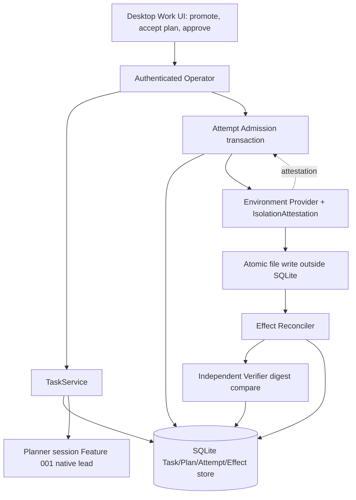

# 005 - Safe Task Path

**ID:** 005
**Status:** ACCEPTED/LOCKED
**Owners:** Task Runtime, Environments, Trust, Storage, Desktop UI
**Updated:** 2026-11-09
**Revision:** 1.0
**Owner acceptance:** accepted 2026-11-09 by the repository owner (sarv-projects) via [docs/OWNER-ACCEPTANCE-REVIEW-PACKET.md](../../docs/OWNER-ACCEPTANCE-REVIEW-PACKET.md) (PR #1), including every "ACCEPT (scoped)" caveat and the B-17 rider as binding conditions.
**Revision note:** revision 1.0 adds V1 gap coverage per owner acceptance 2026-11-09: the Conversation-to-Task promotion control (AC-013), the Windows-row UNAVAILABLE posture for Task execution (AC-014), the observed-launch Linux attestation rule (AC-015), the atomic-replace crash rule (AC-016) and the PROPOSED Windows Environment provider B-35 (AC-017, pending owner).
**Change control:** this is a locked contract. Any later change to a LOCKED decision, accepted target interface or AC requires a new revision and renewed owner approval (SPECIFICATION-STANDARD §7). Acceptance authorizes implementation only; it is not a claim of implementation, SERVED, INTEGRATED or QUALIFIED status.
**Target release:** V1 local desktop. Release matrix consequence (B-17 rider): Task execution qualifies first on the Linux x86_64 desktop row; on the Windows 11/10 `x86_64-pc-windows-msvc` row it stays visibly UNAVAILABLE until a Windows Environment provider (B-35) qualifies.
**Dependencies:** root ARCHITECTURE.md, docs/V1-PRODUCT-RELEASE-CONTRACT.md, docs/IMPLEMENTATION-MASTER-PLAN.md, and the owner documents named in RESEARCH.md. Feature 001 remains the Conversation send authority.

## 1. Problem

Ordinary chat must not become a Task by inference. A working directory is not a sandbox. One consequential edit needs plan acceptance, isolation attestation, lease, grant and independent verification.

Observable outcome: The owner promotes one Conversation outcome into a Task, accepts an immutable plan, and one isolated Attempt edits one approved file with a receipt that survives cancel and restart.

## 2. Goals

- Create a Task explicitly from a committed Conversation outcome or a standalone objective.
- Accept one immutable PlanRevision and Steps atomically before any Attempt.
- Run one Environment provider that attests read/write roots, network, process tree and limits.
- Reconcile an ambiguous write before retry and verify the edit independently.

## 3. Non-goals

- Multi-step heterogeneous delegation beyond one edit.
- Coworker-required Tasks.
- Treating git worktree alone as isolation.
- Treating omission of LeadFailoverPolicy as DISABLED when a Coworker revision already supplies ASK or ALLOW_LISTED.

## 4. Current evidence

The active checkout contains a partial Task record/specification/read model, a read-only planning preflight, and compiled domain/storage execution primitives. It does not contain an integrated Task planning → accepted PlanRevision → Attempt → isolated Environment → mediated Effect → independent verification path. The following matrix records the current source/route/UI boundary; it is not owner acceptance or release qualification.

| Capability | Current source/route evidence | Limitation / release meaning |
|---|---|---|
| Explicit Task creation | CODE/SERVED: `POST /v1/tasks` persists a durable Task and initial TaskSpecRevision with idempotency receipt. The Home “New task” composer submits a standalone objective, optional Coworker/default lead, and pinned Resource revision refs. Suggestion acceptance and Routine Manual Run also materialize Task records. | Task creation deliberately does not start planning, an AgentSession, an Attempt or an Environment. No explicit “promote this Conversation outcome” action was found in `ConversationsPage`; current Home creation is a separate Task objective flow. |
| Task/specification read and edit | CODE/SERVED: Task list/get, `POST /v1/tasks/{task_id}/spec-revisions`, plan-revision list, Step list, Conversation Task list, Task artifacts, presentation/progress, capability-invocation and verification-run read views | These are durable records and read projections. Reading existing Steps/Attempt/Evidence is not an Attempt admission path. |
| Task lead selection | CODE/SERVED: Task create resolves explicit preferred binding, then selected Coworker default, then Workspace default; missing lead fails `AGENT_UNAVAILABLE`. Owner Task lead handoff is served via `POST /v1/tasks/{task_id}/lead-agent` and commits a Task lead change. | Changing the lead does not start planning or create an Attempt. There is no substitute-agent execution fallback. |
| Planning readiness | CODE/SERVED: `GET /v1/tasks/{task_id}/planning-readiness` validates Workspace ownership and `If-Match`, prepares a bounded internal planning packet, and returns a read-only projection | Response hardcodes `dispatch_available=false`, `planning_started=false`, `agent_session_started=false`, `plan_created=false`. Current blockers include isolation, unmediated native capabilities, protocol/process qualification, planning context materialization and session settlement. No provider is invoked. |
| Plan acceptance | Only `GET /v1/tasks/{task_id}/plan-revisions` is served; `POST /v1/tasks/{task_id}/plan-revisions` (`submitTaskPlan`) is target-only | No authenticated Operator plan-acceptance handler or user acceptance flow. `PlanRevision` and `Step` types/storage exist but are not produced by the current Task UI flow. |
| Attempt admission and recovery | Attempt/lease admission state types and SQLite storage methods exist in domain/storage crates with unit tests | No Task daemon route or production caller of `admit_step_attempt` was found. Attempt list, Effect list, recovery, pause/resume/cancel/steer and environment control routes are target-only. `attempt_process_scope.rs` explicitly says its containment/journal remains staged and is `allow(dead_code)`. |
| Environment provider | CODE (checked 2026-11-12): `probe_environment_provider` reports platform/provider observations. Windows reports no Task-capable `LocalWorkspace` class or supported lifetime and returns a typed planning blocker. Linux only reports a local workspace class if the canonical trust-checked Bubblewrap probe finds an eligible candidate; that probe does not attest isolation. | Provider probe is not provisioning or Task invocation. Budget enforcement is `Unavailable`; checkpoint/restore and persistent Workspace lifetime are false. No Task API provisions or attaches an Environment. Job Object support in `windows-local-security` is a process-lifetime primitive only, not a Windows Environment provider. |
| Isolation/quiescence evidence | CODE: `IsolationAttestation`, enforcement dimensions and fail-closed admission checks exist in `environment_isolation.rs`; process-scope journal/proof types exist | Search found no production caller wiring those attestations into Task Attempt admission or recovery. A Windows Job Object is process-tree containment evidence; by itself it does not prove filesystem-root confinement, network denial or resource-budget enforcement. |
| Trust and grants | CODE/SERVED: `POST /v1/capability-grants` and revoke route accept bounded, expiring Task-planning `workspace.resource.read` grants scoped to exact Resource refs | These are read grants for planning context, not an execution grant for the proposed file write. The Trust evaluator is not connected to a live Attempt/tool invocation path. |
| Effects and verification | CODE/SERVED read views for Task verification runs, Artifacts, capability invocations and presentation/progress | No production Task Effect dispatcher/reconciler/verification pipeline is connected to the Attempt path. No file write is issued through an Environment by this feature. |
| Desktop Work UI | `App.tsx` Home composer explicitly saves a Task; Work lists Tasks, opens detail, edits objective revisions, checks planning readiness, displays pinned inputs, read-only Steps, presentation/progress snapshots and committed outputs | No plan acceptance, Attempt start, cancellation, retry/recover, approval, Environment detail or real execution controls. Task presentation reads saved records and does not prove an execution worker is live. |

Feature 005 is ACCEPTED/LOCKED as a design (owner acceptance 2026-11-09). The current-state matrix above is unchanged by that acceptance: the code has useful domain/storage primitives and a truthful read-only readiness screen, but the V1 outcome of one independently verified isolated file edit is not implemented. Additional current-state facts checked 2026-11-09 for task grounding:

- Storage refuses Conversation-origin Task creation: `validate_task_create_commit` in `crates/storage-sqlite/src/lib.rs` returns "Conversation-origin Task creation is unavailable until its ConversationMessage can be appended atomically" whenever `conversation_id` or `source_message_refs` is supplied.
- Storage refuses planning-session start: `require_task_planning_isolation_admission()` in `crates/storage-sqlite/src/lib.rs` always returns `TASK_PLANNING_ISOLATION_UNAVAILABLE`, which closes `start_task_planning_session`. `accept_initial_plan` (`PlanAcceptanceCommit` / `PlanAcceptance` in `crates/storage-core/src/lib.rs`) exists with tests but has no Operator caller.
- `apps/litecoworkd/Cargo.toml` does not depend on `domain-environment` or `local-environment-staging`; the daemon keeps parallel `EnforcementStatus`, `EnvironmentLifetime`, `BudgetEnforcement` and `probe_local_provider` definitions in `environment_isolation.rs` / `environment_provider.rs` beside the crate versions, and three different bubblewrap candidate lists exist (`environment_provider.rs`, `environment_isolation.rs`, `linux-process-scope` `BUBBLEWRAP_CANDIDATES`).
- `crates/linux-process-scope/src/bubblewrap.rs` `prepare_bubblewrap_command` already passes `--unshare-user --unshare-pid --unshare-net --unshare-ipc --unshare-uts --die-with-parent` with read-only inputs and one writable output root under a systemd transient scope; its module comment states it has no egress broker, aggregate output quota, Runtime-local attestation or Task/Attempt admission.
- `crates/windows-local-security` provides `spawn_kill_on_drop_job` (Job Object, KILL_ON_JOB_CLOSE) and `replace_file_write_through`; it has no AppContainer, restricted-token or Windows Filtering Platform code.
- `StepAttemptCoordinator::admit` (`crates/domain-task/src/execution.rs`), `SqliteCapabilityDispatchStore::admit_capability_dispatch` and the Effect/Evidence store (`crates/storage-sqlite/src/effect_evidence.rs`) have no daemon caller.

## 5. LOCKED and FLEXIBLE decisions

### LOCKED

- Task creation does not imply Step, Attempt, lease or Environment (TASK-RUNTIME).
- No persisted Task DRAFT; unsent composer stays in the Operator.
- Unavailable lead fails with AGENT_UNAVAILABLE and does not substitute another binding.
- Unknown external effect is reconciled before retry (release contract §6).
- Grants are explicit and scoped.

### FLEXIBLE

- Module file layout and private helper names, provided the transactions and secret boundaries stay intact.
- Presentation copy, provided state distinctions remain visible.

### OWNER-ACCEPTED DECISIONS AND ARCHITECTURAL CONTRACTS

B-17 and B-18 were accepted by the repository owner on 2026-11-09 via [docs/OWNER-ACCEPTANCE-REVIEW-PACKET.md](../../docs/OWNER-ACCEPTANCE-REVIEW-PACKET.md); the B-17 rider below is binding. B-35 is a new blocker raised by that rider; it is PROPOSED and still needs an owner decision. The register of record is [docs/CONTRADICTION-AND-ALIGNMENT-REGISTER.md](../../docs/CONTRADICTION-AND-ALIGNMENT-REGISTER.md).

| ID | Topic | Status, resolution and architectural contract | Canonical authority and consequence |
|---|---|---|---|
| B-17 | First Environment provider for safe Task execution | **ACCEPTED (2026-11-09): The first Environment provider is the Linux bubblewrap-backed local provider, qualified for all four isolation dimensions, not the Windows Job Object provider.** Admission accepts only a current-incarnation `IsolationAttestation` whose filesystem roots, process-tree lifetime/quiescence, network policy (default deny) and resource-limit fields are all `ENFORCED`. A Windows Job Object proves process-tree containment only; by itself it is `NOT_ENFORCED` for filesystem-root confinement and network denial and therefore fails admission closed. `probe_environment_provider()` output is discovery evidence, not an attestation. **Owner rider (binding):** Task execution (Area 6) and the daemon-owned terminal (Area 4, B-23 needs an admitted Environment) qualify first on the Linux x86_64 desktop row; on the Windows 11/10 `x86_64-pc-windows-msvc` row they stay visibly UNAVAILABLE until a Windows Environment provider (B-35) qualifies. Per the B-09 caveat a Job Object or cgroup is process lifetime only, never an isolation claim. | [ENVIRONMENTS.md](../../docs/ENVIRONMENTS.md), [TRUST.md](../../docs/TRUST.md). A partial OS capability is never promoted to a full sandbox. The exact bubblewrap version and launch profile are pinned by the contract-promotion task and recorded with the qualification evidence. |
| B-18 | First mediated file-operation class | **ACCEPTED (2026-11-09): The one write primitive is atomic whole-file replacement of exactly one approved file.** Contract: input is a new-content blob bound to the approved plan digest; the base is the pinned prior revision digest; maximum 1 MiB; the path must resolve inside the admitted WorkspaceRoot with no symlink escape; the provider writes to a temporary file, fsyncs, then atomically renames over the target; on an `INTEGRITY_FAILURE` or ambiguous result it rolls back and reconciles before any retry; an independent post-write verifier recomputes the digest against the approved content. Arbitrary shell commands and general workspace writes are not an equivalent first slice. | [TASK-RUNTIME.md](../../docs/TASK-RUNTIME.md), [ENVIRONMENTS.md](../../docs/ENVIRONMENTS.md), [TRUST.md](../../docs/TRUST.md). The write runs outside SQLite after the Attempt/lease/grant/receipt commit; the verifier makes success independently provable. |
| B-35 | Windows Environment provider for safe Task execution | **PROPOSED (pending owner): a Windows local Environment provider built from an AppContainer (filesystem and object-namespace confinement to the admitted roots through explicit capability SIDs and ACLs), a restricted token (no privileges, deny-only administrator and user groups), a Job Object (process-tree lifetime, KILL_ON_JOB_CLOSE, active-process, memory and CPU limits) and a Windows Filtering Platform egress policy (default-deny outbound for the AppContainer package SID), with all four isolation dimensions (filesystem, process-tree, network, resource-limit) ENFORCED and attested in a current-incarnation `IsolationAttestation` from an observed launch.** Delivered as a V1 task after the Linux bubblewrap slice qualifies. A Job Object alone is never described or attested as a sandbox; any dimension that is UNKNOWN or NOT_ENFORCED fails admission closed. | [ENVIRONMENTS.md](../../docs/ENVIRONMENTS.md), [TRUST.md](../../docs/TRUST.md), [NETWORK-SECURITY.md](../../docs/NETWORK-SECURITY.md). Until B-35 is owner-accepted and its provider qualifies on the exact Windows build, Task execution and the daemon-owned terminal on the Windows release row remain visibly UNAVAILABLE (AC-014). Owner: Environments with Security; decision needed from the repository owner. |

B-17 and B-18 are owner-accepted and the package is ACCEPTED/LOCKED. B-35 is PROPOSED only; its tasks stay BLOCKED until the owner accepts it. Implementation and qualification status are unchanged by acceptance and are tracked in §4 and [docs/IMPLEMENTATION-STATUS.md](../../docs/IMPLEMENTATION-STATUS.md).

## 6. High-level design

UI promotes work with an explicit command. TaskService commits Task and TaskSpecRevision. Planning uses a native lead session. Acceptance commits PlanRevision. Attempt admission is a separate transaction that never contains the filesystem call. Effect reconciler and verifier run after the external write returns.

### Feature-specific component diagram



The Attempt-admission transaction, the Environment provider attestation gate, the reconciler and the independent verifier are the feature-specific components; Task/Plan records and Trust decisions remain owned by TASK-RUNTIME/TRUST and are not redefined.

### Trust boundaries

The desktop UI is untrusted; the authenticated Operator is the only command path. The Environment cannot widen roots; network defaults to deny unless the plan's grant allows it; secret material never enters the TaskPacket. Admission accepts only a Runtime-held attestation whose four dimensions are `ENFORCED`; a caller-supplied or `UNKNOWN` attestation fails closed. The filesystem write runs outside SQLite; the transaction performs no process or network call.

### Actor sequence (target)

1. Owner explicitly promotes a Conversation outcome or submits a standalone objective; TaskService commits Task + TaskSpecRevision (no Attempt).
2. Planner admission revalidates a current-incarnation `IsolationAttestation`; without it, planning returns `DEPENDENCY_UNAVAILABLE`.
3. Owner accepts an immutable PlanRevision and Steps atomically (If-Match on TaskSpec head).
4. Attempt admission commits Attempt + ExecutionLease + grant + idempotency receipt in one transaction; the Environment is attached before that commit.
5. The provider performs the atomic whole-file replace outside SQLite.
6. The reconciler settles the Effect; the independent verifier recomputes the digest; cancel/restart fence the lease and never report success without verification.

### Ownership

| Owner | Responsibility | Excluded responsibility |
|---|---|---|
| Desktop UI | Promote command, plan acceptance, approval, durable receipt display | Starting execution on its own |
| Operator | Auth, Workspace scope, plan-acceptance and attempt validation | Running the filesystem write |
| TaskService | Task/spec/plan commits, lead resolution | Isolation enforcement |
| Environment Provider | Attestation, confined roots, process-tree/network/limits | Task outcome authority |
| Attempt Admission | Atomic Attempt/lease/grant/receipt commit | External call inside the transaction |
| Effect Reconciler + Verifier | Reconcile ambiguous writes, independent digest verify | Inferring success from intent |
| Storage | Atomic commits, fences, receipts | External process/network calls |

Trust boundary: the desktop UI is untrusted; the authenticated Operator is the only command path; native credentials and OS handles stay outside public events; SQLite transactions do not perform network or process calls.

## 7. Low-level design and interfaces

CreateTaskRequest fields follow TASK-RUNTIME. Plan acceptance is atomic. Attempt, lease, grant, invocation intent and idempotency receipt commit together before the Environment is invoked. The write happens outside SQLite. Reconciliation updates Effect and Evidence after the external result is known.

### 7.1 Existing signatures (CODE)

- Served: `POST /v1/tasks` (Task + TaskSpecRevision + receipt), `POST /v1/tasks/{task_id}/spec-revisions`, Task/plan/Step/artifact read routes, `GET /v1/tasks/{task_id}/planning-readiness` (hardcodes dispatch/planning/session/plan booleans false), `POST /v1/tasks/{task_id}/lead-agent`, `POST /v1/capability-grants` (bounded `workspace.resource.read`).
- Domain/storage primitives with unit tests: `admit_step_attempt`, Attempt/lease admission types, `IsolationAttestation` and enforcement dimensions in `environment_isolation.rs`, process-scope journal types (compiled `allow(dead_code)`), `probe_environment_provider`.

### 7.2 Accepted target signatures (not yet in source)

Every signature below is an accepted target interface (not yet in source). It becomes source only when its canonical owner document and the OpenAPI/schema change are promoted together (contract-promotion task 005-T01). The B-35 Windows provider shape in §7.3 is PROPOSED, not accepted.

```rust
// Accepted target (not yet in source): atomic Attempt admission; external call stays outside.
pub struct AdmitFileWriteAttempt {
    pub principal_id: String,
    pub workspace_id: String,
    pub task_id: String,
    pub plan_revision_id: String,
    pub step_id: String,
    pub attestation: IsolationAttestation,   // all four dimensions ENFORCED
    pub lease: ExecutionLeaseRequest,
    pub grant: FileWriteGrant,               // one path, base digest, max 1 MiB
    pub idempotency_key: String,             // 1..=200 printable ASCII
}

// Accepted target (not yet in source): one write class = atomic whole-file replacement.
pub struct ApprovedFileReplacement {
    pub target_path: WorkspaceConfinedPath,
    pub base_revision_digest: ContentDigest,
    pub new_content: BoundedBlob,            // <= 1 MiB
    pub plan_action_digest: ActionDigest,
}

// Accepted target (not yet in source): independent post-write verification.
pub trait FileWriteVerifier: Send + Sync {
    fn verify(
        &self, target: &WorkspaceConfinedPath, expected: &ContentDigest,
    ) -> Result<VerificationEvidence, VerifyError>;
}
```

Typed errors (accepted target, not yet in source): `AttemptAdmissionError::{AttestationNotEnforced, StalePlanVersion, StaleFence, LeaseConflict}`; `FileWriteError::{IntegrityFailure, PathEscape, OverBound, AmbiguousResult}`.

Ordering: authorize, compare expected version, commit the durable receipt, then perform any external call, then reconcile. Payload fields stay accepted target interfaces until the canonical owner document and machine schema change together.

Conversation-to-Task promotion (accepted target interface, not yet in source): the existing `POST /v1/tasks` (`createTask`) request already names `conversation_id` and `source_message_refs[]` in TASK-RUNTIME `CreateTaskRequest`. Promotion reuses that operation; it does not add a second create route. Storage must append the originating ConversationMessage reference and the Task in one admission transaction before `validate_task_create_commit` stops refusing a Conversation origin.

### 7.3 PROPOSED Windows Environment provider shape (B-35, pending owner)

```rust
// PROPOSED (B-35, not accepted): Windows provider composed from four OS mechanisms.
pub struct WindowsEnvironmentLaunch {
    pub appcontainer_profile: AppContainerProfileName, // per-Environment, derived SID
    pub readable_roots: Vec<ConfinedRoot>,             // ACL grants to the package SID, read-only
    pub writable_root: ConfinedRoot,                   // one output root, write ACL only here
    pub restricted_token: RestrictedTokenPolicy,       // no privileges, deny-only admin/user groups
    pub job_limits: JobObjectLimits,                   // kill-on-close, process count, memory, CPU
    pub egress: WfpEgressPolicy,                       // default-deny outbound for the package SID
}
```

The attestation for this provider is the same `IsolationAttestation` type; each enforcement field is set from an observed post-launch probe (denied write outside the root, denied outbound connect, observed Job accounting), never from configuration intent.

## 8. Data

See [DATA-MODEL.md](DATA-MODEL.md). This feature does not create a second source of truth beside the domain owner.

## 9. Wiring

See [WIRING.yaml](WIRING.yaml). Requests enter through the Operator. External calls sit outside transactions.

## 10. Security

Workspace and owner checks on every command. Environment cannot widen roots. Network default deny unless the plan's grant allows it. Secret material is not placed in the TaskPacket.

## 11. Errors and recovery

Cancel fences the lease. Timeout-after-dispatch reconciles. Restart reloads Task state and does not reissue a write whose receipt is ambiguous. Stale plan version conflicts.

Races use compare-and-swap or a single-writer occurrence identity. Timeout after an external effect reconciles. Duplicate retries return the original receipt when the idempotency key matches and fail when the payload conflicts.

## 12. Crash and restart

Reload the last committed owner records. Do not infer success from an intent. Reconcile in-flight external work before a new side effect. Cancellation fences late results.

## 13. Configuration and compatibility

One Environment provider. One file edit. LeadFailoverPolicy is pinned from an explicit Task request, otherwise the selected Coworker revision, otherwise DISABLED with empty triggers, empty fallbacks, and max_lead_changes 0.

OS qualification is per native desktop. WSL2 does not qualify Windows or Linux GUI behavior.

Release matrix for this package (B-17 rider): the Linux x86_64 desktop row (0600/0700 socket, B-28 second row) is the first row on which Task execution can qualify, with the native lead route that row declares. On the Windows 11/10 `x86_64-pc-windows-msvc` row with OpenCode v2.0.32, Task create, spec edit and read views remain available, while planning dispatch, plan acceptance that leads to execution, Attempt start and the file write render as visibly UNAVAILABLE with the reason "no qualified Windows Environment provider (B-35)". That row's state changes only when B-35 is accepted and its provider qualifies on the exact Windows build.

## 14. Observability

Log ids, versions, statuses and denial reasons. Do not log secret bytes, native handles, private locators or raw credentials. Audit commits include actor, workspace and receipt id.

## 15. EARS acceptance

Positive:
- **AC-002:** WHEN the owner explicitly promotes an outcome, THE SYSTEM SHALL commit Task and TaskSpecRevision without an Attempt. Verify: Task-creation storage test.
- **AC-004:** WHEN the owner accepts a plan, THE SYSTEM SHALL commit an immutable PlanRevision and Steps before any Effect. Verify: plan-acceptance atomicity test.
- **AC-005:** WHEN the Attempt runs, THE SYSTEM SHALL invoke the Environment only after lease, grant and idempotency receipt are committed, and the external call SHALL stay outside that transaction. Verify: admission-ordering test.

Negative:
- **AC-001:** WHEN the owner sends an ordinary Conversation message, THE SYSTEM SHALL NOT create a Task. Verify: no-Task assertion.
- **AC-003:** IF the preferred lead binding is unavailable, THEN THE SYSTEM SHALL return AGENT_UNAVAILABLE and create no Task. Verify: lead-unavailable negative test.

Security:
- **AC-008:** WHEN an Attempt is admitted, THE SYSTEM SHALL accept only a current-incarnation `IsolationAttestation` whose filesystem, process-tree, network and resource-limit dimensions are all `ENFORCED` and SHALL fail closed otherwise. Verify: attestation-gate matrix.
- **AC-009:** WHEN the approved write resolves a path, THE SYSTEM SHALL confine it to the admitted WorkspaceRoot with no symlink escape and reject writes over the 1 MiB bound. Verify: path-escape and over-bound tests.

Recovery:
- **AC-006:** IF the external write result is unknown, THEN THE SYSTEM SHALL reconcile before any retry. Verify: ambiguous-result reconciliation test.
- **AC-007:** WHEN the Runtime restarts after cancel or timeout, THE SYSTEM SHALL show a durable receipt and SHALL NOT report success without independent verification. Verify: restart + verifier test.

Concurrency:
- **AC-010:** WHILE an Attempt holds a writer lease, THE SYSTEM SHALL require `QUIESCENT` before releasing the lease or destroying the Environment and SHALL fence a stale fence with `STALE_FENCE`. Verify: lease/quiescence race test.

UI and accessibility:
- **AC-011:** WHEN execution controls are shown, THE SYSTEM SHALL present planning readiness, plan acceptance and approval distinctly and SHALL NOT present a saved record as live execution proof. Verify: Work-surface render test.

Performance:
- **AC-012:** WHEN a bounded plan is accepted, THE SYSTEM SHALL build the planning preflight packet within a finite budget and SHALL NOT scan unbounded Task history. Verify: bounded-preflight test.

V1 gap coverage (revision 1.0):
- **AC-013:** WHEN the owner selects "Create Task from this reply" on a committed AGENT message in a Conversation, THE SYSTEM SHALL create the Task through `createTask` with that `conversation_id` and exact `source_message_refs`, append the origin reference and the Task in one transaction, keep the Conversation usable, and SHALL NOT offer the control on an uncommitted, streaming or failed turn. Verify: storage atomic-origin test plus Conversation-page render and keyboard test.
- **AC-014:** WHILE the running platform has no qualified Environment provider (the Windows row until B-35 qualifies), THE SYSTEM SHALL report planning dispatch and Attempt start as UNAVAILABLE with the provider reason, SHALL keep Task create and read views working, and SHALL NOT render a Job Object observation as an isolation badge. Verify: Windows-row readiness projection test and Work render test.
- **AC-015:** WHEN the Linux bubblewrap provider produces an `IsolationAttestation`, THE SYSTEM SHALL derive each of the four enforcement fields from an observed launch probe bound to the current Runtime incarnation and SHALL refuse an attestation built from probe output alone. Verify: live bubblewrap attestation test and probe-only refusal test.
- **AC-016:** IF the Runtime crashes between the temporary-file write and the atomic rename of an approved replacement, THEN THE SYSTEM SHALL on restart leave the Effect AMBIGUOUS, reconcile the target digest against the base and approved digests, remove the orphaned temporary file and SHALL NOT reissue the write automatically. Verify: crash-injection recovery test.
- **AC-017:** WHERE B-35 is owner-accepted, WHEN the Windows provider launches an Attempt, THE SYSTEM SHALL admit it only if AppContainer filesystem confinement, restricted-token plus Job Object process-tree control, WFP default-deny egress and Job resource limits are each observed ENFORCED for the current incarnation. Verify: Windows attestation matrix on the exact Windows build.

## 16. Executable acceptance command

```bash
python3 .specify/scripts/validate_feature_package.py specs/005-safe-task-path
```

Further gates after ACCEPTED/LOCKED are the cargo filters named in TASKS.md. They are not evidence until run on a recovered source tree.

## 17. Out-of-bounds

- Do not run browser automation.
- Do not install connectors.
- Do not enable standing automations.

## 18. Assumptions and open questions

- The first Environment provider is decided (B-17 accepted: Linux bubblewrap). The Windows provider (B-35) is PROPOSED and needs the owner.
- Verification for this slice is an independent digest recompute of the approved file (B-18 accepted).
- Open: which native lead harness and version the Linux row declares for planning. OpenCode v2.0.32 is the only harness the supervisor dispatches today; the Linux row reuses it unless the release matrix names another.
- Open: whether the 006 golden connector write, which is a broker-only STRUCTURED_API Step with no filesystem effect, needs an admitted Environment. If it does, E2E-05 inherits the Windows-row UNAVAILABLE posture. The decision belongs to the Trust and Environments owners and is recorded in 006 SPEC §18.

Accepted decisions are recorded in §5. Implementation tasks: 005-T01 through 005-T20 in [TASKS.md](TASKS.md); B-35 work is 005-T16, 005-T17 and 005-T18.

## 7a. Owner facts incorporated and implementation crosswalk checked 2026-11-06

Read from TASK-RUNTIME, ENVIRONMENTS, DELEGATION, and STATE-MACHINES.

- If the lead binding is unavailable, creation returns AGENT_UNAVAILABLE, creates no Task or turn, does not fall through to a lower-precedence binding, and leaves the unsent composer draft.
- Until a current-incarnation IsolationAttestation is revalidated, planner admission returns DEPENDENCY_UNAVAILABLE and creates no session, PlanRevision, Step, Attempt, or Environment.
- Plan acceptance uses If-Match and the current TaskSpec head. A Task-version mismatch returns 409 STALE_TASK_VERSION. A spec mismatch returns 409 STALE_SPEC_REVISION. A producer who is no longer the active TASK_PLANNING session or leased lead is 403 FORBIDDEN or 409 CONFLICT.
- The Runtime attaches an Environment before the transaction that commits Attempt, ExecutionLease, grant, and receipt, starts the AgentSession only after that commit, and runs the file mutation outside SQLite.
- Admission accepts only a Runtime-held IsolationAttestation whose filesystem, process-tree, network, and resource-limit fields are ENFORCED. UNKNOWN, NOT_ENFORCED, or a caller-supplied attestation fails closed.
- Releasing a writer lease or destroying the Environment requires QuiescenceObservation QUIESCENT. UNKNOWN, timeout, or restart leaves the Attempt fenced.
- Cancel moves the Task to CANCEL_REQUESTED, reconciles STARTED, ACKNOWLEDGED, and AMBIGUOUS Effects, and commits CANCELLED only after attempts, invocations, verification, and Effects have settled.
- There is no Task retry command. Continuation is recover_step, which creates a new Attempt id. A changed placement plan returns STALE_VERSION.
- A new Runtime incarnation cannot renew the prior lease. Recovery commits that lease EXPIRED or REVOKED and the Attempt ABANDONED. A stale fence returns STALE_FENCE.
- The provider exposes the pinned revision read-only, writes through a revalidated handle and atomic replace, and returns INTEGRITY_FAILURE when the observed digest differs.


## 7b. Current source and UI boundary checked 2026-11-12

- Task create/spec edit and planning-readiness read are served; plan submission, Attempt admission/listing, Effect list/dispatch, recovery, Task pause/resume/cancel/steer and Environment provision/control remain target-only.
- The current Task composer is a standalone Home “New task” form. It creates a Task envelope and pins selected Coworker/default lead plus Resource revision refs. It is not an in-Conversation promotion control; ordinary Conversation messages do not create Tasks.
- Task planning readiness only builds an internal bounded preflight packet. It hardcodes dispatch/planning/session/plan booleans false. `LocalPlanningPreflight::require_dispatch()` remains unused and always refuses dispatch. No production `admit_step_attempt` call site exists in the daemon.
- `probe_environment_provider()` reports provider observations, not an attached Environment. On Windows it reports no Task-capable `LocalWorkspace` class or supported Task lifetime and returns `WINDOWS_ENVIRONMENT_PROVIDER_UNAVAILABLE`; a Job Object is only a process-lifetime primitive. On Linux, LocalWorkspace discovery requires a root-owned, non-group/world-writable Bubblewrap candidate from `linux-process-scope`; even that trusted candidate does not attest isolation. The probe reports no budget enforcement, checkpoint/restore, or workspace-persistent lifetime.
- IsolationAttestation and quiescence proof types exist with strict comparisons, but they are not connected to production Task admission/recovery. The attempt process-scope journal is compiled as staged/dead code until exact Runtime scope evidence is wired.
- The only currently served capability grant is the bounded Task-planning Resource-read grant. It does not authorize a file write. Trust evaluation and Effect reconciliation are not connected to a live Attempt execution path.
- The desktop Work surface renders persisted Task envelope/spec/plan/Step/Artifact/presentation records and read-only planning readiness. It does not provide plan acceptance, Attempt start, Effect approval, cancel/recover, or Environment control. Task presentation is not a live execution proof.
- The current Windows Job Object process-tree observation is not an attestation of filesystem root enforcement, network deny or every resource limit. Do not show it as a full Environment isolation badge.
## 19. Requirement traceability

| Requirement | Canonical contract | Task | Acceptance | Verification method |
|---|---|---|---|---|
| Ordinary chat is not a Task | TASK-RUNTIME, PRODUCT | 005-T12 | AC-001 | No-Task assertion |
| Explicit promote without Attempt | TASK-RUNTIME, STORAGE | 005-T12 | AC-002 | Task-creation test |
| Unavailable lead fails, no Task | DELEGATION, AGENT-CONTROL | 005-T12 | AC-003 | Lead-unavailable test |
| Atomic plan acceptance | TASK-RUNTIME, STATE-MACHINES | 005-T03 | AC-004 | Plan atomicity test |
| Attempt admission before external call | TASK-RUNTIME, STORAGE | 005-T08 | AC-005 | Admission-ordering test |
| Reconcile unknown write | TRUST, ENVIRONMENTS | 005-T09 | AC-006 | Reconciliation test |
| Restart + independent verify | FAILURE-RECOVERY, TASK-RUNTIME | 005-T11 | AC-007 | Restart + verifier test |
| Enforced attestation gate | ENVIRONMENTS, TRUST | 005-T08 | AC-008 | Attestation matrix |
| Confined path + byte bound | ENVIRONMENTS, STORAGE | 005-T06 | AC-009 | Path-escape + bound tests |
| Lease quiescence + stale fence | ENVIRONMENTS, STATE-MACHINES | 005-T11 | AC-010 | Lease/quiescence race test |
| Distinct execution controls | PRESENTATION-RUNTIME, contracts/ui-behavior.md | 005-T13 | AC-011 | Render test |
| Bounded preflight build | TASK-RUNTIME | 005-T05 | AC-012 | Bounded-preflight test |
| Conversation-to-Task promotion control | TASK-RUNTIME, V1-UI-SCREEN-CONTRACT | 005-T12 | AC-013 | Atomic-origin storage test + render/keyboard test |
| Windows row Task execution UNAVAILABLE until B-35 | V1-PRODUCT-RELEASE-CONTRACT, ENVIRONMENTS | 005-T14 | AC-014 | Readiness projection + Work render test |
| Observed-launch Linux attestation | ENVIRONMENTS | 005-T04 | AC-015 | Live bubblewrap attestation + probe-only refusal |
| Atomic-replace crash recovery | FAILURE-RECOVERY, TRUST | 005-T11 | AC-016 | Crash-injection recovery test |
| Windows provider four-dimension attestation (B-35, PROPOSED) | ENVIRONMENTS, NETWORK-SECURITY | 005-T17 | AC-017 | Windows attestation matrix |
