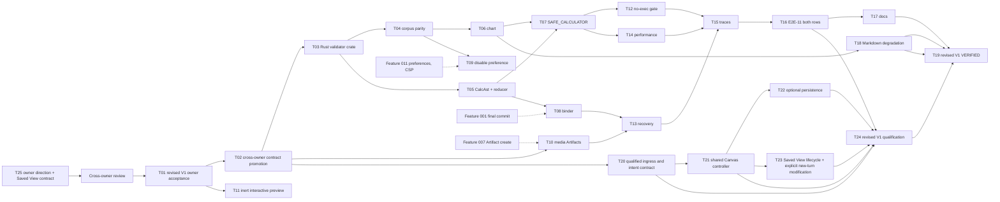

# Implementation Plan - Intelligent Workspace Presentation Runtime

**Feature:** 016 | **Spec revision:** 0.4 (proposed)
**Status:** IN_REVIEW - revised end-to-end V1 proposal. The Saved View direction is owner-decided, but cross-owner review, T01 whole-scope acceptance and T02 contract promotion remain required before implementation.

## 1. Delivery strategy

Deliver one safe answer-to-view journey rather than a disconnected rich-renderer baseline followed by an optional extension. Record the owner scope, review the Feature 007 Saved View contract, then promote one canonical declarative profile and prove Rust/TypeScript parity. Implement semantic fallback and deterministic composition before optional provider ingress. Add bounded local interactions and the inline-to-Canvas controller. Saved Views persist only the committed view and declared defaults; changed calculator values remain transient under B-40. Optional Remember/Forget behavior remains separately gated by B-46/T22. Finish with replay, deletion, recovery, accessibility and packaged provider evidence. The approach remains local-first, chat-first and BYOA-first; no Environment provider is required for this presentation feature, but exact native provider/version rows still require qualification.

### Language and module placement (optimization)

| Concern | Placement | Reason |
|---|---|---|
| Bounds, allowlist, canonical bytes, digests, bindings, metric semantics, CalcAst validation | Rust, new `crates/domain-presentation` | Reject bad documents before they persist; one definition shared by storage and any future publisher; no dependency on SQLite |
| Defensive re-validation in the WebView | TypeScript `rich-presentation.ts` (existing) | Defence in depth at the render boundary; same corpus as Rust |
| Local interaction state and calculation evaluation | TypeScript controller and `calc-reducer.ts` | Live changes are local by default; only explicit owner commands persist allowlisted values |
| Chart geometry | TypeScript `chart-model.ts` (pure) + React SVG | No chart library; testable without a DOM |
| Media sniffing and hashing | Rust `media_ingestion.rs` | Bytes never reach the WebView unvalidated; Artifact lifecycle stays Feature 007-owned |
| Saved View Artifact and Library lifecycle | Feature 007 ArtifactStore/Library | Feature 016 requests a capability-backed owner operation and never writes Artifact rows/files itself |
| Contextual Canvas host | Feature 008 Workbench | Feature 016 supplies one Canvas object/controller; Feature 008 owns tabs, focus, object reauthorization and other Workbench providers |

Existing `serde_json`, `serde_json_canonicalizer` and `sha2` cover the Rust needs; no new crates beyond the workspace member. No new npm dependency.

## 2. Dependency graph

## 3. Phases and exit gates

| Phase | Tasks | Exit gate |
|---|---|---|
| 0 Saved View owner boundary | T25 | Product direction is decided; Feature 007 and cross-owner reviewers confirm the Artifact/Library representation, update/archive/retention contract and recovery details before T01/T02 |
| 1 Revised V1 acceptance | T01 | Owner records accept/revise/defer for AC-001..AC-041 and B-40/B-46; no code begins before acceptance |
| 2 Cross-owner contracts | T02 | RichPresentation, intent, errors/events, Saved View Artifact, Canvas/UI, privacy/deletion/backup and release contracts are promoted together |
| 3 Validation and semantic output | T03-T05, T08-T09, T18, T20 | Shared Rust/TypeScript corpus, deterministic text fallback, bound data/metrics and qualified ingress work |
| 4 Native registered views | T06-T07, T12, T14 | Chart/table, calculator and approved local controls meet accessibility/security/performance gates |
| 5 Contextual Canvas and durable continuity | T21-T23 | Same controller across inline/Canvas; consented state and Saved View create/reopen/update receipts recover correctly |
| 6 Media, Artifact posture and recovery | T10-T13 | Provenance media through Feature 007; inert executable-app preview; crash/replay/deletion recovery |
| 7 Cross-layer trace and packaged qualification | T15-T16, T24 | Complete E2E-11 fallback and, if accepted, the rich-answer-to-Canvas continuity journey (candidate E2E-18; T02 must assign/check its canonical ID) on exact Windows and Linux release rows |
| 8 Documentation and VERIFIED | T17-T19 | All ACs and owner evidence recorded; status rows reflect exact evidence |

## 4. Scope and file ownership (candidate paths)

| Area | Paths |
|---|---|
| Rust validator | `crates/domain-presentation/` (new), `Cargo.toml` members |
| Storage | `crates/storage-sqlite/src/rich_presentations.rs`, `crates/storage-core/src/rich_presentation.rs` |
| Daemon | `apps/litecoworkd/src/presentation_binder.rs`, `media_ingestion.rs` (new), `agents/supervisor.rs` (one call each) |
| Desktop | `apps/litecowork-ui/src/presentation/` (`rich-presentation.ts`, `RichResponseView.tsx`, new `ChartBlock.tsx`, `chart-model.ts`, `SafeCalculatorBlock.tsx`, `calc-reducer.ts`), `src/artifacts/ArtifactWorkbench.tsx` |
| Contracts | owner docs and schemas listed in TASKS T02 |

## 5. Persistence, migration, rollout

No migration or store choice is accepted by this proposal. `rich_presentations` remains immutable and message-bound. Remembered answer state and Saved View ArtifactVersion are separate records/owners. T22 must obtain an allocated migration and reconcile Workspace/Conversation deletion, Feature 017 backup/restore, consent, quota, authorization, receipts and old-write fences before persistent state can ship. T23 uses Feature 007 create/version/Library owner routes; Feature 016 never writes Artifact tables or blobs itself. Rollout requires a promoted renderer profile; older or unsupported clients use semantic fallback and never partially hydrate unknown state.

## 6. Operational risks

| Risk | Mitigation |
|---|---|
| Validators drift again | Shared corpus run by both test suites in CI (Feature 019) |
| Chart misrepresents data | Chart only from the bound semantic table; data table always available |
| Calculator mistaken for an action | No submit, no bridge call, view-local state, visible fallback text |
| Image bytes carry an exploit | Magic-byte sniff, size and dimension bounds, no SVG, display through authorized read |
| CSP loosened for images | Feature 011 owns the change; Feature 019 audits it |
| Saved View duplicates Artifact ownership | T25 requires Feature 007 owner approval; if the existing Artifact lifecycle cannot represent it, defer Saved Views until a separate cross-owner design is accepted |
| Saved state leaks into native transcript or another Workspace | State is local-only, exact-digest bound and consented; provider input requires an explicit ordinary Send and source authorization |
| Interactive app pressure | PREVIEW_ONLY until a new accepted revision after E08-S09 evidence |

## 7. Validation command matrix

| Layer | Command |
|---|---|
| Docs | `python3 .specify/scripts/validate_feature_package.py` |
| Rust validator | `cargo test -p domain-presentation --locked` |
| Storage | `cargo test -p storage-sqlite --locked rich_presentation` |
| Daemon | `cargo test -p litecoworkd --locked presentation_binder` |
| Desktop | `pnpm --dir apps/litecowork-ui test` and `pnpm --dir apps/litecowork-ui run build` |
| Feature | `cargo test -p litecoworkd --test rich_presentation_intelligent_ui --locked -- --nocapture` |

## 8. Stop and rollback criteria

Stop if any path executes model content, a rendered element changes host state, the binder runs inside the final-commit transaction, a URL is fetched for media, or Run appears for an interactive Artifact. Roll back by disabling the binder call; stored presentations stay readable and the desktop falls back safely.

The product owner selected Saved Views for V1. If cross-owner review at T25 cannot promote the Feature 007 Artifact contract, return the technical design for resolution before T01; do not silently remove the product decision or bypass the Artifact owner. T01 still decides the complete Feature 016 AC set and riders.

## 9. Handoff

Feature 007 owns media Artifacts and proposed Saved View Library objects. Feature 008 owns the contextual Workbench shell. A later, separately accepted and qualified revision may enable executable Interactive Artifact Runtime; the Feature 016 V1 proposal does not turn it on.

## 10. Revision 0.3 cross-owner and V1 sequence

[Pipeline LLD](../../docs/ACP-PRESENTATION-PIPELINE-LLD.md) is the implementation decomposition target and remains TARGET. The product owner selected Saved Views for V1 and directed the Feature 007 B-21 amendment; T25 has recorded that direction and drafted a non-executable ArtifactVersion/Library contract. Cross-owner review must still resolve source deletion, backup, retention, receipt and recovery details. Saved Views preserve only declared RichPresentation defaults; changed calculator values remain transient under B-40. T01 then accepts the complete revised AC set; B-40 alone does not authorize it. T02 reconciles global contracts and canonical schemas before code. T20 proves exact provider ingress or preserves deterministic text fallback. T21 builds one inline/Canvas controller. T22 implements opt-in local answer-state persistence only after privacy, migration, receipt and deletion contracts are promoted. T23 adds Feature 007 Saved View create/reopen/versioned update plus explicit ordinary-turn modification. T24 performs denial, recovery, accessibility and packaged evidence. T19 closes only after every accepted V1 AC is qualified.

No persistence rollout begins until migration and owner contracts are approved. Optional answer state is off by default and device-local. Saved Views use Feature 007's exact immutable versions and receipts. Failure disables only the optional presentation/persistence path and leaves semantic messages readable. Rollback disables new writes without deleting saved user data; deletion follows the accepted Artifact/Conversation retention policy. Never erase user data as rollback.
