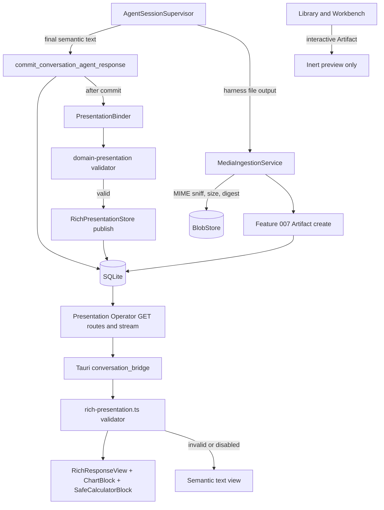

# Feature Specification - Intelligent Workspace Presentation Runtime

- **Feature ID:** 016 | **Status:** IN_REVIEW | **Revision:** 0.4 (proposed)
- **Owner acceptance:** revised V1 scope AC-001..AC-041 is a TARGET proposal and requires formal package acceptance at T01. B-40 was accepted as proposed on 2026-11-10; it defines bounded SAFE_CALCULATOR, transient view-local component state and PREVIEW_ONLY executable Artifacts. On 2026-11-17 the owner directed that Saved Views remain in V1 and Feature 007 B-21 be amended. On 2026-11-24 the user delegated implementation direction for the full current proposal, including an optional explicit numeric input snapshot inside a Saved View ArtifactVersion. A-84 records that direction. Implementation may proceed through explicitly scoped tasks without changing IN_REVIEW lifecycle, cross-owner ratification, provider evidence or qualification. T18 is one such independent Markdown slice; Chart/Calculator implementation must remain within the canonical RichPresentation profile and its owner tasks.
- **Change control:** after acceptance this becomes a locked contract; any later change needs a new revision and renewed owner approval (SPECIFICATION-STANDARD section 7).
- **Target:** LiteCowork V1 local desktop: master plan P10 "Intelligent UI and media", build tasks BT-06.3, BT-06.4 and BT-06.5, E2E-11 "Rich UI response with presentation disabled", release contract sections 3-4 "product areas" and "Workbench and deliverables". The revised proposal extends the conversational answer into a bounded interactive view, a contextual Canvas and a Library-backed Saved View; it does not turn LiteCowork into a hosted model router or executable app platform.
- **Release rows:** Windows 11/10 `x86_64-pc-windows-msvc` with OpenCode v2.0.32 first, Linux x86_64 second. Nothing in this package needs an Environment provider, so both rows can qualify; the Interactive Artifact Runtime stays PREVIEW_ONLY on both rows in V1.
- **Owners:** Presentation Runtime, Conversation, Artifacts, Storage, Operator/API, Desktop UI, Security, Accessibility, Product.
- **Dependencies:** Feature 001 (committed semantic AGENT message is authoritative; ordinary Send and producer identity), Feature 003/006 only for exact authorized data sources, Feature 007 (Artifact create/version/Library lifecycle and Saved View compatibility), Feature 008 (contextual Workbench Canvas), Feature 011 (CSP, display preferences and authenticated IPC), Feature 014 (Conversation retention/deletion), Feature 017 (backup/restore), Feature 019 (CSP audit and release rows).

> **Revision authority:** Sections 1-18 retain the earlier technical baseline and AC-001..AC-019 for history and traceability. Section 19 is historical. Section 20 is the current revision 0.4 TARGET proposal and supersedes earlier text where scope conflicts; it does not override global owner contracts. A-84 records USER-DELEGATED implementation direction for all current proposal capabilities. This permits implementation through task-specific file scopes while the package remains IN_REVIEW; it does not mark T01/T25 accepted, promote every contract, satisfy cross-owner ratification or establish qualification. T25 records the Saved View direction and the user-directed optional numeric snapshot boundary; exact owner API/schema and recovery promotion remains Feature 007 work.

## 1. Problem and user outcome

LiteCowork's product direction is one local, conversation-first workspace that can present supported work as readable answers, analysis, deliverables and safe interactive views. RichPresentation is an immutable, message-bound display projection, but the runtime is not yet an end-to-end experience: Rust and TypeScript contract validators accept the same renderer-v1/v2 profiles through a shared corpus, and the desktop parser/renderer supports v1 plus source-bound v2 METRIC/CHART/SAFE_CALCULATOR. T07 now supplies CODE/UI for a transient, bounded calculator using the pure CalcAst evaluator. T08 now publishes exact semantic tables and surrounding text slices after settlement; structured provider intent, Saved View and Canvas paths are not integrated. The design must serve native agents that only return text as well as exact routes that can provide qualified structured intent. It must keep semantic content authoritative, map all optional structure into one validated host-owned format, and preserve a complete answer if any presentation path is missing, disabled, invalid or interrupted.

**Outcome:** the user can move from a readable answer to a registered interactive view and expand that same view into the right-side Workbench Canvas. When a committed response has grounded data, LiteCowork can present accessible tables, accurately labelled metrics, charts with data-table fallback and bounded local calculations. Separate explicit controls support device-local Remember, Library Saved Views with exact-version reopen and reviewed version updates, and a conversational follow-up through the existing ordinary turn path. A-84 directs implementation of these host-owned actions while retaining the B-40 boundary: components remain passive, local and non-submitting; any selected values appear as ordinary visible message text and are sent only after explicit preview and Send. The semantic response remains complete. No hidden model call or arbitrary generated code is used; executable custom applications remain outside Feature 016 V1 and the separate Artifact Runtime remains PREVIEW_ONLY.

## 2. Goals

- G-01 A versioned Rust validator owns each RichPresentation renderer profile and its bounds; the TypeScript validator mirrors every supported profile exactly and both pass one shared golden corpus. Both validators reject every integer-valued JSON number whose magnitude exceeds `9007199254740991`, including values written with exponent notation, so Rust and ECMAScript do not accept different meanings for the same canonical document. A schema's generic `number` type is insufficient to enforce this rule; the owner validators are authoritative.
- G-02 The user-directed renderer-v2 profile is closed: existing TEXT_SLICE, LAYOUT, CARD, CALLOUT, TABLE plus METRIC, CHART, SAFE_CALCULATOR and only registered local input bindings. T02 promotes the exact canonical schema and both validators; every unknown kind, field or binding fails closed to semantic text. Formal package acceptance and cross-owner review remain separate.
- G-03 Calculations use only a restricted arithmetic AST validated in Rust at publish time and evaluated by a pure TypeScript reducer over local state. Explicit remembered-state or user-reviewed send actions are separate host-owned operations, never implicit component behavior.
- G-04 A CHART is bound to a semantic-message table, drawn by host React components as SVG elements, and always exposes an equivalent accessible data table.
- G-05 A host-side binder publishes RichPresentations after the semantic message commits, outside the commit transaction; presentation failure never blocks or changes turn settlement.
- G-06 The owner can disable rich presentation; the semantic answer remains complete and readable (E2E-11).
- G-07 Generated media is stored as a provenance-bearing Artifact (Conversation, turn, AgentSession, digest) through the Feature 007 create path, never fetched from a model-supplied URL.
- G-08 Interactive Artifacts open PREVIEW_ONLY and inert in V1 until E08-S09 CODE, SYSTEM and owner USER evidence exists for the exact OS and Runtime profile.
- G-09 No executable model content reaches the chat WebView: no eval, no script, no model HTML, CSS or SVG markup, no `dangerouslySetInnerHTML` on agent output, CSP `script-src 'self'` unchanged.
- G-10 An eligible presentation can expand into the existing contextual Canvas with exact message/document/controller identity; no new permanent specialist navigation tab is added.
- G-11 The owner selected Saved Views for V1; save/open/update/archive use the proposed Feature 007 immutable-version and durable-receipt lifecycle after cross-owner review and contract promotion. Saved answer state is not an executable app or a second schema.
- G-12 Native agents are optional proposal sources, not UI contract authorities. Unsupported or unqualified ingress uses deterministic host formatting or semantic-only fallback; ACP alone implies neither a UI tree nor child-agent feed.

## 3. Non-goals

No arbitrary generated HTML, JavaScript, CSS, model SVG, code execution, or generic model-authored host action is admitted. No Interactive Artifact execution or arbitrary sandbox-generated mini-apps are included in this Feature 016 V1 proposal; the Interactive Artifact Runtime remains a separate PREVIEW_ONLY owner path. No schema-declared block becomes supported until validators, renderer, fallback and evidence are promoted together. Host-owned Save, Forget, Expand, Send, Update and Library controls are separate typed owner operations, never model-authored actions. Generated media, Artifact creation and durable saved-view data use Feature 007 and other existing owners; Feature 016 does not duplicate their stores or lifecycle.

## 4. Current implementation/evidence boundary

Original source claims below were rechecked at `f146bb3a187449d5348c5bf2e380c122c6d290c0` on 2026-11-17. The current source cross-check for this implementation slice is `main` HEAD `8af299d8b2e305b8411a704ff4e9f0152801b09f` plus the uncommitted 2026-11-24 worktree; Rust, storage, TypeScript, Operator and renderer files were rechecked. T06 is CODE/UI for v2 METRIC and CHART; T07 is now CODE/UI for SAFE_CALCULATOR. The metric contract requires closed unit/scale/time-interval/aggregation declarations, exact source-derived measure labels and an exact committed semantic line that grounds those labels; the host displays the unchanged source cell and performs no calculation or conversion. This prevents the renderer from inventing context but does not establish the truth of provider-authored semantics or complete the derived-metric fixtures in T20/T24. The calculator parser emits an immutable model only after exact input/result binding and initial AST checks; the view applies only bounded local input changes, retains visible semantic fallback and performs no provider/IPC/persistence action. The table-only post-commit publisher is wired, but structured provider intent is not ingressed, so provider answers cannot yet produce validated METRIC, CHART or SAFE_CALCULATOR blocks. B-40's accepted baseline has no migration and keeps calculator input state transient; revision 0.4 keeps any separately remembered-input record gated on T22 allocation and owner review.

| Capability | Current evidence | Limitation |
|---|---|---|
| Desktop validator/parser | CODE: `apps/litecowork-ui/src/presentation/rich-presentation.ts` (`parseRichPresentationDocument`, `parseRichPresentationResponse`, `resolveRichResponseContent`, `isValidatedRichPresentation`); constants `MAX_DOCUMENT_BYTES = 512 * 1024`, `MAX_SEMANTIC_BYTES = 1024 * 1024`, `MAX_BLOCKS = 200`, `MAX_DEPTH = 8`, `MAX_JSON_VALUES = 30_000`, `MAX_JSON_DEPTH = 32`; validates v1/v2, binds exact semantic source slices and returns renderable METRIC/CHART/SAFE_CALCULATOR models; calculator formula AST is frozen in its parser-branded model; RFC 8785 canonical bytes and SHA-256 checks; any integrity failure returns null | METRIC context is closed/bounded and grounded in the exact semantic answer; derived-metric truth is not computed by the host. Media, host projections and actions remain unsupported; citations/actions must be empty |
| Rust and TypeScript validators | CODE: `crates/domain-presentation` owns Rust validation and SQLite calls it after owner-scoped record and semantic-message checks. TypeScript mirrors renderer-v1/v2 through one shared corpus; both validate source-bound METRIC/CHART context and SAFE_CALCULATOR initial output against exact semantic numeric cells. | Contract parity is CODE only; it does not fact-check provider-authored semantic claims. No production publication or provider integration exists. See T02/T03/T04/T05/T06/T07/T20/T24. |
| CalcAst v1 reducer and calculator view | CODE/UI: `calc-reducer.ts` exports `evaluateCalc`; `safe-calculator-state.ts` checks finite/range/step values, owns the transient reducer, formats only declared output formats and renders a readable expression from the validated AST; `SafeCalculatorBlock.tsx` uses labelled native number inputs, polite result announcement, reset and always-visible fallback. Rust structural validation and initial-value evaluation remain in `crates/domain-presentation/src/calc.rs`. | Input changes are local and never persisted or sent to an agent. Production publication/provider ingress is absent, so calculator views remain unreachable from native-agent answers. |
| Size cap | `MAX_RICH_PRESENTATION_BYTES: u64 = 524_288` in `crates/storage-core/src/rich_presentation.rs`, matching `MAX_DOCUMENT_BYTES = 512 * 1024` in the desktop validator and `document_size_bytes.maximum` in `docs/schemas/operator-stream.schema.json` | Aligned on all three surfaces; `rich_presentation_document_cap_agrees_with_the_desktop_and_the_wire_schema` fails if any one of them changes alone |
| Store | CODE: `RichPresentationStore` (`publish_rich_presentation`, `read_rich_presentation`, conversation presentation reads) and `SqliteRichPresentationStore`; table from migration `rich_presentation_optional_v12` | `PresentationBinder` in `apps/litecoworkd/src/presentation_binder.rs` calls `publish_rich_presentation` after semantic Conversation commit; current production producer emits exact TABLE/TEXT_SLICE only, while structured provider intent remains unwired |
| Read route | CODE/SERVED: `GET /v1/rich-presentations/{presentation_id}` (`get_rich_presentation`), `GET /v1/conversations/{conversation_id}/presentation`, `POST /v1/stream` in `apps/litecoworkd/src/presentation_operator.rs`; Tauri `get_rich_presentation` and `valid_rich_presentation_response` in `apps/litecowork-ui/src-tauri/src/conversation_bridge.rs` | No publish route (by design: publishing is daemon-internal) |
| Renderer | CODE/UI: `apps/litecowork-ui/src/presentation/RichResponseView.tsx` renders v1 TEXT_SLICE/LAYOUT/CARD/CALLOUT/TABLE plus renderer-v2 source-bound METRIC, CHART and SAFE_CALCULATOR; `ChartBlock` uses host-generated SVG and a keyboard-toggle exact source table, `MetricBlock` displays the original bound value with source-derived measure and declared context, and `SafeCalculatorBlock` uses bounded local state with inert formula text and semantic fallback. T18 routes semantic fallback and TEXT_SLICE through bounded Markdown with block-local fallback. | T08 provides a production table-only publisher after settlement; provider structured-intent ingress and Canvas controller remain absent. Metric-context integrity does not verify provider-authored claims or complete T20/T24 derived analytics. T18's real native-agent answer corpus remains missing; no provider integration or qualification is implied. |
| Fallback tests | CODE: `apps/litecowork-ui/tests/presentation-runtime-fallback.test.mjs` (escaping, unsupported kinds, malformed payloads for `PresentationRuntime.tsx` and `presentation-types.ts`), `rich-presentation.test.ts`, `rich-response-view-policy.test.ts` | No shared Rust and TypeScript corpus |
| Schemas | `docs/schemas/rich-presentation.schema.json` (versioned renderer profiles; 200 root blocks, 4,000-character accessibility summary), `docs/schemas/calc-ast.schema.json`, `docs/schemas/presentation-intent.schema.json` (strategies, elements 40) | One RichPresentation schema family remains canonical. Renderer-v2 validators and METRIC/CHART UI components have CODE evidence; SAFE_CALCULATOR UI, derived analytics, production publication and provider ingress remain incomplete. |
| Rust schema library | NOT FOUND: no `jsonschema` crate in `Cargo.lock`; hand-written `closed_object` validation is the repo pattern; `serde_json_canonicalizer` and `sha2` are present | |
| Errors | NOT FOUND: no `PRESENTATION_*` codes; routes use `INVALID_ARGUMENT`, `FORBIDDEN`, `INTEGRITY_FAILURE`, `INTERNAL` | |
| Generated media | NOT FOUND: no ingestion pipeline; Feature 007 B-30 Artifact create is planned (no create route today) | CSP `img-src 'self' asset: http://asset.localhost data:` has no `litecowork-resource:` scheme |
| Interactive Artifact Runtime | NOT FOUND in code; `docs/schemas/interactive-artifact-runtime.schema.json` and `interactive-artifact-package.schema.json` exist; `PresentationRuntime.tsx` renders MCP_APP as "Interactive app content is unavailable in this renderer." | E08-S09 evidence absent |
| CSP | `apps/litecowork-ui/src-tauri/tauri.conf.json`: `default-src 'self'; connect-src ipc: http://ipc.localhost; img-src 'self' asset: http://asset.localhost data:; style-src 'self' 'unsafe-inline'; script-src 'self'` | Must stay at least this strict |

## 5. Decision register

### Inherited LOCKED invariants (canonical owners; not feature approval)

| ID | Invariant | Authority |
|---|---|---|
| L-01 | The committed semantic ConversationMessage is authoritative; RichPresentation is an optional display improvement that never blocks turn completion. | RENDERING-CONFORMANCE-LLD, PRESENTATION-RUNTIME, release contract section 4 |
| L-02 | RichPresentation v1 is a static, display-only subset with a closed block list; it is not an executable UI container. | RICH-RESPONSE "Intelligent UI and image content audit", PRESENTATION-RUNTIME |
| L-03 | No executable JavaScript, no eval, no script tags, no CSS imports and no network URLs in Intelligent UI documents; calculations use a bounded arithmetic-only AST evaluated by a pure reducer. | INTELLIGENT-UI-AND-IMAGE-CONTENT section 3.1 |
| L-04 | Chart binding is required and selects exactly one source; numbers are finite; charts include an accessible summary and a table fallback. | RICH-RESPONSE "Tables and charts" |
| L-05 | Images refer only to authorized pinned Resource or Artifact revisions; direct model URLs are not fetched; autoplay is false; alt text is required. | RICH-RESPONSE "Diagrams and media", INTELLIGENT-UI section 4 |
| L-06 | Interactive Artifact Run is enabled only for an exact qualified OS/Runtime profile after E08-S09 evidence; until then the Workbench remains inert preview or source only. | V1-PRODUCT-RELEASE-CONTRACT section 4, INTERACTIVE-ARTIFACT-RUNTIME |
| L-07 | Do not execute arbitrary model-supplied HTML or JavaScript in the chat WebView. | AGENTS.md section 8 |
| L-08 | Rendered controls cannot forge or settle host state (Approvals, Tasks, Effects, grants). | ACCEPTANCE-AND-E2E-PLAN E2E-11, P10 exit |

### FLEXIBLE

| ID | Choice | Allowed options | Constraint |
|---|---|---|---|
| F-01 | Validator crate shape | New `crates/domain-presentation` or a module inside `storage-core` | One Rust definition of bounds and allowlist; no `storage-sqlite` dependency |
| F-02 | Golden corpus format | JSON files with expected verdicts | Read by both `cargo test` and `node --test` |
| F-03 | Chart drawing | Hand-written React SVG elements | No new npm dependency without RESEARCH justification; no model-supplied SVG |
| F-04 | Media display scheme | Existing `asset:` protocol through an authorized read, or a new scheme added to CSP | CSP change goes through Feature 011 and Feature 019 audit |

### DECISIONS (B-40 accepted as proposed 2026-11-10)

| ID | Topic | Proposed resolution | Canonical authority and consequence |
|---|---|---|---|
| B-40 | First Intelligent UI component and Interactive Artifact Runtime V1 posture | **ACCEPTED as proposed (owner sarv-projects, 2026-11-10).** (1) **First component: `SAFE_CALCULATOR`** (the canonical SAFE_CALCULATOR target with declared numeric inputs): up to 8 labelled numeric inputs whose initial values are bound to cells of a TABLE in the same semantic message, one `formula_ast` from the restricted CalcAst (LITERAL, VARIABLE, BINARY_OP `+ - * / %`, UNARY_OP `-`, FUNCTION `MIN MAX ROUND ABS CLAMP`; at most 64 nodes, depth at most 12, finite literals only), output formats `NUMBER`, `INTEGER`, `PERCENTAGE`, `CURRENCY_USD`, and a required `fallback_text` that states the formula and the result for the original values. State is view-local, never persisted by the component, never sent to the agent and never used as an action. Divide by zero or a non-finite result shows "Cannot calculate with these values" and the fallback text. It is carried as a new block kind `SAFE_CALCULATOR` in RichPresentation renderer contract version 2 (schema version stays 1 for existing kinds), so there is one validated document per message. (2) **CHART** is a static block in the same contract version, bound only to a semantic-message TABLE slice in V1. (3) **Interactive Artifact Runtime V1 posture: PREVIEW_ONLY on both release rows.** Selecting an interactive Artifact opens an inert preview (title, exact version, provenance, package validation result, source view); there is no Run control in V1, only the text "Running interactive apps is not available in this version." Run may be enabled only by a later accepted revision after E08-S09 CODE, SYSTEM and owner USER evidence for the exact packaged build and OS. | [INTELLIGENT-UI-AND-IMAGE-CONTENT.md](../../docs/INTELLIGENT-UI-AND-IMAGE-CONTENT.md), [RICH-RESPONSE.md](../../docs/RICH-RESPONSE.md), [INTERACTIVE-ARTIFACT-RUNTIME.md](../../docs/INTERACTIVE-ARTIFACT-RUNTIME.md). Exercises the restricted AST and reducer (BT-06.4) with the smallest attack surface; keeps BT-06.5 honest. Owner: Presentation Runtime with Product and Security; owner acceptance is recorded. |

B-40 was accepted as proposed on 2026-11-10 and remains the component-level boundary: the component is local, transient and cannot persist or submit values. On 2026-11-24, A-84 records user-delegated implementation direction for the complete current proposal. That direction extends renderer-v2 formatting from B-40's `CURRENCY_USD` to explicit three-letter `CURRENCY` codes; `CURRENCY` with `currency_code: USD` preserves the accepted B-40 case. The extension is display-only and remains subject to cross-owner review; the accepted B-40 row is not rewritten. The Rust validator also binds the original calculation result to an exact semantic table cell and evaluates the bounded AST at original input values before accepting it. A separate Library action may store explicitly selected validated values in an immutable Saved View ArtifactVersion; a separate Ask-a-follow-up host action may place selected values into visible ordinary composer text after exact preview, with the existing Send control as the only dispatch. Neither action changes component authority. Device-local Remember/Forget retains its own consent, storage, receipt, deletion, backup and recovery requirements. Revision 0.4 remains TARGET/IN_REVIEW; cross-owner ratification and T01 formal acceptance remain separate. T02 promotes the canonical interfaces for the directed scope.

**Historical revision 0.3 decision note (superseded by §20 revision 0.4 and A-84):** B-40 governs the calculator component itself: local-only, transient, cannot submit or persist. At the time, B-46 had no host-owned Remember/follow-up direction. A-84 now directs explicit host-owned actions while preserving that component boundary; this historical paragraph is not the current behavior target.

## 6. High-level design



### Trust boundaries

| Boundary | Rule |
|---|---|
| Native harness to daemon | Semantic text, presentation intent and files are untrusted until validated; only the binder creates RichPresentation documents |
| Daemon to WebView | Only validated documents with digest bindings; the WebView validates again and falls back on any mismatch |
| WebView rendering | Host React components only; model strings are rendered as text nodes; no `dangerouslySetInnerHTML`, no eval, no model SVG |
| Media | Bytes are content-addressed and sniffed; displayed only through an authorized Artifact read |

### Actor sequence: rich answer with chart and calculator (target)

1. The native turn settles; `commit_conversation_agent_response` (Feature 001) commits the AGENT message.
2. After commit, `PresentationBinder` derives a document from the semantic text: Markdown tables become TABLE blocks bound by slice digest; an eligible numeric table may add a CHART and, when a validated canonical calculation-intent variant has been promoted by T02/T20 and supplied by the harness, a SAFE_CALCULATOR.
3. `domain-presentation::validate_document` checks bounds, allowlist, bindings and the CalcAst; on success the store publishes and emits `rich.presentation.published.v1`; on failure nothing is published and a counter increments.
4. The desktop reads the Conversation presentation, fetches the document through `get_rich_presentation`, validates again in `rich-presentation.ts` and renders, or shows semantic text.

### Ownership

| Owner | Responsibility | Excluded |
|---|---|---|
| domain-presentation (new Rust crate) | Bounds, allowlist, closed-object checks, CalcAst validation, chart binding checks | Storage, I/O |
| Storage | Publish transaction, idempotency, reads | Interpreting blocks beyond calling the validator |
| PresentationBinder (daemon) | Deterministic derivation from committed semantic content | Changing the semantic message |
| MediaIngestionService (daemon) | Sniff, bound and hash harness files; request Feature 007 Artifact create | Fetching URLs |
| Desktop validator and views | Defensive re-validation, rendering, accessibility, view-local calculator state | Host state, actions |
| Feature 011 | CSP, display preference persistence | Presentation semantics |

## 7. Low-level design and interfaces

### 7.1 Existing CODE signatures (real paths)

```ts
// apps/litecowork-ui/src/presentation/rich-presentation.ts
export async function parseRichPresentationDocument(value: unknown, semanticText: string,
  expectedMessageId: string, expectedSemanticContentDigest: string): Promise<ValidatedRichPresentation | null>;
export async function parseRichPresentationResponse(value: unknown,
  expected: RichPresentationResponseBinding, semanticText: string): Promise<ValidatedRichPresentation | null>;
export function resolveRichResponseContent(semanticText: string, presentation?: ValidatedRichPresentation | null):
  { semanticText: string; presentation: ValidatedRichPresentation | null; primary: "RICH" | "SEMANTIC" };
export type RichBlock = TEXT_SLICE | LAYOUT | CARD | CALLOUT | TABLE;
```

```rust
// crates/storage-core/src/rich_presentation.rs
pub const MAX_RICH_PRESENTATION_BYTES: u64 = 524_288;
pub const RICH_PRESENTATION_MEDIA_TYPE: &str = "application/vnd.litecowork.rich-presentation+json";
pub trait RichPresentationStore { fn publish_rich_presentation(&self, ..) -> ..; fn read_rich_presentation(&self, ..) -> ..; /* conversation reads */ }
// crates/storage-sqlite/src/rich_presentations.rs (private)
fn validate_metadata(..); fn validate_document(..); fn validate_block(..); // TEXT_SLICE, LAYOUT, CARD, CALLOUT, TABLE
```

Served: `GET /v1/rich-presentations/{presentation_id}` (`get_rich_presentation`), Tauri `get_rich_presentation` in `conversation_bridge.rs`.

### 7.2 Validator and reducer interfaces (CODE; render and publication interfaces remain TARGET)

```rust
// crates/domain-presentation (implemented Rust validation crate)
pub const MAX_DOCUMENT_BYTES: usize = 512 * 1024;   // the single document cap; storage already matches it
pub const MAX_BLOCKS: usize = 200;
pub const MAX_DEPTH: usize = 8;
pub const MAX_JSON_VALUES: usize = 30_000;
pub const MAX_JSON_DEPTH: usize = 32;
pub const MAX_CALC_NODES: usize = 64;
pub const MAX_CALC_DEPTH: usize = 12;
pub const MAX_CALC_INPUTS: usize = 8;
pub enum V1BlockKind { TextSlice, Layout, Card, Callout, Table, Chart, SafeCalculator }
pub fn validate_calc_ast(ast: &serde_json::Value, declared_inputs: &BTreeSet<String>) -> Result<(), ValidationError>;
pub fn evaluate_calc_ast(ast: &serde_json::Value, values: &BTreeMap<String, f64>) -> Result<f64, ValidationError>;

// apps/litecoworkd/src/presentation_binder.rs (new)
pub async fn bind_after_commit(&self, committed: &CommittedConversationAgentResponse) -> Result<Option<CommittedRichPresentation>, BindError>;

// apps/litecoworkd/src/media_ingestion.rs (new)
pub async fn ingest_harness_file(&self, origin: MediaOrigin /* conversation_id, turn_id, agent_session_id */, path: &AdmittedPath)
    -> Result<ArtifactVersionRef, MediaRejection>; // png, jpeg, webp, gif; <= 20 MiB; SVG rejected in V1
```

The Rust functions are implemented in `crates/domain-presentation/src/calc.rs`. The AST is closed to LITERAL, VARIABLE, BINARY_OP (`+ - * / %`), UNARY_OP (`-`) and FUNCTION (MIN, MAX, ROUND, ABS, CLAMP), at most 64 nodes/depth 12. ROUND precision is a literal integer from -6 through 6. Static reversed CLAMP literal bounds are refused during validation; all evaluated bounds are checked before use. Every intermediate and final result must be finite, and division or remainder by zero is an evaluation error.

```ts
// apps/litecowork-ui/src/presentation/calc-reducer.ts (implemented pure TypeScript reducer)
export type CalcFailureReason = "DIVIDE_BY_ZERO" | "NON_FINITE" | "INVALID_AST" | "INVALID_BOUNDS" | "MISSING_INPUT" | "INVALID_INPUTS";
export type CalcEvaluation = { readonly ok: true; readonly value: number } | { readonly ok: false; readonly reason: CalcFailureReason };
export function evaluateCalc(ast: unknown, inputValues: ReadonlyMap<string, number>): CalcEvaluation;
// apps/litecowork-ui/src/presentation/ChartBlock.tsx, SafeCalculatorBlock.tsx (new)
```

The TypeScript reducer copies the bounded AST from own enumerable data descriptors exactly once, rejects accessors, cycles/shared references, malformed arrays and reflective failures, then evaluates an iterative postorder representation. It snapshots finite inputs from a `Map`, applies the same node/depth/arithmetic/ROUND rules, returns one of the closed typed failure reasons above, and performs no IPC, persistence, provider call or other host action. The reducer API is CODE; its eventual component use remains governed by T07.

Accepted target error codes: `PRESENTATION_REJECTED` (with a `reason` from `PresentationRejection`), `MEDIA_TYPE_UNSUPPORTED`, `MEDIA_TOO_LARGE`. Accepted target events: existing `rich.presentation.published.v1`; new `rich.presentation.rejected.v1` (ids and reason only). Accepted target schema: the canonical `docs/schemas/rich-presentation.schema.json` supports renderer contract profiles 1 and 2; profile 2 adds source-bound `METRIC`, static `CHART` and bounded `SAFE_CALCULATOR`. The new `docs/schemas/calc-ast.schema.json` defines the calculator expression tree. Local display preference `rich_presentation_enabled` (default true) is owned by Feature 011's display preferences.

## 8. Data model and lifecycle

See [DATA-MODEL.md](DATA-MODEL.md). Reuses `rich_presentations` (migration `rich_presentation_optional_v12`), blobs with purpose `RICH_PRESENTATION`, Artifact and ArtifactVersion records from Feature 007. A RichPresentation is immutable with one record per committed message; host-owned publication identity is replayed, and a binder upgrade cannot create a second record for that message. No new SQLite table is required; media provenance fields ride on the Feature 007 ArtifactVersion `provenance` value.

## 9. Wiring

See [WIRING.yaml](WIRING.yaml). Publishing happens after the semantic commit in its own transaction; media blob writes happen before the Artifact create transaction; no external call is inside any transaction.

## 10. Security, trust and privacy

- Model output is data. Every string renders as a React text node. A lint and test gate fails the build on `dangerouslySetInnerHTML`, `eval`, `new Function` or `innerHTML` in `apps/litecowork-ui/src/presentation/`.
- CSP stays `script-src 'self'`; Feature 019 audits it. Adding an image scheme is a Feature 011 change with a test.
- Presentation documents carry no actions, citations, links or host projections in V1; they cannot reach a Tauri command.
- The calculator never sends values anywhere; it is not an action and has no submit.
- Media: magic-byte sniff must match the declared type; size at most 20 MiB; dimensions bounded (at most 16384 pixels per side). Stripping EXIF metadata from a display copy is open question O-03; the original bytes are kept as the Artifact.
- OpenIntelligentUI is a test-idea reference only; its renderer, eval use and CSP are rejected.

## 11. Errors, edge cases and recovery

Full matrix in [contracts/errors-recovery.md](contracts/errors-recovery.md). Key cases: a document at exactly 512 KiB passes and at 512 KiB + 1 byte is rejected on both sides; a TABLE whose cells no longer match the semantic text falls back; a CHART with a non-numeric series cell falls back to its table; a calculator divide by zero shows the reason; a crash after blob write and before Artifact commit leaves an orphan blob that the sweep removes; replay of a publish with the same id and digest returns the stored record, a different digest is a conflict; a stream gap resyncs from the Conversation presentation read.

## 12. Configuration and compatibility

Renderer contract version 1 documents (existing kinds) stay valid; the proposed version 2 profile may add METRIC, CHART, SAFE_CALCULATOR and the admitted local input types only after B-46/T02. A desktop that does not know the accepted profile falls back to semantic text. `rich_presentation_enabled` defaults and turn-captured retry behavior must match the accepted Rich Response contract. Optional remembered-input state is off by default and uses a separately approved local owner store; Saved View snapshots use Feature 007, never browser localStorage. Both release rows use their supported WebView rules and require exact conformance evidence.

## 13. Observability

Count published, rejected (by reason), fallback-rendered and disabled views; validator duration; media ingest accepted and rejected (by reason). Never log semantic text, document content or media bytes; log ids, digests and reasons.

## 14. EARS acceptance criteria

- AC-001 WHEN the binder publishes a RichPresentation, THE SYSTEM SHALL validate it in Rust with `MAX_DOCUMENT_BYTES` 512 KiB, at most 200 blocks, depth at most 8, closed keys, RFC 8785 canonical bytes and matching document and slice digests, and IF the document is 512 KiB + 1 byte or larger, THEN THE SYSTEM SHALL reject it with `PRESENTATION_REJECTED` (`TooLarge`). Verify: boundary unit tests in `domain-presentation`.
- AC-002 WHEN a document contains a block kind, field, binding or local control outside the accepted canonical profile, THE SYSTEM SHALL reject it at publish, and the desktop SHALL render the semantic text for any such document it receives. The proposed profile is listed in §20.4 and remains TARGET pending B-46/T01/T02. Verify: corpus tests on both sides.
- AC-003 WHEN the Rust and TypeScript validators process the shared golden corpus, THE SYSTEM SHALL produce identical accept or reject verdicts for every file. Verify: parity test run by `cargo test` and `pnpm test`.
- AC-004 WHILE rich presentation is disabled, missing, invalid or failed to render, THE SYSTEM SHALL show the complete semantic message, and presentation work SHALL NOT delay or change turn settlement. Verify: E2E-11 and a binder fault-injection test.
- AC-005 WHEN any presentation content is rendered, THE SYSTEM SHALL render model strings only as text nodes and SHALL NOT use `dangerouslySetInnerHTML`, `eval`, `new Function`, model-supplied HTML, CSS or SVG markup, or fetch an external URL; any Markdown navigation link admitted by AC-019 SHALL be an explicit `https:` link, and the WebView CSP SHALL keep `script-src 'self'`. Verify: static gate test, hostile corpus test and CSP audit.
- AC-006 IF a document contains action references, citation references, HOST_PROJECTION or MCP_APP, THEN THE SYSTEM SHALL reject it, and no rendered presentation element SHALL invoke a Tauri command that creates or settles an Approval, Task, Effect or grant. A semantic TEXT_SLICE may contain ordinary Markdown links only under AC-019's host-rendered `https:` policy; a link is not an action or citation reference. Verify: hostile corpus and bridge-call spy test.
- AC-007 WHEN a SAFE_CALCULATOR is validated, THE SYSTEM SHALL accept only CalcAst nodes LITERAL, VARIABLE, BINARY_OP (`+ - * / %`), UNARY_OP (`-`) and FUNCTION (MIN, MAX, ROUND, ABS, CLAMP) with at most 64 nodes, depth at most 12, finite literals and variables that name declared inputs; THE SYSTEM SHALL evaluate the AST at the exact declared initial values and require its finite result to match the exact bound semantic numeric result cell within the documented binary64 tolerance. WHILE the view is interactive, IF an input change causes division by zero or a non-finite intermediate/result, THEN THE SYSTEM SHALL show "Cannot calculate with these values" with the semantic fallback text. CalcAst v1 ROUND uses nearest-value rounding with ties away from zero for positive and negative precision. Verify: Rust validator/evaluator boundary tests and TypeScript reducer property tests.
- AC-008 WHEN a CHART is rendered, THE SYSTEM SHALL draw it from host SVG components using only the bound semantic TABLE values and explicit category/series column indexes, derive visible series names from the exact header cells, preserve source row order, show its accessible summary, and offer the equivalent bound table by keyboard; IF the binding, column mapping, category type or any numeric value is invalid, THEN THE SYSTEM SHALL render the table fallback. Verify: chart component tests.
- AC-009 WHEN the SAFE_CALCULATOR renders, THE SYSTEM SHALL label every input, announce the result in an `aria-live="polite"` region, and SHALL NOT itself persist values or send them to an agent. Under B-40, component changes remain transient. Under A-84, only a separate explicit Save-to-Library action may place validated declared numeric values into a Saved View ArtifactVersion after user opt-in. A separate host-owned Ask a follow-up action may prepare an editable ordinary composer draft; values are omitted unless the user selects them, and any selected labels/values must appear as ordinary readable text in the exact draft preview and be sent only through the existing Send control. No hidden metadata, component callback, automatic send, second provider call or event/receipt value is permitted. This does not authorize device-local Remember/Forget. Verify: component bridge-call spy plus explicit host-operation consent/send tests.
- AC-010 WHEN rich content is displayed, THE SYSTEM SHALL meet keyboard operation, visible focus, accessible names, `<th scope>` headers, text contrast 4.5:1 and reduced-motion rules, with no serious or critical axe violations. Verify: accessibility audit in the UI test suite.
- AC-011 WHEN a native harness produces an image file in the admitted Workspace, THE SYSTEM SHALL ingest it only if the sniffed type is PNG, JPEG, WebP or GIF and the size is at most 20 MiB, store the bytes content-addressed, and create an Artifact version through Feature 007 with provenance (Conversation, turn, AgentSession, digest). Verify: ingestion integration test.
- AC-012 IF a media file is SVG, oversized, has a type mismatch, or is referenced only by a URL, THEN THE SYSTEM SHALL reject it with `MEDIA_TYPE_UNSUPPORTED` or `MEDIA_TOO_LARGE`, create no Artifact, fetch nothing and keep the semantic answer. Verify: negative ingestion tests.
- AC-013 WHILE no E08-S09 CODE, SYSTEM and owner USER evidence exists for the exact build and OS, THE SYSTEM SHALL open interactive Artifacts as an inert PREVIEW_ONLY view with no Run control and no script execution. Verify: Workbench component test and packaged check on both rows.
- AC-014 WHEN a publish is replayed with the same presentation id and digest, THE SYSTEM SHALL return the stored record; IF the same id arrives with a different digest, or two publishes race for one message, THEN exactly one SHALL commit and the other SHALL get a conflict with no partial write. Verify: storage concurrency tests.
- AC-015 IF the daemon crashes after a media blob write and before the Artifact commit, or the presentation stream has a gap, THEN THE SYSTEM SHALL remove the orphan blob on the next sweep, and SHALL resync the Conversation presentation from the durable read without duplicating messages. Verify: crash-injection and stream resync tests.
- AC-016 WHEN validating a 512 KiB document, THE SYSTEM SHALL finish the Rust validation within 50 ms and the TypeScript validation within 150 ms at p95, and WHEN rendering 200 blocks THE SYSTEM SHALL not block the main thread for more than 100 ms in a single task on the release-row machine. Verify: benchmark and render trace.
- AC-017 WHEN the binder derives a document, THE SYSTEM SHALL use only committed semantic content and validated PresentationIntent elements with provenance SEMANTIC_MESSAGE or MODEL_INTENT, and SHALL NOT alter the semantic message. Verify: binder unit tests.
- AC-018 WHEN the owner turns rich presentation off in Settings, THE SYSTEM SHALL show semantic text immediately for all messages and persist that preference locally across restart; WHEN the owner opens "Read the original response" on one message, THE SYSTEM SHALL reveal that message's semantic text without changing the global preference. The Settings toggle SHALL be keyboard operable with an accessible name. Verify: preference and UI tests.
- AC-019 WHEN an agent answer renders Markdown (task P-03), THE SYSTEM SHALL degrade per block so that GFM tables, horizontal rules and nested lists render without a whole-message raw fallback, SHALL give each code block a language label, a copy button and lazy highlighting that returns React nodes, SHALL render TEXT_SLICE through the same Markdown renderer, and SHALL emit no HTML strings; a golden corpus of real agent answers SHALL render with no whole-message raw fallback. Verify: per-block degradation and golden-corpus render tests.

## 15. Executable acceptance command

**Proposed feature acceptance command (the Rust crate and E2E target do not exist yet and require owner acceptance plus TASKS 016-T03 and 016-T16):**

```bash
cargo test -p domain-presentation --locked && cargo test -p litecoworkd --test rich_presentation_intelligent_ui --locked -- --nocapture && pnpm --dir apps/litecowork-ui test
```

Do not mark the feature VERIFIED until the accepted revision's AC-001 to AC-041 pass on each release row with packaged SYSTEM and owner USER evidence. Unit tests, schema validation, route presence and component screenshots are not release qualification.

## 16. Out-of-bounds paths and side effects

This package remains IN_REVIEW and has no blanket implementation authorization. A-84 records user-delegated implementation direction; only tasks explicitly covered by that direction may proceed, beginning with T18's listed paths and display-only behavior. T01/T02 and cross-owner gates remain required for the other implementation tasks. Out of scope for Feature 016 ownership: semantic message storage/final-commit transaction (Feature 001), Artifact create/version/Library internals (Feature 007), Workbench shell and live Computer/Browser/Terminal providers (Feature 008), CSP and Settings shell (Feature 011), Conversation retention/deletion (Feature 014), backup/restore (Feature 017), and Interactive Artifact Runtime execution (separate E08-S09 owner). Feature 016 integrates through their accepted commands and records but does not implement a competing owner. Do not run native harnesses or write user files during design validation.

## 17. Assumptions and open questions

| ID | Question | Evidence/limitation | Owner | Gate |
|---|---|---|---|---|
| O-01 | Does OpenCode v2.0.32 emit any structured presentation intent, or only Markdown? | Binder derives from Markdown first; intent is optional | Presentation Runtime | 016-T08 |
| O-02 | Which image scheme to display Artifacts: `asset:` or a new scheme | CSP today lacks `litecowork-resource:` | Feature 011, Security | 016-T10 |
| O-03 | Should EXIF be stripped from a display copy | Privacy improvement; not required by owner docs | Security | 016-T10 |
| O-04 | Reference machine for AC-016 | Feature 019 defines release-row machines | Release | 016-T14 |
| O-05 | Interactive Artifact Runtime execution timeline after V1 | E08-S09 owns it | Product | B-40 |

## 18. Requirement traceability

| Requirement | Canonical owner | Task | Acceptance |
|---|---|---|---|
| Owner acceptance and B-40 | OWNER-ACCEPTANCE-REVIEW-PACKET, register | 016-T01 | AC-013 |
| Contract promotion | RICH-RESPONSE, SCHEMAS, error registry, EVENTS | 016-T02 | AC-001 / AC-002 / AC-006 |
| Single Rust validator and drift fix | RICH-RESPONSE, PRESENTATION-RUNTIME | 016-T03 | AC-001 / AC-002 / AC-006 |
| Shared corpus and TypeScript parity | RENDERING-CONFORMANCE-LLD | 016-T04 | AC-003 |
| Restricted CalcAst and reducer | INTELLIGENT-UI section 3 | 016-T05 | AC-007 |
| Chart with table fallback | RICH-RESPONSE "Tables and charts" | 016-T06 | AC-008 |
| SAFE_CALCULATOR component | INTELLIGENT-UI, B-40 | 016-T07 | AC-009 / AC-010 |
| Binder and publish after commit | PRESENTATION-RUNTIME, STORAGE | 016-T08 | AC-004 / AC-017 |
| Disable preference and semantic fallback | V1 release contract section 4, E2E-11 | 016-T09 | AC-004 / AC-018 |
| Generated media as provenance Artifacts | INTELLIGENT-UI section 4, ARTIFACTS-EVIDENCE | 016-T10 | AC-011 / AC-012 |
| Interactive Artifact PREVIEW_ONLY | INTERACTIVE-ARTIFACT-RUNTIME | 016-T11 | AC-013 |
| No-executable-content gate and CSP | AGENTS.md section 8, INTELLIGENT-UI section 7 | 016-T12 | AC-005 / AC-006 |
| Failure and recovery | FAILURE-RECOVERY | 016-T13 | AC-014 / AC-015 |
| Performance budgets | BENCHMARKS | 016-T14 | AC-016 |
| Cross-layer traces | AGENTS.md section 4 | 016-T15 | AC-004 / AC-018 |
| Release-row qualification (E2E-11) | ACCEPTANCE-AND-E2E-PLAN | 016-T16 | AC-004 / AC-005 / AC-010 / AC-013 |
| Documentation sync | IMPLEMENTATION-STATUS | 016-T17 | AC-013 |
| Per-block Markdown degradation and code/TEXT_SLICE rendering (P-03) | INTELLIGENT-UI-AND-IMAGE-CONTENT | 016-T18 | AC-019 |
| VERIFIED transition | SPECIFICATION-STANDARD | 016-T19 | AC-001, AC-002, AC-003, AC-004, AC-005, AC-006, AC-007, AC-008, AC-009, AC-010, AC-011, AC-012, AC-013, AC-014, AC-015, AC-016, AC-017, AC-018, AC-019 |

The revised V1 trace for Canvas, state, Saved View, conversational modification, provider ingress and release evidence is in §20.12; it supersedes the baseline-only trace above when those capabilities are accepted.

## 19. Superseded revision 0.2 extension proposal (historical TARGET)

This section records the prior 0.2 proposal for traceability. **It is superseded as a scope and task gate by §20.** Its AC-020..AC-028 text is not a second normative proposal and does not constitute acceptance. The revised V1 proposal below reuses those stable AC identifiers, expands and reorders their scope, and adds AC-029..AC-041. No prior T01 or B-40 decision accepts §20.

**Historical revision 0.2 decision state:** at that point A-84 split baseline acceptance (T01) from extension acceptance (T25). Revision 0.3 §20 supersedes that split with one whole-scope T01 review after the Saved View boundary decision at T25. A-85 still keeps any model-visible proposal tool unavailable until its model input, host sequence and replay contract are resolved. B-40's view-local calculator and PREVIEW_ONLY app posture remain accepted; optional persistence and new-turn modification still require explicit owner decisions and must not silently broaden B-40.

**Historical revision 0.2 boundary (superseded by §20 revision 0.4):** this earlier text distinguished the message-bound RichPresentation, optional device-local `PresentationInteractionState`, executable `INTERACTIVE_APP` ArtifactVersion and isolated Artifact Runtime data. It did not yet include the later owner-selected Saved View. The current direction is a Feature 007-owned non-executable Artifact snapshot with exact source lineage, semantic fallback and declared presentation defaults only; no session-modified values are saved or sent. The draft contract and its remaining cross-owner, T01 and T02 gates are recorded in §20 and `specs/007-professional-artifacts/contracts/saved-view.md`.

The LLD supplies HLD/LLD interfaces, optional scoped MCP tool ingress, native structured output capability gates, fallback, typed metrics, deterministic calculations, state data model, authenticated state-command transaction, lineage, provenance, races and recovery. Existing global schemas remain the only machine authorities. T02/T20 must promote calculation intent in the existing schema: current schema has no CALC. No arbitrary native tool event becomes a host invocation. No hidden rendering model, provider substitution, global harness config write or stack replacement is adopted.

### Additional acceptance (gated extension; baseline ACs unchanged)

- AC-020 WHEN the exact native route lacks qualified structured output or scoped MCP injection, THE SYSTEM SHALL preserve bounded semantic output and deterministic formatting without a hidden model call or native config rewrite. Verify: unsupported/ignored guidance fixtures and provider descriptor evidence (T20).
- AC-021 WHEN a native tool_call reports an arbitrary function, UI schema or executable body, THE SYSTEM SHALL treat it only as a correlated observation and SHALL NOT dispatch host operations; wrong-session/retry/incarnation proposals SHALL be refused. Verify: adapter/bridge hostile fixtures (T20/T24).
- AC-022 WHEN a user expands or collapses a registered presentation, THE SYSTEM SHALL preserve the exact document, inputs and state revision through one controller, move/restore focus predictably and SHALL NOT invoke an agent or run an Artifact. Verify: controller identity, keyboard/high-zoom and bridge-spy tests (T21).
- AC-023 WHEN data are labeled as metrics, THE SYSTEM SHALL bind the measure to an exact source header/row, require explicit `unit`, `scale`, `time_interval` and `aggregation`, ground those declarations in the committed semantic answer, and preserve the exact bound numeric value; missing or contradictory definitions SHALL show the source table or clarification. For derived totals, latest-period values and changes, use deterministic reviewed semantics and fixtures: e.g. total INR 12.08 lakh, latest June INR 3.15 lakh and January-to-June change 162.5%; reordered/missing periods, incompatible scales and zero denominators must fail closed. Verify: source/context parity in T02-T06 and arithmetic/period fixtures in T20/T24. A grounded label is not independent proof that a provider's semantic claim is true.
- AC-024 WHEN an unregistered operation such as sipFutureValue is proposed, THE SYSTEM SHALL reject it; any later admitted numerical kernel SHALL have reviewed rate-period, contribution-timing, compounding, zero-rate, finite-domain and stability/rounding tests. Verify: unknown-operation corpus and reviewed kernel fixture set (T20).
- AC-025 WHERE remembered state is separately accepted, THE SYSTEM SHALL retain only allowlisted input data after explicit off-by-default consent, enforce exact namespace/quota/authorization and require expected revision and RequestId; timeout-after-commit SHALL reconcile the same receipt and conflicts SHALL preserve the draft. Verify: persistence denial, quota, replay, timeout, two-window and crash tests (T22/T24).
- AC-026 WHEN Forget, deletion or revocation races an in-flight save, THE SYSTEM SHALL fence old writes and late acknowledgements, clear protected live data and prevent restart/backup from resurrecting it. Verify: save/forget and revocation/restart fixtures (T22/T24).
- AC-027 WHERE conversational modification is separately accepted, THE SYSTEM SHALL send only an explicitly previewed selected snapshot through a new ordinary turn, create a new message and presentation with host-recorded parent/base-revision lineage, and SHALL NOT overwrite newer local inputs or the original message. Verify: no implicit-send spy, stale-base/cancel/retry/new-message tests (T23/T24).
- AC-028 WHEN a user revisits or attempts to save a rich interactive answer, THE SYSTEM SHALL distinguish its immutable message-bound RichPresentation, Feature 016's separately consented answer-input state, a committed interactive ArtifactVersion, and any separately consented Artifact Runtime app data; it SHALL NOT treat either local data store as a Library Artifact or imply that a PREVIEW_ONLY Artifact is runnable. Save/open/update/delete controls require the corresponding authorized, served and recoverable Artifact owner path. A standalone reusable Saved View requires a separate cross-owner accepted revision and canonical record/API/event/retention contract before implementation. Verify: reopen the exact source message, confirm B-40 input reset, capability-gate save controls, verify exact Artifact version/provenance/receipt recovery, and prove the two local-state owners remain isolated (T25 and any later authorized Feature 007/Artifact Runtime task).

### Extension trace and gates

| Requirement | Owner/LLD | Task | Acceptance |
|---|---|---|---|
| Qualified native ingress, canonical intent and data semantics | LLD sections 2-5; RICH-RESPONSE, AgentModule | T20 | AC-020/021/023/024 |
| Shared inline/Canvas controller | LLD section 6; PRESENTATION-RUNTIME | T21 | AC-022 |
| Consent/revision/retention/deletion | LLD section 7; Storage, Workspace/Conversation deletion owners | T22 | AC-025/026 |
| Explicit new-turn modification | LLD section 7; Feature 001 Conversation, provenance | T23 | AC-027 |
| Saved answer, remembered inputs and reusable Artifact boundary | Feature 007 Artifact owner; Data Model and UI behavior; A-103 | T25, then any separately authorized cross-owner task | AC-028 |
| Hostile/recovery/packaged evidence | LLD sections 9-10; Feature 019 | T24 | AC-020 through AC-028 |

Open gates under that superseded design: these notes are retained as historical review context only. Current gates are listed in §20 and TASKS.md; do not start T20-T24 based on this section.

## 20. Revision 0.4: intelligent workspace presentation (TARGET V1 proposal)

### 20.1 Product decision and V1 boundary

The revised proposal turns the narrow rich-answer baseline and the useful 0.2 interaction proposal into one end-to-end V1 capability. The user describes a goal in Conversation; LiteCowork preserves the selected native agent's semantic answer and presents supported data through a safe host-owned component registry. A view may remain inline, expand in the contextual Workbench Canvas, and be explicitly saved as a reusable Library view. It is one workspace experience, not a separate specialist mode.

"Universal" means one canonical, extensible declarative contract and a host registry that accepts optional proposals from different capable native agents. It does not mean every agent emits the same structure, every application can be rebuilt in V1, or ACP itself carries a universal UI tree. Plain text and Markdown remain first-class. If a native route has no qualified structured ingress, deterministic host rendering may use only clearly identified semantic structures or supported structured results; otherwise the full semantic response is shown. No hidden rendering model, provider substitution, hosted BYOK router, native config rewrite, or mandatory agent-side UI generation is introduced.

The V1 proposal includes a bounded native declarative interactive-view runtime and durable Saved View behavior behind Feature 007's owner-backed Artifact/Library path. It does **not** include arbitrary generated executable apps. Such apps need the separate OS-isolated Artifact Runtime and its qualification; that Runtime remains PREVIEW_ONLY. This boundary keeps the product broad in user outcomes while keeping all executed code host-owned and deterministic.

### 20.2 User experience and surface ownership

| Surface | User sees | Owner and invariant |
|---|---|---|
| Conversation | Semantic answer streams and commits first; rich rendering loads after commit. The original response is always available. | Feature 001 owns turn identity and semantic text. Presentation failure cannot change settlement. |
| Inline interactive answer | A compact combination of prose, metrics, tables, charts and supported local controls. It preserves the producing AgentSession and exact source bindings. | Feature 016 renders one immutable message-bound RichPresentation; no generated element grants authority. |
| Expanded Canvas | The same answer/view opens in the existing right Workbench pane. Expand/collapse preserves the presentation digest, current local inputs, scroll context and focus. | Feature 008 owns the contextual object shell; Feature 016 supplies the Canvas object and one controller. Opening a tab is not authorization or execution. |
| Saved Views in Library | The owner selected V1 Saved Views and directed a Feature 007 B-21 amendment. The proposed non-executable snapshot can be reopened and updated through immutable Artifact versions after review. | Feature 007 revision 1.1 remains IN_REVIEW pending Artifact, Storage, Conversation, Privacy, Backup and Product review, plus Feature 016 T01/T02. No new permanent sidebar tab is proposed. |
| Activity / tools / computer | Relevant status and source details remain inspectable through owner-backed Activity or Inspector views. | Features 001/008/015 retain lifecycle and control ownership. Presentation cannot invent subagents, progress, approvals, Effects, or verification. |

The frequent left navigation does not gain a chart/app/tool tab. Conversation owns the answer; Library owns saved objects; Workbench owns the currently open contextual object. The right pane is not a fixed browser/file/terminal inventory. The live computer preview and Take over/Stop run controls remain Feature 008-owned and require their separate consent, provider and qualification gates.

### 20.3 HLD and runtime topology

```mermaid
flowchart LR
  U[User intent] --> C[Conversation composer]
  C --> A[Selected native AgentModule]
  A -->|semantic output + optional correlated intent/data| N[Feature 001 normalization]
  N --> M[Committed semantic message]
  M --> B[Feature 016 deterministic binder]
  N -. qualified structured proposal .-> B
  B --> V[Rust presentation validator]
  V -->|valid| S[Immutable RichPresentation store]
  V -->|unsupported or invalid| F[Semantic fallback]
  S --> R[Authenticated read and stream projection]
  R --> T[Defensive TypeScript validation]
  T --> H[Registered host React renderer]
  H --> I[Inline view + local controller]
  I --> W[Feature 008 Workbench Canvas]
  I --> L[Explicit Save View request]
  L --> O[Feature 007 Artifact/Library owner]
  O --> Lb[Versioned Library projection]
  F --> U
```



Runtime order: (1) selected native harness produces untrusted observations; (2) Feature 001 correlates and commits the complete semantic message; (3) Feature 016 deterministically derives or normalizes a presentation outside the message transaction; (4) the canonical validator binds the document to exact message, source and producer identities; (5) an immutable presentation is stored and projected; (6) the desktop revalidates before rendering; (7) inline and Canvas views share one controller; (8) explicit save/update goes through Feature 007 and returns a durable receipt. A saved view is not published until that receipt is committed. A presentation error never delays or retries the Conversation turn.

### 20.4 One canonical declarative contract and component registry

`docs/schemas/rich-presentation.schema.json` remains the single final-view tree contract. `presentation-intent.schema.json` remains the optional untrusted ingress intent, and ACP/provider envelopes remain adapter inputs rather than a second frontend schema. A future input format such as A2UI may be considered only as a version-pinned adapter that maps a bounded subset into these existing owners; it may not introduce its own renderer, action runtime, or persistent state authority. ACP does not guarantee UI payloads or subagent listings.

Proposed V1 registered families (each requires promotion in the canonical schema and implementation on both validator/renderer sides):

| Family | Proposed behavior | Required source/fallback |
|---|---|---|
| Semantic Markdown | Headings, paragraphs, links, lists, tables, horizontal rules and code render with block-local plain-text fallback; code copy/highlighting returns host React nodes. | Complete original semantic message remains available; links are HTTPS-only. |
| Layout, Card, Callout | Host-owned responsive layout and hierarchy; no CSS or style names from the agent. | Ordered readable stack and semantic text. |
| Table | Accessible, bounded tabular data; sorting/filter controls only if separately registered and local. | Same source values and row order remain inspectable. |
| Metric | Renderer-v2: one finite numeric cell from an exact semantic Markdown table-cell binding. The host derives its measure label from the exact source column header and row label (or a one-column row number), and displays the original value with explicit `unit`, `scale`, `time_interval` and `aggregation` context. The closed `semantics` object uses `unit` (1–80 Unicode scalar values), `scale` (`UNIT`, `THOUSAND`, `MILLION`, `BILLION`, `LAKH`, `CRORE`), `time_interval` (1–80 Unicode scalar values) and `aggregation` (`NONE`, `SUM`, `AVERAGE`, `COUNT`, `MINIMUM`, `MAXIMUM`, `LAST`). Context strings reject controls and bidi overrides. `accessible_summary` must be an exact semantic line containing the source measure/row label and the declared unit, scale, interval and aggregation. The host displays the raw value and labels; it performs no conversion, rescaling or aggregation. | The exact source table remains the accessible fallback. Any missing/contradictory context, source mismatch or non-finite cell falls back to semantic text; derived totals, rates, conversions and intervals must already be present in committed semantic content. |
| Chart | Renderer-v2 V1 profile: BAR, LINE or AREA from one exact semantic Markdown TABLE slice. The document identifies one category-column index and 1–6 unique numeric-series column indexes; the host derives series labels from exact headers and preserves row order. All series share one explicit `unit`, `scale`, `time_interval` and `aggregation`; incompatible series are not plotted together. `accessible_summary` is an exact semantic line containing the category header, every series header and the declared context. The visible chart also displays the context labels. | Equivalent accessible table from the same bound slice. Invalid or ungrounded context, shape, category type, non-finite/non-numeric value, duplicate/out-of-range column or unsupported geometry falls back to the complete semantic answer. |
| SAFE_CALCULATOR | B-40's at-most-eight numeric inputs, each initialized from an exact finite numeric cell; closed min/max/step bounds; bounded CalcAst; a required `result_binding` to the original semantic numeric output cell; initial AST evaluation must match that cell within `1e-9 * max(1, |calculated|, |expected|)`. Range/select controls require separately registered semantics; none are implied. | Formula, original values, units and assumptions must be stated in semantic text. `fallback_text` must repeat a semantic line. Invalid interactive arithmetic or unavailable output formatting shows that fallback. CalcAst v1 ROUND uses nearest-value rounding with ties away from zero. |
| Saved View controls | Host-owned Save, Open, Update and Archive controls appear only when Feature 007 returns the corresponding capability and durable receipt. | No control is implied by a presentation block or a stored input value; V1 has no hard-delete control. |

The Markdown renderer is display-only and shared by the committed semantic answer and validated TEXT_SLICE blocks. Its supported subset is headings, paragraphs, quotes, nested ordered/unordered lists, GFM pipe tables, horizontal rules, fenced code, inline emphasis/code and explicitly confirmed HTTPS links. Raw HTML and image syntax stay literal text; no remote asset is fetched. Unsupported syntax degrades the smallest containing block to literal React text while sibling blocks continue. Bounds: source at most 1 MiB, 20,000 lines, 16,384 characters per line and 2,000 rendered blocks; list nesting at most 8, 2,000 list items and ordered starts at most 2,147,483,647; a GFM table at most 500 data rows, 32 columns and 8,192 characters per cell. Byte and line limits are checked before allocating the line parse tree. An over-bound table or list is shown as literal source for that block. Code appears immediately; lazy highlighting is limited to recognized languages, 100,000 source characters and 20,000 tokens, uses a bounded tokenizer, and emits React text/token nodes. Clipboard writes occur only after a user activates Copy; denial or API absence is reported truthfully. This subset is not full CommonMark, a Markdown editor, a provider capability or a RichPresentation publishing path.

The component registry is closed per accepted renderer profile. A component cannot contain arbitrary markup, script, CSS imports, event-handler strings, network URLs or a model-supplied function. User-editable inputs bind only to declared primitive state. Calculations use the bounded AST or a separately owner-reviewed deterministic kernel. Unknown kinds/fields/functions are refused, not guessed. A schema-declared or catalog-listed type is not enabled until the exact runtime supports it.

### 20.5 Presentation choice, metrics and provenance

Presentation policy is host-owned and versioned. `AUTO` prefers readable prose for ordinary questions, tables for explicit comparisons/tabular facts, charts only when source and metric semantics are clear, and a bounded interactive view only when the answer contains a useful approved input/calculation relationship or a user explicitly asks to explore. `SIMPLE` suppresses decorative composition while preserving functional owner controls; `RICH` requests eligible structure but never requires it. The user's preference is captured on the turn and reused for retry per Rich Response. There is no required second model call.

Every metric block points to an exact numeric cell in a committed semantic Markdown table. It does not derive totals, convert units, rescale values or accept a generated measure label; the host derives the measure from the table header and row. Renderer-v2 carries a closed `semantics` object with explicit `unit`, `scale`, `time_interval` and `aggregation`, plus an `accessible_summary` that exactly repeats one committed semantic line. Rust and TypeScript require that line to contain the exact source header, the source row label where one exists, the declared unit and interval, and the human-readable scale and aggregation labels. This check is an integrity guard against presentation-only meaning; it is not a fact checker for the provider's semantic answer. The host displays those declarations and the raw number without changing its magnitude. Each CHART shares one context across all plotted series; its summary contains the category header and every series header. Mixed units/scales/intervals/aggregation are rejected as a chart and use the complete semantic answer. Derived measures such as "total", "latest", "average" and "change" must already be computed and described in committed semantic content, then may be bound as exact table cells. For example, a time series with values 120000, 155000, 148000, 210000, 260000, 315000 may include separate rows/cells for June (INR 3.15 lakh), January–June total (INR 12.08 lakh), and start-to-end change (162.5%); those are three different declared measures, not interchangeable labels. A RichPresentation cannot add a unit or meaning absent from the semantic answer. Missing or contradictory meaning yields semantic fallback. A candidate presentation may not invent data, units, citations, verification, source lineage or provider identity.

The semantic answer remains the factual explanation and caveats. A RichPresentation may reorganize and interact with explicitly bound data, but every user-visible number must be traceable to committed semantic content or an authorized exact-version result. `BlockProvenance` retains host-assigned producer/source identity. Native AgentSession, provider-reported tool call, LiteCowork Task worker, committed Artifact and verified outcome remain distinct evidence levels.

### 20.6 Stateful views and Saved View lifecycle

There are four separate state/data identities; the UI labels them plainly:

1. **Transient view state:** controller values used while this message is open. Under B-40 the calculator remains local, cannot persist or submit, and resets when the view closes unless a separate host-owned save action is used.
2. **Remembered answer inputs:** an optional, explicit, device-local state for one exact message/presentation digest. It is not a Library item, Artifact, agent memory, or shared Workspace fact. It requires consent, expected revision, same-receipt reconciliation, deletion fencing, bounded quota and backup/retention decisions.
3. **Saved View:** a user-requested reusable Library object derived from one immutable RichPresentation, with exact source Conversation/message/presentation digests and semantic fallback. The owner selected this for V1 and directed a narrow Feature 007 B-21 amendment; revision 1.1 remains IN_REVIEW. By default it preserves declared defaults. A distinct, unchecked-by-default user choice may store up to eight current numeric values in the immutable ArtifactVersion after exact declaration, digest, finite-value, range and step validation. This is a host-owned Artifact content action, not component persistence, device-local Remember/Forget, an agent send, or a new state store. No standalone SavedView identity, table, event, receipt store, route owner or navigation destination is introduced.
4. **Interactive Artifact app/runtime data:** an executable `INTERACTIVE_APP` Artifact and its isolated runtime state, owned by Feature 007 and `INTERACTIVE-ARTIFACT-RUNTIME.md`. This is not a Saved View and remains PREVIEW_ONLY in V1.

Saving a view is an explicit host command, not an implicit presentation action. It commits an exact immutable version and reports success only after Feature 007's durable receipt. Reopening loads that exact version after current authorization; it never silently follows a newer head or executes code. It restores declared defaults unless the user explicitly opted in to a validated numeric snapshot; changes made after reopen remain transient until **Save current values** appends a new immutable ArtifactVersion with a durable receipt. Updating from a new answer requires explicit review and appends a version; old input values are cleared unless compatible declarations are revalidated and the user opts in again. A conflict preserves the review draft. **Ask a follow-up** is a separate host-owned action that opens the ordinary Conversation composer with a visible, editable draft. It includes no calculator values by default. If the user selects **Include these values**, the exact declared labels and current values appear as normal readable message text in the preview; the existing Send control is the only operation that submits the turn. LiteCowork adds no hidden payload or provider-side context field. The source presentation remains unchanged; the visible message content itself tells the native agent which view/values the user chose to discuss. No original message or ArtifactVersion is overwritten.

Remembered answer-input persistence remains a separate contract from the saved reusable object. If both are accepted, their namespace and deletion/revocation rules must not overlap. No browser localStorage, provider configuration mutation, native agent memory injection or silent cross-device sync is allowed.

### 20.7 UI state, actions and failure paths

| State | User-visible behavior | Recovery |
|---|---|---|
| Semantic streaming | Existing Conversation stream is shown; no half-validated UI tree flashes. | On commit, the stable presentation may load independently. |
| Presentation pending/unavailable | Complete semantic answer remains visible; optional progress is display-only and not a turn state. | Read/retry presentation only; never resend the agent turn. |
| Invalid/unsupported block | The affected block falls back safely where the accepted contract allows; otherwise show the complete semantic answer. | Keep original answer and display a concise non-authoritative reason in Inspector. |
| Metric semantics missing | No misleading metric/chart is rendered. | Show source table or ask a plain-language clarification. |
| Local calculation invalid | Show bounded reason and declared fallback; no host call. | Restore valid input or Reset to original values. |
| Canvas expand/collapse | Same message, document digest, input revision and controller. | Restore focus to originating control; no new task, session or provider call. |
| Save/update pending or ambiguous | Retain operation identity and draft; never show Saved until receipt resolves. | Reconcile same RequestId and digest before retry; conflict keeps draft. |
| Saved View unavailable/revoked/deleted | Show an unavailable state without stale data. | Reauthorize exact version; do not silently substitute head. |
| Conversation modification | Preview selected values and the text/context to be sent; explicit Send only. | Cancel leaves original answer and saved version unchanged. |

Only host-owned controls call owner routes. A structured input may change local reducer state; it cannot call Tauri/Operator directly, create Task/Effect/Approval/Artifact, change Trust, claim completion, or send a message. External navigation, publishing and data access stay behind their existing confirmation/authorization owners.

### 20.8 Security and trust boundaries

| Boundary | Requirement |
|---|---|
| Native agent -> adapter | Every event, tool result and UI proposal is untrusted and correlated to exact provider/version/auth route, AgentSession, Conversation, turn and retry. Unsupported ingress falls back to semantic text. |
| Adapter -> binder | Only allowlisted, bounded input fields enter the canonical intent model. Provider credentials, native session handles, private transcript/reasoning and unmediated tool effects do not enter presentation records. |
| Binder -> storage | Rust validates closed objects, limits, canonical bytes, exact source bindings, producer provenance, metric semantics and calculator AST. Publish after semantic commit, idempotently. |
| Storage -> WebView | Authenticated exact-message read; defensive TypeScript validation; stale digest/version falls back. |
| Renderer -> host | Registered React components only. Local reducer state only, except explicit host chrome commands routed through owner APIs. CSP remains `script-src 'self'`; no `eval`, `new Function`, `dangerouslySetInnerHTML`, model HTML/JS, remote code or arbitrary iframe. |
| Canvas -> Workbench | View selection/reopen reauthorizes through the owning object. Opening Canvas does not capture screen, start a process, resume a Task, launch an app or grant authority. |
| Saved View -> ArtifactStore | Exact type and source refs; declared defaults by default, or explicit validated numeric input snapshot; expected version, authorization and RequestId; idempotent receipt; no direct SQLite or file write from React. |

### 20.9 Proposed owner decisions and gates

| Decision | Proposal | Required owners / gate |
|---|---|---|
| B-46: declarative controls and explicit state boundary | USER-DELEGATED direction (2026-11-24): keep controls passive, local and non-submitting. Include only declared typed inputs in the closed RichPresentation profile. Device-local Remember/Forget remains explicit, off by default, exact-version scoped and a separate host-owned state operation with quota, receipt, deletion fence and recovery. Ask-a-follow-up is a separate host-owned action: it opens the ordinary composer, omits current values by default, and may include only user-selected declared values as visible plain message text after exact preview; the user must press the existing Send control. No hidden metadata, component callback, auto-send, second provider request, or event/receipt values. A Saved View may optionally include current values for declared numeric inputs, but only through an explicit unchecked-by-default Save choice; values must be finite, in the declared range and bound to the exact input declaration. No generic action/form submission, autosave, model-triggered persistence or implicit provider disclosure. This is user direction, not cross-owner approval. | Product, Presentation Runtime, Security, Accessibility, Privacy, Storage and Conversation; cross-owner review and T02 promotion remain open. |
| Saved View representation | USER-DELEGATED direction (2026-11-24): keep the 2026-11-17 V1 Saved View direction and amend Feature 007 B-21. The single non-executable Artifact media type retains exact source lineage, semantic fallback, immutable update, durable receipts/recovery and archive-only removal. Its envelope may include an optional `input_snapshot` for explicitly selected current numeric values. Omission is the default; only declared numeric IDs, finite in-range values and matching declaration identity are valid. A new-answer update clears old values unless explicitly reviewed and re-saved. No separate table, route owner, hard delete, internal JSON export or permanent navigation destination is added. Cross-owner review and canonical API/schema promotion remain open. | Feature 007, Presentation Runtime, Storage, Privacy, Conversation, Backup and Product; T25/T02 cross-owner promotion remains open. |
| Local remembered answer state | Include only after explicit opt-in, per-device scope, version/digest partition, bounded quota, replay receipts, forget fence, backup/retention and deletion/revocation behavior are accepted. | Presentation Runtime, Storage, Feature 011, Conversation/Workspace retention, Backup; T22. |
| Native intent input | Text path always works; structured proposals require exact provider capability evidence and A-85 input/sequence/replay mapping. A2UI is an optional pinned adapter candidate, not the canonical schema. | AgentModule, Presentation Runtime, Security, API/Schema; T20. |
| Executable generated apps | Excluded from Feature 016 V1. The separate Runtime remains preview-only until its own OS process isolation and release qualification. | Feature 007, Runtime, Security, Feature 019; no scope implied by this proposal. |

### 20.10 New and revised EARS acceptance criteria

AC-001..AC-019 remain the Feature 016 foundation, subject to the revised contract promotion. The following criteria replace the former §19 wording for AC-020..AC-028 and add AC-029..AC-041. They are all TARGET until T01 and the named cross-owner gates are accepted.

- **AC-020:** WHEN a selected native route has no qualified UI-structure ingress, THE SYSTEM SHALL preserve and render its complete semantic answer using only deterministic, supported formatting, without hidden model calls, provider switching or native configuration writes.
- **AC-021:** WHEN a provider reports an arbitrary function, UI schema, HTML, JavaScript, handler, or out-of-scope intent, THE SYSTEM SHALL treat it as untrusted data, reject or safely display it, and SHALL NOT dispatch host operations or change host state.
- **AC-022:** WHEN a user expands or collapses an eligible answer, THE SYSTEM SHALL preserve the same committed message, RichPresentation digest, local state revision and controller across inline/Canvas surfaces, restore focus predictably, and SHALL NOT invoke an agent or app runtime.
- **AC-023:** WHEN a metric or chart is published, THE SYSTEM SHALL bind each value to an exact semantic table or authorized result, derive its measure label from the bound source labels, and require explicit unit, scale, time interval and aggregation grounded in the committed semantic answer; the renderer SHALL preserve the exact source value. Missing or contradictory semantics SHALL produce a table or clarification instead of a guessed metric. Derived totals/latest/change values require deterministic rules and the T20/T24 period-order, missing-period, scale and denominator fixtures. Grounding does not independently prove a provider-authored claim.
- **AC-024:** WHEN an interactive calculation is published, THE SYSTEM SHALL use only B-40's bounded CalcAst or another explicitly registered and owner-reviewed deterministic kernel; unknown operations, including unregistered `sipFutureValue`, SHALL be rejected.
- **AC-025:** WHERE the owner enables Remember on this device, THE SYSTEM SHALL persist only allowlisted primitive inputs for the exact Workspace/Conversation/message/presentation digest after explicit consent, with expected revision, RequestId, body digest, bounded quota and a durable receipt; state SHALL NOT be sent to an agent or stored in browser localStorage.
- **AC-026:** WHEN Forget, deletion, revocation or Workspace removal races a remembered-state write, THE SYSTEM SHALL fence late writes and acknowledgements, remove protected live data, and prevent restart/backup restore from resurrecting it.
- **AC-027:** WHEN a user chooses **Ask a follow-up**, THE SYSTEM SHALL open the existing ordinary Conversation composer with a visible editable draft and SHALL omit current input values by default. IF the user explicitly selects **Include these values**, THEN the exact declared labels and current values SHALL appear as ordinary readable message text in the preview and SHALL be sent only when the user presses the existing Send control. The composer SHALL use the selected Conversation's ordinary request identity, idempotency, single-flight, permission and recovery behavior; no separate presentation send route or hidden provider metadata is allowed. Changing inputs alone SHALL never send. The originating answer and Saved View remain immutable.
- **AC-028:** WHEN a user saves or reopens an interactive answer, THE SYSTEM SHALL distinguish a message-bound RichPresentation, optional separately gated device-local remembered inputs, a versioned Saved View Artifact, and executable INTERACTIVE_APP/runtime data. Save/Open/Update/Archive SHALL be shown only when Feature 007 serves the corresponding authorized operation and receipt; opening shall reauthorize the exact version and never imply code execution. By default the view restores declared defaults; if the user explicitly opted to include current numeric values when saving, it restores only the validated `input_snapshot` for the exact declared inputs. No input value is sent to an agent by saving or opening.
- **AC-029:** WHEN presentation policy is AUTO, SIMPLE or RICH, THE SYSTEM SHALL apply one versioned deterministic host policy, capture the preference on the turn for retry, preserve essential semantic content and functional owner controls, and make no mandatory second model call.
- **AC-030:** WHEN the renderer receives a component document, THE SYSTEM SHALL accept only the closed, versioned component profile promoted in the canonical RichPresentation schema; unknown kind, field, binding or control SHALL fail closed and preserve semantic fallback.
- **AC-031:** WHEN RichPresentation displays a number, source, unit/scale, time interval and operation SHALL remain inspectable; any value not derivable from committed semantic content or an authorized exact-version result SHALL be rejected.
- **AC-032:** WHEN an admitted NUMBER, RANGE or SELECT control changes, THE SYSTEM SHALL update only declared local state and approved deterministic derived values; controls SHALL be keyboard-accessible, visibly labelled, bounded, resettable and unable to invoke IPC, Task, Effect, Approval, Artifact or provider operations.
- **AC-033:** WHEN a user explicitly saves an eligible view, THE SYSTEM SHALL create one durable Library Artifact through the Feature 007 owner path, bind its exact source Conversation/message/presentation digests and self-contained semantic/RichPresentation snapshot, and show success only after the idempotent durable receipt commits. A separate unchecked-by-default control MAY include current numeric inputs only when every input ID/declaration digest matches, every value is finite and within its declared range, and the user explicitly confirms that those values become durable Artifact content. Events and receipts never carry those values.
- **AC-034:** WHEN a user reopens a Saved View, THE SYSTEM SHALL read and reauthorize the exact immutable ArtifactVersion in the current Workspace and restore either declared defaults or its explicitly saved, validated numeric `input_snapshot`; it SHALL never silently substitute a newer version or uncommitted local state. If the source Conversation was deleted, the self-contained Saved View remains readable while its origin link is masked or marked under Feature 014.
- **AC-035:** WHEN the user updates a Saved View from a new eligible committed presentation in the same Conversation, THE SYSTEM SHALL append a new immutable ArtifactVersion under the owner's expected-version and idempotency contract; stale conflicts preserve the review draft and require explicit confirmation. A prior `input_snapshot` is cleared unless the input declaration identities remain exact and the user explicitly reviews and saves the compatible values again. Updating from another Conversation creates a new Saved View.
- **AC-036:** WHEN the user requests a conversational modification to a Saved View, THE SYSTEM SHALL use an ordinary Conversation Send and SHALL NOT automatically include transient calculator values; an explicit **Include these values** choice may place selected declared values into the visible editable composer draft as plain message text, and the user must press Send. Updating the Library object requires a separate explicit Update from answer review and receipt. User-provided message text remains subject to the normal Conversation contract.
- **AC-037:** WHEN presentation composition or a component fails, THE SYSTEM SHALL leave the committed Conversation settlement unchanged, keep the semantic answer visible and record only bounded identifiers/reasons without logging content or credentials.
- **AC-038:** WHEN an answer or component is generated from a native provider, THE SYSTEM SHALL retain producer/session/source provenance and SHALL NOT render reported native activity as LiteCowork-verified Task, Effect, Approval, progress or completion.
- **AC-039:** WHILE a provider is streaming or a RichPresentation is not committed, THE SYSTEM SHALL render no partial executable or stateful component tree; reconnect and stream gaps SHALL rehydrate from the committed message/presentation projection.
- **AC-040:** WHEN a Saved View itself or separately owned remembered state is inaccessible, stale, denied, deleted, corrupt or has an unknown schema, THE SYSTEM SHALL show a truthful unavailable/recovery state and preserve any unsaved draft without rendering stale protected data. Deleting the source Conversation masks or marks Saved View provenance but does not make its self-contained snapshot unavailable.
- **AC-041:** WHEN the user opens Canvas, saves, reopens, updates, forgets or modifies a view, THE SYSTEM SHALL preserve conversation scroll/composer state, use the owning Feature 007/008/011/001 command as applicable, and SHALL NOT add a permanent Saved Apps sidebar destination or create a duplicate object/state owner.

### 20.11 Delivery sequence and release gates

1. **User-directed contract promotion:** record the Saved View representation and state boundaries in T25, then align Rich Response, Presentation Runtime, Feature 007 Artifact, Workbench Canvas, V1 product/UI contracts, canonical schemas and API/event owners in T02 before the affected code paths. A-84 directs implementation of the complete current proposal, so T01 formal whole-scope acceptance is not a prerequisite for scoped implementation; it remains required before the package can be ACCEPTED/LOCKED, VERIFIED or released. Device-local Remember/Forget still needs its own durable storage/privacy contract. Ordinary follow-up input sharing is defined as visible composer text and existing Send, never as hidden context injection.
2. **Safe output foundation:** Rust/TypeScript validator parity and hostile corpus; Markdown and TEXT_SLICE renderer; deterministic binder and complete semantic fallback; chart/table and B-40 calculator; explicit producer/source provenance.
3. **Interactive workspace:** registered bindings/reducer, inline-to-Canvas controller, accessibility and exact-source metric checks. No code execution or host actions.
4. **Durable continuity:** opt-in answer-state persistence with receipts and forget fences (T22); Saved View create/reopen/versioned update using Feature 007 (T23); ordinary-turn conversational modification with explicit preview/send.
5. **Qualification:** E2E-11 remains the presentation-disabled/malicious-content fallback journey. T02 should add and assign a separate rich-answer-to-Canvas continuity journey (candidate E2E-18; ID must be checked against the global plan), then T24 must exercise the user-directed capabilities including provider fallback, denial, duplicate/replay, timeout-after-commit, stale digest/version, two-window update, forget/save race, deletion/revocation, crash/restart/reconnect, keyboard/zoom/screen-reader on exact Windows and Linux release rows. USER qualification, package verification and release still require formal owner acceptance, cross-owner ratification and exact owner USER evidence; implementation and test presence alone are not sufficient.

The candidate journey begins with an ordinary turn through a qualified native route, commits semantic content before any rich projection, reads the same valid view inline and in Canvas, changes a bounded input locally, then verifies source identity, keyboard/focus/scroll/composer continuity, safe fallback and no hidden provider call. Conditional steps cover explicit consent and restart recovery for remembered inputs, Feature 007 Saved View create/reopen/version conflict, and preview-then-Send modification as a new ordinary Conversation turn. Negative/recovery cases include unsupported ingress, invalid/unbound data, denied save/state operations, timeout after possible commit, duplicate replay, source deletion, restart/reconnect and stale version. T02 must remove steps whose owner capability is deferred; no test ID here is canonical until T02 updates the global E2E plan.

Feature 016 cannot be VERIFIED until the semantic answer, rich renderer, interactive local state, durable Saved View lifecycle and all required cross-owner journeys are qualified on each declared row. Sandboxed custom app execution is not a substitute and remains separately PREVIEW_ONLY.

### 20.12 Traceability

| Outcome | Owner | Task | Acceptance |
|---|---|---|---|
| Semantic message and retry identity | Feature 001 | T08/T16 | AC-004, 017, 020, 037-039 |
| Intent ingress and component/metric contract | Feature 001/002, Presentation, API/schema | T02/T20 | AC-020/021/023/024/029-032/038 |
| Inline renderer and safe fallback | Presentation/Desktop UI/Security/Accessibility | T03-T07/T12/T18 | AC-001-010, 030-032, 037, 039 |
| Contextual Canvas | Feature 008 and Presentation | T21 | AC-022/041 |
| Remember/Forget answer state | Presentation/Storage/011/014/017 | T22 | AC-025/026/040 |
| Saved View Artifact and Library | Feature 007, Presentation, Storage | T23 | AC-028, 033-036, 040/041 |
| Packaged release qualification | Feature 019, Product and repository owner | T16/T24 | AC-001-041 |
