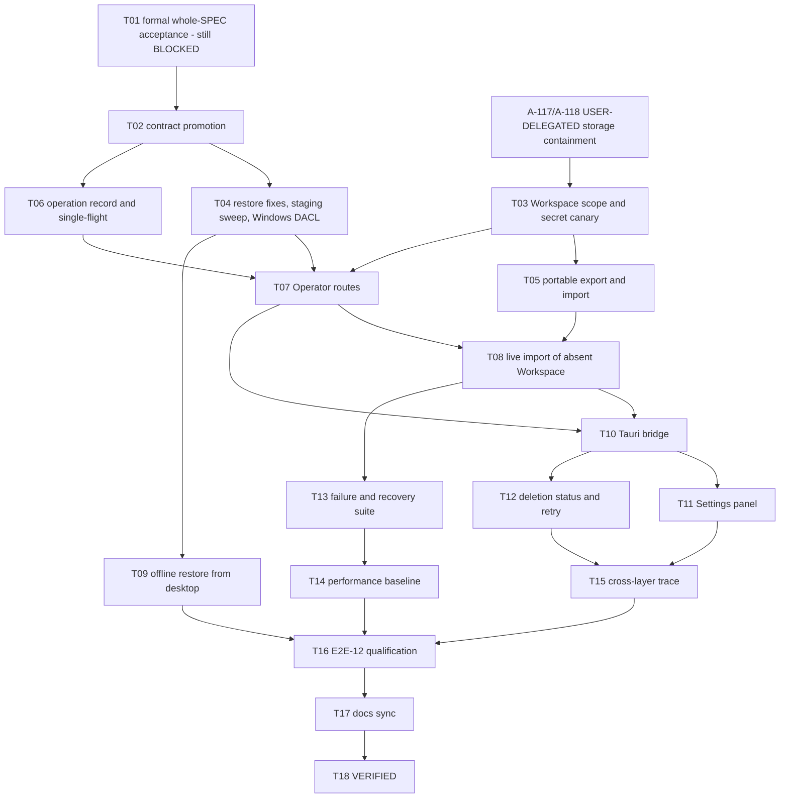

# Implementation Plan - Data Portability, Backup and Restore

**Feature:** 017 | **Spec:** SPEC.md revision 0.2
**Status:** IN_REVIEW - whole-SPEC owner acceptance remains pending. USER-DELEGATED A-117/A-118 authorize T03's storage-only CODE slice; this is not owner ratification or qualification.
**Updated:** 2026-11-23
**Rule:** the authoritative ordered work list is [TASKS.md](TASKS.md) (017-T01 to 017-T18); the phase table below is a summary. USER-DELEGATED T03 implementation does not change Feature lifecycle or count as owner review. Implementation evidence is recorded separately from qualification.

## 1. Delivery strategy

Promote the existing storage implementation rather than writing a second one. T03 now fixes Workspace scope, table classification, local/authority exclusion, unfinished upload state, and canary coverage in CODE. Portability, crash staging, Windows DACL, receipt clock and restore identity remain later storage tasks before routes exist. Then add the durable operation record, Operator routes, Tauri bridge and Settings panel. Whole-installation restore stays an offline sidecar operation behind the Feature 011 stop/quiescence gate; the live Operator only imports an absent Workspace. Qualify E2E-12 on Windows x64 first and Linux x64 second.

Before implementation, inspect the working tree and worktrees and preserve user changes. T03 may proceed under the exact USER-DELEGATED A-117/A-118 scope while the package remains IN_REVIEW; all other tasks retain their listed dependencies and review gates. Never run restore against the owner's real installation in tests.

## 2. Dependency graph

## 3. Phases and exit gates

| Phase | Tasks | Outcome | Exit gate |
|---|---|---|---|
| A - acceptance and promotion | T01, T02 | B-41 accepted; routes, errors, events and migration promoted; live restore route withdrawn | Owner decision recorded; validator, architecture and schema checks pass |
| B - storage correctness | T03, T04, T05, T06 | Workspace-scoped, secret-free, portable, crash-safe, cancellable storage | `cargo test -p storage-sqlite --locked backup` green on both OSes |
| C - daemon and bridge | T07, T08, T09, T10 | Authenticated routes, live import, offline restore, Tauri commands | Route tests, served-route inventory shows no live restore |
| D - UI | T11, T12 | Settings Storage & Backup and Deletion status with all states | UI tests, accessibility audit |
| E - recovery and performance | T13, T14 | Crash windows, fuzzing, races; bounded memory baseline | Canonical test target green; baseline recorded |
| F - trace and qualification | T15, T16 | Cross-layer trace; E2E-12 CODE/SYSTEM/USER on each row | Owner USER sign-off per row |
| G - sync and close | T17, T18 | Status docs, ledgers, register; VERIFIED | Validator and inventory audit pass |

## 4. Ownership and allowed paths

Each task in TASKS.md lists exact allowed paths. Summary: storage work in `crates/storage-core/src/backup.rs` and `crates/storage-sqlite/src/backup*.rs`; daemon work in new `apps/litecoworkd/src/backup_routes.rs`, `runtime.rs` (startup sweep) and `backup_operator.rs`; desktop work in new `apps/litecowork-ui/src-tauri/src/backup_bridge.rs` and `apps/litecowork-ui/src/settings/storage-backup/`; owner docs and schemas only in T02 and T17.

## 5. Migrations

One forward-only migration (allocated `docs/schemas/sqlite-v46.sql`; v34 was wired in the 2026-11-20 checkout and v35-v36 are now wired) adds `backup_operations` and its partial unique index on nonterminal state. `workspace_backup_manifests` stays immutable and unchanged. No migration ships while the package is IN_REVIEW.

## 6. Rollout

- The Settings category appears only when the routes it calls are served on that release row; otherwise it is omitted (no inert control).
- Offline restore appears only on rows where the Feature 011 quiescence gate is qualified.
- Portable export appears only after T05 passes on that row.
- No automatic backup schedule in V1.

## 7. Risks

| Risk | Mitigation |
|---|---|
| Table map misses a table and leaks or drops data | Completeness test over `sqlite_master` after all migrations (T03) |
| Plaintext staging left on disk | Startup sweep, owner-only directory on both OSes (T04) |
| Lost passphrase | No-recovery warning before create; verify immediately after create |
| Restore over live data | No live restore route; import only for absent Workspace (B-41) |
| Large Workspace blocks the daemon | `spawn_blocking`, chunk-bounded streaming, progress and cancel (T06, T14) |
| Windows keystore differs per user | Portable mode re-encrypts under new local keys (T05) |

## DeepSeek Harness proposals (PROPOSED, owner review required)

PROPOSED only; see the matching section in [TASKS.md](TASKS.md). Nothing here changes the accepted design of this package. Owner review is required first.

- **P-41 Installer and uninstaller safety matrix (data-home overlap, known-folder blocklist, handle pinning, no reparse traversal, honest progress)** (touches this package; row owned by package 019). Class **ADAPT (as test cases only)**. Design impact if accepted: T08 of package 019; T04 of package 017. Deferral: DEFERRED; Windows laptop. Upstream: [installer/uninstall-data.h](https://github.com/deepseek-ai/deepseek-harness/blob/fcc0ad462172522aaf5c93a7b2e01f6b9f0b0159/apps/desktop/installer/uninstall-data.h), [installer/uninstall.nsh](https://github.com/deepseek-ai/deepseek-harness/blob/fcc0ad462172522aaf5c93a7b2e01f6b9f0b0159/apps/desktop/installer/uninstall.nsh), [installer/path.nsh](https://github.com/deepseek-ai/deepseek-harness/blob/fcc0ad462172522aaf5c93a7b2e01f6b9f0b0159/apps/desktop/installer/path.nsh), [installer/extract.h](https://github.com/deepseek-ai/deepseek-harness/blob/fcc0ad462172522aaf5c93a7b2e01f6b9f0b0159/apps/desktop/installer/extract.h), [installer/progress.h](https://github.com/deepseek-ai/deepseek-harness/blob/fcc0ad462172522aaf5c93a7b2e01f6b9f0b0159/apps/desktop/installer/progress.h), [tests/expected/windows-uninstall.json](https://github.com/deepseek-ai/deepseek-harness/blob/fcc0ad462172522aaf5c93a7b2e01f6b9f0b0159/apps/desktop/tests/expected/windows-uninstall.json), [tests/expected/windows-installer.json](https://github.com/deepseek-ai/deepseek-harness/blob/fcc0ad462172522aaf5c93a7b2e01f6b9f0b0159/apps/desktop/tests/expected/windows-installer.json). Study: [desktop study](../../docs/DEEPSEEK-HARNESS-DESKTOP-DEEP-DIVE-2026-11.md) Sections 11 (11.7) and 14 (row P-41).
- **P-44 Streaming secret redactor for subprocess output that holds back a buffer whose prefix could still become a secret** (touches this package; row owned by package 018). Class **ADOPT (algorithm port)**. Design impact if accepted: T07 of package 018; T03 of package 017. Deferral: Not started. Rust unit tests with a secret split at every byte offset run on Linux. Upstream: [scripts/packaging-run.mjs](https://github.com/deepseek-ai/deepseek-harness/blob/fcc0ad462172522aaf5c93a7b2e01f6b9f0b0159/apps/desktop/scripts/packaging-run.mjs), [scripts/packaging-step.mjs](https://github.com/deepseek-ai/deepseek-harness/blob/fcc0ad462172522aaf5c93a7b2e01f6b9f0b0159/apps/desktop/scripts/packaging-step.mjs). Study: [desktop study](../../docs/DEEPSEEK-HARNESS-DESKTOP-DEEP-DIVE-2026-11.md) Sections 8 and 14 (row P-44).

